# CAPÍTULO V: Product Implementation, Validation & Deployment

## 5.1. Software Configuration Management

### 5.1.1. Software Development Environment Configuration

| Categoría | Herramienta | Propósito | Enlace |
|---|---|---|---|
| Diseño UX/UI | Figma | Elaboración de wireframes, mockups y prototipos utilizados para definir la interfaz y experiencia de usuario de biciGO. | [https://www.figma.com/design/FIUjx83bu9OhBxZ4EMqyfe/Sin-t%C3%ADtulo?node-id=0-1&t=2NPsUYYjUh7xKI3R-1](https://www.figma.com/design/FIUjx83bu9OhBxZ4EMqyfe/Sin-t%C3%ADtulo?node-id=0-1&t=2NPsUYYjUh7xKI3R-1) |
| Investigación UX | UXPressia | Herramienta utilizada para elaborar los User Personas de los segmentos objetivo de biciGO, permitiendo representar sus características, necesidades, frustraciones y objetivos. | [https://uxpressia.com/](https://uxpressia.com/) |
| Planeamiento del Producto | UXPressia | Herramienta utilizada para desarrollar el Impact Mapping de biciGO, relacionando el objetivo del negocio, actores, impactos esperados y entregables asociados. | [https://uxpressia.com/](https://uxpressia.com/) |
| Modelado de Base de Datos | Draw.io | Elaboración del diagrama de base de datos de biciGO, incluyendo entidades, atributos, claves y relaciones entre las tablas del sistema. | [https://drive.google.com/file/d/1frY_P-cg-4JuKiY2Jh8m85aaZD9V1CCT/view?usp=sharing](https://drive.google.com/file/d/1frY_P-cg-4JuKiY2Jh8m85aaZD9V1CCT/view?usp=sharing) |
| Modelado de Dominio | Canva | Desarrollo del Event Storming utilizado para identificar eventos, procesos y elementos principales del dominio de biciGO. | [https://canva.link/7coo689oj2nx3b7](https://canva.link/7coo689oj2nx3b7) |
| Desarrollo Web | GitHub Pages | Despliegue público de la Landing Page de biciGO. | [https://startup-chapa.github.io/Landing-Page/](https://startup-chapa.github.io/Landing-Page/) |
| Frontend Deployment | Firebase Hosting | Plataforma utilizada para publicar la Frontend Web Application de biciGO y proporcionar acceso mediante una URL pública. | [https://firebase.google.com/](https://firebase.google.com/) |
| Framework frontend | Vue 3 | Construcción de las interfaces reactivas y los componentes de la aplicación web. | https://vuejs.org/ |
| Bundler y entorno de desarrollo | Vite | Servidor local y generación de archivos optimizados de producción en `dist`. | https://vite.dev/ |
| Estado y navegación | Pinia y Vue Router | Estado compartido, navegación entre vistas y separación de rutas por módulo. | https://pinia.vuejs.org/ |
| Biblioteca de componentes | PrimeVue | Controles, formularios, tablas y componentes de interfaz usados en la SPA. | https://primevue.org/ |
| Internacionalización | Vue I18n | Recursos de idioma en español e inglés y actualización de textos de interfaz. | https://vue-i18n.intlify.dev/ |
| API simulada | JSON Server | Simulación local de recursos del frontend mientras se implementan los Web Services definitivos. | https://github.com/typicode/json-server |
| Entorno de Desarrollo | WebStorm | Entorno utilizado para editar y organizar los archivos del proyecto, trabajar con Git y desarrollar los componentes web de biciGO. | [https://www.jetbrains.com/webstorm/](https://www.jetbrains.com/webstorm/) |
| Control de Versiones | Git | Sistema utilizado para registrar cambios, trabajar mediante ramas y mantener el historial del proyecto. | [https://git-scm.com/](https://git-scm.com/) |
| Repositorio Remoto | GitHub | Plataforma utilizada para almacenar el proyecto y facilitar el trabajo colaborativo entre los integrantes. | [https://github.com/](https://github.com/) |
| Documentación | Markdown | Formato utilizado para redactar y mantener los capítulos del informe, tablas, enlaces, imágenes y demás documentación del proyecto bajo un enfoque Docs-as-Code. | [https://www.markdownguide.org/](https://www.markdownguide.org/) |
| Gestión Ágil | Trello | Herramienta utilizada para organizar el Sprint Backlog, distribuir tareas y dar seguimiento al avance del equipo durante el Sprint. | [https://trello.com/invite/b/6aac96a6ce176e2f9d496d31/ATTI96186798f26dde57c47e51ca96f0fff04FDD51DF/sprint-web-1](https://trello.com/invite/b/6aac96a6ce176e2f9d496d31/ATTI96186798f26dde57c47e51ca96f0fff04FDD51DF/sprint-web-1) |
| Gestión del Producto | Product Backlog | Permite organizar y priorizar las User Stories y Technical Stories que forman parte del desarrollo de biciGO. | [https://trello.com/invite/b/6aac96a6ce176e2f9d496d31/ATTI96186798f26dde57c47e51ca96f0fff04FDD51DF/sprint-web-1](https://trello.com/invite/b/6aac96a6ce176e2f9d496d31/ATTI96186798f26dde57c47e51ca96f0fff04FDD51DF/sprint-web-1) |

### 5.1.2. Source Code Management

El equipo de **BiciGO — Startup-Chapa** utiliza Git y GitHub para gestionar el código de la Landing Page, la Frontend Web Application y la documentación del proyecto. Los repositorios asociados son los siguientes:

| Solución | Repositorio | Enlace | Observación |
|---|---|---|---|
| Informe | `project-report` | https://github.com/Startup-Chapa/project-report | Documentación en Markdown y evidencias |
| Landing Page | `Landing-Page` | https://github.com/Startup-Chapa/Landing-Page | Sitio informativo publicado con GitHub Pages |
| Frontend Web Application | `frontend-bicigo` | https://github.com/Startup-Chapa/frontend-bicigo | SPA desarrollada con Vue 3 y Vite |
| Backend / Platform | Pendiente de confirmar | Pendiente | No se identifica aquí un repositorio de backend productivo validado para el Sprint 2 |

El repositorio del frontend tiene `main` como rama principal y utiliza `develop` como rama de integración. El trabajo por funcionalidad se distribuye en ramas tales como `feature/iam`, `feature/trip-management`, `feature/billing-subscriptions`, `feature/fleet-station-management` y `feature/maintenance`. El repositorio también conserva una rama `feature/corrections`. La documentación de integración señala que se consolidaron archivos de los módulos sobre una base compartida; por tanto, no corresponde afirmar que todos los cambios se integraron exclusivamente mediante *merge* o Pull Requests.

El flujo se inspira en prácticas de GitFlow y utiliza, cuando corresponde, ramas de funcionalidad y revisión. Las ramas `release/*` y `hotfix/*` se consideran convenciones para versiones posteriores; **no se declara su uso efectivo en el Sprint 2** sin evidencia. Las confirmaciones de cambios procuran una convención comprensible, por ejemplo `feat(iam): add login view` o `feat: integrate BiciGO frontend modules`. Algunos commits existentes utilizan otra redacción y se conservan tal como figuran en el historial.

La aplicación se organiza por contextos funcionales y comparte en `src` el enrutador, el layout de navegación, Pinia e internacionalización. Para reproducir el entorno de integración local se siguen las instrucciones del [README del frontend](https://github.com/Startup-Chapa/frontend-bicigo/blob/develop/README.md), con una API simulada basada en JSON Server. Esta organización facilita las pruebas tempranas, aunque todavía no equivale a un despliegue integral con backend de producción.

**Evidencias de repositorios:**

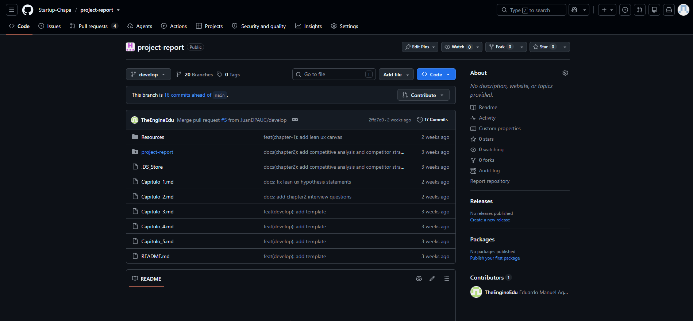

*Figura: repositorio de documentación del proyecto.*

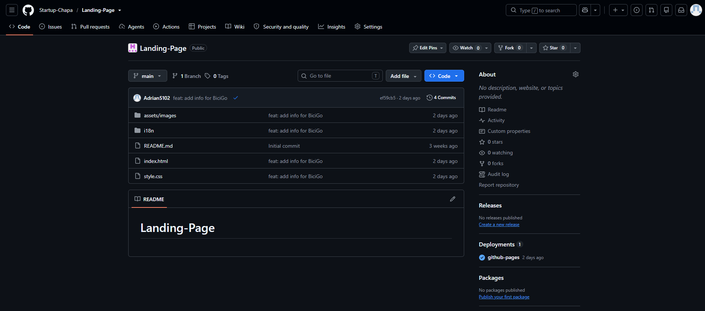

*Figura: repositorio de la Landing Page.*


*Figura: repositorio de la Frontend Web Application.*


*Figura: captura histórica asociada a plataforma; confirmar su repositorio y alcance antes de presentarla como backend implementado.*

### 5.1.3. Source Code Style Guide & Conventions

El equipo usa convenciones de organización y nomenclatura para mantener consistente el código de la aplicación Vue. Estas pautas se relacionan con la guía de estilos del Capítulo IV y con la arquitectura modular documentada en la sección 4.6.

| Aspecto | Convención aplicada o recomendada |
|---|---|
| Organización | Agrupar el código por Bounded Context: IAM, Fleet & Station Management, Trip Management, Billing & Subscriptions y Maintenance. |
| Capas | Separar, según el módulo, `domain`, `application`, `infrastructure` y `presentation`; utilizar servicios y componentes compartidos cuando corresponda. |
| Componentes | Utilizar componentes Vue de responsabilidad específica y mantener separadas vistas, rutas y lógica de estado. |
| Estado | Centralizar el estado compartido en Pinia; evitar duplicar sesiones y datos de usuario entre contextos. |
| Navegación | Declarar rutas en Vue Router y usar guardas de interfaz para la experiencia de demostración. La autorización definitiva deberá verificarse en el backend. |
| HTTP | Emplear el cliente HTTP compartido y una variable de entorno (`VITE_BICIGO_API_URL`) para configurar el origen de la API. |
| Internacionalización | Mantener textos en recursos `vue-i18n` y evitar cadenas duplicadas en las vistas. |
| Diseño | Aplicar la paleta, tipografías, espaciado y estados de interacción definidos en 4.1; considerar mobile y desktop. |
| Commits | Utilizar, de preferencia, mensajes descriptivos con prefijos como `feat`, `fix` y `docs` para registrar las modificaciones. |
| Verificación | Compilar con `npm run build` y ejecutar las pruebas documentadas. No atribuir herramientas de *lint* o pruebas automáticas que aún no estén configuradas. |

Las decisiones de implementación deben preservar la trazabilidad con las User Stories, los escenarios **Given–When–Then** del Capítulo III y las pantallas del Capítulo IV. Para considerar una funcionalidad terminada no basta con tener una vista: deben verificarse sus estados, validaciones, navegación y persistencia según el alcance acordado para el Sprint.

### 5.1.4. Software Deployment Configuration

La arquitectura **diseñada** en el Capítulo IV contempla una SPA, una API, mecanismos de persistencia y servicios externos de geolocalización y pagos. Sin embargo, el **incremento del Sprint 2** se ejecuta principalmente como frontend de demostración. Es necesario distinguir ambos niveles para no presentar componentes proyectados como funcionalidades productivas.

| Componente | Implementación comprobable o documentada para Sprint 2 | Alcance |
|---|---|---|
| Frontend SPA | Vue 3, Vite, PrimeVue, Pinia, Vue Router y `vue-i18n` | Interfaz, navegación y estados de los módulos |
| API de desarrollo | JSON Server, ejecutado con `npm run dev:api` | Datos locales de prueba; no es el backend REST productivo |
| Persistencia de Maintenance | `localStorage` en el modo de demostración | Reportes y cambios simulados que persisten en el navegador |
| Autenticación | Sesión simulada y usuarios de prueba | No constituye autenticación ni autorización de backend |
| Hosting del frontend | Firebase Hosting, según las capturas de despliegue del informe | Publicación de los archivos estáticos de Vite |
| Geolocalización y pagos reales | Servicios previstos en la arquitectura | Integración productiva no acreditada en Sprint 2 |

**Flujo de despliegue y ejecución.** En desarrollo, el navegador accede a Vite en `127.0.0.1:5173` y el frontend consume datos de JSON Server en `127.0.0.1:3000/api/v1`, además de determinados estados locales. En despliegue, Vite genera el directorio `dist`, que es publicado por Firebase Hosting. La publicación de los archivos estáticos no significa por sí sola que la API local quede expuesta en Internet.

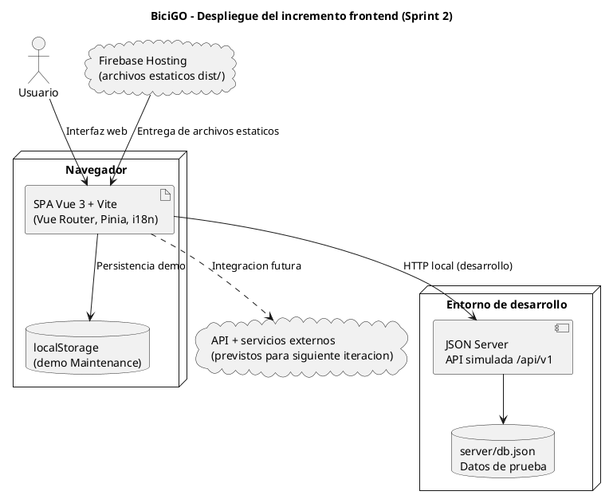

*Figura: vista lógica de la configuración de despliegue del Sprint 2. El nodo de API simulada es local y el nodo de servicios productivos es proyectado, no desplegado.*

**Consideración de seguridad y operación.** La SPA utiliza navegación basada en fragmentos (`createWebHashHistory`), que permite resolver rutas del cliente sin configurar reglas de reescritura en Firebase. Los permisos de vistas o roles simulados no reemplazan controles de autorización en los Web Services definitivos. Los flujos de cobro y de ubicación en tiempo real se dejarán pendientes hasta contar con servicios integrados y pruebas específicas.

## 5.2. Landing Page, Services & Applications Implementation

### 5.2.1. Sprint 1

El Sprint 1 corresponde a la primera entrega del proyecto (AV1 – Sprint Review) y tiene como alcance la implementación y el despliegue de la primera versión del **Landing Page** de BiciGO. El Landing Page presenta el modelo de negocio y el propósito de la plataforma a los visitantes de los segmentos objetivo (ciudadanos urbanos que realizan trayectos cortos e instituciones que desean promover el uso de la bicicleta), y es el punto de entrada hacia las aplicaciones. Los Web Services y las Frontend Web Applications se implementarán en los siguientes Sprints, según el cronograma de entregas del curso.

#### 5.2.1.1. Sprint Planning 1

La planificación del Sprint 1 organiza la primera versión de la Landing Page de biciGO, tomando como insumos el Lean UX Canvas, los segmentos objetivo, las User Personas, el wireframe, el mock-up y la guía de estilos. Se consideran las seis historias de usuario y la historia técnica identificadas en el Sprint Backlog 1.

**Base de planificación:** la fecha y la hora se proponen para completar el registro; los story points y la velocidad planificada son estimaciones de referencia, no mediciones históricas.

**Sprint Planning Background**

| Campo | Sprint 1 |
|---|---|
| Sprint # | Sprint 1 |
| Date | 07/09/2026 (propuesta) |
| Time | 20:00–21:00 (hora de Lima; propuesta) |
| Location | Reunión virtual |
| Prepared By | Aguirre Ramos, Eduardo Manuel |
| Attendees (to planning meeting) | Aguirre Ramos, Eduardo Manuel / Armestar Felipa, Adrian Andres / Ayllon Pauccar, Juan David / Franco del Carpio, José María / Velasquez Velasquez, Rodrigo |
| Sprint 0 Review Summary | No aplica: este es el primer Sprint. Como antecedentes se consideran los artefactos de investigación, requisitos y diseño de los Capítulos I al IV, además de los repositorios del informe y de la Landing Page. |
| Sprint 0 Retrospective Summary | No aplica: no hubo un Sprint anterior. Como acuerdos iniciales de planificación se propone distribuir tareas por sección, registrar avances en Trello y revisar los cambios antes de integrarlos. |

**Sprint Goal & User Stories**

| Campo | Sprint 1 |
|---|---|
| Sprint 1 Goal | *Our focus is on publishing the first deployed version of the BiciGO Landing Page, available in English and Latin American Spanish and responsive on mobile and desktop screens.*<br>*We believe it delivers a clear understanding of the service (mission, vision, benefits and how it works) and a direct way to get in touch with the team to urban citizens who make short trips and to institutions interested in promoting cycling.*<br>*This will be confirmed when the Landing Page is publicly reachable at its GitHub Pages URL, every section can be read on a 390 px and on a 1440 px wide screen without horizontal scrolling, and a visitor can switch the whole interface between English and Spanish.* |
| Selected User Stories | US-LP01: navegación y presentación principal; US-LP02: funcionamiento del servicio; US-LP03: beneficios y métricas; US-LP04: tarifas y planes; US-LP05: preguntas frecuentes; US-LP06: contacto y validación del formulario. |
| Selected Technical Stories | TS-LP01: configuración del repositorio, despliegue en GitHub Pages y revisión responsive. |
| Sprint 1 Velocity | 16 story points por sprint (velocidad planificada inicial, sin historial previo). |
| Sum of Story Points | 16 story points: 13 de historias de usuario y 3 de la historia técnica. |
| Task Estimation | 38 horas, correspondientes a las 16 microtareas del Sprint Backlog 1. |

**Distribución estimada de Story Points**

| Story Id | Story Title | Story Points |
|---|---|---:|
| US-LP01 | Navegación y presentación principal (Navbar & Hero) | 3 |
| US-LP02 | Explicación del funcionamiento del servicio | 2 |
| US-LP03 | Presentación de beneficios y métricas | 2 |
| US-LP04 | Comparación de tarifas y planes | 2 |
| US-LP05 | Consulta de preguntas frecuentes | 2 |
| US-LP06 | Formulario de contacto y validación | 2 |
| TS-LP01 | Despliegue y revisión responsive | 3 |
| **Total** | **6 User Stories y 1 Technical Story** | **16** |

Los puntos se asignan a cada historia una sola vez; sus microtareas conservan las estimaciones en horas del backlog. La velocidad real requiere validar las historias terminadas frente a sus criterios de aceptación. La internacionalización se mantiene como condición transversal del Sprint Goal y requiere reflejar su trabajo en las tareas de las historias correspondientes, ya que el backlog disponible no la desglosa como tarea independiente.

#### 5.2.1.2. Aspect Leaders and Collaborators

Para el Sprint 1 se identificaron seis aspectos dentro del alcance. La Leadership-and-Collaboration Matrix (LACX) indica, para cada aspecto, quién lidera y quiénes colaboran. La organización de líderes y colaboradores guarda relación con la selección de tareas del Sprint Backlog 1.

- **Landing Page Structure & Content (HTML):** estructura semántica de las secciones y redacción de los contenidos.
- **Visual Style & Responsive Design (CSS):** aplicación de la guía de estilos del Capítulo IV y diseño adaptable a móvil y escritorio.
- **Internationalization (i18n):** diccionarios en inglés y español, y selector de idioma.
- **Deployment (GitHub Pages):** publicación del Landing Page en un sitio público.
- **Landing Page UI Design (Figma):** wireframe y mock-up que guían la implementación.
- **Report Documentation:** redacción de las secciones del Capítulo V correspondientes al Sprint.

| Team Member (Last Name, First Name) | GitHub Username | Structure & Content (HTML) | Visual Style & Responsive (CSS) | Internationalization (i18n) | Deployment (GitHub Pages) | UI Design (Figma) | Report Documentation |
|---|---|:---:|:---:|:---:|:---:|:---:|:---:|
| Aguirre Ramos, Eduardo Manuel | TheEngineEdu | C | C | C | C | C | L |
| Armestar Felipa, Adrian Andres | Adrian5102 | L | L | L | L | L | C |
| Ayllon Pauccar, Juan David | JuanDPAUC | C | C | C | C | C | C |
| Franco del Carpio, José María | VoltTrd [POR CONFIRMAR] | C | C | C | C | C | C |
| Velasquez Velasquez, Rodrigo | Rodrigov233 | C | C | C | C | C | C |

*L = Leader, C = Collaborator.*

La asignación de líderes y colaboradores se definió a partir de la participación de cada integrante en los repositorios `Landing-Page` y `project-report`.

#### 5.2.1.3. Sprint Backlog 1

El objetivo principal del Sprint 1 es publicar la primera versión del Landing Page de BiciGO, en inglés y español y con diseño responsive, para presentar el modelo de negocio a los visitantes. El Sprint Backlog 1 se gestiona en un tablero de Trello con las columnas To-do, In-Process, To-Review y Done.

Las tareas se agrupan bajo seis historias específicas de la Landing Page (US-LP01 a US-LP06) y una historia técnica (TS-LP01), diferenciadas de las historias de la aplicación web. El backlog disponible contiene 16 microtareas de 2 a 3 horas cada una, con una estimación total de **38 horas**. La estimación de referencia de sus historias suma **16 story points**, como se detalla en Sprint Planning 1.

**Trello del AV1**

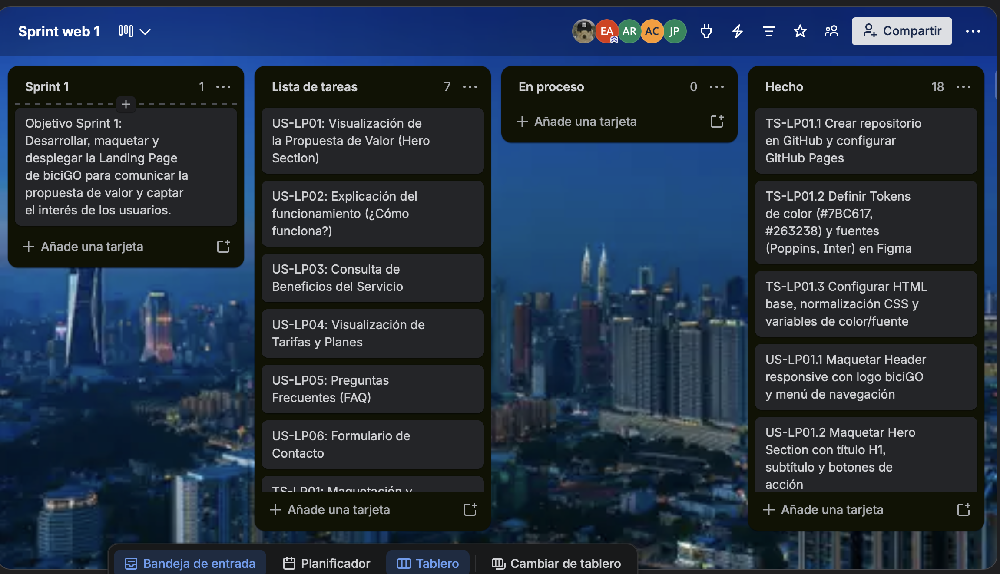

[https://trello.com/invite/b/6aac96a6ce176e2f9d496d31/ATTI96186798f26dde57c47e51ca96f0fff04FDD51DF/sprint-web-1](https://trello.com/invite/b/6aac96a6ce176e2f9d496d31/ATTI96186798f26dde57c47e51ca96f0fff04FDD51DF/sprint-web-1)

**Sprint #: Sprint 1**

| Epic / Story ID | Task ID | Título de la Microtarea | Descripción y Alcance Técnico | Estimación (Horas) | Asignado a | Estado |
| :--- | :--- | :--- | :--- | :---: | :--- | :---: |
| **US-LP01** | T-01.1 | `[US-LP01]` `[UI/UX]` Navbar & Hero Design | Diseñar el componente del Navbar con el isotipo biciGO y la sección Hero en Figma aplicando contraste de marca. | 2 h | Ayllon Pauccar, Juan David | Done |
| **US-LP01** | T-01.2 | `[US-LP01]` `[FRONT]` Navbar responsive layout | Maquetar el menú superior responsive con el logo de biciGO, enlaces de navegación y menú hamburguesa para móviles. | 3 h | Armestar Felipa, Adrian Andres | Done |
| **US-LP01** | T-01.3 | `[US-LP01]` `[FRONT]` Hero section CTA & Overlay | Construir el Hero Section con el título H1, subtítulo, imagen de fondo con overlay oscuro (#263238) y botones principales de acción (CTA). | 3 h | Armestar Felipa, Adrian Andres | Done |
| **US-LP02** | T-02.1 | `[US-LP02]` `[UI/UX]` "How it Works" Icons | Seleccionar y optimizar los 4 íconos SVG representativos del proceso (*Busca, Escanea, Muévete, Devuelve*). | 2 h | Velasquez Velasquez, Rodrigo | Done |
| **US-LP02** | T-02.2 | `[US-LP02]` `[FRONT]` "How it Works" 4-step grid | Maquetar el grid responsive de 4 pasos secuenciales aplicando la escala de espaciado `space-md` (16px) y textos explicativos. | 3 h | Ayllon Pauccar, Juan David | Done |
| **US-LP03** | T-03.1 | `[US-LP03]` `[FRONT]` Benefits cards layout | Maquetar las tarjetas de beneficios (Ahorro, Ecología, Rapidez) con bordes redondeados de 8px y sombras suaves. | 3 h | Velasquez Velasquez, Rodrigo | Done |
| **US-LP03** | T-03.2 | `[US-LP03]` `[FRONT]` Key metrics counter bar | Maquetar la barra de métricas destacadas (100+ estaciones, 500+ bicis, 100% ecofriendly) con números en Verde biciGO (#7BC617). | 2 h | Velasquez Velasquez, Rodrigo | Done |
| **US-LP04** | T-04.1 | `[US-LP04]` `[FRONT]` Pricing cards comparison | Maquetar la comparativa de tarifas (Pago por uso vs. Suscripción Pro) con la tabla de precios transparente. | 3 h | Franco Del Carpio, José María | Done |
| **US-LP04** | T-04.2 | `[US-LP04]` `[FRONT]` Pro plan highlight & CTA | Aplicar el estilo destacado (Fondo #263238, tag 'Recomendado' y botón #7BC617) a la tarjeta de suscripción mensual. | 2 h | Franco Del Carpio, José María | Done |
| **US-LP05** | T-05.1 | `[US-LP05]` `[FRONT]` FAQ accordion HTML/CSS | Maquetar la estructura de acordeón para las preguntas frecuentes sobre zonas de cobertura y métodos de pago. | 2 h | Armestar Felipa, Adrian Andres | Done |
| **US-LP05** | T-05.2 | `[US-LP05]` `[JS]` Accessible accordion logic | Implementar la interacción JavaScript para abrir/cerrar preguntas con soporte de teclado y atributos ARIA de accesibilidad. | 2 h | Armestar Felipa, Adrian Andres | Done |
| **US-LP06** | T-06.1 | `[US-LP06]` `[FRONT]` Contact form UI | Maquetar los campos del formulario (Nombre, Correo, Mensaje) asegurando una altura táctil mínima de 44px. | 2 h | Armestar Felipa, Adrian Andres | Done |
| **US-LP06** | T-06.2 | `[US-LP06]` `[JS]` Form validation & feedback | Implementar la validación básica de campos obligatorios e indicador de confirmación de envío en verde (#2E8B57). | 2 h | Armestar Felipa, Adrian Andres | Done |
| **TS-LP01** | T-07.1 | `[TS-LP01]` `[DEVOPS]` Git repo & GitHub Pages setup | Crear el repositorio en GitHub, configurar la rama `main` y habilitar el despliegue automático en GitHub Pages. | 2 h | Armestar Felipa, Adrian Andres | Done |
| **TS-LP01** | T-07.2 | `[TS-LP01]` `[DEVOPS]` Public URL & Domain check | Verificar el despliegue correcto de la URL pública (`https://startup-chapa.github.io/Landing-Page/`) y ruta de assets. | 2 h | Armestar Felipa, Adrian Andres | Done |
| **TS-LP01** | T-11.1 | `[TS-LP01]` `[QA]` Cross-device responsive test | Probar la adaptabilidad en resoluciones móviles (393x852px), tablets y monitores de escritorio (1200px max-width). | 3 h | Aguirre Ramos, Eduardo Manuel | Done |

#### 5.2.1.4. Development Evidence for Sprint Review

Durante el Sprint 1 se implementó la primera versión del Landing Page en el repositorio `Startup-Chapa/Landing-Page`: la estructura HTML, los estilos CSS responsive, los diccionarios de traducción en inglés y español y las imágenes de las secciones. En paralelo, en el repositorio `Startup-Chapa/project-report` se documentaron el wireframe y el mock-up del Landing Page (Capítulo IV) y la gestión del código fuente (Capítulo V), que sirvieron de base para la implementación. Los commits siguen la convención Conventional Commits descrita en la sección 5.1.2.

| Commit | Autor | Email | Fecha | Mensaje |
|---|---|---|---|---|
| `ef59cb5` | Adrian5102 | u202410084@upc.edu.pe | 2026-09-14 | feat: add info for BiciGo |
| `615a806` | Adrian5102 | u202410084@upc.edu.pe | 2026-09-14 | feat: add first version of Landing Page |
| `aeca1f3` | Adrian5102 | u202410084@upc.edu.pe | 2026-09-14 | feat: add index & css files |
| `ef218d4` | Eduardo Manuel Aguirre | enginedujob@gmail.com | 2026-08-30 | Initial commit |

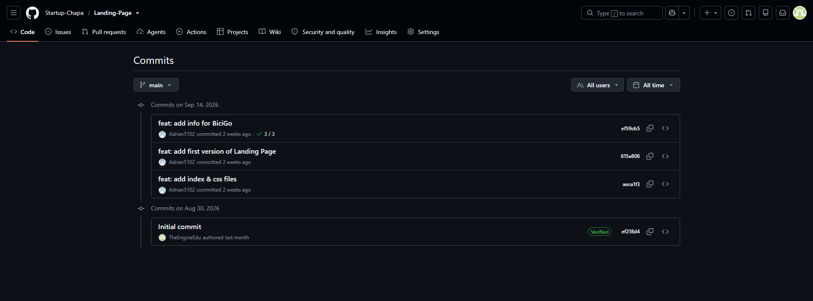

*Figura: historial de commits del repositorio Landing-Page en GitHub.*

#### 5.2.1.5. Execution Evidence for Sprint Review

El Landing Page de BiciGO está publicado y accesible en https://startup-chapa.github.io/Landing-Page/. La primera versión incluye las siguientes vistas:

- **Barra de navegación:** logotipo, enlaces a Home, About Us, Benefits, How does it work?, FAQs y Contact, selector de idioma EN/ES y botones Login y Sign Up.
- **Hero:** lema de la marca "MOVE | LIVE | LIMA", mensaje principal y botón de llamado a la acción *Get Started*.
- **Misión y visión:** textos de la propuesta de valor con fotografías de movilidad en Lima.
- **Beneficios:** seis tarjetas con los beneficios del servicio.
- **How does it work?:** explicación del recorrido del usuario, desde encontrar una bicicleta hasta finalizar el viaje.
- **Contacto:** formulario con nombre, teléfono, correo, tipo de usuario (estudiante, trabajador o ciudadano) y mensaje.
- **FAQs:** cinco preguntas frecuentes en formato acordeón, operables con el teclado.
- **Footer:** logotipo, íconos de redes sociales y aviso de derechos.

La interfaz está disponible en inglés (idioma por defecto) y en español latinoamericano, y se adapta a móvil y escritorio. En la verificación realizada, el ancho de la página coincide con el ancho de la pantalla tanto en 390 px como en 1440 px, es decir, sin desplazamiento horizontal.

**Vista de escritorio (1440 px)**


**Página completa en escritorio (1440 px)**

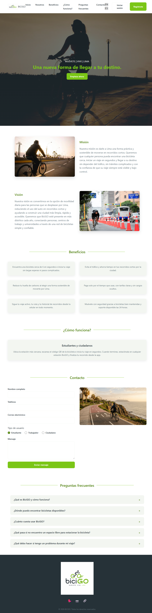

**Página completa en móvil (390 px)**


#### 5.2.1.6. Services Documentation Evidence for Sprint Review

En el Sprint 1 no se implementaron Web Services. El alcance de este Sprint se limitó al Landing Page, tal como establece la primera entrega del trabajo final, por lo que no existen endpoints documentados con OpenAPI ni commits de documentación de API en este Sprint.

Los endpoints que se implementarán en los siguientes Sprints están especificados como Technical Stories en el Capítulo III (por ejemplo, `GET /api/coverage` para la consulta de zonas de cobertura). Su documentación con OpenAPI (Swagger) se presentará en esta sección a partir del Sprint en que se implementen los Web Services.

#### 5.2.1.7. Software Deployment Evidence for Sprint Review

En el Sprint 1 se desplegó el Landing Page en **GitHub Pages**, directamente desde el repositorio `Startup-Chapa/Landing-Page`. Como el Landing Page es un sitio estático (HTML, CSS, JavaScript y archivos JSON), no requiere una etapa de compilación, y la publicación se realiza a partir del contenido de la rama `main`.

Los pasos realizados fueron los siguientes:

1. Se creó el repositorio `Landing-Page` en la organización Startup-Chapa de GitHub.
2. Se subieron a la rama `main` el archivo `index.html`, la hoja de estilos `style.css`, la carpeta `assets/images` y los diccionarios de la carpeta `i18n`.
3. En la configuración del repositorio (*Settings > Pages*) se habilitó GitHub Pages con la publicación desde la rama `main`.
4. GitHub ejecutó el flujo `pages build and deployment`, que finalizó correctamente el 14/09/2026 a las 23:42 (GMT-5), con una duración de 38 segundos, para el commit `ef59cb5`.
5. Se verificó el acceso público al sitio en https://startup-chapa.github.io/Landing-Page/.

| Producto | Plataforma | URL | Estado |
|---|---|---|---|
| Landing Page | GitHub Pages | https://startup-chapa.github.io/Landing-Page/ | Desplegado |
| Web Applications | Por definir (sección 5.1.4) | Sin desplegar en el Sprint 1 | No incluido en el alcance |
| Web Services | Por definir (sección 5.1.4) | Sin desplegar en el Sprint 1 | No incluido en el alcance |

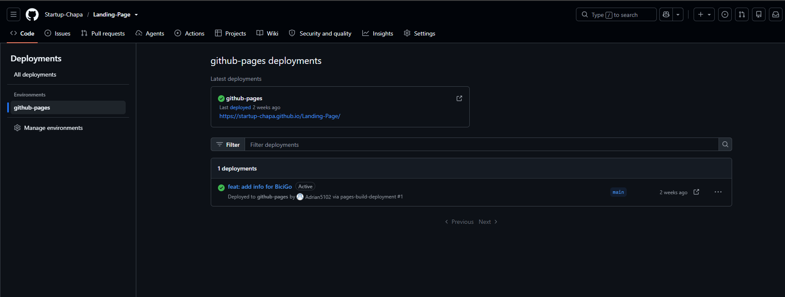

*Figura: ejecución del flujo pages build and deployment en GitHub Actions.*

#### 5.2.1.8. Team Collaboration Insights during Sprint

Las actividades del Sprint 1 se organizaron con el flujo GitFlow descrito en la sección 5.1.2: el trabajo del informe se realizó en ramas `feature/*` creadas a partir de `develop` e integradas mediante Pull Requests. La implementación del Landing Page se realizó en el repositorio `Landing-Page`. La siguiente tabla resume los commits de cada integrante, sin contar los commits de fusión (*merge*), en la rama `develop` al cierre de este informe.

| Integrante | Usuario de GitHub | Commits en Landing-Page | Commits en project-report |
|---|---|:---:|:---:|
| Aguirre Ramos, Eduardo Manuel | TheEngineEdu | 1 | 9 |
| Armestar Felipa, Adrian Andres | Adrian5102 | 3 | 18 |
| Ayllon Pauccar, Juan David | JuanDPAUC | 0 | 7 |
| Franco del Carpio, José María | VoltTrd | 0 | 1 |
| Velasquez Velasquez, Rodrigo | Rodrigov233 | 0 | 4 |

### 5.2.2. Sprint 2

El Sprint 2 corresponde al primer incremento integrado de la **Frontend Web Application de BiciGO**. Como referencia se utilizan el Product Backlog y los escenarios de aceptación actualizados del Capítulo III, la guía de estilos, los wireframes y mock-ups del Capítulo IV y las evidencias de código disponibles en el repositorio `Startup-Chapa/frontend-bicigo`.

El alcance real debe documentarse distinguiendo entre **interfaz integrada**, **flujo simulado** y **funcionalidad productiva**. Las pruebas locales con JSON Server o `localStorage` no demuestran por sí mismas una integración con el backend real.

#### 5.2.2.1. Sprint Planning 2

**Sprint Planning Background**

| Campo | Registro de Sprint 2 |
|---|---|
| Sprint # | Sprint 2 |
| Fecha de planificación | 28/09/2026, **fecha propuesta en el registro anterior; pendiente de confirmar** |
| Hora | 20:00–21:00, hora de Lima, **referencia propuesta** |
| Modalidad | Reunión virtual |
| Preparado por | Chapa Technologies / Startup-Chapa |
| Participantes | Aguirre Ramos, Eduardo Manuel; Armestar Felipa, Adrian Andres; Ayllon Pauccar, Juan David; Franco del Carpio, José María; Velasquez Velasquez, Rodrigo |
| Sprint 1 Review Summary | Se elaboró y publicó la primera versión de la Landing Page, con estructura responsive e internacionalización. |
| Sprint 1 Retrospective Summary | Se propuso mantener la asignación por responsables, actualizar el tablero y documentar mejor los commits y las evidencias individuales. Los acuerdos específicos deben validarse con el acta o tablero. |

**Sprint Goal & User Stories**

*Our focus is on integrating the first navigable version of the BiciGO Frontend Web Application using the user flows and interface guidelines defined in Chapters III and IV. We believe it delivers a coherent demonstration of account access, bicycle and station consultation, trip information, subscription plans and incident management to prospective users and operators. This will be confirmed when the integrated SPA can be executed, its main routes and validations can be demonstrated, and the team clearly documents which interactions use mock data or local persistence and which requirements remain pending.*

Las **15 User Stories** consignadas en el backlog anterior se mantienen como **selección originalmente planificada**, hasta que el equipo confirme formalmente si hubo cambios de alcance. La disponibilidad de un módulo integrado no demuestra automáticamente el cumplimiento de todos sus escenarios Given–When–Then.

| Indicador | Valor y criterio |
|---|---|
| Selected User Stories | IAM: US-01, US-02, US-03; Fleet: US-07, US-08, US-09; Trip: US-11, US-13, US-15; Billing: US-16, US-17, US-19; Maintenance: US-26, US-29, US-33. |
| Tareas transversales | T2-16 integración; T2-17 pruebas de interfaces y responsive; T2-18 publicación del frontend. |
| Suma de SP de la selección original con la línea base actualizada | **56 SP**, recalculados según las estimaciones actuales de **3.3 Product Backlog**; reemplazan la suma anterior de 30 SP, sin afirmar que sean velocidad real. |
| Estimación de tareas | **70 h**, correspondientes a 18 tareas; las horas son esfuerzo estimado y no una conversión de SP. |
| Velocidad real | **No determinada**: requiere el resultado de cada historia frente a sus criterios de aceptación y Definition of Done. |
| Alcance técnico | SPA Vue con integración de módulos y servicios de demostración. La API REST de producción permanece en una iteración posterior. |

**Correspondencia de estimaciones con el Capítulo III**

| Bounded Context | Story ID | Historia | SP del Product Backlog |
|---|---|---|---:|
| IAM | US-01 | Registro de usuario | 3 |
| IAM | US-02 | Inicio de sesión | 3 |
| IAM | US-03 | Recuperación de contraseña | 3 |
| Fleet & Station Management | US-07 | Visualización de bicicletas cercanas | 5 |
| Fleet & Station Management | US-08 | Consulta de información de bicicleta | 3 |
| Fleet & Station Management | US-09 | Búsqueda de bicicletas por zona | 3 |
| Trip Management | US-11 | Inicio de alquiler | 5 |
| Trip Management | US-13 | Consulta del viaje activo | 3 |
| Trip Management | US-15 | Finalización de alquiler | 5 |
| Billing & Subscriptions | US-16 | Registro de método de pago | 5 |
| Billing & Subscriptions | US-17 | Consulta de tarifa | 2 |
| Billing & Subscriptions | US-19 | Suscripción a plan mensual | 5 |
| Maintenance | US-26 | Reporte de bicicleta dañada | 3 |
| Maintenance | US-29 | Seguimiento de incidencias | 3 |
| Maintenance | US-33 | Gestión de incidencias de bicicletas | 5 |
| **Total** | **15 US** | **Selección originalmente planificada** | **56** |

**Observación de alcance.** Los módulos implementados también contienen vistas relacionadas con otras historias del Capítulo III, como consulta de perfil (US-21), historial de viajes (US-23), detalle de viaje (US-24) y administración de flota (US-31/US-32). Estas funcionalidades pueden mencionarse como evidencia adicional, **pero no se suman retroactivamente** a la velocidad del Sprint 2 sin una actualización aprobada del Sprint Backlog.

#### 5.2.2.2. Aspect Leaders and Collaborators

Para el Sprint 2 se organizó el desarrollo en cinco Bounded Contexts. Esta división facilita la identificación de responsables de implementación y permite integrar funcionalidades sobre una estructura de navegación compartida. Los Epics del Capítulo III no deben confundirse con los Bounded Contexts: un mismo contexto puede implementar historias pertenecientes a más de un Epic, como sucede con Maintenance (EP-06 y EP-07).

| Team Member | GitHub Username | IAM | Trip Management | Billing & Subscriptions | Fleet & Station Management | Maintenance |
|---|---|:---:|:---:|:---:|:---:|:---:|
| Armestar Felipa, Adrian Andres | Adrian5102 | L | C | C | C | C |
| Franco del Carpio, José María | VoltTrd | C | L | C | C | C |
| Ayllon Pauccar, Juan David | JuanDPAUC | C | C | L | C | C |
| Aguirre Ramos, Eduardo Manuel | TheEngineEdu | C | C | C | L | C |
| Velasquez Velasquez, Rodrigo | Rodrigov233 | C | C | C | C | L |

*L = Leader; C = Collaborator. Esta matriz refleja la asignación documentada y no constituye por sí misma un conteo de commits ni una validación del trabajo completado.*

#### 5.2.2.3. Sprint Backlog 2

El backlog organiza las tareas inicialmente asociadas a las 15 historias seleccionadas, más tres actividades transversales. El tablero de seguimiento se encuentra en [Trello — Sprint 2 Web Application](https://trello.com/invite/b/6ac5b1a35529b83a03b51a0b/ATTI93c275e0a7f8461177850a9425f1680415930B03/sprint-2-web-application).

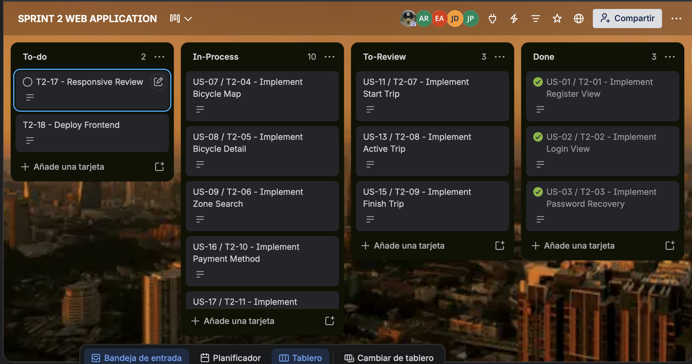

*Figura: captura del tablero de Sprint 2. Sus estados deben contrastarse con la versión actual del tablero.*

La columna **Revisión documental** de la tabla siguiente refleja lo que puede inferirse de la documentación del repositorio. **No reemplaza el estado oficial en Trello** ni equivale a la aceptación formal de cada User Story.

| Story ID | Task ID | Microtarea | Estimación | Responsable | Revisión documental |
|---|---|---|---:|---|---|
| US-01 | T2-01 | Implement Register View | 3 h | Adrian Armestar | Vista de registro documentada; flujo local de demostración |
| US-02 | T2-02 | Implement Login View | 3 h | Adrian Armestar | Vista y sesión simulada documentadas |
| US-03 | T2-03 | Implement Password Recovery | 3 h | Adrian Armestar | Recuperación de prueba; envío real no acreditado |
| US-07 | T2-04 | Implement Bicycle Map | 5 h | Eduardo Aguirre | Falta evidenciar mapa con bicicletas cercanas al usuario |
| US-08 | T2-05 | Implement Bicycle Detail | 3 h | Eduardo Aguirre | Fleet consulta bicicletas; validar detalle y criterios de US-08 |
| US-09 | T2-06 | Implement Zone Search | 3 h | Eduardo Aguirre | Falta evidenciar búsqueda por zona de usuario |
| US-11 | T2-07 | Implement Start Trip | 5 h | José María Franco | No se acredita inicio de alquiler; Trip documenta historial |
| US-13 | T2-08 | Implement Active Trip | 5 h | José María Franco | No se acredita vista o estado de viaje activo |
| US-15 | T2-09 | Implement Finish Trip | 5 h | José María Franco | No se acredita finalización de alquiler |
| US-16 | T2-10 | Implement Payment Method | 3 h | Juan David Ayllon | No se acredita registro de un método de pago real o simulado |
| US-17 | T2-11 | Implement Pricing View | 3 h | Juan David Ayllon | Existen vistas de planes; confirmar tarifa por alquiler |
| US-19 | T2-12 | Implement Subscription View | 5 h | Juan David Ayllon | Selección y compra simulada de plan documentadas |
| US-26 | T2-13 | Implement Damage Report | 3 h | Rodrigo Velasquez | Reporte de Maintenance en modo demo local |
| US-29 | T2-14 | Implement Incident Tracking | 5 h | Rodrigo Velasquez | Consulta de reportes demo; comprobar estados de incidencias |
| US-33 | T2-15 | Implement Incident Management | 5 h | Rodrigo Velasquez | Gestión local para rol de operador/administrador simulado |
| Transversal | T2-16 | Integrate Frontend | 5 h | Equipo completo | Integración modular documentada en `develop` |
| Transversal | T2-17 | Responsive Review | 3 h | Equipo completo | Pruebas de 390, 768 y 1440 px descritas en README de Maintenance; adjuntar resultados de ejecución |
| Transversal | T2-18 | Deploy Frontend | 3 h | Equipo completo | Capturas de publicación Firebase incluidas; comprobar la versión accesible |
| **Total** | **18 tareas** | | **70 h** | | **Pendiente de cierre validado** |

**Criterio para el cierre.** Cada historia solo debe pasar a `Done` cuando el equipo pueda demostrar todos los escenarios comprometidos para ese incremento o haya aprobado formalmente un alcance reducido. Los estados `To-do`, `In-Process`, `To-Review` y `Done` deben actualizarse desde el tablero real; aquí no se asignan estados inventados. Un mockup del Capítulo IV sirve como referencia visual, pero no equivale a una captura de ejecución de la aplicación.

#### 5.2.2.4. Development Evidence for Sprint Review

El desarrollo del Sprint 2 se documenta en el repositorio [Startup-Chapa/frontend-bicigo](https://github.com/Startup-Chapa/frontend-bicigo). La aplicación integrada contiene rutas y componentes de IAM, Trip Management, Billing & Subscriptions, Fleet & Station Management y Maintenance, además de un router, layout, cliente HTTP y estado compartidos.

| Bounded Context | Rama de desarrollo | Evidencia funcional identificada | Limitación relevante |
|---|---|---|---|
| IAM | `feature/iam` | Login, registro, perfil, sesión y recuperación de prueba | Autenticación y recuperación simuladas |
| Trip Management | `feature/trip-management` | Consulta del historial de viajes y acceso al reporte de incidencias desde un viaje | Inicio, viaje activo y cierre de alquiler no acreditados por el README |
| Billing & Subscriptions | `feature/billing-subscriptions` | Planes, selección y compra simulada de suscripción | No existe evidencia de pasarela de pagos productiva |
| Fleet & Station Management | `feature/fleet-station-management` | Gestión y consulta de estaciones y bicicletas mediante API local | No se demuestra por sí sola la geolocalización de bicicletas cercanas |
| Maintenance | `feature/maintenance` | Reportes, gestión administrativa y transiciones de estado de bicicleta en demo | Uso de `localStorage` sin contratos API productivos confirmados |

El archivo `src/router.js` usa `createWebHashHistory` para integrar la navegación y las rutas de los contextos; `src/main.js` registra Pinia, Vue Router, `vue-i18n` y PrimeVue. El README explica que parte de la integración se realizó por selección y combinación de archivos, de modo que las estadísticas de Pull Requests no representan toda la integración efectuada.

**Fuente de verificación técnica:** [README de integración](https://github.com/Startup-Chapa/frontend-bicigo/blob/develop/README.md), [Router de la aplicación](https://github.com/Startup-Chapa/frontend-bicigo/blob/develop/src/router.js), [README de Maintenance](https://github.com/Startup-Chapa/frontend-bicigo/blob/develop/src/maintenance/README.md).

**Historial aportado para la revisión inicial (instantánea de `develop`)**

La tabla conserva los mensajes y fechas registrados previamente en el informe. Las fechas de esta instantánea pertenecen al período **27/09/2026–07/10/2026**; no sustituyen un historial completo ni representan necesariamente el estado del repositorio en la última fecha de edición del informe. Como el extracto proporcionado carece de códigos SHA y cuerpos, estos datos permanecen identificados como no proporcionados, sin rellenarlos arbitrariamente.

| Repository | Branch | Commit Id | Commit Message | Commit Message Body | Committed on | GitHub User |
|---|---|---|---|---|---|---|
| Startup-Chapa/frontend-bicigo | `develop` | No proporcionado | fix: modify db.json | No proporcionado | 07/10/2026 | TheEngineEdu |
| Startup-Chapa/frontend-bicigo | `develop` | No proporcionado | Merge branch 'develop' of https://github.com/Startup-Chapa/frontend-bicigo into develop | No proporcionado | 07/10/2026 | TheEngineEdu |
| Startup-Chapa/frontend-bicigo | `develop` | No proporcionado | Refactor JSON structure in db.json | No proporcionado | 07/10/2026 | Adrian5102 |
| Startup-Chapa/frontend-bicigo | `develop` | No proporcionado | Change localStorage key from 'bicigo_user' to 'users' | No proporcionado | 07/10/2026 | Adrian5102 |
| Startup-Chapa/frontend-bicigo | `develop` | No proporcionado | Merge branch 'develop' of https://github.com/Startup-Chapa/frontend-bicigo into develop | No proporcionado | 07/10/2026 | TheEngineEdu |
| Startup-Chapa/frontend-bicigo | `develop` | No proporcionado | db.json | No proporcionado | 06/10/2026 | VoltTrd |
| Startup-Chapa/frontend-bicigo | `develop` | No proporcionado | feat: integrate BiciGO frontend modules | No proporcionado | 06/10/2026 | Rodrigov233 |
| Startup-Chapa/frontend-bicigo | `develop` | No proporcionado | feat:add configuration to the page | No proporcionado | 06/10/2026 | TheEngineEdu |
| Startup-Chapa/frontend-bicigo | `develop` | No proporcionado | Merge pull request #2 from Startup-Chapa/feature/iam | No proporcionado | 06/10/2026 | TheEngineEdu |
| Startup-Chapa/frontend-bicigo | `develop` | No proporcionado | feat(iam): add forgot password view | No proporcionado | 02/10/2026 | Adrian5102 |
| Startup-Chapa/frontend-bicigo | `develop` | No proporcionado | feat(iam): add final details for i18n | No proporcionado | 02/10/2026 | Adrian5102 |
| Startup-Chapa/frontend-bicigo | `develop` | No proporcionado | feat(iam): fixed great part of iam | No proporcionado | 02/10/2026 | Adrian5102 |
| Startup-Chapa/frontend-bicigo | `develop` | No proporcionado | feat(iam): trying to fix everything pls maybe hopefully | No proporcionado | 02/10/2026 | Adrian5102 |
| Startup-Chapa/frontend-bicigo | `develop` | No proporcionado | feat(iam): update layout | No proporcionado | 02/10/2026 | Adrian5102 |
| Startup-Chapa/frontend-bicigo | `develop` | No proporcionado | fix iam requirements | No proporcionado | 02/10/2026 | Adrian5102 |
| Startup-Chapa/frontend-bicigo | `develop` | No proporcionado | feat(iam): add iam routes | No proporcionado | 02/10/2026 | Adrian5102 |
| Startup-Chapa/frontend-bicigo | `develop` | No proporcionado | feat(iam): add authentication section component | No proporcionado | 02/10/2026 | Adrian5102 |
| Startup-Chapa/frontend-bicigo | `develop` | No proporcionado | feat(iam): add reset password view | No proporcionado | 02/10/2026 | Adrian5102 |
| Startup-Chapa/frontend-bicigo | `develop` | No proporcionado | feat(iam): add forgot password view | No proporcionado | 02/10/2026 | Adrian5102 |
| Startup-Chapa/frontend-bicigo | `develop` | No proporcionado | feat(iam): add register view | No proporcionado | 02/10/2026 | Adrian5102 |
| Startup-Chapa/frontend-bicigo | `develop` | No proporcionado | feat(iam): add login view | No proporcionado | 02/10/2026 | Adrian5102 |
| Startup-Chapa/frontend-bicigo | `develop` | No proporcionado | feat(iam): add pinia start | No proporcionado | 02/10/2026 | Adrian5102 |
| Startup-Chapa/frontend-bicigo | `develop` | No proporcionado | feat(iam): add i18n start | No proporcionado | 02/10/2026 | Adrian5102 |
| Startup-Chapa/frontend-bicigo | `develop` | No proporcionado | feat(iam): add iam store | No proporcionado | 02/10/2026 | Adrian5102 |
| Startup-Chapa/frontend-bicigo | `develop` | No proporcionado | feat(iam): add mock api for iam | No proporcionado | 02/10/2026 | Adrian5102 |
| Startup-Chapa/frontend-bicigo | `develop` | No proporcionado | feat(iam): add user assembler | No proporcionado | 01/10/2026 | Adrian5102 |
| Startup-Chapa/frontend-bicigo | `develop` | No proporcionado | feat(iam): add iam interceptor | No proporcionado | 01/10/2026 | Adrian5102 |
| Startup-Chapa/frontend-bicigo | `develop` | No proporcionado | feat(iam): add iam storage | No proporcionado | 01/10/2026 | Adrian5102 |
| Startup-Chapa/frontend-bicigo | `develop` | No proporcionado | feat(iam): add user entity | No proporcionado | 01/10/2026 | Adrian5102 |
| Startup-Chapa/frontend-bicigo | `develop` | No proporcionado | feat: add base entity | No proporcionado | 01/10/2026 | Adrian5102 |
| Startup-Chapa/frontend-bicigo | `develop` | No proporcionado | feat:add shared context to src | No proporcionado | 30/09/2026 | TheEngineEdu |
| Startup-Chapa/frontend-bicigo | `develop` | No proporcionado | feat:initial commit | No proporcionado | 27/09/2026 | TheEngineEdu |

El extracto original tiene **32 entradas**, incluidas **3 entradas de fusión**. La confirmación exacta de autoría, SHA y fecha de cada commit requiere consultar el historial completo, filtrando por el rango de Sprint y diferenciando commits propios de merges.

**GitHub Pulse: actividad del 30/09/2026 al 07/10/2026 (captura histórica)**

| Indicador de la captura | Valor |
|---|---:|
| Autores activos | 5 |
| Commits en todas las ramas | 62 |
| Commits en `main` | 2 |
| Pull Requests fusionados | 2 |
| Pull Requests abiertos | 0 |
| Archivos modificados en `main` | 14 |
| Líneas añadidas en `main` | 632 |
| Líneas eliminadas en `main` | 0 |

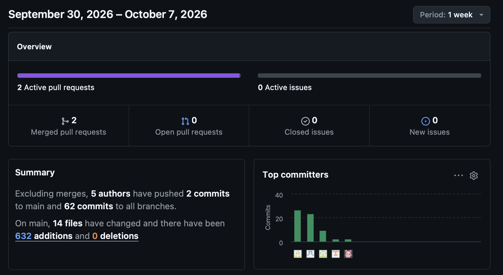

*Figura: GitHub Pulse del período indicado. Incluye los Pull Requests #1 (Trip Management) y #2 (IAM) fusionados, según la captura del informe.*

Estos datos **no deben presentarse como resultado final de todo el Sprint 2** si el equipo continuó trabajando después del 07/10/2026. Es necesario adjuntar, al cierre, una captura con el rango completo acordado para la evaluación.

#### 5.2.2.5. Execution Evidence for Sprint Review

Las evidencias de ejecución deben mostrar pantallas **reales de la SPA** y relacionarse con las User Stories y mockups de los Capítulos III y IV. Se conserva la estructura de archivos de imágenes existente, pero se corrige la asociación de contextos: la pantalla de perfil pertenece a gestión de cuenta y la pantalla de suscripciones no corresponde a Trip Management.

**Identity & Access Management (IAM)**

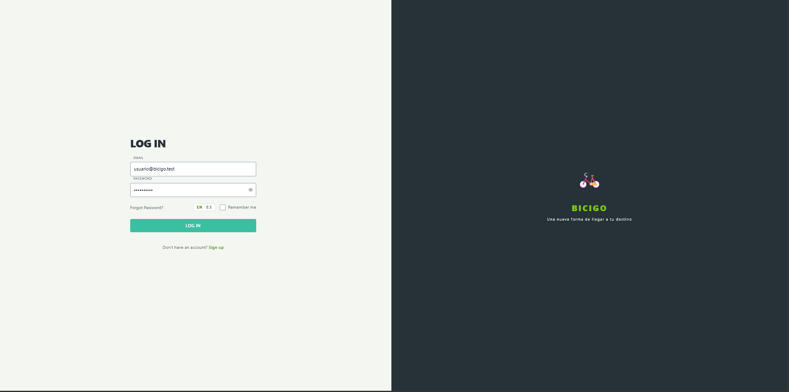

*Figura: vista de login (US-02). Comparar las validaciones de credenciales con los escenarios del Capítulo III; la autenticación actual es de demostración.*

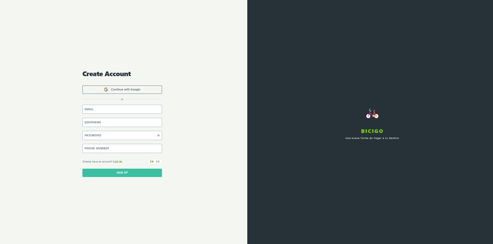

*Figura: vista de registro (US-01); verificar campos obligatorios y prevención de duplicados con datos de prueba.*

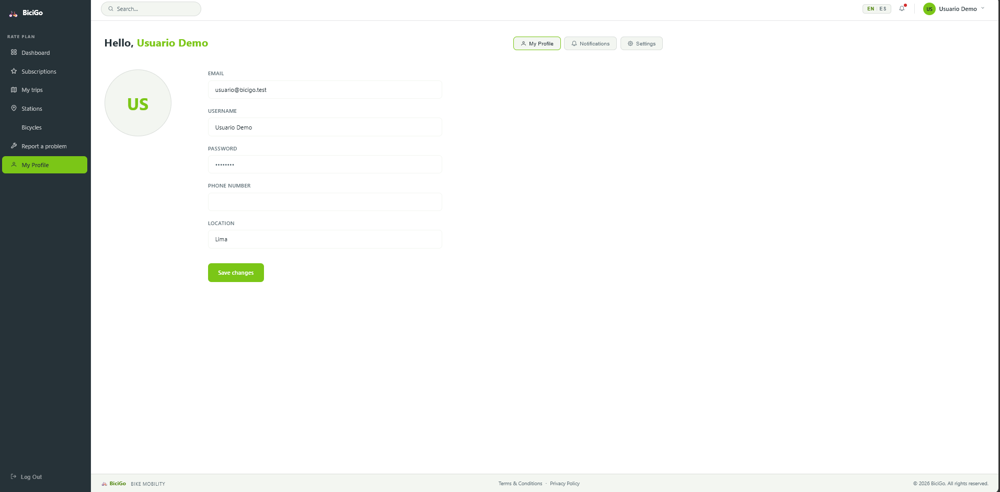

*Figura: perfil (US-21, funcionalidad adicional a las 15 historias originalmente seleccionadas).* 

**Fleet & Station Management**

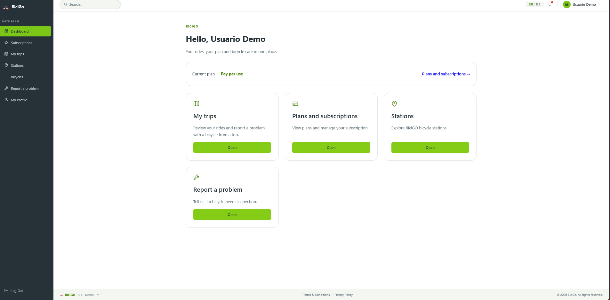

*Figura: dashboard integrado; sirve como evidencia de navegación, pero no prueba geolocalización o estados en tiempo real.*

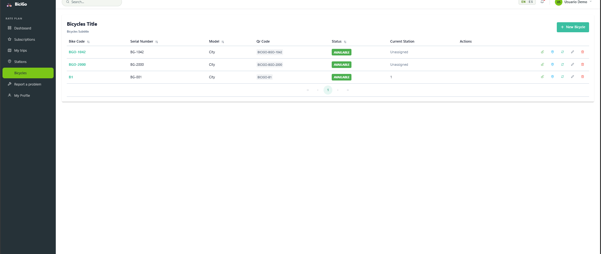

*Figura: vista de bicicletas. Contrastar sus campos con US-08 y añadir una captura específica si existe un mapa para US-07 o una búsqueda para US-09.*

**Trip Management**

El repositorio documenta una vista de historial y la navegación a reportes desde un viaje. **En el material adjunto no aparece una captura inequívoca** del inicio de alquiler (US-11), del viaje activo (US-13) o de su finalización (US-15). Antes de marcarlas `Done`, se requieren evidencias de esas pantallas o una replanificación documentada. Para el historial, puede añadirse una captura de `/#/app/trips` (US-23), indicando que es trabajo adicional al alcance inicial.

**Billing & Subscriptions**

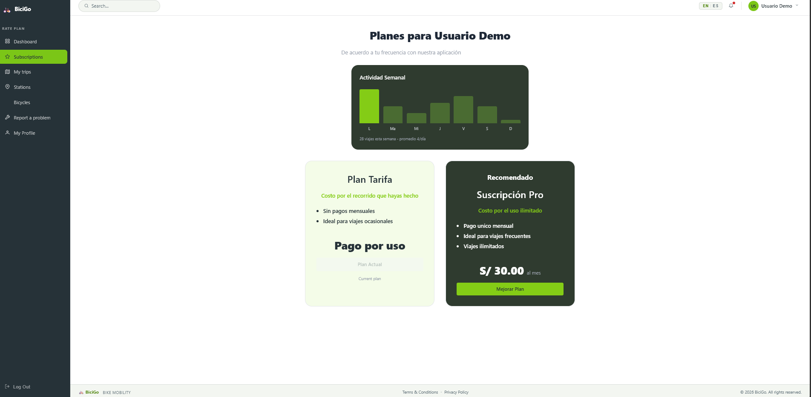

*Figura: consulta de planes y suscripción simulada (US-19). No equivale a un pago procesado por pasarela real.*

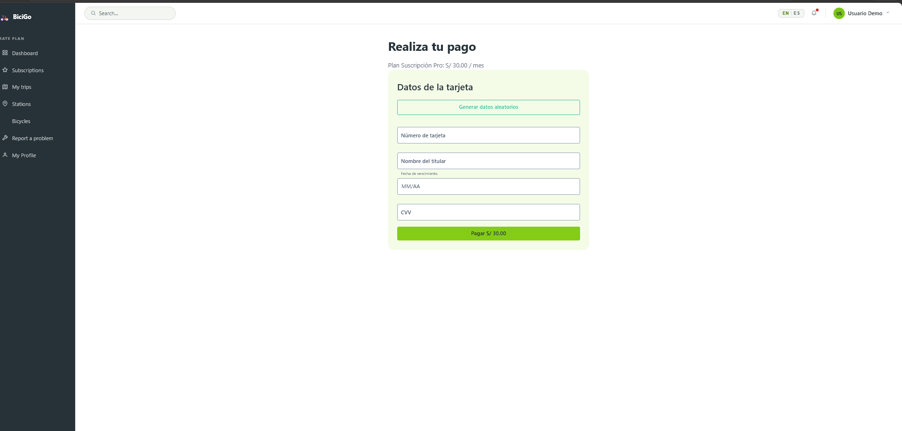

*Figura: vista de Billing. La captura por sí sola no confirma US-16 ni el cálculo de la tarifa de US-17.*

**Maintenance**

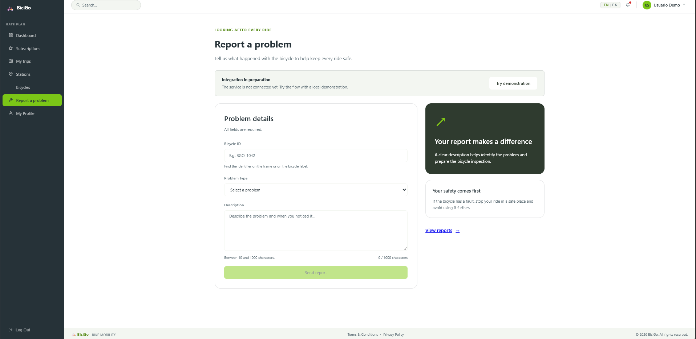

*Figura: formulario para reportar una bicicleta (US-26). En la implementación de demostración, los datos de Maintenance se mantienen mediante `localStorage`.*

Para completar las evidencias US-29 y US-33, agregar capturas de la consulta de incidencias y de la vista `/#/maintenance/management` utilizando un usuario operador de prueba. Una captura del cambio de estado `AVAILABLE → MAINTENANCE → AVAILABLE` debe identificarse expresamente como una simulación y no como una actualización de flota productiva.

**Video de ejecución**

Se debe incorporar un video que muestre, de manera continua, el recorrido por IAM, Fleet, Trip, Billing y Maintenance, indicando qué funcionalidades dependen de API simulada, cuáles usan almacenamiento local y cuáles están pendientes de integración. El enlace y el intervalo de tiempo del video **no figuran aún en el material recibido**:

```text
Microsoft Stream: PENDIENTE DE ENLACE
Minutos de demostración por contexto: PENDIENTES
```

#### 5.2.2.6. Services Documentation Evidence for Sprint Review

El Sprint 2 se centra en la Frontend Web Application. El entorno local utiliza JSON Server para ofrecer recursos de prueba mediante rutas bajo `/api/v1` y variables de entorno del frontend. Este mecanismo permite desarrollar y evaluar flujos sin depender del backend final. **No debe presentarse JSON Server como implementación de los Web Services productivos exigidos por las Technical Stories.**

En el Capítulo III se especifican Technical Stories de registro, login, flota, viajes, pagos e incidencias. La implementación y documentación OpenAPI/Swagger de esos endpoints corresponde a la iteración de backend que corresponda. Por ello, no se adjuntan aquí contratos OpenAPI atribuidos a servicios todavía no confirmados.

| Recurso | Estado documentado en Sprint 2 | Próximo paso |
|---|---|---|
| JSON Server / API de desarrollo | Disponible en desarrollo con datos de prueba | Verificar rutas y contratos de cada contexto |
| IAM | Sesión y recuperación de prueba | Conectar autenticación, autorización y recuperación reales |
| Billing | Compra simulada de planes | Integrar reglas de pago y pasarela verificada |
| Maintenance | Modo demo local; endpoints definitivos sin confirmar | Definir contrato y trasladar persistencia al backend |
| Fleet y Trip | Consumos y flujos parciales con API local | Vincular casos de uso y estados de alquiler con API definitiva |

Como evidencia complementaria se pueden enlazar `server/routes.json`, el archivo de datos de desarrollo y el README del proyecto, pero deben etiquetarse como **mock API** y no como Swagger de producción.

#### 5.2.2.7. Software Deployment Evidence for Sprint Review

En el informe se documenta la publicación de la versión frontend mediante **Firebase Hosting**. El procedimiento descrito se basa en un build de Vite y la subida de los archivos estáticos del directorio `dist`. El repositorio confirma que `firebase.json` configura `dist` como directorio público; el router implementa `createWebHashHistory`.

**Procedimiento registrado**

1. Preparar dependencias del proyecto y ejecutar `npm run build`.
2. Verificar que Vite genera los archivos de producción dentro de `dist`.
3. Autenticarse en Firebase CLI con `firebase login`.
4. Configurar Hosting para publicar `dist` y conservar el `index.html` generado.
5. Ejecutar `firebase deploy --only hosting`.
6. Validar el acceso por HTTPS y comprobar navegación, recursos estáticos y comportamiento en móvil y escritorio.

```bash
npm install
npm run build
firebase login
firebase deploy --only hosting
```

| Producto | Plataforma | URL o acceso | Estado de evidencia |
|---|---|---|---|
| Landing Page | GitHub Pages | https://startup-chapa.github.io/Landing-Page/ | Publicación documentada en Sprint 1 |
| Frontend Web Application | Firebase Hosting | https://example-pro-d6e84.web.app | URL reportada en captura del informe; **revalidar acceso y versión publicada** |
| API local de desarrollo | JSON Server | `http://127.0.0.1:3000/api/v1` | Solo para desarrollo; no accesible públicamente por estar en localhost |
| RESTful Web Services productivos | Pendiente | No disponible en la evidencia del Sprint 2 | No incluidos en el incremento actual |

**Evidencia del despliegue registrada por el equipo**

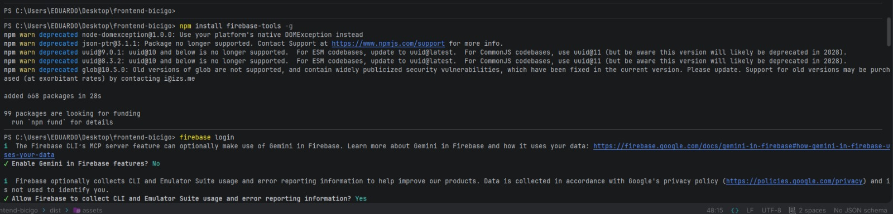

*Figura: instalación y autenticación con Firebase CLI.*

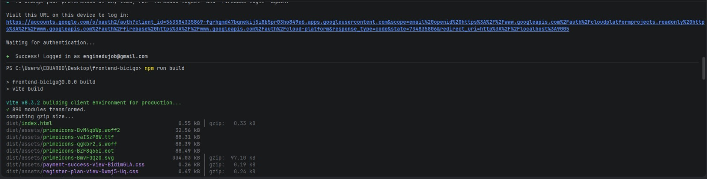

*Figura: autenticación y comando de compilación del frontend.*

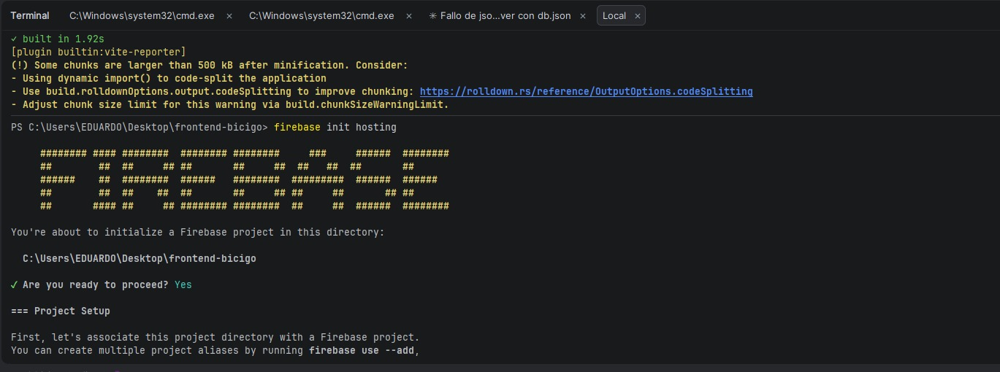

*Figura: generación del build e inicialización de Firebase Hosting.*

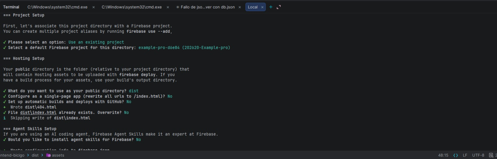

*Figura: selección de proyecto Firebase y directorio público `dist`.*

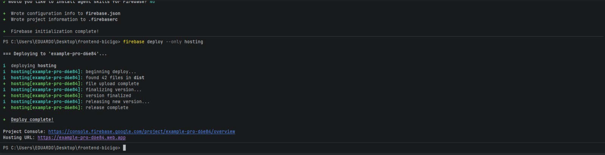

*Figura: evidencia reportada del resultado de `firebase deploy --only hosting`.*

**Verificaciones pendientes.** La configuración de Hosting en el repositorio no agrega rewrites para rutas de SPA; por eso resulta relevante documentar que el frontend utiliza navegación hash. Además, el despliegue estático por sí solo no publica la API local ni valida compras, ubicación o autorizaciones productivas. Se debe comprobar desde una ventana privada y un dispositivo ajeno al equipo de desarrollo qué vistas funcionan con datos de producción y cuáles únicamente con datos simulados.

#### 5.2.2.8. Team Collaboration Insights during Sprint

La coordinación del equipo se distribuyó por cinco Bounded Contexts y se complementó con actividades compartidas de integración, verificación y documentación. La matriz de responsabilidades de 5.2.2.2 identifica liderazgo funcional; la actividad de GitHub presenta evidencia de contribuciones, pero debe interpretarse en función de la rama y el período observados.

| Integrante | GitHub Username | Contexto liderado | Rama relacionada |
|---|---|---|---|
| Adrian Andres Armestar Felipa | Adrian5102 | IAM | `feature/iam` |
| José María Franco del Carpio | VoltTrd | Trip Management | `feature/trip-management` |
| Juan David Ayllon Pauccar | JuanDPAUC | Billing & Subscriptions | `feature/billing-subscriptions` |
| Eduardo Manuel Aguirre Ramos | TheEngineEdu | Fleet & Station Management | `feature/fleet-station-management` |
| Rodrigo Velasquez Velasquez | Rodrigov233 | Maintenance | `feature/maintenance` |

**GitHub Contributors**

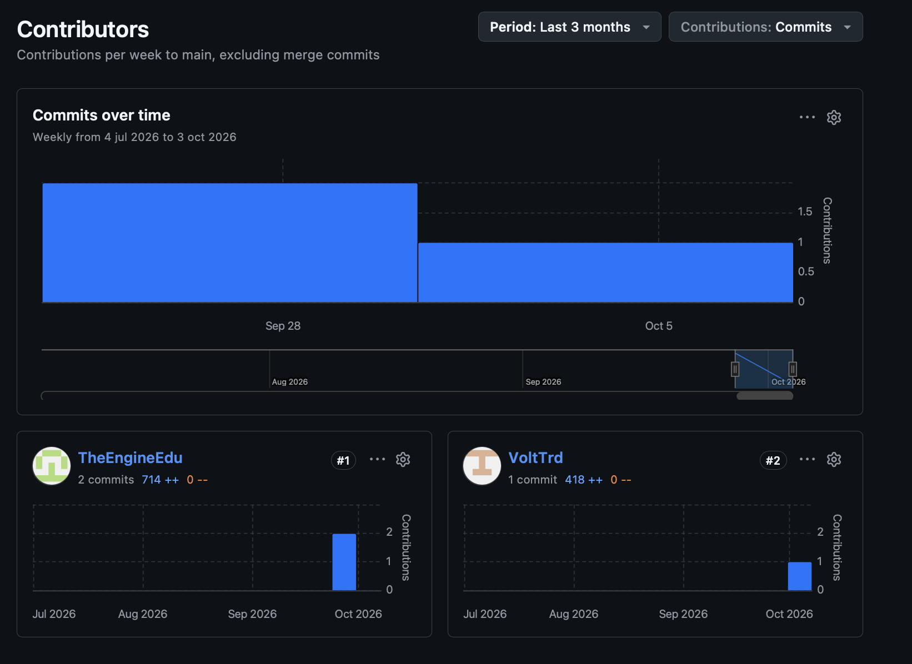

*Figura: Contributors correspondiente a la rama `main` y al filtro de tres meses de la captura proporcionada, excluyendo commits de fusión.*

| Integrante visible en la captura | Usuario | Commits mostrados en `main` | Líneas añadidas | Líneas eliminadas |
|---|---|---:|---:|---:|
| Eduardo Manuel Aguirre Ramos | TheEngineEdu | 2 | 714 | 0 |
| José María Franco del Carpio | VoltTrd | 1 | 418 | 0 |

El panel de Contributors **no contabiliza necesariamente la actividad de las ramas `feature/*` y `develop`**. No corresponde registrar cero contribuciones para los demás miembros solo porque no aparezcan en esta captura. Del mismo modo, la captura de Pulse (5 autores y 62 commits en todas las ramas entre el 30/09 y el 07/10) no es directamente comparable con Contributors, porque mide otro conjunto de datos.

Para una evaluación completa de la colaboración se recomienda adjuntar una tabla de commits y Pull Requests filtrados por los límites reales del Sprint, con autor, rama de origen, SHA, fecha y referencia al aspecto desarrollado. Las cifras deberán actualizarse al cierre, sin inventar historiales ni atribuir aportes sin evidencia.

### 5.2.3. Sprint 3

#### 5.2.3.1. Sprint Planning 3

El Sprint 3 está proyectado como una iteración posterior orientada a implementar e integrar los **RESTful Web Services** pendientes y a sustituir progresivamente los contratos simulados utilizados durante el Sprint 2. La planificación final debe derivarse de las Technical Stories del Capítulo III, de la evaluación del incremento frontend y del calendario del curso.

**Sprint Planning Background**

| Campo | Registro previsto para Sprint 3 |
|---|---|
| Sprint # | Sprint 3 |
| Date | 09/11/2026 (**propuesta original, por confirmar**) |
| Time | 20:00–21:00, hora de Lima (**propuesta**) |
| Location | Reunión virtual |
| Prepared By | Aguirre Ramos, Eduardo Manuel (**según borrador**) |
| Attendees | Aguirre Ramos, Eduardo Manuel; Armestar Felipa, Adrian Andres; Ayllon Pauccar, Juan David; Franco del Carpio, José María; Velasquez Velasquez, Rodrigo |
| Sprint 2 Review Summary | **Pendiente:** completar con historias aceptadas, pendientes y evidencia validada del Sprint 2. |
| Sprint 2 Retrospective Summary | **Pendiente:** registrar acuerdos reales sobre integración, pruebas, distribución y deuda técnica. |

**Sprint Goal provisional**

*Our focus is on implementing and connecting the backend services required by BiciGO's priority user journeys. We believe it will replace key simulated operations with verifiable RESTful endpoints and allow the frontend and backend to work as a consistent application. This will be confirmed when the selected Technical Stories meet their acceptance criteria, API contracts are documented, and end-to-end scenarios can be demonstrated.*

| Campo | Situación |
|---|---|
| Selected Technical Stories | Pendiente de selección formal a partir del Product Backlog del Capítulo III. |
| Sprint 3 Velocity | No definida: se debe estimar según capacidad y resultados validados del Sprint 2. |
| Sum of Story Points | Pendiente de sumar después de seleccionar las historias. |
| Task Estimation | Pendiente de desglose y estimación por el equipo. |

**Nota de planificación:** la tabla del borrador anterior repetía el objetivo, las historias de Landing Page y las referencias a Sprint 0 del Sprint 1. Esos datos no correspondían al Sprint 3 y se retiran sin sustituirlos por resultados ficticios.

#### 5.2.3.2. Aspect Leaders and Collaborators

La organización del Sprint 3 se encuentra basada en los cinco Bounded Contexts definidos durante el diseño de arquitectura.

Cada integrante lidera un contexto y participa como colaborador en los demás.

| Team Member | GitHub Username | IAM | Trip Management | Billing & Subscriptions | Fleet & Station Management | Maintenance |
|---|---|:---:|:---:|:---:|:---:|:---:|
| Armestar Felipa, Adrian Andres | Adrian5102 | L | C | C | C | C |
| Franco del Carpio, José María | VoltTrd | C | C | C | L | C |
| Ayllon Pauccar, Juan David | JuanDPAUC | C | C | L | C | C |
| Aguirre Ramos, Eduardo Manuel | TheEngineEdu | C | L | C | C | C |
| Velasquez Velasquez, Rodrigo | Rodrigov233 | C | C | C | C | L |

**L:** Leader  
**C:** Collaborator

La distribución permite desarrollar funcionalidades en paralelo y posteriormente integrarlas en una versión común del Frontend Web Application.

#### 5.2.3.3. Sprint Backlog 3

#### 5.2.3.4. Development Evidence for Sprint Review

#### 5.2.3.5. Execution Evidence for Sprint Review

#### 5.2.3.6. Services Documentation Evidence for Sprint Review

#### 5.2.3.7. Software Deployment Evidence for Sprint Review

#### 5.2.3.8. Team Collaboration Insights during Sprint

## 5.3. Validation Interviews.
### 5.3.1. Diseño de Entrevistas.

### 5.3.2. Registro de Entrevistas.

### 5.3.3. Evaluaciones según heurísticas.

## 5.4. Video About-the-Product.