<div align="center">


# Universidad Peruana de Ciencias Aplicadas

## Carrera de Ingeniería de Software

**1ASI0730**

**Aplicaciones Web**

NRC:

**8168**

**Informe del Trabajo Final**

Docente:

**Sánchez Ponce, Alex Humberto**

Start Up:

**Chapa Technologies**

Proyecto:

**BiciGo**

**Integrantes**

| **Código** | **Apellidos y Nombres**         |
| ---------- | ------------------------------- |
| U20241A911 | Aguirre Ramos, Eduardo Manuel   |
| U202410084 | Armestar Felipa, Adrian Andres  |
| U20241A860 | Ayllon Pauccar, Juan David      |
| U202319178 | Franco Del Carpio, José María   |
| U202222074 | Velasquez Velasquez, Rodrigo    |

**Período 202620**

**Septiembre 2026**

</div>
<div style="page-break-after: always;"></div>

## **Registro de versiones del Informe**

| N.º | Versión | Fecha | Autor / Involucrado | Actividad / Capítulo |
| :---: | :---: | :---: | :--- | :--- |
| 1 | **1.0** | 01/09/2026 | Eduardo | 1.1.1. Descripción de la Startup |
| 2 | **1.0** | 01/09/2026 | Cada uno | 1.1.2. Perfiles de integrantes del equipo |
| 3 | **1.0** | 02/09/2026 | David & Adrian | 1.2.1 Antecedentes y problemática |
| 4 | **1.0** | 02/09/2026 | Eduardo | 1.2.2.1. Lean UX Problem Statements |
| 5 | **1.0** | 03/09/2026 | Jose | 1.2.2.2. Lean UX Assumptions |
| 6 | **1.0** | 03/09/2026 | Jose | 1.2.2.3. Lean UX Hypothesis Statements |
| 7 | **1.0** | 04/09/2026 | Adrian | 1.2.2.4. Lean UX Canvas |
| 8 | **1.0** | 04/09/2026 | Adrian | 1.3. Segmentos objetivo |
| 9 | **1.1** | 05/09/2026 | Rodrigo | 2.1.1. Análisis competitivo |
| 10 | **1.1** | 05/09/2026 | Rodrigo | 2.1.2. Estrategias y tácticas frente a competidores |
| 11 | **1.1** | 06/09/2026 | David | 2.2.1. Diseño de entrevistas |
| 12 | **1.1** | 06/09/2026 | Cada uno | 2.2.2. Registro de entrevistas |
| 13 | **1.1** | 07/09/2026 | Rodrigo Velazquez | 2.2.3. Análisis de entrevistas |
| 14 | **1.1** | 07/09/2026 | Eduardo Aguirre | 2.3.1. User Personas |
| 15 | **1.1** | 08/09/2026 | Eduardo Aguirre | 2.3.2. User Task Matrix |
| 16 | **1.1** | 08/09/2026 | Eduardo Aguirre | 2.3.3. User Journey Mapping |
| 17 | **1.1** | 09/09/2026 | Eduardo Aguirre | 2.3.4. Empathy Mapping |
| 18 | **1.2** | 09/09/2026 | Adrian León | 2.4. Big Picture EventStorming |
| 19 | **1.2** | 10/09/2026 | Jose María | 2.5. Ubiquitous Language |
| 20 | **1.2** | 10/09/2026 | Equipo (7 HU por persona) | 3.1. User Stories |
| 21 | **1.2** | 11/09/2026 | Rodrigo | 3.2. Impact Mapping |
| 22 | **1.2** | 11/09/2026 | Rodrigo | 3.3. Product Backlog |
| 23 | **1.3** | 12/09/2026 | Juan David | 4.1.1. General Style Guidelines |
| 24 | **1.3** | 12/09/2026 | Juan David | 4.1.2. Web Style Guidelines |
| 25 | **1.3** | 13/09/2026 | Jose Maria | 4.2.1. Organization Systems |
| 26 | **1.3** | 13/09/2026 | Jose Maria | 4.2.2. Labeling Systems |
| 27 | **1.3** | 13/09/2026 | Jose Maria | 4.2.3. SEO Tags and Meta Tags |
| 28 | **1.3** | 14/09/2026 | Adrian Leon | 4.2.4. Searching Systems |
| 29 | **1.3** | 14/09/2026 | Adrian Leon | 4.2.5. Navigation Systems |
| 30 | **1.4** | 14/09/2026 | Eduardo | 4.3. Landing Page UI Design (Wireframe y Mock-up) |
| 31 | **1.4** | 15/09/2026 | Adrian Leon | 4.4. Web Applications UX/UI Design |
| 32 | **1.4** | 15/09/2026 | Juan | 4.6.1. Design-Level EventStorming |
| 33 | **1.4** | 16/09/2026 | Jose Maria | 4.6.2. Software Architecture Context Diagram |
| 34 | **1.4** | 16/09/2026 | Adrian | 4.6.3. Software Architecture Container Diagrams |
| 35 | **1.5** | 16/09/2026 | Eduardo | 4.6.4. Software Architecture Components Diagrams |
| 36 | **1.5** | 17/09/2026 | Eduardo | 4.7.1. Class Diagrams |
| 37 | **1.5** | 17/09/2026 | Rodrigo | 4.8.1. Database Diagrams |
| 38 | **1.5** | 17/09/2026 | Rodrigo | 5.1.1. Software Development Environment Configuration |
| 39 | **1.6** | 18/09/2026 | Adrian | 5.1.2. Source Code Management |
| 40 | **1.6** | 18/09/2026 | Eduardo | 5.1.3. Source Code Style Guide & Conventions |
| 41 | **1.6** | 18/09/2026 | Jose Maria | 5.1.4. Software Deployment Configuration |
| 42 | **1.7** | 19/09/2026 | Eduardo  | 5.2.1  Sprint 1 |
| 43 | **2.0** | 06/10/2026 | Rodrigo  | 5.2.2  Sprint 2 |
| 44 | **3.0** | 12/11/2026 | Juan David | 5.2.3  Sprint 3 y evidencias de despliegue en Azure |


<div style="page-break-after: always;"></div>

## Project Report Collaboration Insights

Para el desarrollo del Project Report, se utilizó un repositorio dentro de la organización del equipo en GitHub. A continuación, se presenta la evidencia de colaboración correspondiente, en coherencia con el Registro de Versiones del Informe.

Repositorio del informe del proyecto: <a href="https://github.com/Startup-Chapa/project-report.git">https://github.com/Startup-Chapa/project-report.git</a>

## AV1

Durante esta fase, el equipo elaboró el informe base del proyecto, abarcando la definición del problema, justificación, objetivos, marco teórico y todas las secciones correspondientes al primer entregable.

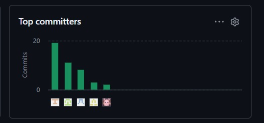

Figura 1: Gráfico de contribuciones del repositorio del informe del proyecto para AV1, mostrando la actividad de colaboración de todos los miembros del equipo durante la elaboración del informe inicial.


Esta distribución evidencia un esfuerzo colaborativo y la participación activa de todos los integrantes en la elaboración y redacción de la documentación del proyecto.

## TB1

Durante esta fase, el equipo elaboró el informe en base a la entrega anterior, corrigiendo errores y tambien perfeccionando algunos puntos de este TB1.


Figura 1: Gráfico de contribuciones del repositorio del informe del proyecto para TB1, mostrando la actividad de colaboración de todos los miembros del equipo durante la elaboración del informe.


Esta distribución evidencia un esfuerzo colaborativo y la participación activa de todos los integrantes en la elaboración y redacción de la documentación del proyecto.

## AV2

Durante esta fase, el equipo implementó el primer incremento de backend de biciGO (RESTful Web Services organizados por Bounded Contexts), documentó el Sprint 3 en el Capítulo V del informe y aprovisionó la base de datos MySQL en Azure como parte del despliegue.

<!-- Imagen de contribuciones para AV2: reemplazar URL_PENDIENTE con la ruta o URL de la captura de GitHub -->


Figura: Gráfico de contribuciones del repositorio del informe del proyecto para AV2, mostrando la actividad de colaboración de todos los miembros del equipo durante el Sprint 3 y el despliegue en Azure.


<div style="page-break-after: always;"></div>

# Tabla de contenidos

## [Capítulo I: Introducción](Capitulo_1.md)

- [1.1 Startup Profile](Capitulo_1.md#11-startup-profile)
  - [1.1.1 Descripción de la Startup](Capitulo_1.md#111-descripción-de-la-startup)
  - [1.1.2 Perfiles de integrantes del equipo](Capitulo_1.md#112-perfiles-de-integrantes-del-equipo)
- [1.2 Solution Profile](Capitulo_1.md#12-solution-profile)
  - [1.2.1 Antecedentes y problemática](Capitulo_1.md#121-antecedentes-y-problemática)
  - [1.2.2 Lean UX Process](Capitulo_1.md#122-lean-ux-process)
    - [1.2.2.1 Lean UX Problem Statements](Capitulo_1.md#1221-lean-ux-problem-statements)
    - [1.2.2.2 Lean UX Assumptions](Capitulo_1.md#1222-lean-ux-assumptions)
    - [1.2.2.3 Lean UX Hypothesis Statements](Capitulo_1.md#1223-lean-ux-hypothesis-statements)
    - [1.2.2.4 Lean UX Canvas](Capitulo_1.md#1224-lean-ux-canvas)
- [1.3 Segmentos Objetivos](Capitulo_1.md#13-segmentos-objetivo)

## [Capítulo II: Requirements Elicitation & Analysis](Capitulo_2.md)

- [2.1 Competidores](Capitulo_2.md#21-competidores)
  - [2.1.1 Análisis competitivo](Capitulo_2.md#211-análisis-competitivo)
  - [2.1.2 Estrategias y tácticas frente a competidores](Capitulo_2.md#212-estrategias-y-tácticas-frente-a-competidores)
- [2.2 Entrevistas](Capitulo_2.md#22-entrevistas)
  - [2.2.1 Diseño de entrevistas](Capitulo_2.md#221-diseño-de-entrevistas)
  - [2.2.2 Registro de entrevistas](Capitulo_2.md#222-registro-de-entrevistas)
  - [2.2.3 Análisis de entrevistas](Capitulo_2.md#223-análisis-de-entrevistas)
- [2.3 Needfinding](Capitulo_2.md#23-needfinding)
  - [2.3.1 User Personas](Capitulo_2.md#231-user-personas)
  - [2.3.2 User Task Matrix](Capitulo_2.md#232-user-task-matrix)
  - [2.3.3 User Journey Mapping](Capitulo_2.md#233-user-journey-mapping)
  - [2.3.4 Empathy Mapping](Capitulo_2.md#234-empathy-mapping)
- [2.4 Big Picture EventStorming](Capitulo_2.md#24-big-picture-eventstorming)
- [2.5 Ubiquitous Language](Capitulo_2.md#25-ubiquitous-language)

## [Capítulo III: Requirements Specification](Capitulo_3.md)

- [3.1 User Stories](Capitulo_3.md#31-user-stories)
- [3.2 Impact Mapping](Capitulo_3.md#32-impact-mapping)
- [3.3 Product Backlog](Capitulo_3.md#33-product-backlog)

## [Capítulo IV: Product Design](Capitulo_4.md)

- [4.1 Style Guidelines](Capitulo_4.md#41-style-guidelines)
  - [4.1.1 General Style Guidelines](Capitulo_4.md#411-general-style-guidelines)
  - [4.1.2 Web Style Guidelines](Capitulo_4.md#412-web-style-guidelines)
- [4.2 Information Architecture](Capitulo_4.md#42-information-architecture)
  - [4.2.1 Organization Systems](Capitulo_4.md#421-organization-systems)
  - [4.2.2 Labeling Systems](Capitulo_4.md#422-labeling-systems)
  - [4.2.3 SEO Tags and Meta Tags](Capitulo_4.md#423-seo-tags-and-meta-tags)
  - [4.2.4 Searching Systems](Capitulo_4.md#424-searching-systems)
  - [4.2.5 Navigation Systems](Capitulo_4.md#425-navigation-systems)
- [4.3 Landing Page UI Design](Capitulo_4.md#43-landing-page-ui-design)
  - [4.3.1 Landing Page Wireframe](Capitulo_4.md#431-landing-page-wireframe)
  - [4.3.2 Landing Page Mock-up](Capitulo_4.md#432-landing-page-mock-up)
- [4.4 Web Applications UX/UI Design](Capitulo_4.md#44-web-applications-uxui-design)
  - [4.4.1 Web Applications Wireframes](Capitulo_4.md#441-web-applications-wireframes)
  - [4.4.2 Web Applications Wireflow Diagrams](Capitulo_4.md#442-web-applications-wireflow-diagrams)
  - [4.4.3 Web Applications Mock-ups](Capitulo_4.md#443-web-applications-mock-ups)
  - [4.4.4 Web Applications User Flow Diagrams](Capitulo_4.md#444-web-applications-user-flow-diagrams)
- [4.5 Web Applications Prototyping](Capitulo_4.md#45-web-applications-prototyping)
- [4.6 Domain-Driven Software Architecture](Capitulo_4.md#46-domain-driven-software-architecture)
  - [4.6.1 Design-Level EventStorming](Capitulo_4.md#461-design-level-eventstorming)
  - [4.6.2 Software Architecture Context Diagram](Capitulo_4.md#462-software-architecture-context-diagram)
  - [4.6.3 Software Architecture Container Diagrams](Capitulo_4.md#463-software-architecture-container-diagrams)
  - [4.6.4 Software Architecture Components Diagrams](Capitulo_4.md#464-software-architecture-components-diagrams)
- [4.7 Software Object-Oriented Design](Capitulo_4.md#47-software-object-oriented-design)
  - [4.7.1 Class Diagrams](Capitulo_4.md#471-class-diagrams)
  - [4.7.2 Class Dictionary](Capitulo_4.md#472-class-dictionary)
- [4.8 Database Design](Capitulo_4.md#48-database-design)
  - [4.8.1 Database Diagrams](Capitulo_4.md#481-database-diagrams)
- [4.9 DDD Estratégico](Capitulo_4.md#49-ddd-estratégico)

## [Capítulo V: Product Implementation, Validation & Deployment](Capitulo_5.md)

- [5.1 Software Configuration Management](Capitulo_5.md#51-software-configuration-management)
  - [5.1.1 Software Development Environment Configuration](Capitulo_5.md#511-software-development-environment-configuration)
  - [5.1.2 Source Code Management](Capitulo_5.md#512-source-code-management)
  - [5.1.3 Source Code Style Guide & Conventions](Capitulo_5.md#513-source-code-style-guide--conventions)
  - [5.1.4 Software Deployment Configuration](Capitulo_5.md#514-software-deployment-configuration)
- [5.2 Landing Page, Services & Applications Implementation](Capitulo_5.md#52-landing-page-services--applications-implementation)
  - [5.2.1 Sprint 1](Capitulo_5.md#521-sprint-1)
    - [5.2.1.1 Sprint Planning 1](Capitulo_5.md#5211-sprint-planning-1)
    - [5.2.1.2 Aspect Leaders and Collaborators](Capitulo_5.md#5212-aspect-leaders-and-collaborators)
    - [5.2.1.3 Sprint Backlog 1](Capitulo_5.md#5213-sprint-backlog-1)
    - [5.2.1.4 Development Evidence for Sprint Review](Capitulo_5.md#5214-development-evidence-for-sprint-review)
    - [5.2.1.5 Execution Evidence for Sprint Review](Capitulo_5.md#5215-execution-evidence-for-sprint-review)
    - [5.2.1.6 Services Documentation Evidence for Sprint Review](Capitulo_5.md#5216-services-documentation-evidence-for-sprint-review)
    - [5.2.1.7 Software Deployment Evidence for Sprint Review](Capitulo_5.md#5217-software-deployment-evidence-for-sprint-review)
    - [5.2.1.8 Team Collaboration Insights during Sprint](Capitulo_5.md#5218-team-collaboration-insights-during-sprint)
  - [5.2.2 Sprint 2](Capitulo_5.md#522-sprint-2)
    - [5.2.2.1 Sprint Planning 2](Capitulo_5.md#5221-sprint-planning-2)
    - [5.2.2.2 Aspect Leaders and Collaborators](Capitulo_5.md#5222-aspect-leaders-and-collaborators)
    - [5.2.2.3 Sprint Backlog 2](Capitulo_5.md#5223-sprint-backlog-2)
    - [5.2.2.4 Development Evidence for Sprint Review](Capitulo_5.md#5224-development-evidence-for-sprint-review)
    - [5.2.2.5 Execution Evidence for Sprint Review](Capitulo_5.md#5225-execution-evidence-for-sprint-review)
    - [5.2.2.6 Services Documentation Evidence for Sprint Review](Capitulo_5.md#5226-services-documentation-evidence-for-sprint-review)
    - [5.2.2.7 Software Deployment Evidence for Sprint Review](Capitulo_5.md#5227-software-deployment-evidence-for-sprint-review)
    - [5.2.2.8 Team Collaboration Insights during Sprint](Capitulo_5.md#5228-team-collaboration-insights-during-sprint)
  - [5.2.3 Sprint 3](Capitulo_5.md#523-sprint-3)
    - [5.2.3.1 Sprint Planning 3](Capitulo_5.md#5231-sprint-planning-3)
    - [5.2.3.2 Aspect Leaders and Collaborators](Capitulo_5.md#5232-aspect-leaders-and-collaborators)
    - [5.2.3.3 Sprint Backlog 3](Capitulo_5.md#5233-sprint-backlog-3)
    - [5.2.3.4 Development Evidence for Sprint Review](Capitulo_5.md#5234-development-evidence-for-sprint-review)
    - [5.2.3.5 Execution Evidence for Sprint Review](Capitulo_5.md#5235-execution-evidence-for-sprint-review)
    - [5.2.3.6 Services Documentation Evidence for Sprint Review](Capitulo_5.md#5236-services-documentation-evidence-for-sprint-review)
    - [5.2.3.7 Software Deployment Evidence for Sprint Review](Capitulo_5.md#5237-software-deployment-evidence-for-sprint-review)
    - [5.2.3.8 Team Collaboration Insights during Sprint](Capitulo_5.md#5238-team-collaboration-insights-during-sprint)
- [5.3 Validation Interviews](Capitulo_5.md#53-validation-interviews)
  - [5.3.1 Diseño de Entrevistas](Capitulo_5.md#531-diseño-de-entrevistas)
  - [5.3.2 Registro de Entrevistas](Capitulo_5.md#532-registro-de-entrevistas)
  - [5.3.3 Evaluaciones según heurísticas](Capitulo_5.md#533-evaluaciones-según-heurísticas)
- [5.4 About-the-Product](Capitulo_5.md#54-about-the-product)

## [Conclusiones](Conclusiones_bibliografica.md#conclusiones)

- [Conclusiones y recomendaciones](Conclusiones_bibliografica.md#conclusiones-y-recomendaciones)
- [Video About-the-Team](Conclusiones_bibliografica.md#video-about-the-team)

## [Bibliografía](Conclusiones_bibliografica.md#bibliografía)

## [Anexos](Conclusiones_bibliografica.md#anexos)

<div style="page-break-after: always;"></div>

## Student Outcome

*ABET - EAC - Student Outcome 5*  
*Criterio:* La capacidad de funcionar efectivamente en un equipo cuyos miembros juntos proporcionan liderazgo, crean un entorno de colaboración e inclusivo, establecen objetivos, planifican tareas y cumplen objetivos.

En el siguiente cuadro se describen las acciones realizadas y las conclusiones del grupo que sustentan el logro del ABET - EAC - Student Outcome 5:

| Criterio específico | Acciones realizadas | Conclusiones |
| :--- | :--- | :--- |
| *5.c.1 Trabaja en equipo para proporcionar liderazgo en forma conjunta* | **Aguirre, Eduardo**<br>**AV1:** Apoyó la planificación del trabajo y orientó al equipo en la resolución de los problemas que surgieron durante el desarrollo de los entregables.<br>**TB1:** Lideró el desarrollo del frontend del bounded context Fleet & Station Management, guiando las decisiones de implementación de sus vistas y asegurando su coherencia con el resto de la aplicación. Además, lideró la finalización de las entrevistas y la mejora del perfil demográfico, orientando al equipo en la comprensión de los usuarios.<br>**Franco, José**<br>**AV1:** Coordinó al equipo en la organización de tareas y en la revisión de avances, facilitando que los entregables avanzaran de forma ordenada.<br>**TB1:** Lideró el desarrollo del frontend del bounded context Trip Management, coordinando la implementación de sus vistas con los demás módulos. Asimismo, guio la mejora de la resolución de los diagramas de clases y de base de datos asegurando una comunicación clara del trabajo del equipo.<br>**Velasquez, Rodrigo**<br>**AV1:** Colaboró en la estructuración del contenido y orientó el análisis de la información, aportando coherencia a los documentos del proyecto.<br>**TB1:** Lideró el desarrollo del frontend del bounded context Maintenance y coordinó la elaboración del Reporte de Participación. Además, guio la corrección del apartado de Open Source por Aplicaciones Web y la reorganización del README, asegurando que el repositorio fuera claro y estuviera correctamente presentado.<br>**Ayllon, Juan**<br>**AV1:** Guio las decisiones de diseño de la landing page y la web app, la definición de las style guidelines y la arquitectura del sistema mediante EventStorming.<br>**TB1:** Lideró el desarrollo del frontend del bounded context Billing & Subscription y guio la corrección de las historias de usuario de 8 story points, descomponiéndolas para facilitar su planificación. También coordinó la finalización de la sección 4.4 Web Applications UX/UI Design, manteniendo la consistencia visual del producto.<br>**Armestar, Adrian**<br>**AV1:** Lideró la elaboración de Antecedentes y problemática, Lean UX Canvas, Segmentos objetivo, Big Picture EventStorming, Software Architecture Container Diagrams y Source Code Management, orientando las decisiones técnicas y de producto del equipo.<br>**TB1:** Lideró el desarrollo del frontend del bounded context IAM, estableciendo la base de identidad y acceso sobre la que se integran los demás módulos. Asimismo, lideró la mejora de este Student Outcome y la edición del video del proyecto, asegurando una presentación coherente del trabajo del equipo. | **AV1:** El equipo demostró liderazgo conjunto al distribuir responsabilidades según las áreas del proyecto, apoyar a sus integrantes y coordinar las decisiones importantes. Cada integrante asumió la conducción de una parte del trabajo, lo que permitió avanzar de forma estructurada.<br>**TB1:** En el TB1, el liderazgo se distribuyó por bounded context del frontend (IAM, Trip Management, Billing & Subscription, Fleet & Station Management y Maintenance), y cada integrante asumió además la conducción de un frente de corrección o documentación. Esto consolidó un avance técnico ordenado y alineado con los objetivos del producto. |
| *5.c.2 Crea un entorno colaborativo e inclusivo, establece metas, planifica tareas y cumple objetivos* | **Aguirre, Eduardo**<br>**AV1:** Colaboró en la descripción del equipo y en el needfinding, y cumplió con el maquetado del frontend en Figma dentro del plazo establecido para el Sprint 1.<br>**TB1:** Completó las entrevistas pendientes, mejoró el perfil demográfico, agregó la potencialidad del proyecto y completó los precios del Benchmark, además de cumplir con la implementación del módulo Fleet & Station Management dentro del plazo del TB1.<br>**Franco, José**<br>**AV1:** Participó en la planificación y revisión de avances, contribuyendo a mantener las tareas ordenadas y orientadas a los objetivos del Sprint 1.<br>**TB1:** Colaboró en el desarrollo del módulo Trip Management y cumplió con la elaboración del PPT de la exposición y la mejora de los diagramas de clases y de base de datos, apoyando la entrega final del equipo.<br>**Velasquez, Rodrigo**<br>**AV1:** Aportó a la organización del contenido y a la coordinación del trabajo grupal, favoreciendo que todos los integrantes pudieran contribuir de manera equilibrada.<br>**TB1:** Participó en el desarrollo del módulo Maintenance y cumplió con el Reporte de Participación y la reorganización del README.<br>**Ayllon, Juan**<br>**AV1:** Colaboró en la definición de tareas y en la mejora de la estructura del proyecto, contribuyendo a una planificación más clara del Sprint 1.<br>**TB1:** Colaboró en el desarrollo del módulo Billing & Subscription y cumplió con agregar la evidencia de Trello del Sprint 1, corregir los Story Points de 8 y completar la sección de las Web Applications UX/UI Design, mejorando la trazabilidad de la planificación del equipo.<br>**Armestar, Adrian**<br>**AV1:** Contribuyó a la definición de la Landing Page UI Design, los wireframes y los mockups, cumpliendo con sus entregables dentro del plazo del Sprint 1.<br>**TB1:** Colaboró en el desarrollo del módulo IAM y cumplió con la mejora del Student Outcome, contribuyendo al cumplimiento de los objetivos del TB1 dentro del plazo establecido. | **AV1:** El equipo mantuvo un ambiente colaborativo e incluso estableció metas claras, con el objetivo de planificar las tareas y revisar el progreso de forma continua. Esto permitió cumplir los objetivos y consolidar una propuesta de valor estructurada para BiciGo.<br>**TB1:** En el TB1 se combinó el desarrollo del frontend por módulos con la corrección de los entregables del AV1, manteniendo una distribución equitativa de tareas, seguimiento constante del avance y cumplimiento de los entregables dentro de los plazos definidos. |

</div>


# CAPÍTULO I: INTRODUCCIÓN

## 1.1. Startup Profile

### 1.1.1. Descripción del Startup

Chapa es una startup de movilidad urbana sostenible que transforma la forma en que las personas se desplazan en Lima Metropolitana. Digitalizamos y optimizamos el transporte en zonas de alto tránsito como San Isidro, Miraflores y Santiago de Surco a través de BiciGo: una plataforma de micro-movilidad que conecta a los usuarios con una red inteligente de bicicletas y estaciones estratégicas (paradas), permitiendo trayectos rápidos, ecológicos y eficientes por la red de ciclovías.

Misión: Facilitar un transporte accesible, ecológico y digitalizado mediante soluciones de micro-movilidad inteligente, mejorando la calidad de vida urbana y reduciendo la huella de carbono en Lima Metropolitana.

Visión: Convertirnos en la plataforma líder de movilidad sostenible e intermodal en el Perú, transformando las ciudades en espacios más conectados, eficientes y libres de congestión vehicular.

### 1.1.2. Perfiles de integrantes del equipo

| Integrantes | Descripción |
| :--- | :--- |
|  | **Nombres y Apellidos:** Eduardo Manuel Aguirre Ramos <br> **Código:** U20241A911 <br> **Edad:** 19 años <br> **Ciclo:** Sexto ciclo <br> **Carrera:** Ingeniería de Software - UPC <br> Me gusta aprender de las vivencias de las demás personas y siento curiosidad por conocer sus historias. Tengo conocimientos sobre HTML, CSS, JavaScript, React, Python y MySQL, además de dominar Scrum. Como aporte fundamental, me especializo en habilidades blandas y en la colaboración constante con mis compañeros, facilitando así la comunicación entre los miembros del equipo. |
|  | **Nombres y Apellidos:** Adrian Andres Armestar Felipa <br> **Código:** U202410084 <br> **Carrera:** Ingenieria de Software <br> Soy una persona confiable, adaptable y responsable en cuanto a las entregas de los trabajos. Me especializo en el lenguaje C++ pero también tengo conocimientos acerca de base de datos y JavaScript. Poseo una mentalidad de mejora continua, donde busco aprender y mejorar mis habilidades. Del mismo modo, busco trabajar de manera constante y con una adecuada gestión del tiempo. |
|  | **Nombres y Apellidos:** José María Franco del Carpio <br> **Edad:** 21 años <br> **Ciclo:** Quinto ciclo <br> **Carrera:** Ingeniería de Software <br> Soy una persona creativa y apasionada por la tecnología. Entre mis hobbies se encuentran jugar videojuegos, dibujar y crear historias, además del desarrollo de videojuegos. Tengo conocimientos en los lenguajes de programación C++ y Python, y busco seguir desarrollando mis habilidades en el área de la ingeniería de software. |
|  | **Nombres y Apellidos:** Juan David Ayllon Pauccar <br> **Código:** U20241A860 <br> **Carrera:** Ingeniería de Software <br> Estudiante de sexto ciclo de Ingeniería de Software en la UPC. Cuento con conocimientos técnicos avanzados en desarrollo con C++, SQL, Python intermedio, HTML y CSS. Me distingo por ser un integrante responsable y con gran capacidad de comunicación, facilitando la coordinación y el flujo de trabajo dentro del equipo. |
|  | **Nombres y Apellidos:** Rodrigo Velasquez Velasquez <br> **Código:** U202222074 <br> **Ciclo:** Sexto ciclo <br> **Carrera:** Ingeniería de Software <br> Me interesa el desarrollo de aplicaciones web, las bases de datos y el diseño de software. Participo activamente en proyectos académicos colaborativos, donde aplico buenas prácticas de desarrollo, documentación y control de versiones. |


## 1.2. Solution Profile

### 1.2.1. Antecedentes y problemática
#### What?
En Lima Metropolitana existen pocas alternativas para movilizarse en rutas cortas sin atraer problemas, siendo que los ciudadanos tienden a usar taxis o transporte público. A largo plazo, esto genera congestion vehicular y algunos de estos vehiculos llegan a contaminar el medio ambiente.
#### Why?
Según un informe hecho por Lima Como Vamos (2026) ha habido un incremento en la población insatisfecha con el servicio de mobilidad que recibe, siendo que respecto al 2024 la cifra aumento de 11.5% a 27.7% en servicios de taxi y 18.7% a 37.6% en el Metro de Lima.
#### Where?
El problema ocurre en Lima Metropolitana, sobre todo en distritos con altas cantidades de transito y actividad urbana como Santiago de Surco, Miraflores y San Isidro.
#### When?
Esta problematica sucede diariamente, especialmente en horas de mayor transito.
#### Who?
Los afectados por dicho problema son los trabajadores, estudiantes y ciudadanos en general que necesitan realizar desplazamientos cortos de manera seguida en la ciudad de Lima.
#### How?
La problematica se evidencia cuando los ciudadanos utilizan un metodo de transporte convencional para trayectos cortos, metodo el cual no es sostenible debido al incremento en el transito o la emisión de gases.
#### How much?
Segun el grupo Banco Mundial, los costos relacionados al trafico en Lima equivalen al 1,8% del Producto Bruto Interno (2024). Esto evidencia que el impacto de esta problematica es significativo.
### 1.2.2. Lean UX Process

#### 1.2.2.1. Lean UX Problem Statements

El estado actual de la movilidad urbana en Lima Metropolitana se caracteriza por un uso intensivo del transporte privado y del servicio público para recorridos cortos, especialmente en distritos con alta densidad poblacional y congestionamiento, como San Isidro, Miraflores y Santiago de Surco. La mayoría de los usuarios realiza desplazamientos breves entre su hogar, trabajo, universidad o centros comerciales, pero enfrenta tiempos de espera prolongados, dificultades para encontrar opciones eficientes y altos niveles de frustración por la congestión vial y la falta de alternativas sostenibles.

Lo que los productos y servicios actuales no logran resolver de manera efectiva es la combinación entre rapidez, accesibilidad, seguridad y sostenibilidad en recorridos cortos dentro de la ciudad. En muchos casos, los usuarios deben depender de taxis, transporte público o movilidad privada, lo que incrementa el tráfico, aumenta los costos del desplazamiento y no responde adecuadamente a la necesidad de una solución ecológica y práctica.

Nuestra propuesta, BiciGo, busca resolver esta brecha a través de una plataforma de micro-movilidad inteligente que conecta a los usuarios con bicicletas disponibles en estaciones estratégicas y con una experiencia de uso digital, rápida y conveniente. La solución integrará una red de bicicletas, puntos de acceso (BikePoints), un sistema de desbloqueo por código QR y un modelo de acceso adaptable a distintos tipos de usuarios.

Nuestro enfoque inicial estará dirigido a trabajadores, estudiantes y ciudadanos urbanos que requieren traslados cortos, frecuentes y de alta repetición dentro de Lima Metropolitana, así como a instituciones interesadas en promover movilidad sostenible. Esta audiencia es la más sensible a los problemas de congestión, tiempo de viaje y costos de traslado.

Sabremos que hemos tenido éxito cuando observemos un aumento significativo en la adopción de la solución, una reducción en los tiempos de inicio de viaje y una mejora en la retención de usuarios. En términos medibles, esto se reflejará en un mayor número de recorridos diarios por usuario, un volumen de uso sostenido en horas pico y una reducción en la pérdida o uso ineficiente de bicicletas.

#### 1.2.2.2. Lean UX Assumptions


A continuación se presentan los assumptions definidos para el proyecto, organizados según los cinco tipos recomendados por Lean UX:

##### Business Assumptions
- Chapa puede posicionarse como una startup competitiva en el mercado de movilidad urbana sostenible, aprovechando la demanda creciente por soluciones de transporte alternativas en Lima.
- La implementación de bicicletas como servicio tendrá viabilidad económica si se logra una alta frecuencia de uso y una operación eficiente en zonas de alta demanda.
- La adopción del servicio dependerá de la capacidad de la empresa para establecer alianzas estratégicas con instituciones, municipios y usuarios frecuentes.
- Un modelo de negocio basado en suscripción mensual y pago por uso puede generar ingresos sostenibles y mejorar la retención de clientes.
- La operación de BiciGo puede escalarse en distritos con alta densidad poblacional, siempre que se mida correctamente la demanda y la logística de estaciones y bicicletas.

##### Business Outcome Assumptions
- Si la solución genera valor real para los usuarios, la empresa logrará aumentar la cantidad de viajes registrados por usuario al mes.
- La reducción en el tiempo de inicio del viaje y la mejora en la experiencia del usuario impulsará la retención y la frecuencia de uso.
- Un mejor control de la flota y una política de devoluciones más organizada disminuirá la pérdida y el daño de bicicletas.
- La organización podrá optimizar sus costos operativos si mantiene una proporción equilibrada entre demanda, inventario y mantenimiento.
- El crecimiento de la base de usuarios permitirá mejorar la rentabilidad del servicio a través de economías de escala.

##### User Assumptions
- Los usuarios principales son estudiantes, trabajadores y profesionales que realizan recorridos cortos dentro de la ciudad y buscan un transporte rápido y eficiente.
- El segmento urbano valorará mucho la conveniencia, la rapidez y la reducción del tiempo de desplazamiento durante las horas pico.
- Los usuarios estarán más dispuestos a utilizar la solución si la plataforma ofrece una experiencia simple, clara y accesible desde dispositivos móviles.
- Las personas que usan transporte público frecuentemente buscan alternativas más cómodas, menos congestionadas y con mayor control del tiempo de viaje.
- Las instituciones, universidades y empresas pueden actuar como aliados para ampliar la cobertura del servicio y fomentar la movilidad sostenible.

##### User Outcome and Benefit Assumptions
- Los usuarios esperan poder iniciar un viaje en segundos y evitar tiempos de espera prolongados.
- Los usuarios desean reducir la dependencia del transporte privado o del transporte público para recorridos cortos.
- El servicio debe ofrecer una experiencia de viaje accesible, segura y sostenible para el usuario cotidiano.
- Los clientes perciben valor cuando el costo del desplazamiento es menor o comparable con otros medios de transporte.
- Los usuarios valoran la posibilidad de recorrer distancias cortas de forma rápida, sin esfuerzo adicional y con menor impacto ambiental.

##### Feature Assumptions
- Un sistema de desbloqueo mediante código QR permitirá a los usuarios iniciar sus viajes de manera más rápida y sin fricción.
- La restricción de devoluciones únicamente a BikePoints autorizados reducirá la pérdida, el robo y el mal uso de las bicicletas.
- Una suscripción mensual con viajes de hasta 30 minutos incentivará la fidelización y la frecuencia de uso.
- La ubicación estratégica de estaciones en zonas de mayor demanda facilitará la accesibilidad y el uso cotidiano del servicio.
- Una app móvil con información de estaciones, disponibilidad y recorrido permitirá mejorar la comprensión del servicio y la experiencia de usuario.

#### 1.2.2.3. Lean UX Hypothesis Statements
A partir de los assumptions definidos, se establecen las hipótesis de valor del producto. Cada una de ellas refleja una relación entre la propuesta de valor, el segmento objetivo y la funcionalidad clave del sistema.

- Creemos que lograremos aumentar la adopción del servicio si los usuarios urbanos pueden desbloquear bicicletas mediante código QR de forma rápida y sencilla, porque esto les permitirá iniciar sus viajes con menor esfuerzo y menos tiempo de espera. Sabremos que hemos tenido éxito cuando más del 80% de los usuarios pueda iniciar su recorrido en menos de 30 segundos.

- Creemos que lograremos disminuir la pérdida y el robo de bicicletas si los usuarios solo pueden devolverlas en BikePoints autorizados, porque esto permitirá un control más eficiente de la flota y una operación más segura. Sabremos que hemos tenido éxito cuando la cantidad de bicicletas reportadas como perdidas o no devueltas sea menor al 5% del total de bicicletas.

- Creemos que fomentaremos la fidelidad del servicio si ofrecemos una suscripción mensual con viajes de hasta 30 minutos, porque muchos usuarios de uso frecuente preferirán un plan claro y económico frente al pago por uso. Sabremos que hemos tenido éxito cuando más del 75% de los usuarios recurrentes se suscriba al plan mensual.

- Creemos que lograremos aumentar la frecuencia de uso del servicio si ubicamos estaciones estratégicamente en zonas con mayor flujo cotidiano, porque esto reducirá la fricción de acceso y mejorará la experiencia de los usuarios en sus desplazamientos diarios. Sabremos que hemos tenido éxito cuando la demanda de viajes en horas pico aumente de forma sostenida en los distritos con mayor cobertura.

- Creemos que mejoraremos la experiencia del usuario si incorporamos una aplicación móvil con información en tiempo real sobre disponibilidad de bicicletas y estaciones, porque los usuarios podrán planificar mejor sus viajes y reducir la incertidumbre al momento de desplazarse. Sabremos que hemos tenido éxito cuando más del 70% de los usuarios utilicen la aplicación al menos una vez por viaje o al menos una vez por semana.


#### 1.2.2.4. Lean UX Canvas
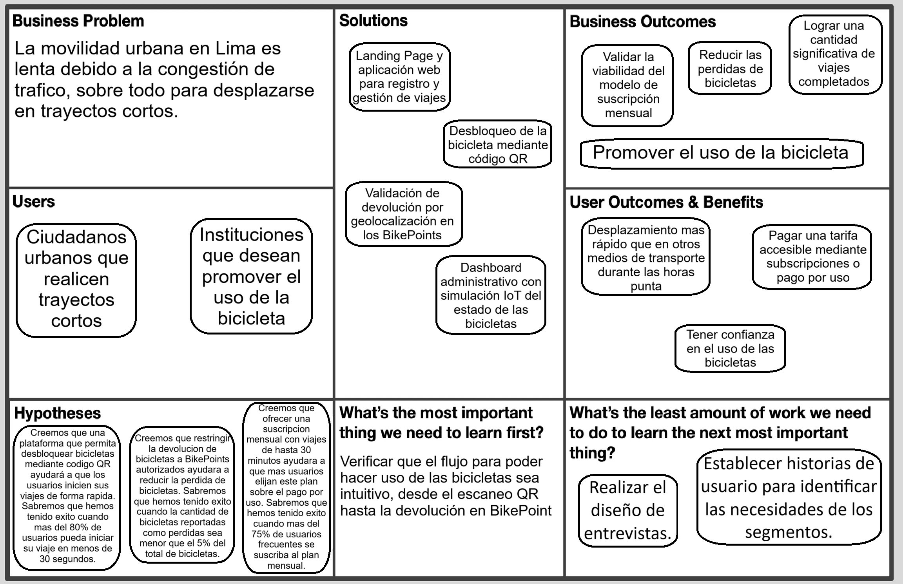

## 1.3. Segmentos Objetivo
### Segmento 1: Estudiantes y jovenes profesionales
#### Descripción general:
Se refiere a personas que se desplazan diariamente por motivos de estudio o trabajo, utilizando diariamente medios como el transporte publico.
#### Perfil demográfico:
Incluye a jovenes de entre a 18 a 30 años que transitan por San Isidro, Miraflores y Santiago de Surco.
#### Dato del sector:
Según Ortega Et Al. (2026), el 83.6% de estudiantes universitarios cree que las horas perdidas en el transporte publico afectan negativamente en sus horas de estudio y rendimiento academico.
#### Necesidad:
Este segmento necesita soluciones rapidas y que pueda predecir cuanto tiempo puede reducir en tiempos de viaje durante las horas punta.

### Segmento 2: Ciudadanos urbanos que realicen trayectos cortos
#### Descripción general:
Se refiere a personas que necesitan recorrer trayectos cortos dentro de la ciudad y que busquen una alternativa accesible a comparación del transporte público actual.
#### Perfil demográfico:
Incluye a residentes de entre 23 a 40 años que residen en Lima Metropolitana.
#### Dato del sector:
Según ComexPerú (2024), los limeños pierden aproximadamente 157 horas al año debido al tránsito en las horas punta. Lo cual evidencia que el segmento se traslada con mayor lentitud a comparación de las bicicletas.
#### Necesidad:
Este segmento necesita una alternativa de movilidad rápida y accesible para los trayectos cortos, la cual no influya en la congestion vehicular ni del transporte informal.


# CAPÍTULO II: REQUIREMENTS ELICITATION & ANALYSIS

## 2.1. Competidores


### 2.1.1. Análisis competitivo.
<table border="1" cellspacing="0" cellpadding="7" style="border-collapse: collapse; width: 100%; border: 2px solid black;"> <tr> <th colspan="6" align="left">Competitive Analysis Landscape</th> </tr> <tr> <td colspan="2" rowspan="2"><b>¿Por qué llevar a cabo este análisis?</b></td> <td colspan="4"><b>Identificar las características, fortalezas y debilidades de los principales servicios de alquiler de bicicletas en Lima, con el propósito de reconocer oportunidades de diferenciación y establecer una propuesta de valor competitiva para la startup.</b></td> </tr> <tr> <td colspan="4">&nbsp;<br><br></td> </tr> <tr> <td colspan="2"><b>Competidores</b></td>   <th align="center">
    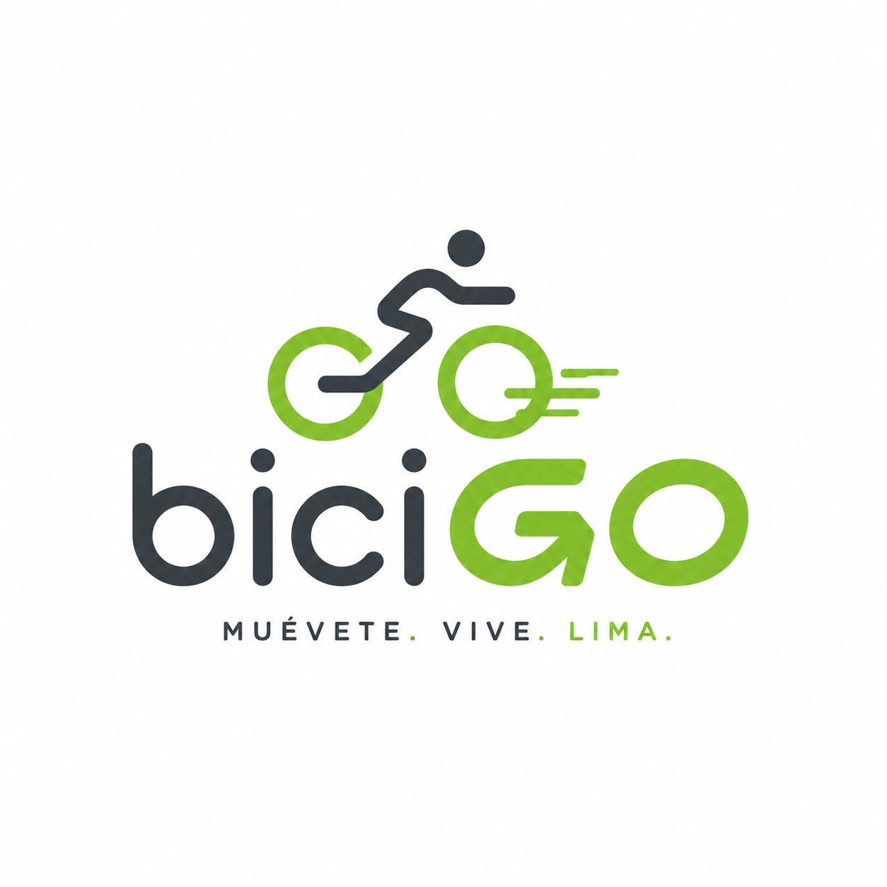<br>
    <b>biciGO</b>
  </th> <th align="center">
    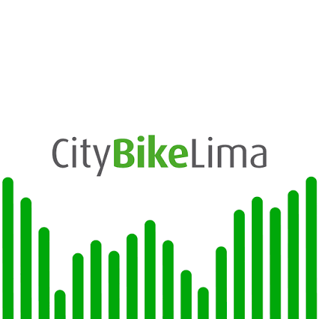<br>
    <b>CityBike Lima</b>
  </th>
  <th align="center">
    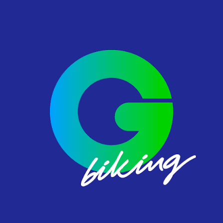<br>
    <b>GOGO Biking</b>
  </th><th align="center">
    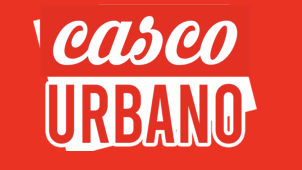<br>
    <b>Casco Urbano</b>
  </th>
</tr></tr> <tr> <td rowspan="2" align="center"><b>Perfil</b></td> <td><b>Overview</b></td>
<td>
  Startup enfocada en el alquiler de bicicletas para desplazamientos urbanos de corta duración. Los usuarios podrán localizar bicicletas, iniciar y finalizar alquileres, realizar pagos y gestionar sus viajes mediante una plataforma web y móvil.
</td>

<td>
  Sistema de bicicletas compartidas que funciona mediante una red de bicicletas y estaciones ubicadas principalmente en Miraflores.
</td>

<td>
  Empresa dedicada al alquiler de bicicletas y a la realización de recorridos turísticos por diferentes zonas de Lima.
</td>

<td>
  Negocio especializado en bicicletas que ofrece alquiler, mantenimiento, reparación, tours y otros servicios relacionados.
</td>
</tr> <tr> <td> <b>Ventaja competitiva<br> ¿Qué valor ofrece a los clientes?</b> </td>
<td>
  Servicio digital sencillo y flexible, alquiler por tiempo, consulta de disponibilidad y posibilidad de implementar puntos mediante alianzas con universidades, empresas y establecimientos.
</td>

<td>
  Infraestructura ya implementada, estaciones establecidas, tarifas accesibles y reconocimiento dentro de Miraflores.
</td>

<td>
  Atención personalizada, experiencia en alquiler de bicicletas y recorridos turísticos especializados.
</td>

<td>
  Combina el alquiler de bicicletas con servicios de mantenimiento, reparación y otros servicios especializados.
</td>
</tr> <tr> <td align="center"><b>Perfil de Marketing</b></td> <td><b>Mercado objetivo</b></td>
<td>
  Estudiantes, jóvenes, trabajadores, residentes y turistas que necesiten realizar desplazamientos urbanos cortos de manera práctica, económica y sostenible.
</td>

<td>
  Residentes, trabajadores y visitantes de Miraflores que realizan desplazamientos de corta distancia.
</td>

<td>
  Principalmente turistas nacionales y extranjeros interesados en recorridos recreativos y turísticos en bicicleta.
</td>

<td>
  Ciclistas, turistas y personas interesadas en alquiler, mantenimiento o reparación de bicicletas.
</td>
</tr> <tr> <td>&nbsp;</td> <td><b>Estrategias de marketing</b></td>
<td>
  Redes sociales, descuentos para estudiantes y nuevos usuarios, programas de referidos y alianzas con universidades, empresas, hoteles, gimnasios, cafeterías y comercios.
</td>

<td>
  Promoción de la movilidad sostenible mediante página web, aplicación móvil y presencia de estaciones en espacios urbanos.
</td>

<td>
  Marketing enfocado en turismo, redes sociales, recomendaciones, promociones y difusión de tours.
</td>

<td>
  Promoción digital de sus servicios de alquiler, mantenimiento, reparación y productos relacionados.
</td>
</tr> <tr> <td rowspan="3" align="center"><b>Perfil del Producto</b></td> <td><b>Productos &amp; Servicios</b></td>
<td>
  Alquiler por tiempo, consulta de disponibilidad, inicio y finalización del alquiler, pagos digitales, historial de viajes, reporte de averías y planes para usuarios frecuentes.
</td>

<td>
  Bicicletas compartidas mediante estaciones, diferentes tipos de pases y gestión mediante aplicación y página web.
</td>

<td>
  Alquiler de bicicletas y tours guiados por diferentes zonas de Lima.
</td>

<td>
  Alquiler de bicicletas, mantenimiento, reparación, tours y accesorios.
</td>
</tr> <tr> <td><b>Precios &amp; Costos</b></td>
<td>
  Pago según el tiempo utilizado, planes diarios o mensuales y descuentos para estudiantes o usuarios frecuentes. Los principales costos corresponden a bicicletas, mantenimiento, desarrollo tecnológico, soporte e infraestructura básica.
</td>

<td>
  Diferentes tipos de pases con tarifas accesibles. Sus principales costos corresponden a bicicletas, estaciones, mantenimiento e infraestructura.
</td>

<td>
  Precios principalmente por tiempo de alquiler y servicios turísticos. Sus costos incluyen bicicletas, mantenimiento, locales, personal y guías.
</td>

<td>
  Precios según alquiler y servicios adicionales. Sus principales costos corresponden a mantenimiento, herramientas, personal, inventario y establecimiento físico.
</td>
</tr> <tr> <td> <b>Canales de distribución<br> (Web y/o Móvil)</b> </td>
<td>
  Plataforma web responsive, aplicación móvil y puntos físicos asociados para recoger y devolver bicicletas. También contará con un dashboard administrativo.
</td>

<td>
  Página web, aplicación móvil y estaciones físicas.
</td>

<td>
  Página web, redes sociales, contacto directo y establecimientos físicos.
</td>

<td>
  Página web, redes sociales y establecimiento físico.
</td>
</tr> <tr> <td rowspan="5" align="center"><b>Análisis SWOT</b></td>
<td colspan="5">
  <b>Realice esto para su startup y sus competidores. Sus fortalezas deberían apoyar sus oportunidades y contribuir a lo que ustedes definen como su posible ventaja competitiva.</b>
</td>
</tr> <tr> <td><b>Fortalezas</b></td>
<td>
  Plataforma web y móvil, modelo flexible, posibilidad de expansión mediante alianzas, gestión digital y enfoque en recorridos urbanos cortos.
</td>

<td>
  Infraestructura implementada, estaciones disponibles, tarifas accesibles y reconocimiento dentro de Miraflores.
</td>

<td>
  Experiencia en alquiler, atención personalizada y conocimiento del mercado turístico.
</td>

<td>
  Experiencia técnica, mantenimiento, reparación y variedad de servicios relacionados con bicicletas.
</td>
</tr> <tr> <td><b>Debilidades</b></td>
<td>
  Marca nueva, cantidad inicial limitada de bicicletas, capital reducido y dependencia inicial de alianzas para ampliar cobertura.
</td>

<td>
  Dependencia de estaciones determinadas y necesidad de nueva infraestructura para ampliar la cobertura.
</td>

<td>
  Dependencia de locales y horarios y orientación principalmente turística.
</td>

<td>
  Dependencia de un establecimiento físico y menor automatización del proceso de alquiler.
</td>
</tr> <tr> <td><b>Oportunidades</b></td>
<td>
  Crecimiento de la movilidad sostenible, congestión vehicular, alianzas con universidades y empresas y expansión hacia zonas con menor cobertura.
</td>

<td>
  Expansión hacia nuevos distritos, crecimiento del uso de bicicletas y desarrollo de nuevas ciclovías.
</td>

<td>
  Crecimiento del turismo urbano, nuevas rutas y alianzas con hoteles y agencias.
</td>

<td>
  Crecimiento del ciclismo urbano y mayor demanda de servicios de mantenimiento y reparación.
</td>
</tr> <tr> <td><b>Amenazas</b></td>
<td>
  Robo o vandalismo, costos de mantenimiento, accidentes, regulaciones municipales, nuevos competidores y otras alternativas de micromovilidad.
</td>

<td>
  Nuevos competidores, costos de expansión, daños y vandalismo de las bicicletas.
</td>

<td>
  Reducción del turismo, otros servicios turísticos y sistemas automatizados de alquiler.
</td>

<td>
  Competencia de talleres, plataformas digitales y sistemas de bicicletas compartidas.
</td>
</tr> <tr> <td>&nbsp;</td> <td>&nbsp;</td> <td>&nbsp;</td> <td>&nbsp;</td> <td>&nbsp;</td> <td>&nbsp;</td> </tr> </table>


### 2.1.2 Estrategias y tácticas frente a competidores

Se plantean estrategias y tácticas preliminares que permitan a **biciGO** afrontar las fortalezas de sus competidores, aprovechar sus debilidades y responder a las oportunidades y amenazas presentes en el mercado de alquiler de bicicletas.

| **Aspecto** | **biciGO** | **CityBike Lima** | **GOGO Biking** | **Casco Urbano** | **Acciones de biciGO** |
|---|---|---|---|---|---|
| **Fortalezas a afrontar** | Plataforma digital orientada a alquileres rápidos, flexibles y recorridos urbanos cortos. | Cuenta con infraestructura implementada, estaciones establecidas, tarifas accesibles y reconocimiento en Miraflores. | Posee experiencia en alquiler de bicicletas, atención personalizada y presencia en el mercado turístico. | Cuenta con experiencia técnica, mantenimiento, reparación y conocimiento especializado en bicicletas. | biciGO buscará diferenciarse mediante facilidad de uso, digitalización, flexibilidad y puntos de alquiler estratégicos, evitando competir únicamente por precio. |
| **Debilidades a aprovechar** | Al ser una startup nueva puede adaptar su plataforma y modelo de negocio desde el inicio según las necesidades de los usuarios. | Depende de estaciones específicas y necesita infraestructura adicional para ampliar su cobertura. | Su servicio está orientado principalmente al turismo y depende de locales y horarios determinados. | Su operación depende principalmente de un establecimiento físico y presenta menor automatización del alquiler. | Implementar puntos mediante alianzas con universidades, empresas, hoteles, estacionamientos y comercios, evitando depender de un único establecimiento o de grandes estaciones. |
| **Oportunidades** | Crecimiento de la movilidad sostenible, mayor uso de servicios digitales y necesidad de alternativas para recorridos urbanos cortos. | El uso de bicicletas compartidas demuestra que existe interés por este tipo de movilidad. | La existencia de alquileres turísticos demuestra que existe demanda por servicios de bicicletas. | El crecimiento del ciclismo urbano genera mayor interés por bicicletas y servicios relacionados. | Crear alianzas con universidades y empresas, promociones para estudiantes, planes para usuarios frecuentes y expansión hacia zonas con menor cobertura. |
| **Amenazas** | Robo, vandalismo, costos de mantenimiento, accidentes, regulaciones municipales y aparición de nuevos competidores. | Puede ampliar su infraestructura o mejorar su plataforma y competir en nuevas zonas. | Puede ampliar sus servicios hacia alquileres urbanos de corta duración. | Puede incorporar herramientas digitales y aumentar su presencia en el mercado de alquiler. | Implementar registro obligatorio de usuarios, historial de alquileres, reporte de daños, mantenimiento preventivo y expansión progresiva para reducir riesgos. |
| **Estrategia competitiva** | Ofrecer un servicio digital, sencillo, flexible y orientado a desplazamientos urbanos de corta duración. | Competir mediante mayor flexibilidad y presencia en zonas donde CityBike tenga menor cobertura. | Diferenciarse mediante alquileres urbanos rápidos y autoservicio digital en lugar de centrarse principalmente en tours. | Diferenciarse mediante automatización del alquiler y disponibilidad desde diferentes puntos. | Posicionar a biciGO como una alternativa de movilidad urbana práctica, digital y accesible. |
| **Tácticas preliminares** | Plataforma web y móvil, alquiler por tiempo, pagos digitales, historial de viajes, reportes y dashboard administrativo. | Implementar puntos en universidades y establecimientos privados, ofrecer descuentos para estudiantes y simplificar el proceso de alquiler. | Ofrecer alquileres de 30 minutos, 1 hora o varias horas y promociones para usuarios frecuentes. | Permitir localizar bicicletas, iniciar y finalizar alquileres y reportar problemas desde la plataforma. | Redes sociales, programa de referidos, descuentos iniciales, alianzas estratégicas, planes mensuales, mantenimiento preventivo y expansión según la demanda. |

##  Estrategia general

La estrategia competitiva de **biciGO** estará basada en ofrecer un servicio de alquiler de bicicletas **digital, flexible y accesible**, orientado principalmente a desplazamientos urbanos de corta duración.

La startup buscará aprovechar las limitaciones de los competidores mediante una mayor facilidad de uso, puntos de alquiler estratégicos y alianzas con universidades, empresas y establecimientos privados.

## Principales tácticas

- Implementar una plataforma web y móvil sencilla.
- Permitir consultar bicicletas disponibles.
- Facilitar el inicio y finalización de los alquileres.
- Incorporar pagos digitales.
- Ofrecer descuentos para estudiantes y nuevos usuarios.
- Implementar programas de referidos.
- Crear planes para usuarios frecuentes.
- Establecer alianzas con universidades, empresas y comercios.
- Implementar reportes de daños y averías.
- Gestionar el mantenimiento preventivo de las bicicletas.
- Expandir progresivamente los puntos de alquiler según la demanda.

## 2.2. Entrevistas

### 2.2.1. Diseño de entrevistas

A continuación, se presentan las preguntas principales y complementarias diseñadas para cada segmento objetivo.

#### Segmento 1: Ciudadanos urbanos que realizan trayectos cortos

Este segmento está compuesto por estudiantes, trabajadores y profesionales jóvenes que residen en Lima Metropolitana y requieren desplazamientos frecuentes en zonas congestionadas.

##### Preguntas principales
| N° | Pregunta |
|---|---|
| 1 | ¿Cuál es su edad, distrito de residencia, ocupación actual y estado civil? |
| 2 | ¿Con qué frecuencia realiza desplazamientos cortos dentro de la ciudad y en qué horarios? |
| 3 | ¿Qué medio de transporte utiliza con mayor frecuencia para recorridos cortos y por qué? |
| 4 | ¿Qué tan cómodo o frustrado se siente al usar transporte público o taxis para trayectos cortos? |
| 5 | ¿Qué factores influyen en su decisión al elegir un medio de transporte para desplazamientos diarios? |
| 6 | ¿Ha considerado alguna vez usar bicicletas como alternativa para moverse por la ciudad? ¿Por qué sí o por qué no? |
| 7 | ¿Qué aspectos serían decisivos para que usted adopte un servicio de bicicletas compartidas? |
| 8 | ¿Cuál sería su nivel de aceptación frente a una app que permita registrar bicicletas, consultar disponibilidad y desbloquearlas mediante código QR? |
| 9 | ¿Está dispuesto a pagar por un servicio de bicicletas compartidas y qué tipo de tarifa le resultaría más atractiva? |
| 10 | ¿Qué tan importante es para usted la seguridad, la sostenibilidad y la rapidez al momento de desplazarse? |

##### Preguntas complementarias
- ¿Qué tan frecuente usa aplicaciones móviles para transporte o pago digital?
- ¿Qué tan seguro se siente al usar bicicletas en la ciudad y qué factores lo afectan?
- ¿Qué tan recomendable sería para usted desplazarse en bicicleta durante la mañana o la tarde en su zona?
- ¿Qué mejoras le gustaría ver en un servicio de bicicletas compartidas?
- ¿Qué tan importante es contar con estaciones cercanas a su hogar, universidad o trabajo?
- ¿Cuánto tiempo está dispuesto a invertir en buscar una bicicleta o station point antes de iniciar un viaje?
- ¿Se sentiría motivado a usar este servicio si existiera un plan mensual para usuarios frecuentes?
- ¿Qué tan útil considera que sería un servicio pensado para recorridos de 10 a 30 minutos?

#### Segmento 2: Instituciones que desean promover el uso de la bicicleta

Este segmento incluye universidades, municipalidades, empresas y otras organizaciones interesadas en fomentar la movilidad sostenible entre sus miembros, estudiantes o trabajadores.

##### Preguntas principales
| N° | Pregunta |
|---|---|
| 1 | ¿Qué tipo de institución representa y cuál es su rol en la promoción de la movilidad sostenible? |
| 2 | ¿Qué tipo de población atiende la institución y qué necesidades de movilidad presenta? |
| 3 | ¿Actualmente se promueve alguna iniciativa relacionada con la bicicleta o con medios de transporte sostenibles? |
| 4 | ¿Qué limitaciones tienen los empleados o estudiantes para desplazarse en bicicleta dentro de la ciudad? |
| 5 | ¿Considera que la movilidad sostenible es una prioridad dentro de la institución o comunidad que representa? |
| 6 | ¿Qué beneficios esperaría obtener una institución si implementa un servicio de bicicletas compartidas para sus usuarios? |
| 7 | ¿Qué tan viable sería para su institución contar con puntos de acceso o BikePoints dentro de sus instalaciones? |
| 8 | ¿Qué condiciones deberían cumplirse para que una alianza con una startup de micromovilidad sea atractiva para su organización? |
| 9 | ¿Qué indicadores permitirían medir el éxito de una iniciativa de movilidad sostenible dentro de la institución? |
| 10 | ¿Estaría dispuesto a participar en una estrategia de promoción del uso de bicicleta mediante beneficios, incentivos o convenios? |

##### Preguntas complementarias
- ¿Qué tan importante es para la institución reducir la congestión, mejorar la movilidad o mejorar la imagen sostenible de la organización?
- ¿Qué tan factible sería implementar bicicletas compartidas en espacios universitarios, corporativos o municipales?
- ¿Qué nivel de apoyo administrativo o financiero podría ofrecer la institución para una iniciativa de este tipo?
- ¿Qué tipo de usuarios serían los principales beneficiarios de una solución de movilidad sostenible?
- ¿Qué tan relevante es para la institución la seguridad del usuario, el mantenimiento de la flota y la digitalización del servicio?
- ¿Qué tipo de servicios adicionales complementarios podrían ser valorados por la institución?
- ¿Qué barreras percibe para la adopción de bicicletas como opción de transporte institucional?
- ¿Qué tan viable es establecer alianzas con empresas o universidades para ampliar los puntos de uso del servicio?


### 2.2.2. Registro de entrevistas
#### Primer Segmento objetivo: Estudiantes y profesionales

<table style="width: 100%" align="center">
  <tr>
    <th>Entrevistado 1</th>
    <th>Entrevistado 2</th>
    <th>Entrevistado 3</th>
  </tr>
  <tr>
    <td align="center">
      <a href="https://upcedupe-my.sharepoint.com/:v:/g/personal/u20241a911_upc_edu_pe/IQDxZUCIUMf8RpBSZ5jmNJTWAe3OcVVZVYDUP-SV0bk5Pu8?e=DMd2bO" target="_blank">
        
      </a>
    </td>
    <td align="center">
      <a href="https://upcedupe-my.sharepoint.com/:v:/g/personal/u20241a911_upc_edu_pe/IQD26ILH7iaJQqIYzfMs8ZDgAaSMjBcDyQOpYwTzCoOx4Yg?e=qi30H0" target="_blank">
        
      </a>
    </td>
    <td align="center">
      <a href="https://upcedupe-my.sharepoint.com/:v:/g/personal/u20241a911_upc_edu_pe/IQATP6dev96vQ496zr1LYLifAUDdGvW6xxuifXeucPhCNBM?nav=eyJyZWZlcnJhbEluZm8iOnsicmVmZXJyYWxBcHAiOiJPbmVEcml2ZUZvckJ1c2luZXNzIiwicmVmZXJyYWxBcHBQbGF0Zm9ybSI6IldlYiIsInJlZmVycmFsTW9kZSI6InZpZXciLCJyZWZlcnJhbFZpZXciOiJNeUZpbGVzTGlua0NvcHkifX0&e=orCIl3" target="_blank">
        
      </a>
    </td>
  </tr>
  <tr>
    <td valign="top">
      <b>Entrevistador:</b> Juan David Ayllon Pauccar<br>
      <b>Entrevistado:</b> Fernando Güere Calero<br>
      <b>Edad:</b> 19 años <br>
      <b>Distrito:</b> Chaclacayo <br>
      <b>Estado civil:</b> Soltero <br>
      <b>Ocupación:</b> Estudiante de ingeniería <br>
      <b>Inicio de la entrevista:</b> 0:00 <br><br>
      <b>Resumen:</b> El entrevistado usa principalmente la bicicleta para desplazamientos cortos porque la considera cómoda, económica y útil para hacer ejercicio. Considera incómodo y costoso utilizar transporte público o taxis para estos trayectos. Muestra interés en un servicio de bicicletas compartidas con una aplicación para consultar disponibilidad y desbloquear bicicletas mediante código QR, siempre que tenga tarifas razonables y condiciones de seguridad adecuadas.<br><br>
      <b>Perfil del entrevistado:</b> Fernando Güere Calero es un hombre de 19 años, soltero, residente en el distrito de Chaclacayo y estudiante de ingeniería. Forma parte del grupo de jóvenes que realiza desplazamientos cotidianos dentro de la ciudad y tiene experiencia utilizando la bicicleta como medio de transporte para recorridos cortos. Su perfil corresponde al de un usuario que busca alternativas prácticas para movilizarse en sus actividades diarias.
    </td>
    <td valign="top">
      <b>Entrevistador:</b> Rodrigo Velázquez<br>
      <b>Entrevistado:</b> Alonso<br>
      <b>Edad:</b> 19 años <br>
      <b>Distrito:</b> No especificado <br>
      <b>Estado civil:</b> Soltero <br>
      <b>Ocupación:</b> Estudiante de arquitectura en la UPC <br>
      <b>Inicio de la entrevista:</b> No especificado <br><br>
      <b>Resumen:</b> Alonso, estudiante de arquitectura de 19 años, suele utilizar bus o automóvil para realizar desplazamientos cortos durante los fines de semana. Sin embargo, se siente incómodo por la congestión, el tiempo de espera y la cantidad de personas en el transporte público. Considera que la bicicleta sería una alternativa más rápida, cómoda y agradable para evitar el tráfico.<br><br>
      También muestra interés en BiciGo, especialmente por el desbloqueo mediante código QR, la disponibilidad de estaciones cercanas y los planes de suscripción. Considera importantes la seguridad, la sostenibilidad, la rapidez y una cobertura amplia en zonas como San Isidro, Miraflores y Barranco.
      <br><br>
      <b>Perfil del entrevistado:</b> Alonso es un estudiante de arquitectura de 19 años de la UPC, soltero y usuario habitual del transporte público. Busca una opción de movilidad económica que reduzca el estrés y el tiempo perdido en el tráfico.
    </td>
    <td valign="top">
      <b>Entrevistador:Eduardo Manuel Aguirre Ramos</b> <br>
      <b>Entrevistado:Angelo Faustino</b> <br>
      <b>Edad: 20 años</b> <br>
      <b>Distrito: Surco</b> <br>
      <b>Inicio de la entrevista: 0:00</b> <br><br>
      <b>Resumen:El entrevistado es un estudiante universitario que realiza rutas cotidianas y frecuentes de tramos cortos (5 a 20 minutos) entre 3 y 4 veces por semana, movilizándose continuamente entre su sede de estudios y áreas aledañas en Surco, San Isidro y Miraflores para almorzar, hacer pagos o asistir a reuniones breves. Aunque camina cuando dispone de tiempo, recurre habitualmente al taxi por aplicativo cuando el horario entre clases o trámites es ajustado. Manifiesta estar muy insatisfecho con el taxi para estas rutas universitarias breves debido a las altas tarifas mínimas y el tiempo que pierde atrapado en el tráfico.</b> <br><br>
      <b>Perfil del entrevistado:Angelo es un estudiante universitario de 20 años que reside en Surco. Su rutina diaria demanda desplazamientos frecuentes e intermedios en zonas universitarias y comerciales con alto flujo vehicular. Encaja en el perfil de un estudiante universitario de rutas frecuentes que necesita una alternativa de micromovilidad rápida, económica y predecible que se integre a su horario académico, permitiéndole conectar sus actividades del día sin depender del tráfico vehicular ni de las altas tarifas de los servicios de transporte tradicional.<b>
    </td>
  </tr>
</table>


#### Segundo Segmento objetivo: Ciudadanos

<table style="width: 100%" align='center'>
  <tr>
    <th>Entrevistado 1</th>
    <th>Entrevistado 2</th>
    <th>Entrevistado 3</th>
  </tr>
  <tr>
    <td align='center'>
      <a href="https://upcedupe-my.sharepoint.com/:v:/g/personal/u202322952_upc_edu_pe/IQCmXEuLne2lTZsZnWYzY_9gAUFseCBoR-M_F5l_kv8R3z0?nav=eyJyZWZlcnJhbEluZm8iOnsicmVmZXJyYWxBcHAiOiJPbmVEcml2ZUZvckJ1c2luZXNzIiwicmVmZXJyYWxBcHBQbGF0Zm9ybSI6IldlYiIsInJlZmVycmFsTW9kZSI6InZpZXciLCJyZWZlcnJhbFZpZXciOiJNeUZpbGVzTGlua0NvcHkifX0&e=PqFbEC" target="_blank">
        
      </a>
    </td>
    <td align='center'>
      <a href="https://upcedupe-my.sharepoint.com/:v:/g/personal/u20241a911_upc_edu_pe/IQCfnIQowgWEQKxTcK51KNwUAeiVUFnDUoG8urSVMs6EWMg?e=Hh2UL8" target="_blank">
        
      </a>
    </td>
    <td align='center'>
      <a href="https://upcedupe-my.sharepoint.com/:v:/g/personal/u20241a911_upc_edu_pe/IQArqY5miSBMTq7c8R2ZrekrAX2BczGjyQ_9jew8pat2KDo?e=aWA2gK" target="_blank">
        
      </a>
    </td>
  </tr>
  <tr>
    <td valign="top">
      <b>Entrevistador:</b> José María Franco del Carpio <br>
      <b>Entrevistado:</b> David<br>
      <b>Edad:</b> 20 años <br>
      <b>Distrito:</b> Santa Anita <br>
      <b>Estado civil:</b> Soltero <br>
      <b>Ocupación:</b> Estudiante <br>
      <b>Inicio de la entrevista:</b> 0:02 <br><br>
      <b>Resumen:</b> David, estudiante de 20 años residente en Santa Anita, realiza desplazamientos cortos principalmente los fines de semana para salir al centro o realizar diversas tareas. Utiliza buses porque son económicos y accesibles, aunque considera incómodo viajar en vehículos pequeños y llenos, además de que algunas veces los conductores cobran tarifas poco claras. También ha considerado usar bicicletas, especialmente en trayectos planos, pero le preocupan las subidas, el cansancio y la seguridad.
      <br><br>
      Considera que la disponibilidad de bicicletas sería determinante para adoptar el servicio, y muestra un interés moderado por una aplicación con desbloqueo mediante código QR. Estaría dispuesto a pagar si la tarifa es igual o menor que la del transporte público, y valora especialmente la seguridad, la rapidez y la sostenibilidad.
      <br><br>
      <b>Perfil del entrevistado:</b> David es un estudiante de 20 años, soltero y residente en Santa Anita. Busca alternativas económicas y disponibles para sus recorridos, priorizando la seguridad, la comodidad y la rapidez.
    </td>
    <td valign="top">
      <b>Entrevistador:</b> Eduardo Manuel Aguirre Ramos <br>
      <b>Entrevistado:</b> Claudia <br>
      <b>Edad:</b> No especificada <br>
      <b>Distrito:</b> No especificado <br>
      <b>Inicio de la entrevista:</b> 0:00 <br><br>
      <b>Resumen:</b> Claudia realiza desplazamientos cortos ocasionalmente para hacer compras, asistir a reuniones o resolver asuntos puntuales. Como no cuenta con automóvil propio, utiliza principalmente el transporte público, pero señala que el tráfico, los tiempos de espera y los costos pueden dificultar sus traslados. También identifica como problemas de los taxis las tarifas elevadas y la inseguridad durante algunas horas de la noche.<br><br>
      Para un servicio de bicicletas compartidas, preferiría pagar una tarifa por uso debido a la poca frecuencia de sus viajes. Considera útil el desbloqueo mediante código QR y espera que la aplicación tenga una interfaz sencilla, un proceso de registro rápido y opciones para vincular cuentas como Facebook o Gmail.
      <br><br>
      <b>Perfil del entrevistado:</b> Claudia es una ciudadana que realiza desplazamientos ocasionales para compras, reuniones y otros asuntos puntuales. Valora la economía, la rapidez, la seguridad y la facilidad de uso al elegir una alternativa de transporte.
    </td>
    <td valign="top">
      <b>Entrevistador:</b> Adrian Armestar <br>
      <b>Entrevistado:</b> Mauricio <br>
      <b>Edad:</b> 23 años <br>
      <b>Distrito:</b> Miraflores <br>
      <b>Inicio de la entrevista:</b> 00:01 <br><br>
      <b>Resumen:</b> El entrevistado Mauricio indica que realiza trayectos cortos muy pocas veces pero tiende a optar por el transporte publica cuando necesita ahorrar tiempo
      aunque se suele frustrar con los tiempos de espera y el trafico que se genera.<br>
      <br>
      <b>Perfil del entrevistado:</b> Es un hombre de 23 años que reside en el distrito de Miraflores
    </td>
  </tr>
</table>

### 2.2.3. Análisis de entrevistas

#### 1.Estudiantes y trabajadores con desplazamientos diarios habituales

Este grupo está integrado por usuarios jóvenes (estudiantes universitarios, de ingeniería y arquitectura) que necesitan realizar **desplazamientos cortos pero continuos (de 5 a 20 minutos), entre 3 a 4 veces por semana o diariamente**, para conectar sus sedes de estudio, lugares de trabajo y áreas comerciales aledañas (como Surco, San Isidro y Miraflores).

* **Principales hallazgos y dolores:** Muestran una alta frustración hacia los servicios de transporte tradicionales. Consideran que el taxi por aplicativo resulta sumamente costoso para tramos breves debido a las tarifas mínimas y al tiempo perdido en la congestión vehicular, mientras que el transporte público les parece incómodo, lento y poco directo.
* **Aceptación y modelo de negocio:** Exhiben una elevada predisposición hacia el uso de bicicletas compartidas como alternativa rápida y práctica. Al ser usuarios de alta frecuencia, **prefieren abrumadoramente un modelo de suscripción mensual** que les permita optimizar y amortizar sus costos sin preocuparse por el conteo de minutos o kilómetros.
* **Requerimientos clave:** Valoran el desbloqueo ágil mediante código QR, una red amplia de estaciones fijas (*bike points*) cerca de sus puntos de interés, rutas sugeridas por ciclovías seguras en la app y la consulta en tiempo real de la disponibilidad de bicicletas y espacios libres para estacionar.
<br>

#### 2. Ciudadanos que utilizan transporte de manera ocasional

Este segmento abarca a ciudadanos que realizan **traslados breves de forma esporádica o durante los fines de semana** para llevar a cabo compras, trámites puntuales, actividades de ocio o reuniones breves, sin mantener una rutina fija de transporte diario.

* **Principales hallazgos y dolores:** Dependen habitualmente del transporte público tradicional o del taxi. Sus mayores incomodidades son la congestión vehicular, los excesivos tiempos de espera, las tarifas elevadas para recorridos cortos y la percepción de inseguridad durante ciertas horas del día.
* **Aceptación y modelo de negocio:** Muestran un interés moderado a positivo en el servicio de bicicletas compartidas por ser una alternativa económica y ágil. Debido a la baja frecuencia e impredecibilidad de sus viajes, **prefieren estrictamente un esquema de pago por uso (tarifa por tiempo o trayecto)** en lugar de asumir el compromiso de una suscripción mensual.
* **Requerimientos clave:** Priorizan tarifas económicas e iguales o menores a las del transporte público, procesos de registro rápidos (mediante integración con cuentas como Google o Facebook), una interfaz sencilla para ubicar estaciones e infraestructura segura que reduzca el cansancio físico y el temor a transitar junto al tráfico vehicular.
## 2.3. Needfinding

### 2.3.1. User Personas
Para comprender mejor las necesidades y comportamientos de los usuarios, se elaboraron dos User Personas basados en los segmentos objetivo identificados en el proyecto.

Andres representa al segmento de Rider que realiza trayectos cortos cotidianos hacia la universidad o trabajo. Busca una alternativa rápida, económica y sostenible para evitar el tráfico y la dependencia del transporte público.

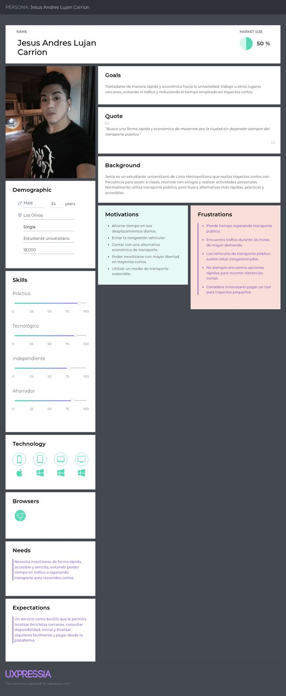

Claudia representa al segmento ciudado el cual realiza trayectos con poca frecuencia para cosas puntuales  orientado a la eficiencia en el uso del tiempo y presupuesto. Realiza trayectos breves para compras, trámites y reuniones, buscando evitar las altas tarifas de taxi y el tráfico, valorando la predictibilidad, la seguridad y la facilidad de pago.

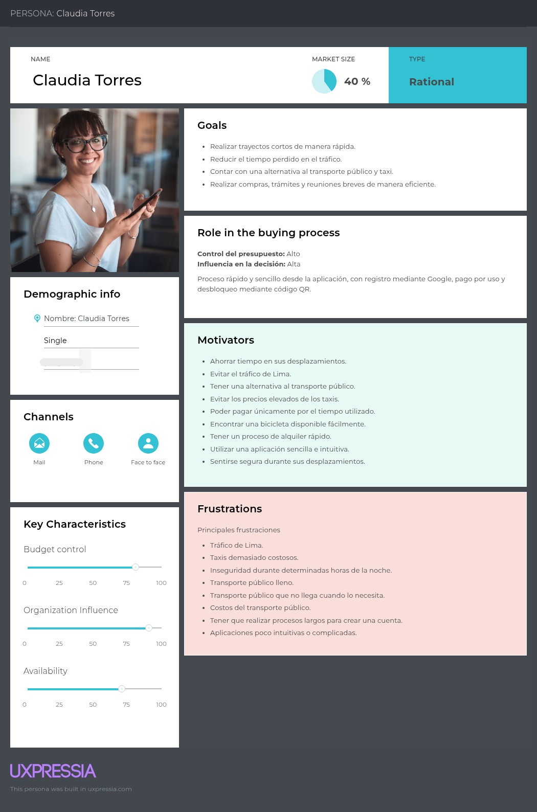


### 2.3.2. User Task Matrix

La User Task Matrix nos permite descomponer las actividades y tareas que nuestros usuarios realizan al utilizar la solución propuesta. Estas tareas, al clasificarse por su frecuencia e importancia, nos ayudan a priorizar qué funcionalidades de BiciGo deben desarrollarse con mayor énfasis para optimizar la experiencia de cada segmento.

Los segmentos considerados para este análisis son:

- **Estudiante (Jesús Andrés)**
- **Ciudadano (Claudia Torres)**

| Tarea | Jesús Andrés Luján (Rider / Commuter - 34) | | Claudia Torres (Rational - 21) | |
| :--- | :--- | :--- | :--- | :--- |
| | **Frecuencia** | **Importancia** | **Frecuencia** | **Importancia** |
| Consultar disponibilidad de bicicletas y BikePoints cercanos | Always | High | Always | High |
| Desbloquear bicicleta mediante código QR | Always | High | Always | High |
| Iniciar y finalizar el alquiler de la bicicleta | Always | High | Always | High |
| Consultar tarifa estimada y métodos de pago | Always | High | Always | High |
| Visualizar rutas y mapa de ciclovías en tiempo real | Often | Medium | Often | Medium |
| Adquirir o gestionar plan de suscripción mensual | Sometimes | Medium | Sometimes | Medium |
| Consultar historial de viajes y pagos | Sometimes | Medium | Sometimes | Medium |
| Monitorear disponibilidad y estado de flota en BikePoints | Never | — | Never | — |
| Registrar incidencias o fallas mecánicas en bicicletas | Rarely | High | Rarely | High |
| Consultar métricas de uso e impacto ambiental | Rarely | Low | Rarely | Low |
| Gestionar datos del perfil personal / cuenta | Sometimes | Medium | Sometimes | Medium |
### 2.3.3. User Journey Mapping

.png)

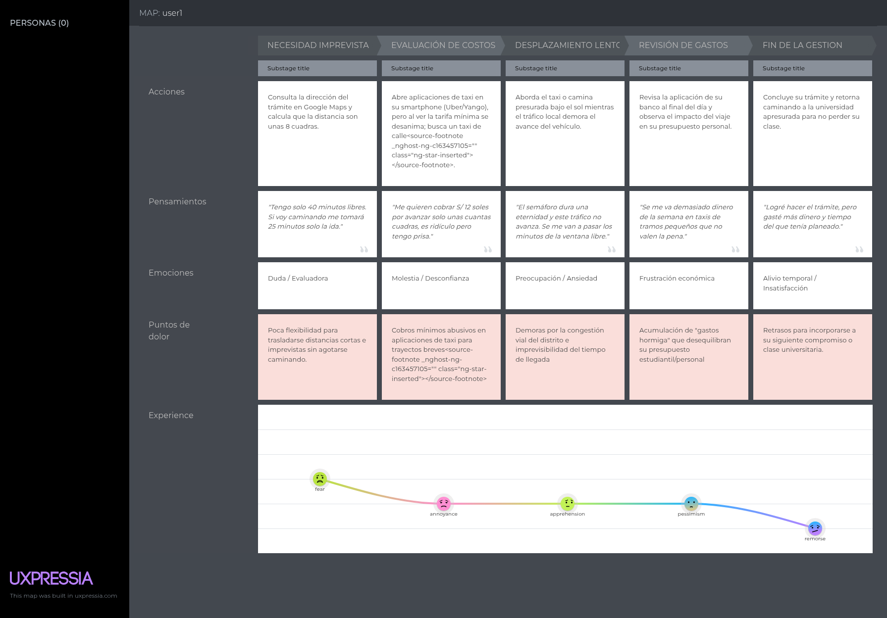
### 2.3.4. Empathy Mapping

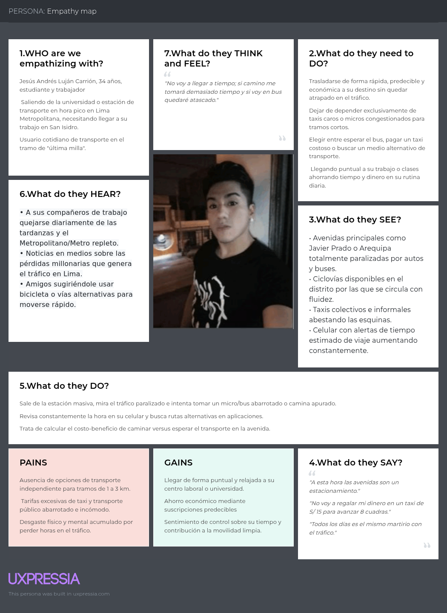

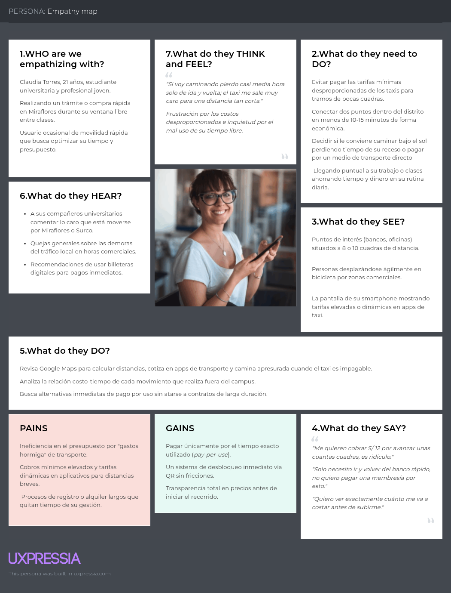

## 2.4. Big Picture EventStorming
En la sesión de Big Picture Event Storming, el equipo exploró de forma visual el panorama general del dominio de movilidad urbana sostenible y gestión de bicicletas compartidas de Chapa. Se identificaron los eventos significativos del ciclo de vida de un viaje, desde el registro del usuario y la disponibilidad de una bicicleta hasta el inicio, seguimiento y finalización del recorrido en un BikePoint autorizado. Integrando los actores que interactuan con la plataforma y exponiendo los problemas, dudas y oportunidades de mejora detectados durante la sesión. Esta primera aproximación permitió alinear el entendimiento del equipo y sentar las bases para el diseño detallado de la solución.

**Primera fase: Eventos**
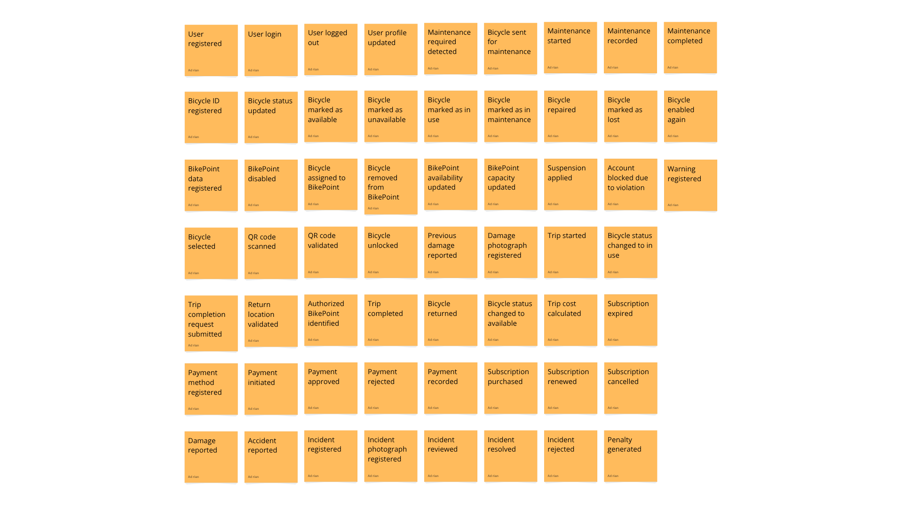

**Mapa General:** https://canva.link/7coo689oj2nx3b7

## 2.5. Ubiquitous Language

El **Ubiquitous Language** establece un lenguaje común para todos los participantes del proyecto **BiciGo**, permitiendo que los conceptos relacionados con el servicio de alquiler de bicicletas sean comprendidos de la misma manera por el equipo de desarrollo, los usuarios y demás participantes.

Los siguientes términos representan los principales conceptos utilizados dentro del dominio de BiciGo.

## Términos del dominio

| Término                      | Definición                                                                                                                                                             |
| ---------------------------- | ---------------------------------------------------------------------------------------------------------------------------------------------------------------------- |
| **BiciGo**                   | Servicio de alquiler de bicicletas que permite a los usuarios realizar desplazamientos mediante bicicletas disponibles en puntos de estacionamiento establecidos.      |
| **Usuario**                  | Persona que se registra en BiciGo y utiliza el servicio de alquiler de bicicletas.                                                                                     |
| **Registro**                 | Proceso mediante el cual una persona crea una cuenta en BiciGo para poder acceder al servicio.                                                                         |
| **Bicicleta**                | Medio de transporte proporcionado por BiciGo para que los usuarios puedan realizar sus desplazamientos.                                                                |
| **Punto de estacionamiento** | Zona fija establecida por BiciGo donde los usuarios pueden recoger o dejar una bicicleta.                                                                              |
| **Disponibilidad**           | Estado que indica si una bicicleta se encuentra disponible para ser utilizada.                                                                                         |
| **Alquiler**                 | Acción mediante la cual un usuario obtiene una bicicleta de BiciGo para realizar un recorrido.                                                                         |
| **Viaje**                    | Recorrido realizado por un usuario desde que inicia el uso de una bicicleta hasta que finaliza y la devuelve en un punto habilitado.                                   |
| **Kilometraje**              | Distancia recorrida durante un viaje y utilizada como referencia para calcular la tarifa del servicio.                                                                 |
| **Tarifa**                   | Monto correspondiente al pago de un viaje de acuerdo con los kilómetros recorridos.                                                                                    |
| **Cobro**                    | Proceso mediante el cual BiciGo determina y realiza el pago correspondiente al viaje del usuario.                                                                      |
| **Suscripción Premium**      | Modalidad de suscripción de BiciGo que permite al usuario utilizar el servicio sin pagar la tarifa correspondiente al kilometraje, según las condiciones establecidas. |
| **Usuario Premium**          | Usuario que posee una suscripción Premium activa y cuenta con los beneficios asociados a dicha modalidad.                                                              |
| **Inicio de viaje**          | Momento en que el usuario comienza a utilizar una bicicleta disponible.                                                                                                |
| **Fin de viaje**             | Momento en que el usuario termina su recorrido y deja la bicicleta en un punto de estacionamiento habilitado.                                                          |
| **Recorrido**                | Trayecto realizado entre el punto donde el usuario recoge la bicicleta y el punto donde la devuelve.                                                                   |
| **Punto de recogida**        | Punto de estacionamiento en el que el usuario obtiene una bicicleta disponible para iniciar un viaje.                                                                  |
| **Punto de devolución**      | Punto de estacionamiento en el que el usuario finaliza su viaje y deja la bicicleta.                                                                                   |

## Flujo principal del servicio

El funcionamiento principal de BiciGo se puede representar mediante el siguiente flujo:

```text
Usuario
   ↓
Registro
   ↓
Bicicleta disponible
   ↓
Punto de recogida
   ↓
Inicio de viaje
   ↓
Recorrido
   ↓
Kilometraje
   ↓
Punto de devolución
   ↓
Fin de viaje
   ↓
Cobro
```

En el caso de un **Usuario Premium**, el sistema mantiene el registro del viaje y del kilometraje recorrido. Sin embargo, el usuario no realiza el cobro asociado a los kilómetros recorridos debido al beneficio proporcionado por su **Suscripción Premium**.

## Uso del lenguaje común

La terminología definida en este apartado será utilizada como referencia durante las siguientes etapas del desarrollo de BiciGo. Esto permitirá mantener una comunicación consistente entre los integrantes del equipo y evitar diferencias en la interpretación de los conceptos del sistema.

Los términos definidos serán considerados posteriormente en:

* Historias de usuario.
* EventStorming.
* Arquitectura de software.
* Arquitectura de información.
* Diseño de la base de datos.
* Diseño de interfaces.
* Implementación de la aplicación.


# CAPÍTULO III: REQUIREMENTS SPECIFICATION
## 3.1. User Stories

### Epics

Los siguientes Epics agrupan las User Stories y Technical Stories de biciGO según las principales capacidades funcionales del sistema.

<table border="1" cellspacing="0" cellpadding="7" style="border-collapse: collapse; width: 100%; border: 2px solid black;">
  <tr>
    <th align="center">Epic ID</th>
    <th align="center">Título</th>
    <th align="center">Descripción</th>
    <th align="center">Historias relacionadas</th>
  </tr>
  <tr>
    <td valign="top"><b>EP-01</b></td>
    <td valign="top">Gestión de cuentas y autenticación</td>
    <td valign="top">Agrupa las funcionalidades relacionadas con el registro, inicio de sesión, verificación, recuperación de contraseña y seguridad de acceso de los usuarios en biciGO.</td>
    <td valign="top">US-01 a US-05, TS-01 a TS-04</td>
  </tr>
  <tr>
    <td valign="top"><b>EP-02</b></td>
    <td valign="top">Localización y disponibilidad de bicicletas</td>
    <td valign="top">Incluye las funcionalidades que permiten consultar la ubicación, disponibilidad, información y cobertura de las bicicletas dentro de las zonas donde opera biciGO.</td>
    <td valign="top">US-06 a US-10, US-39, TS-05 a TS-07</td>
  </tr>
  <tr>
    <td valign="top"><b>EP-03</b></td>
    <td valign="top">Gestión de alquileres y viajes</td>
    <td valign="top">Reúne las funcionalidades necesarias para iniciar, desbloquear, consultar y finalizar alquileres, así como controlar la información del recorrido y su costo.</td>
    <td valign="top">US-11 a US-15, TS-08 a TS-11</td>
  </tr>
  <tr>
    <td valign="top"><b>EP-04</b></td>
    <td valign="top">Pagos, tarifas y suscripciones</td>
    <td valign="top">Comprende la gestión de métodos de pago, tarifas, cobros, comprobantes y planes de suscripción para usuarios frecuentes de biciGO.</td>
    <td valign="top">US-16 a US-20, US-36, US-37, TS-12 a TS-14</td>
  </tr>
  <tr>
    <td valign="top"><b>EP-05</b></td>
    <td valign="top">Perfil, historial y gestión personal</td>
    <td valign="top">Agrupa las funcionalidades que permiten al usuario consultar y actualizar su perfil, revisar viajes anteriores, gestionar su contraseña y desactivar su cuenta.</td>
    <td valign="top">US-21 a US-25, US-40, TS-15 y TS-16</td>
  </tr>
  <tr>
    <td valign="top"><b>EP-06</b></td>
    <td valign="top">Incidencias, soporte y notificaciones</td>
    <td valign="top">Incluye el reporte y seguimiento de problemas, la comunicación con soporte y la gestión de notificaciones relacionadas con alquileres, pagos e incidencias.</td>
    <td valign="top">US-26 a US-30, US-38, TS-17 y TS-18</td>
  </tr>
  <tr>
    <td valign="top"><b>EP-07</b></td>
    <td valign="top">Administración y gestión operativa</td>
    <td valign="top">Reúne las funcionalidades administrativas necesarias para supervisar la flota, gestionar usuarios e incidencias y consultar métricas operativas del servicio.</td>
    <td valign="top">US-31 a US-35, TS-19 y TS-20</td>
  </tr>
</table>


<table border="1" cellspacing="0" cellpadding="7" style="border-collapse: collapse; width: 100%; border: 2px solid black;">
    <tr>
      <th align="center">Epic / Story ID</th>
      <th align="center">Título</th>
      <th align="center">Descripción</th>
      <th align="center">Criterios de Aceptación</th>
      <th align="center">Relacionado con (Epic ID)</th>
    </tr>
    <tr>
      <td valign="top"><b>US-01</b></td>
      <td valign="top">Registro de usuario</td>
      <td valign="top"><b>Como visitante</b>, quiero registrarme en biciGO proporcionando mis datos personales y credenciales, para poder acceder a los servicios de alquiler de bicicletas.</td>
      <td valign="top"><b>Escenario 1: Registro exitoso</b><br><br><b>Dado</b> que el visitante no posee una cuenta registrada<br><b>Cuando</b> completa todos los campos obligatorios con información válida<br><b>Entonces</b> el sistema crea la cuenta correctamente<br><b>Y</b> permite al usuario acceder a la plataforma.<br><br><b>Escenario 2: Correo electrónico ya registrado</b><br><br><b>Dado</b> que existe una cuenta asociada al correo proporcionado<br><b>Cuando</b> el visitante intenta registrarse utilizando dicho correo<br><b>Entonces</b> el sistema rechaza el registro<br><b>Y</b> informa que el correo ya se encuentra registrado.<br><br><b>Escenario 3: Datos obligatorios incompletos</b><br><br><b>Dado</b> que el visitante se encuentra en el formulario de registro<br><b>Cuando</b> intenta registrarse sin completar todos los campos obligatorios<br><b>Entonces</b> el sistema no crea la cuenta<br><b>Y</b> indica qué información debe completar.</td>
      <td valign="top"><b>EP-01</b></td>
    </tr>
    <tr>
      <td valign="top"><b>US-02</b></td>
      <td valign="top">Inicio de sesión</td>
      <td valign="top"><b>Como usuario registrado</b>, quiero iniciar sesión con mis credenciales, para acceder de forma segura a las funcionalidades de biciGO.</td>
      <td valign="top"><b>Escenario 1: Inicio de sesión exitoso</b><br><br><b>Dado</b> que el usuario posee una cuenta activa<br><b>Cuando</b> ingresa un correo electrónico y una contraseña válidos<br><b>Entonces</b> el sistema autentica al usuario<br><b>Y</b> permite acceder a la pantalla principal.<br><br><b>Escenario 2: Contraseña incorrecta</b><br><br><b>Dado</b> que el correo pertenece a una cuenta registrada<br><b>Cuando</b> el usuario proporciona una contraseña incorrecta<br><b>Entonces</b> el sistema rechaza el acceso<br><b>Y</b> informa que las credenciales son incorrectas.<br><br><b>Escenario 3: Cuenta inexistente</b><br><br><b>Dado</b> que el usuario se encuentra en la pantalla de inicio de sesión<br><b>Cuando</b> proporciona un correo no registrado<br><b>Entonces</b> el sistema no inicia sesión<br><b>Y</b> informa que no existe una cuenta asociada al correo.</td>
      <td valign="top"><b>EP-01</b></td>
    </tr>
    <tr>
      <td valign="top"><b>US-03</b></td>
      <td valign="top">Recuperación de contraseña</td>
      <td valign="top"><b>Como usuario registrado</b>, quiero recuperar el acceso a mi cuenta cuando olvide mi contraseña, para poder continuar utilizando biciGO.</td>
      <td valign="top"><b>Escenario 1: Solicitud válida</b><br><br><b>Dado</b> que el usuario posee una cuenta registrada<br><b>Cuando</b> solicita recuperar su contraseña utilizando su correo<br><b>Entonces</b> el sistema inicia el proceso de recuperación<br><b>Y</b> envía las instrucciones correspondientes.<br><br><b>Escenario 2: Correo no registrado</b><br><br><b>Dado</b> que el usuario se encuentra en la opción de recuperación de contraseña<br><b>Cuando</b> ingresa un correo no asociado a ninguna cuenta<br><b>Entonces</b> el sistema no inicia el proceso<br><b>Y</b> informa que el correo no está registrado.<br><br><b>Escenario 3: Nueva contraseña válida</b><br><br><b>Dado</b> que el usuario accedió correctamente al proceso de recuperación<br><b>Cuando</b> establece una nueva contraseña que cumple los requisitos<br><b>Entonces</b> el sistema actualiza sus credenciales<br><b>Y</b> permite iniciar sesión con la nueva contraseña.</td>
      <td valign="top"><b>EP-01</b></td>
    </tr>
    <tr>
      <td valign="top"><b>US-04</b></td>
      <td valign="top">Verificación de cuenta</td>
      <td valign="top"><b>Como usuario recién registrado</b>, quiero verificar mi cuenta, para confirmar mis datos y habilitar el acceso completo a los servicios de biciGO.</td>
      <td valign="top"><b>Escenario 1: Verificación exitosa</b><br><br><b>Dado</b> que el usuario posee una cuenta pendiente de verificación<br><b>Cuando</b> realiza correctamente el proceso de validación<br><b>Entonces</b> el sistema marca la cuenta como verificada<br><b>Y</b> habilita las funcionalidades correspondientes.<br><br><b>Escenario 2: Verificación inválida</b><br><br><b>Dado</b> que el usuario intenta validar su cuenta<br><b>Cuando</b> utiliza información o un código de verificación inválido<br><b>Entonces</b> el sistema rechaza la verificación<br><b>Y</b> solicita realizar nuevamente el proceso.<br><br><b>Escenario 3: Cuenta previamente verificada</b><br><br><b>Dado</b> que la cuenta ya fue verificada<br><b>Cuando</b> el usuario intenta repetir el proceso<br><b>Entonces</b> el sistema mantiene el estado de la cuenta<br><b>Y</b> informa que la verificación ya fue realizada.</td>
      <td valign="top"><b>EP-01</b></td>
    </tr>
    <tr>
      <td valign="top"><b>US-05</b></td>
      <td valign="top">Cierre de sesión</td>
      <td valign="top"><b>Como usuario autenticado</b>, quiero cerrar mi sesión, para evitar que otras personas accedan a mi cuenta desde el mismo dispositivo.</td>
      <td valign="top"><b>Escenario 1: Cierre exitoso</b><br><br><b>Dado</b> que el usuario mantiene una sesión activa<br><b>Cuando</b> selecciona la opción de cerrar sesión<br><b>Entonces</b> el sistema finaliza la sesión<br><b>Y</b> redirige al usuario a la pantalla de acceso.<br><br><b>Escenario 2: Acceso posterior al cierre</b><br><br><b>Dado</b> que la sesión fue finalizada<br><b>Cuando</b> el usuario intenta acceder a una funcionalidad restringida<br><b>Entonces</b> el sistema bloquea el acceso<br><b>Y</b> solicita iniciar sesión nuevamente.<br><br><b>Escenario 3: Sesión expirada</b><br><br><b>Dado</b> que la sesión del usuario ha expirado<br><b>Cuando</b> intenta realizar una operación protegida<br><b>Entonces</b> el sistema impide continuar<br><b>Y</b> solicita nuevamente sus credenciales.</td>
      <td valign="top"><b>EP-01</b></td>
    </tr>
    <tr>
      <td valign="top"><b>US-06</b></td>
      <td valign="top">Permitir acceso a ubicación</td>
      <td valign="top"><b>Como usuario registrado</b>, quiero permitir que biciGO acceda a mi ubicación, para identificar bicicletas disponibles cercanas.</td>
      <td valign="top"><b>Escenario 1: Permiso concedido</b><br><br><b>Dado</b> que el usuario accede por primera vez al mapa<br><b>Cuando</b> concede permiso para utilizar su ubicación<br><b>Entonces</b> el sistema obtiene su ubicación aproximada<br><b>Y</b> centra el mapa en la zona correspondiente.<br><br><b>Escenario 2: Permiso rechazado</b><br><br><b>Dado</b> que el sistema solicita acceso a la ubicación<br><b>Cuando</b> el usuario rechaza el permiso<br><b>Entonces</b> la plataforma continúa funcionando<br><b>Y</b> permite consultar manualmente otras zonas.<br><br><b>Escenario 3: Ubicación no disponible</b><br><br><b>Dado</b> que el usuario permitió el acceso a su ubicación<br><b>Cuando</b> el dispositivo no puede determinarla<br><b>Entonces</b> el sistema informa la situación<br><b>Y</b> permite buscar una ubicación manualmente.</td>
      <td valign="top"><b>EP-02</b></td>
    </tr>
    <tr>
      <td valign="top"><b>US-07</b></td>
      <td valign="top">Visualización de bicicletas cercanas</td>
      <td valign="top"><b>Como usuario registrado</b>, quiero visualizar las bicicletas disponibles cerca de mi ubicación, para elegir una alternativa conveniente para mi viaje.</td>
      <td valign="top"><b>Escenario 1: Bicicletas disponibles</b><br><br><b>Dado</b> que existen bicicletas disponibles cerca del usuario<br><b>Cuando</b> accede al mapa principal<br><b>Entonces</b> el sistema muestra las bicicletas disponibles<br><b>Y</b> indica su ubicación aproximada.<br><br><b>Escenario 2: Sin bicicletas disponibles</b><br><br><b>Dado</b> que no existen bicicletas disponibles en la zona consultada<br><b>Cuando</b> el usuario visualiza el mapa<br><b>Entonces</b> el sistema informa que no existen unidades disponibles<br><b>Y</b> mantiene visible el mapa para consultar otras zonas.<br><br><b>Escenario 3: Cambio de disponibilidad</b><br><br><b>Dado</b> que una bicicleta cambia de estado<br><b>Cuando</b> el usuario actualiza la información del mapa<br><b>Entonces</b> el sistema refleja el nuevo estado<br><b>Y</b> evita mostrar información obsoleta.</td>
      <td valign="top"><b>EP-02</b></td>
    </tr>
    <tr>
      <td valign="top"><b>US-08</b></td>
      <td valign="top">Consulta de información de bicicleta</td>
      <td valign="top"><b>Como usuario registrado</b>, quiero consultar la información de una bicicleta, para verificar su disponibilidad y condición antes de alquilarla.</td>
      <td valign="top"><b>Escenario 1: Consulta exitosa</b><br><br><b>Dado</b> que el usuario observa una bicicleta en el mapa<br><b>Cuando</b> selecciona dicha bicicleta<br><b>Entonces</b> el sistema muestra su información disponible<br><b>Y</b> indica si puede ser alquilada.<br><br><b>Escenario 2: Bicicleta no disponible</b><br><br><b>Dado</b> que la bicicleta seleccionada dejó de estar disponible<br><b>Cuando</b> el usuario consulta su información<br><b>Entonces</b> el sistema muestra su estado actualizado<br><b>Y</b> impide iniciar un alquiler.<br><br><b>Escenario 3: Bicicleta fuera de servicio</b><br><br><b>Dado</b> que una bicicleta fue marcada para mantenimiento<br><b>Cuando</b> el usuario intenta consultarla para alquilarla<br><b>Entonces</b> el sistema informa que se encuentra fuera de servicio<br><b>Y</b> no permite seleccionarla para alquiler.</td>
      <td valign="top"><b>EP-02</b></td>
    </tr>
    <tr>
      <td valign="top"><b>US-09</b></td>
      <td valign="top">Búsqueda de bicicletas por zona</td>
      <td valign="top"><b>Como usuario registrado</b>, quiero buscar bicicletas en una zona específica, para planificar un desplazamiento aunque no me encuentre actualmente en ese lugar.</td>
      <td valign="top"><b>Escenario 1: Zona encontrada</b><br><br><b>Dado</b> que el usuario desea consultar otra ubicación<br><b>Cuando</b> ingresa una zona válida<br><b>Entonces</b> el sistema posiciona el mapa en esa zona<br><b>Y</b> muestra las bicicletas disponibles.<br><br><b>Escenario 2: Zona sin disponibilidad</b><br><br><b>Dado</b> que la ubicación ingresada es válida<br><b>Cuando</b> no existen bicicletas disponibles en ella<br><b>Entonces</b> el sistema informa que no existen unidades disponibles.<br><br><b>Escenario 3: Ubicación inválida</b><br><br><b>Dado</b> que el usuario utiliza el buscador<br><b>Cuando</b> ingresa una ubicación que no puede ser identificada<br><b>Entonces</b> el sistema informa que la ubicación no fue encontrada<br><b>Y</b> permite realizar una nueva búsqueda.</td>
      <td valign="top"><b>EP-02</b></td>
    </tr>
    <tr>
      <td valign="top"><b>US-10</b></td>
      <td valign="top">Actualización de disponibilidad</td>
      <td valign="top"><b>Como usuario registrado</b>, quiero actualizar la disponibilidad de bicicletas mostrada, para consultar información reciente antes de seleccionar una unidad.</td>
      <td valign="top"><b>Escenario 1: Actualización exitosa</b><br><br><b>Dado</b> que el usuario se encuentra visualizando el mapa<br><b>Cuando</b> solicita actualizar la información<br><b>Entonces</b> el sistema obtiene los estados más recientes<br><b>Y</b> actualiza las bicicletas mostradas.<br><br><b>Escenario 2: Bicicleta recientemente ocupada</b><br><br><b>Dado</b> que una bicicleta estaba disponible anteriormente<br><b>Cuando</b> otro usuario inicia su alquiler<br><b>Entonces</b> el sistema actualiza su estado<br><b>Y</b> deja de mostrarla como disponible.<br><br><b>Escenario 3: Error al actualizar</b><br><br><b>Dado</b> que existe un problema de comunicación<br><b>Cuando</b> el usuario solicita actualizar el mapa<br><b>Entonces</b> el sistema informa que no pudo obtener datos recientes<br><b>Y</b> permite intentar nuevamente.</td>
      <td valign="top"><b>EP-02</b></td>
    </tr>
    <tr>
      <td valign="top"><b>US-11</b></td>
      <td valign="top">Inicio de alquiler</td>
      <td valign="top"><b>Como usuario registrado</b>, quiero iniciar el alquiler de una bicicleta disponible, para utilizarla durante mi desplazamiento.</td>
      <td valign="top"><b>Escenario 1: Inicio exitoso</b><br><br><b>Dado</b> que el usuario se encuentra autenticado y la bicicleta está disponible<br><b>Cuando</b> solicita iniciar el alquiler<br><b>Entonces</b> el sistema registra el inicio del servicio<br><b>Y</b> asigna la bicicleta al usuario.<br><br><b>Escenario 2: Bicicleta no disponible</b><br><br><b>Dado</b> que la bicicleta seleccionada ya está siendo utilizada<br><b>Cuando</b> el usuario intenta alquilarla<br><b>Entonces</b> el sistema rechaza la solicitud<br><b>Y</b> informa que la bicicleta no está disponible.<br><br><b>Escenario 3: Alquiler previamente activo</b><br><br><b>Dado</b> que el usuario ya posee un alquiler activo<br><b>Cuando</b> intenta iniciar otro alquiler<br><b>Entonces</b> el sistema rechaza la operación<br><b>Y</b> solicita finalizar primero el alquiler actual.</td>
      <td valign="top"><b>EP-03</b></td>
    </tr>
    <tr>
      <td valign="top"><b>US-12</b></td>
      <td valign="top">Desbloqueo de bicicleta</td>
      <td valign="top"><b>Como usuario con un alquiler autorizado</b>, quiero desbloquear la bicicleta mediante el mecanismo proporcionado por biciGO, para comenzar mi recorrido.</td>
      <td valign="top"><b>Escenario 1: Desbloqueo exitoso</b><br><br><b>Dado</b> que existe un alquiler válido asociado a la bicicleta<br><b>Cuando</b> el usuario utiliza correctamente el código de desbloqueo<br><b>Entonces</b> el sistema autoriza el desbloqueo<br><b>Y</b> habilita el inicio del recorrido.<br><br><b>Escenario 2: Código incorrecto</b><br><br><b>Dado</b> que el usuario intenta desbloquear una bicicleta<br><b>Cuando</b> introduce un código inválido<br><b>Entonces</b> el sistema rechaza la operación<br><b>Y</b> informa que el código no es válido.<br><br><b>Escenario 3: Código asociado a otra bicicleta</b><br><br><b>Dado</b> que el usuario posee un alquiler activo<br><b>Cuando</b> intenta utilizar el código en una bicicleta diferente<br><b>Entonces</b> el sistema impide el desbloqueo<br><b>Y</b> indica la bicicleta correspondiente.</td>
      <td valign="top"><b>EP-03</b></td>
    </tr>
    <tr>
      <td valign="top"><b>US-13</b></td>
      <td valign="top">Consulta del viaje activo</td>
      <td valign="top"><b>Como usuario con un alquiler activo</b>, quiero consultar la información de mi recorrido, para conocer el estado actual de mi viaje.</td>
      <td valign="top"><b>Escenario 1: Viaje activo</b><br><br><b>Dado</b> que el usuario posee un alquiler en curso<br><b>Cuando</b> accede al detalle del viaje<br><b>Entonces</b> el sistema muestra la información disponible del recorrido<br><b>Y</b> mantiene visible el estado activo.<br><br><b>Escenario 2: Sin viaje activo</b><br><br><b>Dado</b> que el usuario no posee un alquiler vigente<br><b>Cuando</b> intenta consultar un viaje activo<br><b>Entonces</b> el sistema informa que actualmente no existe uno.<br><br><b>Escenario 3: Información actualizada</b><br><br><b>Dado</b> que el recorrido continúa en ejecución<br><b>Cuando</b> el usuario actualiza la pantalla<br><b>Entonces</b> el sistema presenta los datos más recientes del viaje.</td>
      <td valign="top"><b>EP-03</b></td>
    </tr>
    <tr>
      <td valign="top"><b>US-14</b></td>
      <td valign="top">Consulta de costo durante el viaje</td>
      <td valign="top"><b>Como usuario con un alquiler activo</b>, quiero consultar el costo acumulado del recorrido, para controlar cuánto estoy gastando mientras utilizo la bicicleta.</td>
      <td valign="top"><b>Escenario 1: Costo disponible</b><br><br><b>Dado</b> que existe un alquiler activo<br><b>Cuando</b> el usuario consulta la información del viaje<br><b>Entonces</b> el sistema calcula el costo acumulado<br><b>Y</b> lo muestra al usuario.<br><br><b>Escenario 2: Actualización del recorrido</b><br><br><b>Dado</b> que el usuario continúa desplazándose<br><b>Cuando</b> aumenta la distancia registrada<br><b>Entonces</b> el sistema recalcula el costo correspondiente<br><b>Y</b> muestra el nuevo importe acumulado.<br><br><b>Escenario 3: Error temporal de cálculo</b><br><br><b>Dado</b> que no puede obtenerse temporalmente la información necesaria<br><b>Cuando</b> el usuario consulta el costo<br><b>Entonces</b> el sistema informa que el cálculo no está disponible momentáneamente<br><b>Y</b> permite actualizarlo posteriormente.</td>
      <td valign="top"><b>EP-03</b></td>
    </tr>
    <tr>
      <td valign="top"><b>US-15</b></td>
      <td valign="top">Finalización de alquiler</td>
      <td valign="top"><b>Como usuario con un alquiler activo</b>, quiero finalizar correctamente mi alquiler, para detener el cobro y liberar la bicicleta para otros usuarios.</td>
      <td valign="top"><b>Escenario 1: Finalización exitosa</b><br><br><b>Dado</b> que el usuario posee un alquiler activo<br><b>Cuando</b> solicita finalizarlo correctamente<br><b>Entonces</b> el sistema registra la hora de finalización<br><b>Y</b> calcula el importe total correspondiente.<br><br><b>Escenario 2: Bicicleta liberada</b><br><br><b>Dado</b> que el alquiler fue finalizado correctamente<br><b>Cuando</b> el sistema confirma el cierre<br><b>Entonces</b> la bicicleta cambia a estado disponible<br><b>Y</b> puede ser consultada por otros usuarios cuando corresponda.<br><br><b>Escenario 3: Error durante la finalización</b><br><br><b>Dado</b> que existe un problema al procesar el cierre<br><b>Cuando</b> el usuario intenta finalizar el alquiler<br><b>Entonces</b> el sistema informa que la operación no pudo completarse<br><b>Y</b> evita registrar un cierre incorrecto.</td>
      <td valign="top"><b>EP-03</b></td>
    </tr>
    <tr>
      <td valign="top"><b>US-16</b></td>
      <td valign="top">Registro de método de pago</td>
      <td valign="top"><b>Como usuario registrado</b>, quiero registrar un método de pago, para poder pagar los servicios utilizados en biciGO.</td>
      <td valign="top"><b>Escenario 1: Método válido</b><br><br><b>Dado</b> que el usuario se encuentra gestionando sus métodos de pago<br><b>Cuando</b> proporciona información válida<br><b>Entonces</b> el sistema registra el método correctamente<br><b>Y</b> lo deja disponible para futuros cobros.<br><br><b>Escenario 2: Información inválida</b><br><br><b>Dado</b> que el usuario intenta registrar un método de pago<br><b>Cuando</b> proporciona información incorrecta o incompleta<br><b>Entonces</b> el sistema rechaza el registro<br><b>Y</b> solicita corregir la información.<br><br><b>Escenario 3: Error en validación</b><br><br><b>Dado</b> que el método de pago no puede ser validado<br><b>Cuando</b> se intenta completar el registro<br><b>Entonces</b> el sistema no lo almacena como válido<br><b>Y</b> informa el inconveniente.</td>
      <td valign="top"><b>EP-04</b></td>
    </tr>
    <tr>
      <td valign="top"><b>US-17</b></td>
      <td valign="top">Consulta de tarifa</td>
      <td valign="top"><b>Como usuario registrado</b>, quiero consultar la tarifa aplicable al alquiler, para conocer las condiciones de cobro antes de utilizar una bicicleta.</td>
      <td valign="top"><b>Escenario 1: Tarifa disponible</b><br><br><b>Dado</b> que el usuario consulta una bicicleta disponible<br><b>Cuando</b> revisa las condiciones del servicio<br><b>Entonces</b> el sistema muestra la tarifa vigente.<br><br><b>Escenario 2: Usuario con suscripción</b><br><br><b>Dado</b> que el usuario posee un plan activo<br><b>Cuando</b> consulta la tarifa<br><b>Entonces</b> el sistema muestra las condiciones correspondientes a su plan.<br><br><b>Escenario 3: Cambio de tarifa</b><br><br><b>Dado</b> que las condiciones de precio fueron actualizadas<br><b>Cuando</b> el usuario consulta un nuevo alquiler<br><b>Entonces</b> el sistema presenta la tarifa vigente actualizada.</td>
      <td valign="top"><b>EP-04</b></td>
    </tr>
    <tr>
      <td valign="top"><b>US-18</b></td>
      <td valign="top">Pago del alquiler</td>
      <td valign="top"><b>Como usuario</b>, quiero pagar el importe generado por mi alquiler, para completar correctamente la transacción del servicio utilizado.</td>
      <td valign="top"><b>Escenario 1: Pago exitoso</b><br><br><b>Dado</b> que el alquiler fue finalizado y existe un importe pendiente<br><b>Cuando</b> el sistema procesa un método de pago válido<br><b>Entonces</b> registra el pago correctamente<br><b>Y</b> marca la transacción como completada.<br><br><b>Escenario 2: Pago rechazado</b><br><br><b>Dado</b> que existe un importe pendiente<br><b>Cuando</b> el método de pago es rechazado<br><b>Entonces</b> el sistema registra el pago como pendiente<br><b>Y</b> informa que debe utilizarse otro método.<br><br><b>Escenario 3: Reintento de pago</b><br><br><b>Dado</b> que existe un pago pendiente<br><b>Cuando</b> el usuario proporciona un método válido y vuelve a intentarlo<br><b>Entonces</b> el sistema procesa nuevamente la transacción<br><b>Y</b> actualiza su estado si fue aprobada.</td>
      <td valign="top"><b>EP-04</b></td>
    </tr>
    <tr>
      <td valign="top"><b>US-19</b></td>
      <td valign="top">Suscripción a plan mensual</td>
      <td valign="top"><b>Como usuario frecuente</b>, quiero contratar un plan mensual de biciGO, para acceder a condiciones de uso más convenientes.</td>
      <td valign="top"><b>Escenario 1: Suscripción exitosa</b><br><br><b>Dado</b> que el usuario no posee una suscripción activa<br><b>Cuando</b> selecciona un plan disponible y completa el pago<br><b>Entonces</b> el sistema activa la suscripción<br><b>Y</b> muestra su periodo de vigencia.<br><br><b>Escenario 2: Pago rechazado</b><br><br><b>Dado</b> que el usuario intenta contratar un plan<br><b>Cuando</b> el pago no puede ser procesado<br><b>Entonces</b> el sistema no activa la suscripción<br><b>Y</b> informa el resultado al usuario.<br><br><b>Escenario 3: Suscripción ya activa</b><br><br><b>Dado</b> que el usuario ya posee el mismo plan vigente<br><b>Cuando</b> intenta contratarlo nuevamente<br><b>Entonces</b> el sistema evita generar una suscripción duplicada<br><b>Y</b> muestra la información del plan actual.</td>
      <td valign="top"><b>EP-04</b></td>
    </tr>
    <tr>
      <td valign="top"><b>US-20</b></td>
      <td valign="top">Cancelación de suscripción</td>
      <td valign="top"><b>Como usuario suscrito</b>, quiero cancelar mi suscripción mensual, para evitar futuras renovaciones cuando ya no desee utilizar el plan.</td>
      <td valign="top"><b>Escenario 1: Cancelación exitosa</b><br><br><b>Dado</b> que el usuario posee una suscripción activa<br><b>Cuando</b> solicita cancelarla<br><b>Entonces</b> el sistema registra la cancelación<br><b>Y</b> evita futuras renovaciones.<br><br><b>Escenario 2: Vigencia restante</b><br><br><b>Dado</b> que el usuario cancela una suscripción antes de finalizar su periodo<br><b>Cuando</b> la cancelación es confirmada<br><b>Entonces</b> el sistema conserva los beneficios hasta la fecha establecida<br><b>Y</b> informa cuándo finalizarán.<br><br><b>Escenario 3: Sin suscripción activa</b><br><br><b>Dado</b> que el usuario no posee una suscripción vigente<br><b>Cuando</b> intenta cancelarla<br><b>Entonces</b> el sistema informa que no existe un plan activo.</td>
      <td valign="top"><b>EP-04</b></td>
    </tr>
    <tr>
      <td valign="top"><b>US-21</b></td>
      <td valign="top">Consulta de perfil</td>
      <td valign="top"><b>Como usuario registrado</b>, quiero consultar la información de mi perfil, para verificar los datos asociados a mi cuenta.</td>
      <td valign="top"><b>Escenario 1: Consulta exitosa</b><br><br><b>Dado</b> que el usuario se encuentra autenticado<br><b>Cuando</b> accede a su perfil<br><b>Entonces</b> el sistema muestra la información registrada en su cuenta.<br><br><b>Escenario 2: Sesión inválida</b><br><br><b>Dado</b> que la sesión dejó de ser válida<br><b>Cuando</b> el usuario intenta acceder al perfil<br><b>Entonces</b> el sistema impide el acceso<br><b>Y</b> solicita iniciar sesión nuevamente.<br><br><b>Escenario 3: Información actualizada</b><br><br><b>Dado</b> que el usuario modificó previamente sus datos<br><b>Cuando</b> consulta nuevamente el perfil<br><b>Entonces</b> el sistema muestra la información actualizada.</td>
      <td valign="top"><b>EP-05</b></td>
    </tr>
    <tr>
      <td valign="top"><b>US-22</b></td>
      <td valign="top">Edición de perfil</td>
      <td valign="top"><b>Como usuario registrado</b>, quiero modificar mis datos personales, para mantener actualizada la información de mi cuenta.</td>
      <td valign="top"><b>Escenario 1: Actualización exitosa</b><br><br><b>Dado</b> que el usuario accede a la edición de perfil<br><b>Cuando</b> modifica sus datos utilizando información válida<br><b>Entonces</b> el sistema guarda los cambios<br><b>Y</b> muestra la información actualizada.<br><br><b>Escenario 2: Información inválida</b><br><br><b>Dado</b> que el usuario está modificando sus datos<br><b>Cuando</b> proporciona información con un formato incorrecto<br><b>Entonces</b> el sistema rechaza los cambios<br><b>Y</b> indica qué datos deben corregirse.<br><br><b>Escenario 3: Campos obligatorios vacíos</b><br><br><b>Dado</b> que existen campos necesarios para mantener la cuenta<br><b>Cuando</b> el usuario intenta dejarlos vacíos<br><b>Entonces</b> el sistema impide guardar los cambios<br><b>Y</b> solicita completar la información requerida.</td>
      <td valign="top"><b>EP-05</b></td>
    </tr>
    <tr>
      <td valign="top"><b>US-23</b></td>
      <td valign="top">Consulta de historial de viajes</td>
      <td valign="top"><b>Como usuario registrado</b>, quiero consultar mis viajes anteriores, para revisar el uso que he realizado de biciGO.</td>
      <td valign="top"><b>Escenario 1: Historial disponible</b><br><br><b>Dado</b> que el usuario realizó alquileres anteriormente<br><b>Cuando</b> accede a su historial<br><b>Entonces</b> el sistema muestra sus viajes registrados<br><b>Y</b> los organiza para facilitar su consulta.<br><br><b>Escenario 2: Sin viajes previos</b><br><br><b>Dado</b> que el usuario todavía no ha utilizado ninguna bicicleta<br><b>Cuando</b> consulta el historial<br><b>Entonces</b> el sistema informa que aún no existen viajes registrados.<br><br><b>Escenario 3: Selección de viaje</b><br><br><b>Dado</b> que existen varios viajes en el historial<br><b>Cuando</b> el usuario selecciona uno<br><b>Entonces</b> el sistema permite acceder a su información detallada.</td>
      <td valign="top"><b>EP-05</b></td>
    </tr>
    <tr>
      <td valign="top"><b>US-24</b></td>
      <td valign="top">Consulta de detalle de viaje</td>
      <td valign="top"><b>Como usuario registrado</b>, quiero consultar el detalle de un viaje realizado, para conocer su duración, distancia y costo final.</td>
      <td valign="top"><b>Escenario 1: Detalle disponible</b><br><br><b>Dado</b> que el viaje pertenece al historial del usuario<br><b>Cuando</b> selecciona dicho registro<br><b>Entonces</b> el sistema muestra la información disponible del viaje<br><b>Y</b> presenta el costo correspondiente.<br><br><b>Escenario 2: Registro inexistente</b><br><br><b>Dado</b> que el viaje solicitado no existe<br><b>Cuando</b> el usuario intenta consultarlo<br><b>Entonces</b> el sistema informa que no puede encontrarse.<br><br><b>Escenario 3: Protección de información</b><br><br><b>Dado</b> que un viaje pertenece a otro usuario<br><b>Cuando</b> se intenta acceder a su información<br><b>Entonces</b> el sistema rechaza la solicitud<br><b>Y</b> protege los datos asociados.</td>
      <td valign="top"><b>EP-05</b></td>
    </tr>
    <tr>
      <td valign="top"><b>US-25</b></td>
      <td valign="top">Cambio de contraseña</td>
      <td valign="top"><b>Como usuario registrado</b>, quiero cambiar mi contraseña desde mi perfil, para mantener segura mi cuenta.</td>
      <td valign="top"><b>Escenario 1: Cambio exitoso</b><br><br><b>Dado</b> que el usuario conoce su contraseña actual<br><b>Cuando</b> proporciona la contraseña actual y una nueva contraseña válida<br><b>Entonces</b> el sistema actualiza sus credenciales<br><b>Y</b> confirma que el cambio fue realizado.<br><br><b>Escenario 2: Contraseña actual incorrecta</b><br><br><b>Dado</b> que el usuario intenta modificar sus credenciales<br><b>Cuando</b> proporciona una contraseña actual incorrecta<br><b>Entonces</b> el sistema rechaza el cambio<br><b>Y</b> mantiene la contraseña existente.<br><br><b>Escenario 3: Nueva contraseña inválida</b><br><br><b>Dado</b> que el usuario está realizando el cambio<br><b>Cuando</b> proporciona una nueva contraseña que no cumple los requisitos<br><b>Entonces</b> el sistema impide actualizarla<br><b>Y</b> informa los requisitos correspondientes.</td>
      <td valign="top"><b>EP-05</b></td>
    </tr>
    <tr>
      <td valign="top"><b>US-26</b></td>
      <td valign="top">Reporte de bicicleta dañada</td>
      <td valign="top"><b>Como usuario</b>, quiero reportar una bicicleta que presente daños, para evitar que otros usuarios utilicen una unidad potencialmente insegura.</td>
      <td valign="top"><b>Escenario 1: Reporte exitoso</b><br><br><b>Dado</b> que el usuario identifica un problema en una bicicleta<br><b>Cuando</b> registra una descripción válida del daño<br><b>Entonces</b> el sistema crea el reporte<br><b>Y</b> lo asocia con la bicicleta correspondiente.<br><br><b>Escenario 2: Información insuficiente</b><br><br><b>Dado</b> que el usuario intenta generar un reporte<br><b>Cuando</b> no proporciona la información requerida<br><b>Entonces</b> el sistema no registra la incidencia<br><b>Y</b> solicita completar los datos necesarios.<br><br><b>Escenario 3: Bicicleta marcada para revisión</b><br><br><b>Dado</b> que se registra una incidencia relevante<br><b>Cuando</b> el sistema procesa el reporte<br><b>Entonces</b> la bicicleta queda marcada para revisión<br><b>Y</b> deja de ofrecerse como disponible cuando corresponda.</td>
      <td valign="top"><b>EP-06</b></td>
    </tr>
    <tr>
      <td valign="top"><b>US-27</b></td>
      <td valign="top">Reporte de problema durante un viaje</td>
      <td valign="top"><b>Como usuario con un alquiler activo</b>, quiero reportar un problema ocurrido durante mi recorrido, para recibir asistencia y dejar constancia del incidente.</td>
      <td valign="top"><b>Escenario 1: Reporte registrado</b><br><br><b>Dado</b> que el usuario posee un viaje activo<br><b>Cuando</b> describe el problema y envía el reporte<br><b>Entonces</b> el sistema registra la incidencia<br><b>Y</b> la relaciona con el alquiler actual.<br><br><b>Escenario 2: Información incompleta</b><br><br><b>Dado</b> que el usuario intenta reportar una incidencia<br><b>Cuando</b> no proporciona una descripción suficiente<br><b>Entonces</b> el sistema solicita completar la información<br><b>Y</b> no registra el reporte hasta contar con los datos requeridos.<br><br><b>Escenario 3: Incidencia crítica</b><br><br><b>Dado</b> que el problema puede impedir continuar el viaje<br><b>Cuando</b> el usuario lo reporta<br><b>Entonces</b> el sistema registra la incidencia como prioritaria<br><b>Y</b> proporciona las opciones de asistencia disponibles.</td>
      <td valign="top"><b>EP-06</b></td>
    </tr>
    <tr>
      <td valign="top"><b>US-28</b></td>
      <td valign="top">Contacto con soporte</td>
      <td valign="top"><b>Como usuario</b>, quiero comunicarme con soporte desde la plataforma, para obtener ayuda ante problemas relacionados con mi cuenta o alquileres.</td>
      <td valign="top"><b>Escenario 1: Solicitud enviada</b><br><br><b>Dado</b> que el usuario accede al apartado de soporte<br><b>Cuando</b> describe su consulta y la envía<br><b>Entonces</b> el sistema registra la solicitud<br><b>Y</b> confirma que fue recibida.<br><br><b>Escenario 2: Información incompleta</b><br><br><b>Dado</b> que el usuario está creando una solicitud<br><b>Cuando</b> intenta enviarla sin describir el problema<br><b>Entonces</b> el sistema impide el envío<br><b>Y</b> solicita completar la información.<br><br><b>Escenario 3: Solicitud asociada a alquiler</b><br><br><b>Dado</b> que el problema corresponde a un viaje específico<br><b>Cuando</b> el usuario selecciona dicho viaje<br><b>Entonces</b> el sistema relaciona la solicitud con el alquiler correspondiente.</td>
      <td valign="top"><b>EP-06</b></td>
    </tr>
    <tr>
      <td valign="top"><b>US-29</b></td>
      <td valign="top">Seguimiento de incidencias</td>
      <td valign="top"><b>Como usuario</b>, quiero consultar el estado de mis incidencias reportadas, para conocer si están pendientes, en revisión o resueltas.</td>
      <td valign="top"><b>Escenario 1: Incidencias disponibles</b><br><br><b>Dado</b> que el usuario posee reportes registrados<br><b>Cuando</b> accede a la sección de incidencias<br><b>Entonces</b> el sistema muestra sus reportes<br><b>Y</b> presenta el estado de cada uno.<br><br><b>Escenario 2: Sin incidencias</b><br><br><b>Dado</b> que el usuario nunca realizó un reporte<br><b>Cuando</b> consulta esta sección<br><b>Entonces</b> el sistema informa que no existen incidencias registradas.<br><br><b>Escenario 3: Incidencia actualizada</b><br><br><b>Dado</b> que soporte modificó el estado de un reporte<br><b>Cuando</b> el usuario vuelve a consultarlo<br><b>Entonces</b> el sistema muestra su estado actualizado.</td>
      <td valign="top"><b>EP-06</b></td>
    </tr>
    <tr>
      <td valign="top"><b>US-30</b></td>
      <td valign="top">Recepción de notificaciones</td>
      <td valign="top"><b>Como usuario</b>, quiero recibir notificaciones relacionadas con mis alquileres, pagos e incidencias, para mantenerme informado sobre eventos importantes de mi cuenta.</td>
      <td valign="top"><b>Escenario 1: Alquiler iniciado</b><br><br><b>Dado</b> que el usuario inicia correctamente un alquiler<br><b>Cuando</b> el sistema confirma la operación<br><b>Entonces</b> genera una notificación informativa<br><b>Y</b> comunica que el viaje fue iniciado.<br><br><b>Escenario 2: Pago procesado</b><br><br><b>Dado</b> que se completa el cobro de un alquiler<br><b>Cuando</b> la transacción obtiene un resultado<br><b>Entonces</b> el sistema informa al usuario si fue aprobada o rechazada.<br><br><b>Escenario 3: Incidencia actualizada</b><br><br><b>Dado</b> que existe una incidencia registrada<br><b>Cuando</b> cambia su estado<br><b>Entonces</b> el sistema notifica al usuario sobre la actualización.</td>
      <td valign="top"><b>EP-06</b></td>
    </tr>
    <tr>
      <td valign="top"><b>US-31</b></td>
      <td valign="top">Visualización de flota</td>
      <td valign="top"><b>Como administrador</b>, quiero consultar el estado de las bicicletas de la plataforma, para supervisar la disponibilidad general de la flota.</td>
      <td valign="top"><b>Escenario 1: Consulta exitosa</b><br><br><b>Dado</b> que el administrador se encuentra autenticado<br><b>Cuando</b> accede a la gestión de bicicletas<br><b>Entonces</b> el sistema muestra las unidades registradas<br><b>Y</b> presenta su estado actual.<br><br><b>Escenario 2: Bicicleta en uso</b><br><br><b>Dado</b> que una bicicleta se encuentra asociada a un alquiler activo<br><b>Cuando</b> el administrador consulta la flota<br><b>Entonces</b> el sistema la muestra como ocupada.<br><br><b>Escenario 3: Bicicleta fuera de servicio</b><br><br><b>Dado</b> que una bicicleta requiere mantenimiento<br><b>Cuando</b> el administrador revisa la flota<br><b>Entonces</b> el sistema la muestra como fuera de servicio.</td>
      <td valign="top"><b>EP-07</b></td>
    </tr>
    <tr>
      <td valign="top"><b>US-32</b></td>
      <td valign="top">Actualización del estado de bicicleta</td>
      <td valign="top"><b>Como administrador</b>, quiero modificar el estado operativo de una bicicleta, para controlar qué unidades pueden ser alquiladas por los usuarios.</td>
      <td valign="top"><b>Escenario 1: Cambio a mantenimiento</b><br><br><b>Dado</b> que una bicicleta presenta un problema<br><b>Cuando</b> el administrador la marca como en mantenimiento<br><b>Entonces</b> el sistema actualiza su estado<br><b>Y</b> evita nuevos alquileres.<br><br><b>Escenario 2: Retorno al servicio</b><br><br><b>Dado</b> que una bicicleta fue reparada<br><b>Cuando</b> el administrador la marca nuevamente como disponible<br><b>Entonces</b> el sistema actualiza su estado<br><b>Y</b> permite que vuelva a mostrarse a los usuarios.<br><br><b>Escenario 3: Bicicleta con alquiler activo</b><br><br><b>Dado</b> que una bicicleta está actualmente alquilada<br><b>Cuando</b> se intenta modificar su estado de forma incompatible<br><b>Entonces</b> el sistema rechaza la operación<br><b>Y</b> informa que existe un alquiler activo.</td>
      <td valign="top"><b>EP-07</b></td>
    </tr>
    <tr>
      <td valign="top"><b>US-33</b></td>
      <td valign="top">Gestión de incidencias de bicicletas</td>
      <td valign="top"><b>Como administrador</b>, quiero revisar los reportes relacionados con bicicletas dañadas, para priorizar su mantenimiento y mantener segura la flota.</td>
      <td valign="top"><b>Escenario 1: Reportes disponibles</b><br><br><b>Dado</b> que existen incidencias registradas por los usuarios<br><b>Cuando</b> el administrador accede a la gestión de incidencias<br><b>Entonces</b> el sistema muestra los reportes pendientes.<br><br><b>Escenario 2: Cambio de estado</b><br><br><b>Dado</b> que una incidencia está pendiente<br><b>Cuando</b> el administrador inicia su revisión<br><b>Entonces</b> el sistema permite actualizar su estado<br><b>Y</b> registra el cambio realizado.<br><br><b>Escenario 3: Incidencia resuelta</b><br><br><b>Dado</b> que el problema de una bicicleta fue solucionado<br><b>Cuando</b> el administrador marca la incidencia como resuelta<br><b>Entonces</b> el sistema registra su resolución<br><b>Y</b> conserva el reporte en el historial.</td>
      <td valign="top"><b>EP-07</b></td>
    </tr>
    <tr>
      <td valign="top"><b>US-34</b></td>
      <td valign="top">Consulta de métricas de alquiler</td>
      <td valign="top"><b>Como administrador</b>, quiero visualizar métricas de uso de las bicicletas, para analizar el comportamiento del servicio y apoyar decisiones operativas.</td>
      <td valign="top"><b>Escenario 1: Datos disponibles</b><br><br><b>Dado</b> que existen alquileres registrados<br><b>Cuando</b> el administrador accede al dashboard<br><b>Entonces</b> el sistema muestra las métricas disponibles<br><b>Y</b> presenta información sobre el uso de la plataforma.<br><br><b>Escenario 2: Periodo seleccionado</b><br><br><b>Dado</b> que existen datos correspondientes a distintos periodos<br><b>Cuando</b> el administrador selecciona un rango de fechas<br><b>Entonces</b> el sistema actualiza las métricas<br><b>Y</b> utiliza únicamente los datos del periodo indicado.<br><br><b>Escenario 3: Sin información</b><br><br><b>Dado</b> que no existen alquileres para el periodo seleccionado<br><b>Cuando</b> se realiza la consulta<br><b>Entonces</b> el sistema informa que no existen datos suficientes para mostrar resultados.</td>
      <td valign="top"><b>EP-07</b></td>
    </tr>
    <tr>
      <td valign="top"><b>US-35</b></td>
      <td valign="top">Gestión de usuarios</td>
      <td valign="top"><b>Como administrador</b>, quiero consultar y gestionar las cuentas de los usuarios, para atender situaciones que puedan afectar la seguridad o el correcto funcionamiento de biciGO.</td>
      <td valign="top"><b>Escenario 1: Consulta de usuarios</b><br><br><b>Dado</b> que el administrador posee los permisos correspondientes<br><b>Cuando</b> accede al listado de usuarios<br><b>Entonces</b> el sistema muestra las cuentas registradas<br><b>Y</b> permite consultar su estado.<br><br><b>Escenario 2: Restricción de cuenta</b><br><br><b>Dado</b> que existe una razón válida para restringir una cuenta<br><b>Cuando</b> el administrador aplica la restricción<br><b>Entonces</b> el sistema actualiza su estado<br><b>Y</b> impide iniciar nuevos alquileres según corresponda.<br><br><b>Escenario 3: Reactivación de cuenta</b><br><br><b>Dado</b> que una cuenta se encuentra restringida<br><b>Cuando</b> el administrador determina que puede reactivarse<br><b>Entonces</b> el sistema elimina la restricción<br><b>Y</b> restablece las funcionalidades correspondientes.</td>
      <td valign="top"><b>EP-07</b></td>
    </tr>
    <tr>
      <td valign="top"><b>US-36</b></td>
      <td valign="top">Eliminación de método de pago</td>
      <td valign="top"><b>Como usuario registrado</b>, quiero eliminar un método de pago que ya no utilizo, para mantener actualizadas mis opciones de cobro.</td>
      <td valign="top"><b>Escenario 1: Eliminación exitosa</b><br><br><b>Dado</b> que el usuario posee un método de pago registrado que no está asociado a una operación pendiente<br><b>Cuando</b> selecciona dicho método y confirma su eliminación<br><b>Entonces</b> el sistema elimina el método seleccionado<br><b>Y</b> actualiza la lista de métodos disponibles.<br><br><b>Escenario 2: Método asociado a un pago pendiente</b><br><br><b>Dado</b> que el método seleccionado está vinculado a una transacción pendiente<br><b>Cuando</b> el usuario intenta eliminarlo<br><b>Entonces</b> el sistema rechaza temporalmente la eliminación<br><b>Y</b> informa que primero debe resolverse la transacción pendiente.<br><br><b>Escenario 3: Método inexistente</b><br><br><b>Dado</b> que el método de pago ya fue eliminado o no pertenece al usuario<br><b>Cuando</b> se intenta procesar nuevamente su eliminación<br><b>Entonces</b> el sistema no realiza cambios<br><b>Y</b> informa que el método no está disponible.</td>
      <td valign="top"><b>EP-04</b></td>
    </tr>
    <tr>
      <td valign="top"><b>US-37</b></td>
      <td valign="top">Consulta de comprobantes de pago</td>
      <td valign="top"><b>Como usuario registrado</b>, quiero consultar los comprobantes de mis pagos realizados, para revisar los cargos asociados a mis alquileres y suscripciones.</td>
      <td valign="top"><b>Escenario 1: Comprobantes disponibles</b><br><br><b>Dado</b> que el usuario posee pagos completados<br><b>Cuando</b> accede a la sección de comprobantes<br><b>Entonces</b> el sistema muestra los comprobantes registrados<br><b>Y</b> permite consultar su información principal.<br><br><b>Escenario 2: Sin comprobantes</b><br><br><b>Dado</b> que el usuario aún no ha realizado pagos<br><b>Cuando</b> accede a la sección de comprobantes<br><b>Entonces</b> el sistema informa que no existen comprobantes disponibles.<br><br><b>Escenario 3: Consulta de un comprobante</b><br><br><b>Dado</b> que existe un comprobante asociado al usuario<br><b>Cuando</b> selecciona dicho registro<br><b>Entonces</b> el sistema muestra el detalle del pago correspondiente<br><b>Y</b> relaciona el comprobante con el servicio pagado.</td>
      <td valign="top"><b>EP-04</b></td>
    </tr>
    <tr>
      <td valign="top"><b>US-38</b></td>
      <td valign="top">Configuración de notificaciones</td>
      <td valign="top"><b>Como usuario registrado</b>, quiero configurar qué notificaciones deseo recibir, para controlar los avisos enviados por biciGO.</td>
      <td valign="top"><b>Escenario 1: Actualización exitosa</b><br><br><b>Dado</b> que el usuario accede a la configuración de notificaciones<br><b>Cuando</b> activa o desactiva una categoría disponible<br><b>Entonces</b> el sistema guarda la nueva preferencia<br><b>Y</b> la aplica a futuras notificaciones opcionales.<br><br><b>Escenario 2: Configuración sin cambios</b><br><br><b>Dado</b> que el usuario mantiene las preferencias actuales<br><b>Cuando</b> sale de la configuración sin modificar opciones<br><b>Entonces</b> el sistema conserva la configuración existente.<br><br><b>Escenario 3: Aviso operativo obligatorio</b><br><br><b>Dado</b> que ocurre un evento crítico que requiere informar al usuario<br><b>Cuando</b> la plataforma genera la notificación correspondiente<br><b>Entonces</b> el sistema envía el aviso operativo<br><b>Y</b> mantiene informada a la persona sobre la operación crítica.</td>
      <td valign="top"><b>EP-06</b></td>
    </tr>
    <tr>
      <td valign="top"><b>US-39</b></td>
      <td valign="top">Consulta de zonas de cobertura</td>
      <td valign="top"><b>Como usuario</b>, quiero consultar las zonas donde opera biciGO, para saber si el servicio está disponible en el lugar donde deseo utilizar una bicicleta.</td>
      <td valign="top"><b>Escenario 1: Zona con cobertura</b><br><br><b>Dado</b> que el usuario consulta una ubicación incluida en el área de operación<br><b>Cuando</b> selecciona o busca dicha zona<br><b>Entonces</b> el sistema indica que existe cobertura<br><b>Y</b> permite visualizar las bicicletas disponibles en el área.<br><br><b>Escenario 2: Zona sin cobertura</b><br><br><b>Dado</b> que el usuario consulta una ubicación fuera del área de operación<br><b>Cuando</b> realiza la búsqueda<br><b>Entonces</b> el sistema informa que biciGO aún no opera en esa zona.<br><br><b>Escenario 3: Cobertura actualizada</b><br><br><b>Dado</b> que se incorpora una nueva zona de operación<br><b>Cuando</b> el usuario vuelve a consultar el mapa de cobertura<br><b>Entonces</b> el sistema muestra la nueva zona disponible.</td>
      <td valign="top"><b>EP-02</b></td>
    </tr>
    <tr>
      <td valign="top"><b>US-40</b></td>
      <td valign="top">Desactivación de cuenta</td>
      <td valign="top"><b>Como usuario registrado</b>, quiero desactivar mi cuenta cuando ya no desee utilizar biciGO, para dejar de acceder a los servicios de la plataforma.</td>
      <td valign="top"><b>Escenario 1: Desactivación exitosa</b><br><br><b>Dado</b> que el usuario no posee alquileres ni pagos pendientes<br><b>Cuando</b> solicita desactivar su cuenta y confirma la acción<br><b>Entonces</b> el sistema cambia la cuenta a estado inactivo<br><b>Y</b> finaliza las sesiones activas.<br><br><b>Escenario 2: Alquiler activo</b><br><br><b>Dado</b> que el usuario mantiene un alquiler en curso<br><b>Cuando</b> intenta desactivar su cuenta<br><b>Entonces</b> el sistema rechaza temporalmente la solicitud<br><b>Y</b> indica que primero debe finalizar el alquiler.<br><br><b>Escenario 3: Pago pendiente</b><br><br><b>Dado</b> que el usuario posee una transacción pendiente<br><b>Cuando</b> solicita desactivar su cuenta<br><b>Entonces</b> el sistema impide completar la desactivación<br><b>Y</b> informa que primero debe resolver el pago pendiente.</td>
      <td valign="top"><b>EP-05</b></td>
    </tr>
    <tr>
      <td valign="top"><b>TS-01</b></td>
      <td valign="top">Register Passenger</td>
      <td valign="top"><b>Como desarrollador</b>, quiero implementar el endpoint de registro de usuario, para permitir la creación de cuentas en la plataforma.</td>
      <td valign="top"><b>Escenario 1: Registro exitoso</b><br><br><b>Dado</b> que un cliente envía una petición con correo válido, contraseña y datos obligatorios<br><b>Cuando</b> el endpoint <code>POST /api/auth/register</code> procesa la solicitud<br><b>Entonces</b> el sistema crea el usuario con estado activo<br><b>Y</b> retorna <code>201 Created</code> con el identificador y correo del usuario.<br><br><b>Escenario 2: Correo duplicado</b><br><br><b>Dado</b> que un cliente envía una petición con un correo ya registrado<br><b>Cuando</b> el endpoint <code>POST /api/auth/register</code> procesa la solicitud<br><b>Entonces</b> el sistema retorna <code>409 Conflict</code><br><b>Y</b> no crea un nuevo registro.<br><br><b>Escenario 3: Datos inválidos</b><br><br><b>Dado</b> que la solicitud contiene campos obligatorios vacíos o con formato inválido<br><b>Cuando</b> el endpoint valida el cuerpo de la petición<br><b>Entonces</b> el sistema retorna <code>400 Bad Request</code><br><b>Y</b> informa los campos que deben corregirse.</td>
      <td valign="top"><b>EP-01</b></td>
    </tr>
    <tr>
      <td valign="top"><b>TS-02</b></td>
      <td valign="top">Login User</td>
      <td valign="top"><b>Como desarrollador</b>, quiero implementar el endpoint de inicio de sesión, para autenticar usuarios y permitir el acceso seguro a las funciones privadas.</td>
      <td valign="top"><b>Escenario 1: Autenticación exitosa</b><br><br><b>Dado</b> que el cliente envía un correo registrado y una contraseña válida<br><b>Cuando</b> el endpoint <code>POST /api/auth/login</code> procesa las credenciales<br><b>Entonces</b> el sistema autentica al usuario y genera un token de acceso<br><b>Y</b> retorna <code>200 OK</code> con la información necesaria para la sesión.<br><br><b>Escenario 2: Credenciales incorrectas</b><br><br><b>Dado</b> que el correo existe pero la contraseña no coincide<br><b>Cuando</b> el endpoint procesa la solicitud<br><b>Entonces</b> el sistema rechaza la autenticación<br><b>Y</b> retorna <code>401 Unauthorized</code>.<br><br><b>Escenario 3: Usuario inexistente</b><br><br><b>Dado</b> que el cliente envía un correo no registrado<br><b>Cuando</b> el endpoint intenta autenticar la cuenta<br><b>Entonces</b> el sistema rechaza el acceso<br><b>Y</b> retorna <code>401 Unauthorized</code> sin exponer información sensible.</td>
      <td valign="top"><b>EP-01</b></td>
    </tr>
    <tr>
      <td valign="top"><b>TS-03</b></td>
      <td valign="top">Recover Password</td>
      <td valign="top"><b>Como desarrollador</b>, quiero implementar el proceso de recuperación de contraseña, para que un usuario pueda restablecer sus credenciales de forma segura.</td>
      <td valign="top"><b>Escenario 1: Solicitud válida</b><br><br><b>Dado</b> que el cliente envía un correo asociado a una cuenta<br><b>Cuando</b> el endpoint <code>POST /api/auth/password/recovery</code> procesa la solicitud<br><b>Entonces</b> el sistema genera un token temporal de recuperación<br><b>Y</b> retorna <code>200 OK</code> e inicia el flujo de restablecimiento.<br><br><b>Escenario 2: Token inválido</b><br><br><b>Dado</b> que el usuario intenta cambiar la contraseña con un token inexistente o alterado<br><b>Cuando</b> el endpoint de restablecimiento valida el token<br><b>Entonces</b> el sistema rechaza la operación<br><b>Y</b> retorna <code>400 Bad Request</code>.<br><br><b>Escenario 3: Token expirado</b><br><br><b>Dado</b> que el token superó su tiempo de vigencia<br><b>Cuando</b> el usuario intenta utilizarlo<br><b>Entonces</b> el sistema impide modificar la contraseña<br><b>Y</b> retorna <code>410 Gone</code> o una respuesta equivalente definida por la API.</td>
      <td valign="top"><b>EP-01</b></td>
    </tr>
    <tr>
      <td valign="top"><b>TS-04</b></td>
      <td valign="top">Verify Account</td>
      <td valign="top"><b>Como desarrollador</b>, quiero implementar la verificación de cuenta, para habilitar únicamente usuarios que hayan completado correctamente el proceso de validación.</td>
      <td valign="top"><b>Escenario 1: Verificación exitosa</b><br><br><b>Dado</b> que existe una cuenta pendiente y el cliente posee un código válido<br><b>Cuando</b> el endpoint <code>POST /api/auth/verify</code> procesa la solicitud<br><b>Entonces</b> el sistema actualiza la cuenta como verificada<br><b>Y</b> retorna <code>200 OK</code>.<br><br><b>Escenario 2: Código inválido</b><br><br><b>Dado</b> que el código proporcionado no corresponde a la cuenta<br><b>Cuando</b> el endpoint valida la solicitud<br><b>Entonces</b> el sistema no modifica el estado del usuario<br><b>Y</b> retorna <code>400 Bad Request</code>.<br><br><b>Escenario 3: Cuenta ya verificada</b><br><br><b>Dado</b> que la cuenta ya se encuentra verificada<br><b>Cuando</b> el cliente intenta repetir el proceso<br><b>Entonces</b> el sistema conserva el estado actual<br><b>Y</b> retorna una respuesta informativa sin duplicar la operación.</td>
      <td valign="top"><b>EP-01</b></td>
    </tr>
    <tr>
      <td valign="top"><b>TS-05</b></td>
      <td valign="top">Get Nearby Bikes</td>
      <td valign="top"><b>Como desarrollador</b>, quiero implementar la consulta de bicicletas cercanas, para mostrar al usuario las unidades disponibles según su ubicación.</td>
      <td valign="top"><b>Escenario 1: Bicicletas encontradas</b><br><br><b>Dado</b> que el cliente envía coordenadas válidas dentro de una zona con cobertura<br><b>Cuando</b> el endpoint <code>GET /api/bikes/nearby?lat={lat}&lng={lng}</code> procesa la consulta<br><b>Entonces</b> el sistema obtiene las bicicletas disponibles cercanas<br><b>Y</b> retorna <code>200 OK</code> con la lista de unidades.<br><br><b>Escenario 2: Sin bicicletas disponibles</b><br><br><b>Dado</b> que la ubicación es válida pero no existen unidades disponibles<br><b>Cuando</b> el endpoint procesa la consulta<br><b>Entonces</b> el sistema devuelve una lista vacía<br><b>Y</b> retorna <code>200 OK</code>.<br><br><b>Escenario 3: Coordenadas inválidas</b><br><br><b>Dado</b> que la latitud o longitud poseen un formato o rango incorrecto<br><b>Cuando</b> el endpoint valida los parámetros<br><b>Entonces</b> el sistema rechaza la consulta<br><b>Y</b> retorna <code>400 Bad Request</code>.</td>
      <td valign="top"><b>EP-02</b></td>
    </tr>
    <tr>
      <td valign="top"><b>TS-06</b></td>
      <td valign="top">Get Bike Detail</td>
      <td valign="top"><b>Como desarrollador</b>, quiero implementar el detalle de una bicicleta, para exponer su estado y datos necesarios antes de iniciar un alquiler.</td>
      <td valign="top"><b>Escenario 1: Bicicleta encontrada</b><br><br><b>Dado</b> que existe una bicicleta con el identificador solicitado<br><b>Cuando</b> el endpoint <code>GET /api/bikes/{bikeId}</code> procesa la consulta<br><b>Entonces</b> el sistema recupera la información de la bicicleta<br><b>Y</b> retorna <code>200 OK</code> con su estado actual.<br><br><b>Escenario 2: Bicicleta inexistente</b><br><br><b>Dado</b> que no existe una bicicleta con el identificador recibido<br><b>Cuando</b> el endpoint procesa la solicitud<br><b>Entonces</b> el sistema no encuentra el recurso<br><b>Y</b> retorna <code>404 Not Found</code>.<br><br><b>Escenario 3: Bicicleta en mantenimiento</b><br><br><b>Dado</b> que la bicicleta existe pero está fuera de servicio<br><b>Cuando</b> el usuario consulta su detalle<br><b>Entonces</b> el sistema retorna la información con estado de mantenimiento<br><b>Y</b> impide que sea tratada como disponible.</td>
      <td valign="top"><b>EP-02</b></td>
    </tr>
    <tr>
      <td valign="top"><b>TS-07</b></td>
      <td valign="top">Search Coverage Zone</td>
      <td valign="top"><b>Como desarrollador</b>, quiero implementar la consulta de zonas de cobertura, para indicar si biciGO opera en una ubicación determinada.</td>
      <td valign="top"><b>Escenario 1: Zona con cobertura</b><br><br><b>Dado</b> que el cliente envía una ubicación válida dentro del área de operación<br><b>Cuando</b> el endpoint <code>GET /api/coverage</code> procesa la consulta<br><b>Entonces</b> el sistema identifica la zona como cubierta<br><b>Y</b> retorna <code>200 OK</code> con la información de cobertura.<br><br><b>Escenario 2: Zona sin cobertura</b><br><br><b>Dado</b> que la ubicación consultada está fuera del área de operación<br><b>Cuando</b> el endpoint procesa la solicitud<br><b>Entonces</b> el sistema indica que no existe cobertura<br><b>Y</b> retorna <code>200 OK</code> con el estado correspondiente.<br><br><b>Escenario 3: Parámetros inválidos</b><br><br><b>Dado</b> que la consulta no contiene la información mínima requerida<br><b>Cuando</b> el endpoint valida los parámetros<br><b>Entonces</b> el sistema rechaza la solicitud<br><b>Y</b> retorna <code>400 Bad Request</code>.</td>
      <td valign="top"><b>EP-02</b></td>
    </tr>
    <tr>
      <td valign="top"><b>TS-08</b></td>
      <td valign="top">Start Rental</td>
      <td valign="top"><b>Como desarrollador</b>, quiero implementar el endpoint para iniciar un alquiler, para asociar una bicicleta disponible con un usuario autenticado.</td>
      <td valign="top"><b>Escenario 1: Alquiler iniciado</b><br><br><b>Dado</b> que el usuario está autenticado, no posee otro alquiler activo y la bicicleta está disponible<br><b>Cuando</b> el endpoint <code>POST /api/rentals</code> procesa la solicitud<br><b>Entonces</b> el sistema crea el alquiler y cambia la bicicleta a estado ocupado<br><b>Y</b> retorna <code>201 Created</code> con el identificador del alquiler.<br><br><b>Escenario 2: Bicicleta no disponible</b><br><br><b>Dado</b> que la bicicleta ya está alquilada o fuera de servicio<br><b>Cuando</b> el cliente intenta iniciar el alquiler<br><b>Entonces</b> el sistema rechaza la operación<br><b>Y</b> retorna <code>409 Conflict</code>.<br><br><b>Escenario 3: Usuario con alquiler activo</b><br><br><b>Dado</b> que el usuario ya posee un alquiler en curso<br><b>Cuando</b> el endpoint procesa una nueva solicitud<br><b>Entonces</b> el sistema impide crear otro alquiler<br><b>Y</b> retorna <code>409 Conflict</code>.</td>
      <td valign="top"><b>EP-03</b></td>
    </tr>
    <tr>
      <td valign="top"><b>TS-09</b></td>
      <td valign="top">Unlock Bike</td>
      <td valign="top"><b>Como desarrollador</b>, quiero implementar la validación del código de desbloqueo, para autorizar únicamente la apertura de la bicicleta asociada al alquiler vigente.</td>
      <td valign="top"><b>Escenario 1: Código válido</b><br><br><b>Dado</b> que existe un alquiler activo y el código corresponde a la bicicleta asignada<br><b>Cuando</b> el endpoint <code>POST /api/rentals/{rentalId}/unlock</code> procesa la solicitud<br><b>Entonces</b> el sistema valida el código y autoriza el desbloqueo<br><b>Y</b> retorna <code>200 OK</code>.<br><br><b>Escenario 2: Código incorrecto</b><br><br><b>Dado</b> que el código enviado no coincide con el alquiler<br><b>Cuando</b> el endpoint valida la solicitud<br><b>Entonces</b> el sistema rechaza el desbloqueo<br><b>Y</b> retorna <code>400 Bad Request</code>.<br><br><b>Escenario 3: Alquiler inexistente</b><br><br><b>Dado</b> que el identificador de alquiler no existe o no pertenece al usuario<br><b>Cuando</b> el cliente solicita el desbloqueo<br><b>Entonces</b> el sistema rechaza la operación<br><b>Y</b> retorna <code>404 Not Found</code> o <code>403 Forbidden</code> según corresponda.</td>
      <td valign="top"><b>EP-03</b></td>
    </tr>
    <tr>
      <td valign="top"><b>TS-10</b></td>
      <td valign="top">Get Active Rental</td>
      <td valign="top"><b>Como desarrollador</b>, quiero implementar la consulta del alquiler activo, para mostrar al usuario la información actual de su viaje.</td>
      <td valign="top"><b>Escenario 1: Viaje activo</b><br><br><b>Dado</b> que el usuario posee un alquiler en curso<br><b>Cuando</b> el endpoint <code>GET /api/rentals/active</code> procesa la consulta<br><b>Entonces</b> el sistema recupera los datos del alquiler vigente<br><b>Y</b> retorna <code>200 OK</code> con su información.<br><br><b>Escenario 2: Sin viaje activo</b><br><br><b>Dado</b> que el usuario no posee ningún alquiler vigente<br><b>Cuando</b> el endpoint procesa la consulta<br><b>Entonces</b> el sistema no encuentra un alquiler activo<br><b>Y</b> retorna <code>204 No Content</code> o la respuesta definida por la API.<br><br><b>Escenario 3: Usuario no autenticado</b><br><br><b>Dado</b> que la solicitud no contiene credenciales válidas<br><b>Cuando</b> el cliente intenta consultar el alquiler<br><b>Entonces</b> el sistema bloquea el acceso<br><b>Y</b> retorna <code>401 Unauthorized</code>.</td>
      <td valign="top"><b>EP-03</b></td>
    </tr>
    <tr>
      <td valign="top"><b>TS-11</b></td>
      <td valign="top">Finish Rental</td>
      <td valign="top"><b>Como desarrollador</b>, quiero implementar el endpoint de finalización de alquiler, para cerrar el viaje, calcular el importe y liberar la bicicleta.</td>
      <td valign="top"><b>Escenario 1: Finalización exitosa</b><br><br><b>Dado</b> que existe un alquiler activo válido<br><b>Cuando</b> el endpoint <code>POST /api/rentals/{rentalId}/finish</code> procesa la solicitud<br><b>Entonces</b> el sistema registra la hora final, calcula el costo y libera la bicicleta<br><b>Y</b> retorna <code>200 OK</code> con el resumen del viaje.<br><br><b>Escenario 2: Alquiler ya finalizado</b><br><br><b>Dado</b> que el alquiler solicitado ya se encuentra cerrado<br><b>Cuando</b> el cliente intenta finalizarlo nuevamente<br><b>Entonces</b> el sistema evita duplicar el cierre<br><b>Y</b> retorna <code>409 Conflict</code>.<br><br><b>Escenario 3: Alquiler inexistente</b><br><br><b>Dado</b> que no existe un alquiler con el identificador recibido<br><b>Cuando</b> el endpoint procesa la solicitud<br><b>Entonces</b> el sistema no encuentra el recurso<br><b>Y</b> retorna <code>404 Not Found</code>.</td>
      <td valign="top"><b>EP-03</b></td>
    </tr>
    <tr>
      <td valign="top"><b>TS-12</b></td>
      <td valign="top">Register Payment Method</td>
      <td valign="top"><b>Como desarrollador</b>, quiero implementar el registro de métodos de pago, para permitir que los usuarios dispongan de una opción válida para realizar cobros.</td>
      <td valign="top"><b>Escenario 1: Método registrado</b><br><br><b>Dado</b> que el usuario autenticado envía datos válidos de un método de pago<br><b>Cuando</b> el endpoint <code>POST /api/payments/methods</code> procesa la solicitud<br><b>Entonces</b> el sistema registra la referencia segura del método<br><b>Y</b> retorna <code>201 Created</code>.<br><br><b>Escenario 2: Datos inválidos</b><br><br><b>Dado</b> que la información enviada no cumple las reglas del proveedor de pagos<br><b>Cuando</b> el endpoint intenta validar el método<br><b>Entonces</b> el sistema rechaza el registro<br><b>Y</b> retorna <code>400 Bad Request</code>.<br><br><b>Escenario 3: Error del proveedor</b><br><br><b>Dado</b> que el servicio externo de pagos no puede validar el método<br><b>Cuando</b> el backend procesa la respuesta del proveedor<br><b>Entonces</b> el sistema no registra el método como válido<br><b>Y</b> retorna una respuesta de error controlada.</td>
      <td valign="top"><b>EP-04</b></td>
    </tr>
    <tr>
      <td valign="top"><b>TS-13</b></td>
      <td valign="top">Process Rental Payment</td>
      <td valign="top"><b>Como desarrollador</b>, quiero implementar el procesamiento del pago de un alquiler, para registrar el cobro correspondiente al servicio utilizado.</td>
      <td valign="top"><b>Escenario 1: Pago aprobado</b><br><br><b>Dado</b> que existe un alquiler finalizado con importe pendiente y un método de pago válido<br><b>Cuando</b> el endpoint <code>POST /api/payments/rentals/{rentalId}</code> procesa el cobro<br><b>Entonces</b> el sistema registra la transacción como aprobada<br><b>Y</b> retorna <code>200 OK</code> con el identificador de pago.<br><br><b>Escenario 2: Pago rechazado</b><br><br><b>Dado</b> que el proveedor rechaza la transacción<br><b>Cuando</b> el backend recibe la respuesta<br><b>Entonces</b> el sistema mantiene el pago como pendiente o rechazado<br><b>Y</b> retorna una respuesta que informa el resultado sin marcar la deuda como pagada.<br><br><b>Escenario 3: Reintento duplicado</b><br><br><b>Dado</b> que una solicitud de pago ya fue procesada con la misma clave de idempotencia<br><b>Cuando</b> el cliente reenvía la operación<br><b>Entonces</b> el sistema no realiza un segundo cobro<br><b>Y</b> retorna el resultado previamente registrado.</td>
      <td valign="top"><b>EP-04</b></td>
    </tr>
    <tr>
      <td valign="top"><b>TS-14</b></td>
      <td valign="top">Manage Subscription</td>
      <td valign="top"><b>Como desarrollador</b>, quiero implementar la gestión de suscripciones, para permitir activar y cancelar planes mensuales de biciGO.</td>
      <td valign="top"><b>Escenario 1: Suscripción activada</b><br><br><b>Dado</b> que el usuario no posee el mismo plan activo y el pago es aprobado<br><b>Cuando</b> el endpoint <code>POST /api/subscriptions</code> procesa la solicitud<br><b>Entonces</b> el sistema crea la suscripción con su periodo de vigencia<br><b>Y</b> retorna <code>201 Created</code>.<br><br><b>Escenario 2: Suscripción duplicada</b><br><br><b>Dado</b> que el usuario ya posee el mismo plan activo<br><b>Cuando</b> intenta contratarlo nuevamente<br><b>Entonces</b> el sistema rechaza la operación<br><b>Y</b> retorna <code>409 Conflict</code>.<br><br><b>Escenario 3: Cancelación exitosa</b><br><br><b>Dado</b> que existe una suscripción vigente<br><b>Cuando</b> el endpoint <code>DELETE /api/subscriptions/{subscriptionId}</code> procesa la solicitud<br><b>Entonces</b> el sistema desactiva la renovación automática<br><b>Y</b> retorna <code>200 OK</code> conservando la vigencia ya pagada.</td>
      <td valign="top"><b>EP-04</b></td>
    </tr>
    <tr>
      <td valign="top"><b>TS-15</b></td>
      <td valign="top">Get User Profile</td>
      <td valign="top"><b>Como desarrollador</b>, quiero implementar la consulta y actualización del perfil, para permitir que cada usuario gestione sus datos personales.</td>
      <td valign="top"><b>Escenario 1: Perfil obtenido</b><br><br><b>Dado</b> que el usuario se encuentra autenticado<br><b>Cuando</b> el endpoint <code>GET /api/users/me</code> procesa la consulta<br><b>Entonces</b> el sistema recupera únicamente la información del usuario autenticado<br><b>Y</b> retorna <code>200 OK</code>.<br><br><b>Escenario 2: Perfil actualizado</b><br><br><b>Dado</b> que el usuario envía datos válidos<br><b>Cuando</b> el endpoint <code>PUT /api/users/me</code> procesa la solicitud<br><b>Entonces</b> el sistema actualiza la información permitida<br><b>Y</b> retorna <code>200 OK</code> con los datos actualizados.<br><br><b>Escenario 3: Datos inválidos</b><br><br><b>Dado</b> que la solicitud contiene información con formato incorrecto<br><b>Cuando</b> el endpoint valida los campos<br><b>Entonces</b> el sistema rechaza la actualización<br><b>Y</b> retorna <code>400 Bad Request</code>.</td>
      <td valign="top"><b>EP-05</b></td>
    </tr>
    <tr>
      <td valign="top"><b>TS-16</b></td>
      <td valign="top">Get Travel History</td>
      <td valign="top"><b>Como desarrollador</b>, quiero implementar la consulta del historial de viajes, para mostrar únicamente los alquileres pertenecientes al usuario autenticado.</td>
      <td valign="top"><b>Escenario 1: Historial disponible</b><br><br><b>Dado</b> que el usuario posee alquileres finalizados<br><b>Cuando</b> el endpoint <code>GET /api/rentals/history</code> procesa la consulta<br><b>Entonces</b> el sistema recupera sus viajes registrados<br><b>Y</b> retorna <code>200 OK</code> con la lista correspondiente.<br><br><b>Escenario 2: Historial vacío</b><br><br><b>Dado</b> que el usuario aún no ha realizado viajes<br><b>Cuando</b> el endpoint procesa la consulta<br><b>Entonces</b> el sistema devuelve una colección vacía<br><b>Y</b> retorna <code>200 OK</code>.<br><br><b>Escenario 3: Acceso a viaje ajeno</b><br><br><b>Dado</b> que el usuario intenta consultar un alquiler que pertenece a otra cuenta<br><b>Cuando</b> el endpoint valida la propiedad del recurso<br><b>Entonces</b> el sistema rechaza el acceso<br><b>Y</b> retorna <code>403 Forbidden</code>.</td>
      <td valign="top"><b>EP-05</b></td>
    </tr>
    <tr>
      <td valign="top"><b>TS-17</b></td>
      <td valign="top">Create Incident</td>
      <td valign="top"><b>Como desarrollador</b>, quiero implementar el registro de incidencias, para almacenar reportes relacionados con bicicletas y viajes.</td>
      <td valign="top"><b>Escenario 1: Incidencia creada</b><br><br><b>Dado</b> que el usuario envía una descripción válida y una referencia de bicicleta o alquiler<br><b>Cuando</b> el endpoint <code>POST /api/incidents</code> procesa la solicitud<br><b>Entonces</b> el sistema crea el reporte con estado pendiente<br><b>Y</b> retorna <code>201 Created</code> con su identificador.<br><br><b>Escenario 2: Datos incompletos</b><br><br><b>Dado</b> que la solicitud no incluye la información obligatoria<br><b>Cuando</b> el endpoint valida el cuerpo<br><b>Entonces</b> el sistema rechaza la creación<br><b>Y</b> retorna <code>400 Bad Request</code>.<br><br><b>Escenario 3: Recurso relacionado inexistente</b><br><br><b>Dado</b> que la bicicleta o alquiler indicado no existe<br><b>Cuando</b> el endpoint procesa la solicitud<br><b>Entonces</b> el sistema no crea la incidencia<br><b>Y</b> retorna <code>404 Not Found</code>.</td>
      <td valign="top"><b>EP-06</b></td>
    </tr>
    <tr>
      <td valign="top"><b>TS-18</b></td>
      <td valign="top">Get Incident Status</td>
      <td valign="top"><b>Como desarrollador</b>, quiero implementar la consulta del estado de incidencias, para que el usuario pueda dar seguimiento a sus reportes.</td>
      <td valign="top"><b>Escenario 1: Incidencias encontradas</b><br><br><b>Dado</b> que el usuario posee reportes registrados<br><b>Cuando</b> el endpoint <code>GET /api/incidents</code> procesa la consulta<br><b>Entonces</b> el sistema devuelve únicamente las incidencias pertenecientes al usuario<br><b>Y</b> retorna <code>200 OK</code>.<br><br><b>Escenario 2: Incidencia específica</b><br><br><b>Dado</b> que existe una incidencia perteneciente al usuario<br><b>Cuando</b> el endpoint <code>GET /api/incidents/{incidentId}</code> procesa la solicitud<br><b>Entonces</b> el sistema devuelve el detalle y estado actual<br><b>Y</b> retorna <code>200 OK</code>.<br><br><b>Escenario 3: Incidencia ajena</b><br><br><b>Dado</b> que el identificador pertenece a otro usuario<br><b>Cuando</b> el cliente intenta consultarlo<br><b>Entonces</b> el sistema rechaza el acceso<br><b>Y</b> retorna <code>403 Forbidden</code>.</td>
      <td valign="top"><b>EP-06</b></td>
    </tr>
    <tr>
      <td valign="top"><b>TS-19</b></td>
      <td valign="top">Manage Bike Status</td>
      <td valign="top"><b>Como desarrollador</b>, quiero implementar endpoints administrativos para actualizar el estado de las bicicletas, para controlar disponibilidad y mantenimiento de la flota.</td>
      <td valign="top"><b>Escenario 1: Cambio a mantenimiento</b><br><br><b>Dado</b> que un administrador autenticado selecciona una bicicleta disponible<br><b>Cuando</b> el endpoint <code>PATCH /api/admin/bikes/{bikeId}/status</code> recibe el estado <code>MAINTENANCE</code><br><b>Entonces</b> el sistema actualiza la bicicleta<br><b>Y</b> retorna <code>200 OK</code>.<br><br><b>Escenario 2: Retorno a disponible</b><br><br><b>Dado</b> que una bicicleta en mantenimiento ya fue reparada<br><b>Cuando</b> el administrador cambia su estado a <code>AVAILABLE</code><br><b>Entonces</b> el sistema actualiza la unidad<br><b>Y</b> retorna <code>200 OK</code>.<br><br><b>Escenario 3: Usuario sin permisos</b><br><br><b>Dado</b> que un usuario sin rol administrativo intenta modificar el estado<br><b>Cuando</b> el endpoint valida su autorización<br><b>Entonces</b> el sistema rechaza la operación<br><b>Y</b> retorna <code>403 Forbidden</code>.</td>
      <td valign="top"><b>EP-07</b></td>
    </tr>
    <tr>
      <td valign="top"><b>TS-20</b></td>
      <td valign="top">Get Dashboard Metrics</td>
      <td valign="top"><b>Como desarrollador</b>, quiero implementar las consultas del dashboard administrativo, para obtener métricas de alquileres, usuarios y disponibilidad de bicicletas.</td>
      <td valign="top"><b>Escenario 1: Métricas disponibles</b><br><br><b>Dado</b> que existen datos registrados en el periodo solicitado<br><b>Cuando</b> el endpoint <code>GET /api/admin/metrics?from={date}&to={date}</code> procesa la consulta<br><b>Entonces</b> el sistema calcula y devuelve las métricas correspondientes<br><b>Y</b> retorna <code>200 OK</code>.<br><br><b>Escenario 2: Periodo sin datos</b><br><br><b>Dado</b> que no existen registros en el rango indicado<br><b>Cuando</b> el endpoint procesa la consulta<br><b>Entonces</b> el sistema devuelve métricas vacías o con valor cero según corresponda<br><b>Y</b> retorna <code>200 OK</code>.<br><br><b>Escenario 3: Rango inválido</b><br><br><b>Dado</b> que la fecha inicial es posterior a la fecha final<br><b>Cuando</b> el endpoint valida los parámetros<br><b>Entonces</b> el sistema rechaza la consulta<br><b>Y</b> retorna <code>400 Bad Request</code>.</td>
      <td valign="top"><b>EP-07</b></td>
    </tr>
</table>

## 3.2. Impact Mapping

<p align="center">
  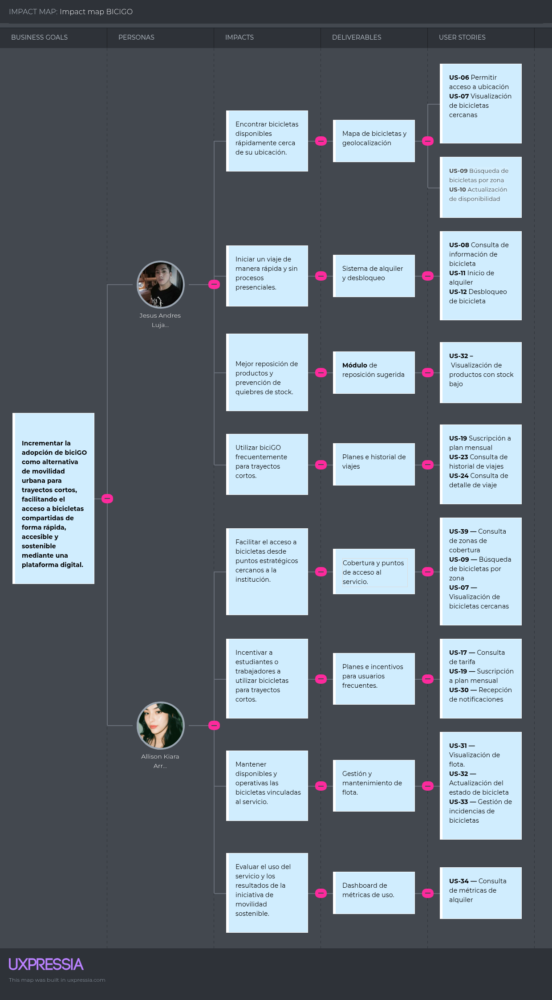
</p>

## 3.3. Product Backlog

<table border="1" cellspacing="0" cellpadding="7" style="border-collapse: collapse; width: 100%; border: 2px solid black;">
  <tr>
    <th align="center"># Orden</th>
    <th align="center">User Story Id</th>
    <th align="center">Título</th>
    <th align="center">Descripción</th>
    <th align="center">Story Points<br>(1 / 2 / 3 / 5 / 8)</th>
  </tr>
  <tr>
    <td valign="top" align="center"><b>1</b></td>
    <td valign="top" align="center"><b>US-39</b></td>
    <td valign="top">Consulta de zonas de cobertura</td>
    <td valign="top">Como usuario , quiero consultar las zonas donde opera biciGO, para saber si el servicio está disponible en el lugar donde deseo utilizar una bicicleta.</td>
    <td valign="top" align="center"><b>3</b></td>
  </tr>
  <tr>
    <td valign="top" align="center"><b>2</b></td>
    <td valign="top" align="center"><b>US-07</b></td>
    <td valign="top">Visualización de bicicletas cercanas</td>
    <td valign="top">Como usuario registrado , quiero visualizar las bicicletas disponibles cerca de mi ubicación, para elegir una alternativa conveniente para mi viaje.</td>
    <td valign="top" align="center"><b>5</b></td>
  </tr>
  <tr>
    <td valign="top" align="center"><b>3</b></td>
    <td valign="top" align="center"><b>US-08</b></td>
    <td valign="top">Consulta de información de bicicleta</td>
    <td valign="top">Como usuario registrado , quiero consultar la información de una bicicleta, para verificar su disponibilidad y condición antes de alquilarla.</td>
    <td valign="top" align="center"><b>3</b></td>
  </tr>
  <tr>
    <td valign="top" align="center"><b>4</b></td>
    <td valign="top" align="center"><b>US-17</b></td>
    <td valign="top">Consulta de tarifa</td>
    <td valign="top">Como usuario registrado , quiero consultar la tarifa aplicable al alquiler, para conocer las condiciones de cobro antes de utilizar una bicicleta.</td>
    <td valign="top" align="center"><b>2</b></td>
  </tr>
  <tr>
    <td valign="top" align="center"><b>5</b></td>
    <td valign="top" align="center"><b>US-01</b></td>
    <td valign="top">Registro de usuario</td>
    <td valign="top">Como visitante , quiero registrarme en biciGO proporcionando mis datos personales y credenciales, para poder acceder a los servicios de alquiler de bicicletas.</td>
    <td valign="top" align="center"><b>3</b></td>
  </tr>
  <tr>
    <td valign="top" align="center"><b>6</b></td>
    <td valign="top" align="center"><b>US-02</b></td>
    <td valign="top">Inicio de sesión</td>
    <td valign="top">Como usuario registrado , quiero iniciar sesión con mis credenciales, para acceder de forma segura a las funcionalidades de biciGO.</td>
    <td valign="top" align="center"><b>3</b></td>
  </tr>
  <tr>
    <td valign="top" align="center"><b>7</b></td>
    <td valign="top" align="center"><b>US-11</b></td>
    <td valign="top">Inicio de alquiler</td>
    <td valign="top">Como usuario registrado , quiero iniciar el alquiler de una bicicleta disponible, para utilizarla durante mi desplazamiento.</td>
    <td valign="top" align="center"><b>5</b></td>
  </tr>
  <tr>
    <td valign="top" align="center"><b>8</b></td>
    <td valign="top" align="center"><b>US-12</b></td>
    <td valign="top">Desbloqueo de bicicleta</td>
    <td valign="top">Como usuario con un alquiler autorizado , quiero desbloquear la bicicleta mediante el mecanismo proporcionado por biciGO, para comenzar mi recorrido.</td>
    <td valign="top" align="center"><b>5</b></td>
  </tr>
  <tr>
    <td valign="top" align="center"><b>9</b></td>
    <td valign="top" align="center"><b>US-13</b></td>
    <td valign="top">Consulta del viaje activo</td>
    <td valign="top">Como usuario con un alquiler activo , quiero consultar la información de mi recorrido, para conocer el estado actual de mi viaje.</td>
    <td valign="top" align="center"><b>3</b></td>
  </tr>
  <tr>
    <td valign="top" align="center"><b>10</b></td>
    <td valign="top" align="center"><b>US-14</b></td>
    <td valign="top">Consulta de costo durante el viaje</td>
    <td valign="top">Como usuario con un alquiler activo , quiero consultar el costo acumulado del recorrido, para controlar cuánto estoy gastando mientras utilizo la bicicleta.</td>
    <td valign="top" align="center"><b>3</b></td>
  </tr>
  <tr>
    <td valign="top" align="center"><b>11</b></td>
    <td valign="top" align="center"><b>US-15</b></td>
    <td valign="top">Finalización de alquiler</td>
    <td valign="top">Como usuario con un alquiler activo , quiero finalizar correctamente mi alquiler, para detener el cobro y liberar la bicicleta para otros usuarios.</td>
    <td valign="top" align="center"><b>5</b></td>
  </tr>
  <tr>
    <td valign="top" align="center"><b>12</b></td>
    <td valign="top" align="center"><b>US-16</b></td>
    <td valign="top">Registro de método de pago</td>
    <td valign="top">Como usuario registrado , quiero registrar un método de pago, para poder pagar los servicios utilizados en biciGO.</td>
    <td valign="top" align="center"><b>5</b></td>
  </tr>
  <tr>
    <td valign="top" align="center"><b>13</b></td>
    <td valign="top" align="center"><b>US-18</b></td>
    <td valign="top">Pago del alquiler</td>
    <td valign="top">Como usuario , quiero pagar el importe generado por mi alquiler, para completar correctamente la transacción del servicio utilizado.</td>
    <td valign="top" align="center"><b>5</b></td>
  </tr>
  <tr>
    <td valign="top" align="center"><b>14</b></td>
    <td valign="top" align="center"><b>US-37</b></td>
    <td valign="top">Consulta de comprobantes de pago</td>
    <td valign="top">Como usuario registrado , quiero consultar los comprobantes de mis pagos realizados, para revisar los cargos asociados a mis alquileres y suscripciones.</td>
    <td valign="top" align="center"><b>2</b></td>
  </tr>
  <tr>
    <td valign="top" align="center"><b>15</b></td>
    <td valign="top" align="center"><b>US-06</b></td>
    <td valign="top">Permitir acceso a ubicación</td>
    <td valign="top">Como usuario registrado , quiero permitir que biciGO acceda a mi ubicación, para identificar bicicletas disponibles cercanas.</td>
    <td valign="top" align="center"><b>2</b></td>
  </tr>
  <tr>
    <td valign="top" align="center"><b>16</b></td>
    <td valign="top" align="center"><b>US-09</b></td>
    <td valign="top">Búsqueda de bicicletas por zona</td>
    <td valign="top">Como usuario registrado , quiero buscar bicicletas en una zona específica, para planificar un desplazamiento aunque no me encuentre actualmente en ese lugar.</td>
    <td valign="top" align="center"><b>3</b></td>
  </tr>
  <tr>
    <td valign="top" align="center"><b>17</b></td>
    <td valign="top" align="center"><b>US-10</b></td>
    <td valign="top">Actualización de disponibilidad</td>
    <td valign="top">Como usuario registrado , quiero actualizar la disponibilidad de bicicletas mostrada, para consultar información reciente antes de seleccionar una unidad.</td>
    <td valign="top" align="center"><b>3</b></td>
  </tr>
  <tr>
    <td valign="top" align="center"><b>18</b></td>
    <td valign="top" align="center"><b>US-23</b></td>
    <td valign="top">Consulta de historial de viajes</td>
    <td valign="top">Como usuario registrado , quiero consultar mis viajes anteriores, para revisar el uso que he realizado de biciGO.</td>
    <td valign="top" align="center"><b>3</b></td>
  </tr>
  <tr>
    <td valign="top" align="center"><b>19</b></td>
    <td valign="top" align="center"><b>US-24</b></td>
    <td valign="top">Consulta de detalle de viaje</td>
    <td valign="top">Como usuario registrado , quiero consultar el detalle de un viaje realizado, para conocer su duración, distancia y costo final.</td>
    <td valign="top" align="center"><b>3</b></td>
  </tr>
  <tr>
    <td valign="top" align="center"><b>20</b></td>
    <td valign="top" align="center"><b>US-26</b></td>
    <td valign="top">Reporte de bicicleta dañada</td>
    <td valign="top">Como usuario , quiero reportar una bicicleta que presente daños, para evitar que otros usuarios utilicen una unidad potencialmente insegura.</td>
    <td valign="top" align="center"><b>3</b></td>
  </tr>
  <tr>
    <td valign="top" align="center"><b>21</b></td>
    <td valign="top" align="center"><b>US-27</b></td>
    <td valign="top">Reporte de problema durante un viaje</td>
    <td valign="top">Como usuario con un alquiler activo , quiero reportar un problema ocurrido durante mi recorrido, para recibir asistencia y dejar constancia del incidente.</td>
    <td valign="top" align="center"><b>3</b></td>
  </tr>
  <tr>
    <td valign="top" align="center"><b>22</b></td>
    <td valign="top" align="center"><b>US-28</b></td>
    <td valign="top">Contacto con soporte</td>
    <td valign="top">Como usuario , quiero comunicarme con soporte desde la plataforma, para obtener ayuda ante problemas relacionados con mi cuenta o alquileres.</td>
    <td valign="top" align="center"><b>3</b></td>
  </tr>
  <tr>
    <td valign="top" align="center"><b>23</b></td>
    <td valign="top" align="center"><b>US-29</b></td>
    <td valign="top">Seguimiento de incidencias</td>
    <td valign="top">Como usuario , quiero consultar el estado de mis incidencias reportadas, para conocer si están pendientes, en revisión o resueltas.</td>
    <td valign="top" align="center"><b>3</b></td>
  </tr>
  <tr>
    <td valign="top" align="center"><b>24</b></td>
    <td valign="top" align="center"><b>US-30</b></td>
    <td valign="top">Recepción de notificaciones</td>
    <td valign="top">Como usuario , quiero recibir notificaciones relacionadas con mis alquileres, pagos e incidencias, para mantenerme informado sobre eventos importantes de mi cuenta.</td>
    <td valign="top" align="center"><b>3</b></td>
  </tr>
  <tr>
    <td valign="top" align="center"><b>25</b></td>
    <td valign="top" align="center"><b>US-19</b></td>
    <td valign="top">Suscripción a plan mensual</td>
    <td valign="top">Como usuario frecuente , quiero contratar un plan mensual de biciGO, para acceder a condiciones de uso más convenientes.</td>
    <td valign="top" align="center"><b>5</b></td>
  </tr>
  <tr>
    <td valign="top" align="center"><b>26</b></td>
    <td valign="top" align="center"><b>US-20</b></td>
    <td valign="top">Cancelación de suscripción</td>
    <td valign="top">Como usuario suscrito , quiero cancelar mi suscripción mensual, para evitar futuras renovaciones cuando ya no desee utilizar el plan.</td>
    <td valign="top" align="center"><b>3</b></td>
  </tr>
  <tr>
    <td valign="top" align="center"><b>27</b></td>
    <td valign="top" align="center"><b>US-38</b></td>
    <td valign="top">Configuración de notificaciones</td>
    <td valign="top">Como usuario registrado , quiero configurar qué notificaciones deseo recibir, para controlar los avisos enviados por biciGO.</td>
    <td valign="top" align="center"><b>2</b></td>
  </tr>
  <tr>
    <td valign="top" align="center"><b>28</b></td>
    <td valign="top" align="center"><b>US-21</b></td>
    <td valign="top">Consulta de perfil</td>
    <td valign="top">Como usuario registrado , quiero consultar la información de mi perfil, para verificar los datos asociados a mi cuenta.</td>
    <td valign="top" align="center"><b>2</b></td>
  </tr>
  <tr>
    <td valign="top" align="center"><b>29</b></td>
    <td valign="top" align="center"><b>US-22</b></td>
    <td valign="top">Edición de perfil</td>
    <td valign="top">Como usuario registrado , quiero modificar mis datos personales, para mantener actualizada la información de mi cuenta.</td>
    <td valign="top" align="center"><b>3</b></td>
  </tr>
  <tr>
    <td valign="top" align="center"><b>30</b></td>
    <td valign="top" align="center"><b>US-25</b></td>
    <td valign="top">Cambio de contraseña</td>
    <td valign="top">Como usuario registrado , quiero cambiar mi contraseña desde mi perfil, para mantener segura mi cuenta.</td>
    <td valign="top" align="center"><b>3</b></td>
  </tr>
  <tr>
    <td valign="top" align="center"><b>31</b></td>
    <td valign="top" align="center"><b>US-36</b></td>
    <td valign="top">Eliminación de método de pago</td>
    <td valign="top">Como usuario registrado , quiero eliminar un método de pago que ya no utilizo, para mantener actualizadas mis opciones de cobro.</td>
    <td valign="top" align="center"><b>2</b></td>
  </tr>
  <tr>
    <td valign="top" align="center"><b>32</b></td>
    <td valign="top" align="center"><b>US-40</b></td>
    <td valign="top">Desactivación de cuenta</td>
    <td valign="top">Como usuario registrado , quiero desactivar mi cuenta cuando ya no desee utilizar biciGO, para dejar de acceder a los servicios de la plataforma.</td>
    <td valign="top" align="center"><b>3</b></td>
  </tr>
  <tr>
    <td valign="top" align="center"><b>33</b></td>
    <td valign="top" align="center"><b>US-31</b></td>
    <td valign="top">Visualización de flota</td>
    <td valign="top">Como administrador , quiero consultar el estado de las bicicletas de la plataforma, para supervisar la disponibilidad general de la flota.</td>
    <td valign="top" align="center"><b>5</b></td>
  </tr>
  <tr>
    <td valign="top" align="center"><b>34</b></td>
    <td valign="top" align="center"><b>US-32</b></td>
    <td valign="top">Actualización del estado de bicicleta</td>
    <td valign="top">Como administrador , quiero modificar el estado operativo de una bicicleta, para controlar qué unidades pueden ser alquiladas por los usuarios.</td>
    <td valign="top" align="center"><b>3</b></td>
  </tr>
  <tr>
    <td valign="top" align="center"><b>35</b></td>
    <td valign="top" align="center"><b>US-33</b></td>
    <td valign="top">Gestión de incidencias de bicicletas</td>
    <td valign="top">Como administrador , quiero revisar los reportes relacionados con bicicletas dañadas, para priorizar su mantenimiento y mantener segura la flota.</td>
    <td valign="top" align="center"><b>5</b></td>
  </tr>
  <tr>
    <td valign="top" align="center"><b>36</b></td>
    <td valign="top" align="center"><b>US-34</b></td>
    <td valign="top">Consulta de métricas de alquiler</td>
    <td valign="top">Como administrador , quiero visualizar métricas de uso de las bicicletas, para analizar el comportamiento del servicio y apoyar decisiones operativas.</td>
    <td valign="top" align="center"><b>5</b></td>
  </tr>
  <tr>
    <td valign="top" align="center"><b>37</b></td>
    <td valign="top" align="center"><b>US-35</b></td>
    <td valign="top">Gestión de usuarios</td>
    <td valign="top">Como administrador , quiero consultar y gestionar las cuentas de los usuarios, para atender situaciones que puedan afectar la seguridad o el correcto funcionamiento de biciGO.</td>
    <td valign="top" align="center"><b>5</b></td>
  </tr>
  <tr>
    <td valign="top" align="center"><b>38</b></td>
    <td valign="top" align="center"><b>US-03</b></td>
    <td valign="top">Recuperación de contraseña</td>
    <td valign="top">Como usuario registrado , quiero recuperar el acceso a mi cuenta cuando olvide mi contraseña, para poder continuar utilizando biciGO.</td>
    <td valign="top" align="center"><b>3</b></td>
  </tr>
  <tr>
    <td valign="top" align="center"><b>39</b></td>
    <td valign="top" align="center"><b>US-04</b></td>
    <td valign="top">Verificación de cuenta</td>
    <td valign="top">Como usuario recién registrado , quiero verificar mi cuenta, para confirmar mis datos y habilitar el acceso completo a los servicios de biciGO.</td>
    <td valign="top" align="center"><b>3</b></td>
  </tr>
  <tr>
    <td valign="top" align="center"><b>40</b></td>
    <td valign="top" align="center"><b>US-05</b></td>
    <td valign="top">Cierre de sesión</td>
    <td valign="top">Como usuario autenticado , quiero cerrar mi sesión, para evitar que otras personas accedan a mi cuenta desde el mismo dispositivo.</td>
    <td valign="top" align="center"><b>1</b></td>
  </tr>
  <tr>
    <td valign="top" align="center"><b>41</b></td>
    <td valign="top" align="center"><b>TS-05</b></td>
    <td valign="top">Get Nearby Bikes</td>
    <td valign="top">Como desarrollador , quiero implementar la consulta de bicicletas cercanas, para mostrar al usuario las unidades disponibles según su ubicación.</td>
    <td valign="top" align="center"><b>5</b></td>
  </tr>
  <tr>
    <td valign="top" align="center"><b>42</b></td>
    <td valign="top" align="center"><b>TS-06</b></td>
    <td valign="top">Get Bike Detail</td>
    <td valign="top">Como desarrollador , quiero implementar el detalle de una bicicleta, para exponer su estado y datos necesarios antes de iniciar un alquiler.</td>
    <td valign="top" align="center"><b>3</b></td>
  </tr>
  <tr>
    <td valign="top" align="center"><b>43</b></td>
    <td valign="top" align="center"><b>TS-07</b></td>
    <td valign="top">Search Coverage Zone</td>
    <td valign="top">Como desarrollador , quiero implementar la consulta de zonas de cobertura, para indicar si biciGO opera en una ubicación determinada.</td>
    <td valign="top" align="center"><b>3</b></td>
  </tr>
  <tr>
    <td valign="top" align="center"><b>44</b></td>
    <td valign="top" align="center"><b>TS-01</b></td>
    <td valign="top">Register Passenger</td>
    <td valign="top">Como desarrollador , quiero implementar el endpoint de registro de usuario, para permitir la creación de cuentas en la plataforma.</td>
    <td valign="top" align="center"><b>5</b></td>
  </tr>
  <tr>
    <td valign="top" align="center"><b>45</b></td>
    <td valign="top" align="center"><b>TS-02</b></td>
    <td valign="top">Login User</td>
    <td valign="top">Como desarrollador , quiero implementar el endpoint de inicio de sesión, para autenticar usuarios y permitir el acceso seguro a las funciones privadas.</td>
    <td valign="top" align="center"><b>5</b></td>
  </tr>
  <tr>
    <td valign="top" align="center"><b>46</b></td>
    <td valign="top" align="center"><b>TS-08</b></td>
    <td valign="top">Start Rental</td>
    <td valign="top">Como desarrollador , quiero implementar el endpoint para iniciar un alquiler, para asociar una bicicleta disponible con un usuario autenticado.</td>
    <td valign="top" align="center"><b>8</b></td>
  </tr>
  <tr>
    <td valign="top" align="center"><b>47</b></td>
    <td valign="top" align="center"><b>TS-09</b></td>
    <td valign="top">Unlock Bike</td>
    <td valign="top">Como desarrollador , quiero implementar la validación del código de desbloqueo, para autorizar únicamente la apertura de la bicicleta asociada al alquiler vigente.</td>
    <td valign="top" align="center"><b>5</b></td>
  </tr>
  <tr>
    <td valign="top" align="center"><b>48</b></td>
    <td valign="top" align="center"><b>TS-10</b></td>
    <td valign="top">Get Active Rental</td>
    <td valign="top">Como desarrollador , quiero implementar la consulta del alquiler activo, para mostrar al usuario la información actual de su viaje.</td>
    <td valign="top" align="center"><b>3</b></td>
  </tr>
  <tr>
    <td valign="top" align="center"><b>49</b></td>
    <td valign="top" align="center"><b>TS-11</b></td>
    <td valign="top">Finish Rental</td>
    <td valign="top">Como desarrollador , quiero implementar el endpoint de finalización de alquiler, para cerrar el viaje, calcular el importe y liberar la bicicleta.</td>
    <td valign="top" align="center"><b>8</b></td>
  </tr>
  <tr>
    <td valign="top" align="center"><b>50</b></td>
    <td valign="top" align="center"><b>TS-12</b></td>
    <td valign="top">Register Payment Method</td>
    <td valign="top">Como desarrollador , quiero implementar el registro de métodos de pago, para permitir que los usuarios dispongan de una opción válida para realizar cobros.</td>
    <td valign="top" align="center"><b>5</b></td>
  </tr>
  <tr>
    <td valign="top" align="center"><b>51</b></td>
    <td valign="top" align="center"><b>TS-13</b></td>
    <td valign="top">Process Rental Payment</td>
    <td valign="top">Como desarrollador , quiero implementar el procesamiento del pago de un alquiler, para registrar el cobro correspondiente al servicio utilizado.</td>
    <td valign="top" align="center"><b>8</b></td>
  </tr>
  <tr>
    <td valign="top" align="center"><b>52</b></td>
    <td valign="top" align="center"><b>TS-14</b></td>
    <td valign="top">Manage Subscription</td>
    <td valign="top">Como desarrollador , quiero implementar la gestión de suscripciones, para permitir activar y cancelar planes mensuales de biciGO.</td>
    <td valign="top" align="center"><b>5</b></td>
  </tr>
  <tr>
    <td valign="top" align="center"><b>53</b></td>
    <td valign="top" align="center"><b>TS-15</b></td>
    <td valign="top">Get User Profile</td>
    <td valign="top">Como desarrollador , quiero implementar la consulta y actualización del perfil, para permitir que cada usuario gestione sus datos personales.</td>
    <td valign="top" align="center"><b>5</b></td>
  </tr>
  <tr>
    <td valign="top" align="center"><b>54</b></td>
    <td valign="top" align="center"><b>TS-16</b></td>
    <td valign="top">Get Travel History</td>
    <td valign="top">Como desarrollador , quiero implementar la consulta del historial de viajes, para mostrar únicamente los alquileres pertenecientes al usuario autenticado.</td>
    <td valign="top" align="center"><b>3</b></td>
  </tr>
  <tr>
    <td valign="top" align="center"><b>55</b></td>
    <td valign="top" align="center"><b>TS-17</b></td>
    <td valign="top">Create Incident</td>
    <td valign="top">Como desarrollador , quiero implementar el registro de incidencias, para almacenar reportes relacionados con bicicletas y viajes.</td>
    <td valign="top" align="center"><b>5</b></td>
  </tr>
  <tr>
    <td valign="top" align="center"><b>56</b></td>
    <td valign="top" align="center"><b>TS-18</b></td>
    <td valign="top">Get Incident Status</td>
    <td valign="top">Como desarrollador , quiero implementar la consulta del estado de incidencias, para que el usuario pueda dar seguimiento a sus reportes.</td>
    <td valign="top" align="center"><b>3</b></td>
  </tr>
  <tr>
    <td valign="top" align="center"><b>57</b></td>
    <td valign="top" align="center"><b>TS-19</b></td>
    <td valign="top">Manage Bike Status</td>
    <td valign="top">Como desarrollador , quiero implementar endpoints administrativos para actualizar el estado de las bicicletas, para controlar disponibilidad y mantenimiento de la flota.</td>
    <td valign="top" align="center"><b>5</b></td>
  </tr>
  <tr>
    <td valign="top" align="center"><b>58</b></td>
    <td valign="top" align="center"><b>TS-20</b></td>
    <td valign="top">Get Dashboard Metrics</td>
    <td valign="top">Como desarrollador , quiero implementar las consultas del dashboard administrativo, para obtener métricas de alquileres, usuarios y disponibilidad de bicicletas.</td>
    <td valign="top" align="center"><b>5</b></td>
  </tr>
  <tr>
    <td valign="top" align="center"><b>59</b></td>
    <td valign="top" align="center"><b>TS-03</b></td>
    <td valign="top">Recover Password</td>
    <td valign="top">Como desarrollador , quiero implementar el proceso de recuperación de contraseña, para que un usuario pueda restablecer sus credenciales de forma segura.</td>
    <td valign="top" align="center"><b>5</b></td>
  </tr>
  <tr>
    <td valign="top" align="center"><b>60</b></td>
    <td valign="top" align="center"><b>TS-04</b></td>
    <td valign="top">Verify Account</td>
    <td valign="top">Como desarrollador , quiero implementar la verificación de cuenta, para habilitar únicamente usuarios que hayan completado correctamente el proceso de validación.</td>
    <td valign="top" align="center"><b>3</b></td>
  </tr>
</table>


# CAPÍTULO IV: PRODUCT DESIGN

## 4.1. Style Guidelines

### 4.1.1. General Style Guidelines

La guía de estilos de biciGO establece los criterios visuales y comunicacionales que se aplicarán en la landing page, la aplicación web de los usuarios y el dashboard administrativo. Su objetivo es mantener una experiencia consistente, accesible y fácil de utilizar en los distintos dispositivos. Las decisiones se relacionan con la propuesta de valor del proyecto: ofrecer una alternativa de movilidad urbana práctica, flexible y sostenible para recorridos cortos en Lima.

#### Branding

La identidad de biciGO se construye alrededor de los conceptos de movimiento, rapidez, sostenibilidad y accesibilidad. El isotipo representa una persona desplazándose en bicicleta y las líneas horizontales comunican velocidad y continuidad del recorrido. El logotipo combina una palabra de apariencia cercana y moderna con un recurso visual que destaca la letra "GO", reforzando la idea de iniciar un viaje.

El lema de la marca es **"Muévete. Vive. Lima."**. Esta frase relaciona el uso de la bicicleta con una experiencia cotidiana de movilidad y con el contexto urbano en el que funcionará el servicio. La marca utilizará una versión principal del logotipo sobre fondos claros y una versión de alto contraste para fondos oscuros.


Figura 1: Logotipo e isotipo de biciGO.

El logotipo debe conservar un área libre alrededor para evitar que otros elementos compitan visualmente con él. No se debe deformar, rotar, cambiar sus colores principales ni colocarlo sobre fondos que dificulten su lectura.

#### Tipografía

Se utilizará una combinación de dos familias tipográficas sans serif. Esta decisión favorece la lectura en dispositivos móviles y permite diferenciar los títulos del contenido operativo de la plataforma.

- **Tipografía primaria: Poppins.** Se utilizará en el logotipo de apoyo, títulos, encabezados y llamados principales. Sus formas geométricas y redondeadas transmiten dinamismo, modernidad y cercanía, características relacionadas con la movilidad urbana.
- **Tipografía secundaria: Inter.** Se utilizará en párrafos, etiquetas, formularios, tablas, mensajes del sistema y botones. Está pensada para conservar una buena legibilidad en tamaños pequeños y en pantallas de distintas dimensiones.

Los pesos definidos son: **Poppins SemiBold y Bold** para títulos; **Inter Regular** para párrafos; e **Inter Medium y SemiBold** para etiquetas, botones y datos destacados.

| Elemento | Tipografía | Peso | Tamaño referencial |
|---|---|---|---:|
| Título principal H1 | Poppins | Bold | 32 px |
| Título de sección H2 | Poppins | SemiBold | 24 px |
| Subtítulo H3 | Poppins | SemiBold | 20 px |
| Texto principal | Inter | Regular | 16 px |
| Texto secundario | Inter | Regular | 14 px |
| Botones y etiquetas | Inter | SemiBold | 14-16 px |


Figura 2: Muestra tipográfica de la familia Poppins aplicada a encabezados y textos destacados.


Figura 3: Muestra tipográfica de la familia Inter aplicada a textos, botones y etiquetas de interfaz.

La selección tipográfica busca equilibrar personalidad visual y legibilidad. Poppins aporta una sensación moderna y dinámica, ideal para encabezados y llamados de atención, mientras que Inter mantiene claridad, estructura y lectura cómoda en párrafos, formularios y botones.

#### Paleta de colores

La paleta se inspira en los colores presentes en el logotipo de biciGO. El verde representa movilidad sostenible, crecimiento y energía; el gris grafito comunica estabilidad, seguridad y legibilidad; y los tonos neutros permiten que la información sea clara en la interfaz.

| Rol | Color | Código | Uso |
|---|---|---|---|
| Primary Brand | Verde biciGO | `#7BC617` | Marca, enlaces y elementos destacados |
| Primary Dark | Verde oscuro | `#4F850D` | Estados activos y contraste del color de marca |
| Neutral Dark | Grafito | `#263238` | Texto principal, navegación y encabezados |
| Neutral Medium | Gris | `#607078` | Texto secundario e íconos informativos |
| Neutral Light | Gris muy claro | `#F3F6F1` | Fondos secundarios y superficies |
| Neutral White | Blanco | `#FFFFFF` | Fondo principal y contenido |
| Warning | Amarillo | `#E6A817` | Advertencias, mantenimiento y pagos pendientes |
| Error | Rojo | `#C93C3C` | Errores, cancelaciones y reportes críticos |
| Success | Verde de confirmación | `#2E8B57` | Viajes iniciados, pagos y acciones completadas |

El verde biciGO se utilizará para reforzar la identidad, pero no será el único recurso para comunicar estados. Los mensajes de éxito, advertencia y error también incluirán texto o íconos para que la información sea comprensible para personas con dificultades para distinguir colores. En la lámina de colores se deben presentar los nombres, códigos hexadecimales y ejemplos de uso de cada muestra.

#### Principios de diseño

Las decisiones visuales se basan en los siguientes principios:

- **Claridad:** las acciones principales, como buscar, alquilar y finalizar un viaje, deben identificarse rápidamente.
- **Consistencia:** los mismos colores, tipografías, íconos y patrones de interacción deben mantenerse en todas las vistas.
- **Eficiencia:** el usuario debe poder encontrar una bicicleta e iniciar un alquiler con la menor cantidad posible de pasos.
- **Accesibilidad:** los textos, controles y contrastes deben ser legibles en diferentes tamaños de pantalla.
- **Retroalimentación:** cada acción debe mostrar un estado claro de carga, éxito, error o confirmación.
- **Confianza:** los pagos, tiempos de alquiler, tarifas y datos del viaje deben mostrarse de manera visible y comprensible.

#### Spacing y dimensiones

Se utilizará una escala de espaciado basada en múltiplos de 4 y 8 píxeles para mantener un ritmo visual uniforme.

| Token | Valor | Uso |
|---|---:|---|
| `space-xs` | 4 px | Separación entre íconos y texto |
| `space-sm` | 8 px | Separación entre elementos relacionados |
| `space-md` | 16 px | Espaciado interno de controles |
| `space-lg` | 24 px | Separación entre componentes |
| `space-xl` | 32 px | Separación entre bloques de contenido |
| `space-2xl` | 48 px | Separación entre secciones principales |

Los botones y campos de formulario tendrán una altura mínima de 44 px para facilitar la interacción táctil. Los bordes redondeados serán de 8 px como máximo, con el fin de conservar una apariencia moderna sin perder claridad visual. Para la lámina de spacing se deben ilustrar los valores de 4, 8, 16, 24, 32 y 48 px.

#### Tono de comunicación

El tono de biciGO será **casual, respetuoso, claro y entusiasta**, sin utilizar un lenguaje excesivamente técnico. La comunicación será dinámica en promociones y mensajes de bienvenida, pero directa y serena en situaciones relacionadas con pagos, seguridad, accidentes o errores.

| Dimensión | Decisión de biciGO |
|---|---|
| Divertido / Serio | Dinámico, pero responsable |
| Formal / Casual | Casual y profesional |
| Respetuoso / Irreverente | Respetuoso e inclusivo |
| Entusiasta / Sereno | Entusiasta en acciones y sereno en alertas |

Ejemplos de textos de interfaz son: **"Buscar bicicleta"**, **"Iniciar alquiler"**, **"Tu viaje está activo"**, **"Viaje finalizado correctamente"** y **"No pudimos iniciar el alquiler. Intenta nuevamente."**. Los mensajes deben indicar qué ocurrió y cuál es el siguiente paso disponible para el usuario.

### 4.1.2. Web Style Guidelines

Las reglas web aplican la identidad de biciGO a interfaces responsive. La prioridad será la experiencia móvil, ya que el usuario probablemente consultará el mapa, escaneará un código QR o finalizará un alquiler mientras se encuentra desplazándose por la ciudad.

#### Grid System

En móvil se utilizará una sola columna con márgenes laterales de 16 px para priorizar la lectura y la interacción táctil. En escritorio se empleará un sistema de **12 columnas**, con un gutter de **24 px** y un ancho máximo de contenido de aproximadamente **1200 px**. El contenido debe conservar alineaciones consistentes entre encabezados, tarjetas, formularios y botones.

| Dispositivo | Ancho referencial | Estructura |
|---|---:|---|
| Móvil | Menor a 768 px | Una columna y navegación compacta |
| Escritorio | Desde 1024 px | Grid de 12 columnas y contenido centrado |

#### Navegación

La navegación de la landing page de biciGO estará orientada a la conversión y a la comprensión del servicio. Su estructura principal será simple, clara y enfocada en comunicar valor al usuario de forma directa. En escritorio se utilizará una barra superior con el logotipo, enlaces de navegación y un botón principal para **"Alquilar bicicleta"**. En móvil se utilizará una navegación compacta con opciones esenciales y acceso directo a la acción principal.

La estructura sugerida de navegación es la siguiente: **Inicio**, **¿Cómo funciona?**, **Beneficios**, **Tarifas**, **FAQ** y **Contacto**. Este enfoque evita saturar la página con elementos operativos y prioriza la intención comercial de la landing page: explicar la propuesta de valor y motivar la acción de registro o alquiler.

#### Componentes y estados de interacción

Los componentes deben conservar el estilo definido en la guía general. Se considerarán botones primarios, secundarios y de peligro; campos de formulario; tarjetas de bicicletas; marcadores de mapa; modales de confirmación; alertas; indicadores de disponibilidad; y tarjetas de resumen del viaje.

Cada componente interactivo debe contemplar los estados **normal, hover, focus, deshabilitado, cargando, éxito y error**. El estado de focus tendrá un borde visible para facilitar la navegación mediante teclado. Los botones y controles táctiles tendrán un área mínima de 44 por 44 px.


## 4.2. Information Architecture

### 4.2.1. Organization Systems

### 4.2.2. Labeling Systems

### 4.2.3. SEO Tags and Meta Tags

### 4.2.4. Searching Systems
El sistema incorpora mecanismos de búsqueda que permiten acceder rápidamente a información específica:

- **Búsqueda por:**
    - Codigo QR de bicicleta
    - ID de bicicleta.
    - Ubicacion del BikePoint
    - ID del viaje
    - ID del incidente

- **Filtros avanzados:**
    - Estado de bicicleta (disponible, en uso, en mantenimiento, no disponible)
    - Nombre del BikePoint
    - Fecha del viaje (dia, semana, mes)
    - Fecha del incidente

### 4.2.5. Navigation Systems
La navegación del sistema está diseñada para ser clara, eficiente y orientada a las necesidades del usuario:

- **Menú principal:**
  - Dashboard
  - Mapa
  - Mis viajes
  - Incidentes
  - Pagos y suscripciones

- **Navegación por flujo:**
  - Seguimiento de la bicicleta en base a su estado, ya sea si se encuentra disponible, en uso, en mantenimiento o no disponible por fallas.  

- **Navegación contextual:**
  - Acceso a información detallada desde dashboards.

- **Elementos de apoyo:**
  - Breadcrumbs (ej: Dashboard > Bicicletas > Bicicleta)  
  - Botones de acceso rápido
  - Indicadores de estado de las bicicletas

Asimismo, el sistema permite al usuario desplazarse facilmente entre las funcionalidades de alquiler y uso de bicicletas.

## 4.3. Landing Page UI Design
### 4.3.1. Landing Page Wireframe
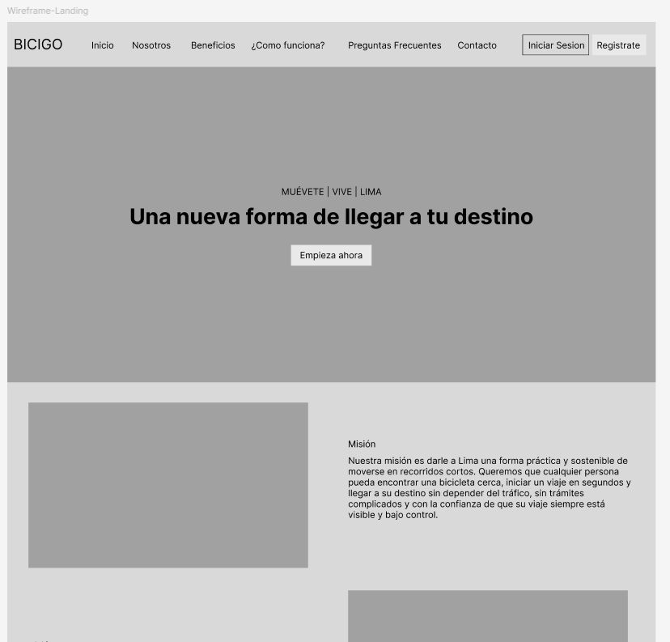

**Para ver el Wireframe completo dar click aqui:** https://www.figma.com/design/3nqdv1dpncuL6cV2shloZk/BiciGo_Landing_Page_Wireframe_-_Mockups?node-id=0-1&t=yX2veXVTfTuGFtXk-1

### 4.3.2. Landing Page Mock-up
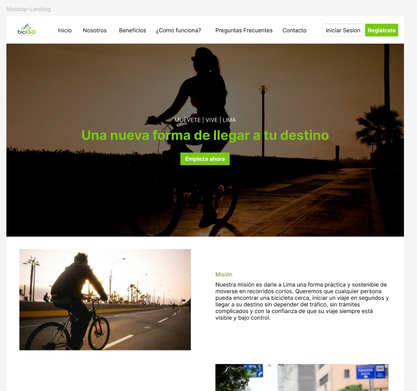

**Para ver el Mockup completo dar click aqui:** https://www.figma.com/design/3nqdv1dpncuL6cV2shloZk/BiciGo_Landing_Page_Wireframe_-_Mockups?node-id=0-1&t=yX2veXVTfTuGFtXk-1
## 4.4. Web Applications UX/UI Design

### 4.4.1. Web Applications Wireframes

Los siguientes wireframes muestran la estructura base de la interfaz web de biciGO en sus principales flujos de uso: acceso, registro, visualización del mapa, alquiler de bicicletas, historial de viajes, pagos, suscripciones y administración del servicio. Estos bocetos permiten validar la organización visual, la jerarquía de la información y la lógica de navegación antes de pasar a la etapa de prototipado y diseño final.

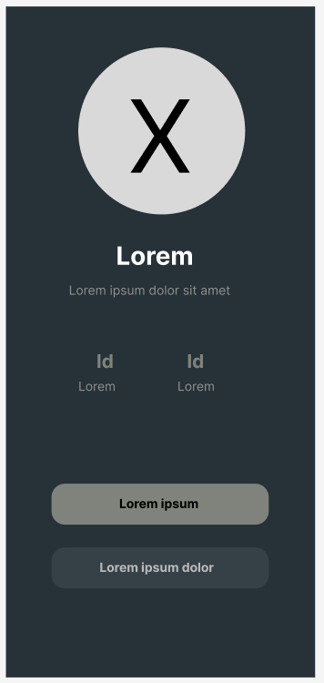

Figura 1: Wireframe de inicio de sesión y acceso a la aplicación.

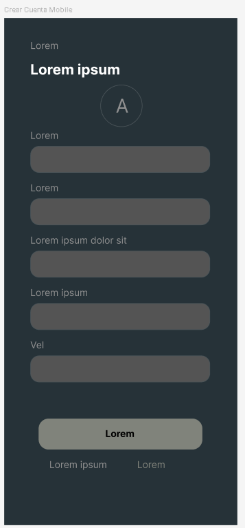

Figura 2: Wireframe de registro de usuario y creación de cuenta.

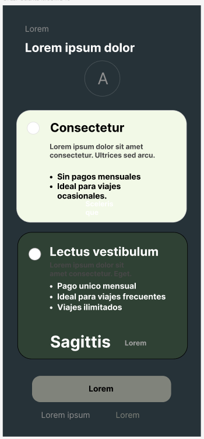

Figura 3: Wireframe de onboarding y bienvenida inicial del usuario.

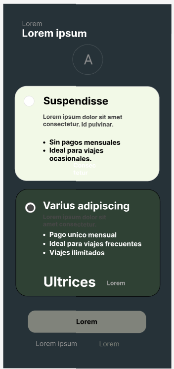

Figura 4: Wireframe de mapa principal con bicicletas disponibles.

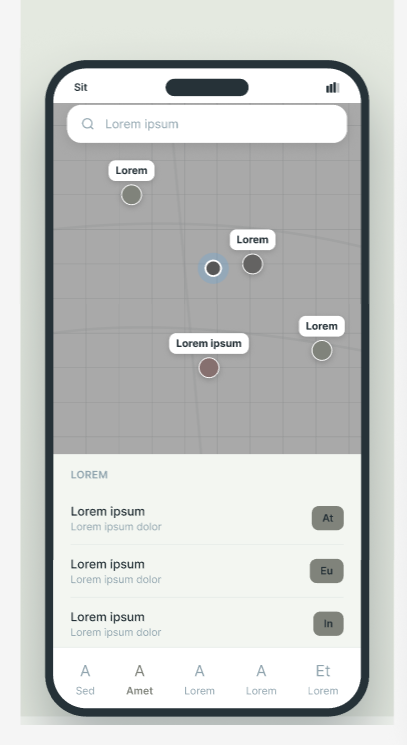

Figura 5: Wireframe de detalle de una bicicleta y confirmación de reserva.

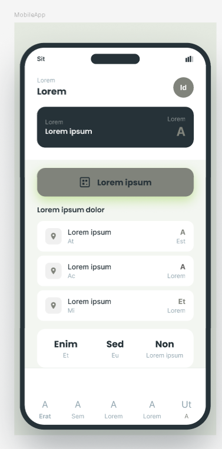

Figura 6: Wireframe del flujo de inicio del alquiler.

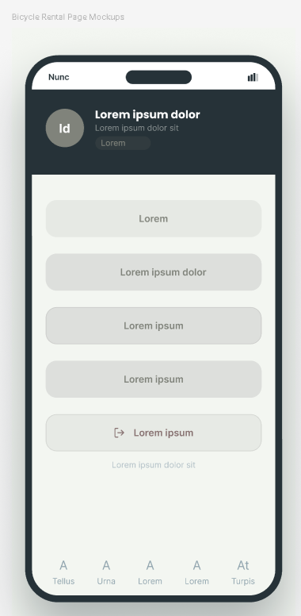

Figura 7: Wireframe de viaje activo con seguimiento del recorrido.

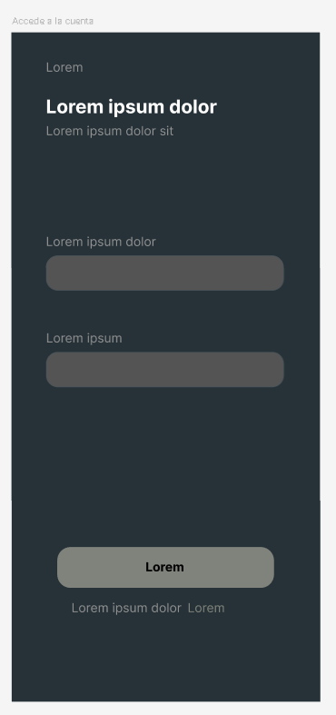

Figura 8: Wireframe de finalización del viaje y resumen del costo.

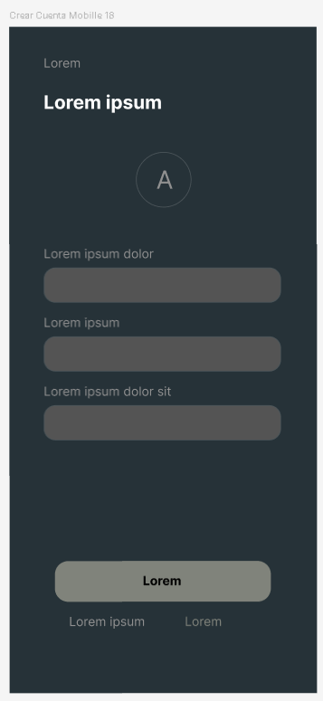

Figura 9: Wireframe del historial de viajes realizados por el usuario.

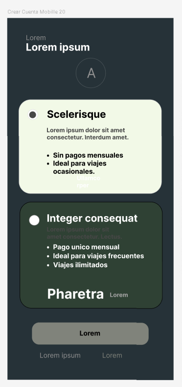

Figura 10: Wireframe de gestión de pagos y métodos de cobro.

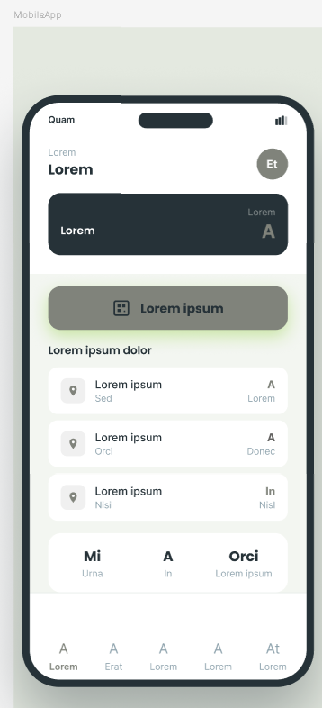

Figura 11: Wireframe de suscripciones y planes disponibles.

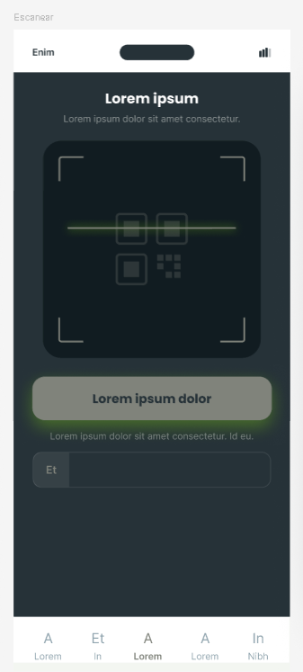

Figura 12: Wireframe de perfil del usuario y configuración de cuenta.

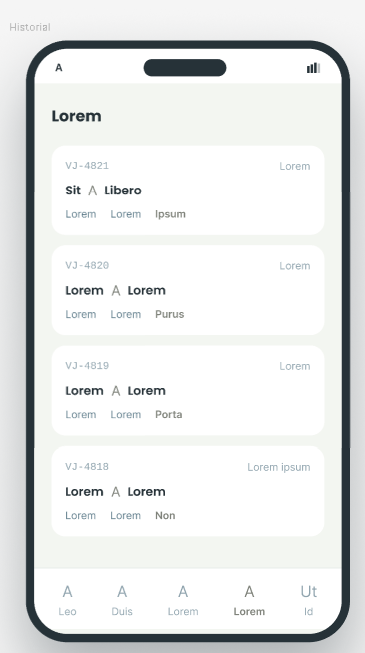

Figura 13: Wireframe del dashboard administrativo para gestión de bicicletas y viajes.

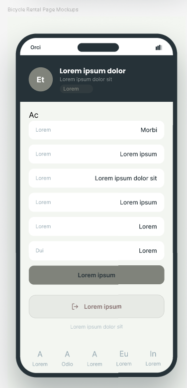

Figura 14: Wireframe de incidencias, mantenimiento y control operativo del sistema.


### 4.4.2. Web Applications Mock-ups

Estas maquetas visuales representan la experiencia principal del producto BiciGo en dispositivos móviles y web. Permiten validar la lógica de navegación del usuario, la claridad de la información y la consistencia visual con la guía de estilos definida en la sección anterior. En conjunto, los mockups muestran cómo el usuario accede, se registra, visualiza bicicletas disponibles, inicia un viaje, revisa su estado de cuenta y gestiona servicios adicionales como la suscripción o el cambio de plan.

#### Acceso y autenticación


Figura 5: Mockup de inicio de sesión para usuarios móviles.

**Análisis:** La vista de acceso prioriza la simplicidad y la rapidez para un usuario que necesita entrar al sistema en movimiento. El uso de una composición limpia, campos mínimos y un llamado a la acción visible refuerza la intención de uso móvil. La interfaz evita saturar la pantalla y permite una lectura rápida del flujo de autenticación, lo cual es coherente con el contexto urbano y la necesidad de interacción ágil.


Figura 6: Mockup de acceso a la cuenta con enfoque en la validación de identidad del usuario.

**Análisis:** Esta propuesta comunica la confianza y la seguridad del proceso de ingreso. La estructura del formulario y la disposición de la información favorecen la comprensión del usuario, reduciendo la incertidumbre asociada a la autenticación. Además, destaca la relación entre la acción de acceso y la experiencia de servicio continuo, sugeriendo una plataforma disponible en cualquier momento.

#### Registro de usuario y onboarding


Figura 7: Secuencia de registro y onboarding para usuario nuevo.

**Análisis:** El conjunto de pantallas muestra un flujo guiado, con pasos claramente separados para completar la creación de la cuenta. Esto ayuda a disminuir la fricción en la primera interacción con la aplicación, especialmente cuando el usuario se registra por primera vez. La progresión visual sugiere un proceso ordenado, intuitivo y enfocado en la captación de información esencial sin sobrecargar la pantalla.

#### Mapa, localización y alquiler de bicicletas


Figura 8: Mockup del mapa de bicicletas disponibles para el usuario.

**Análisis:** El mapa es el componente principal dentro del flujo de uso de la aplicación, ya que permite ubicar bicicletas en tiempo real y decidir rápidamente el punto de retirada. La distribución de la información en una vista geográfica favorece la toma de decisiones inmediatas; además, el uso de marcadores y estados visuales permite distinguir de forma intuitiva la disponibilidad de cada vehículo. Este tipo de diseño responde directamente a la necesidad de rapidez de un usuario en movimiento.


Figura 9: Propuestas de interfaz del proceso de alquiler de bicicletas.

**Análisis:** Estas pantallas presentan la experiencia del ciclo de alquiler con un enfoque en la claridad del recorrido, desde la búsqueda de la bicicleta hasta la confirmación de la acción. El diseño prioriza elementos funcionales como el estado de la bicicleta, la ruta, la tarifa y la validación del viaje. La consistencia visual entre pantallas refuerza la identidad de marca y reduce la necesidad de aprendizaje por parte del usuario.

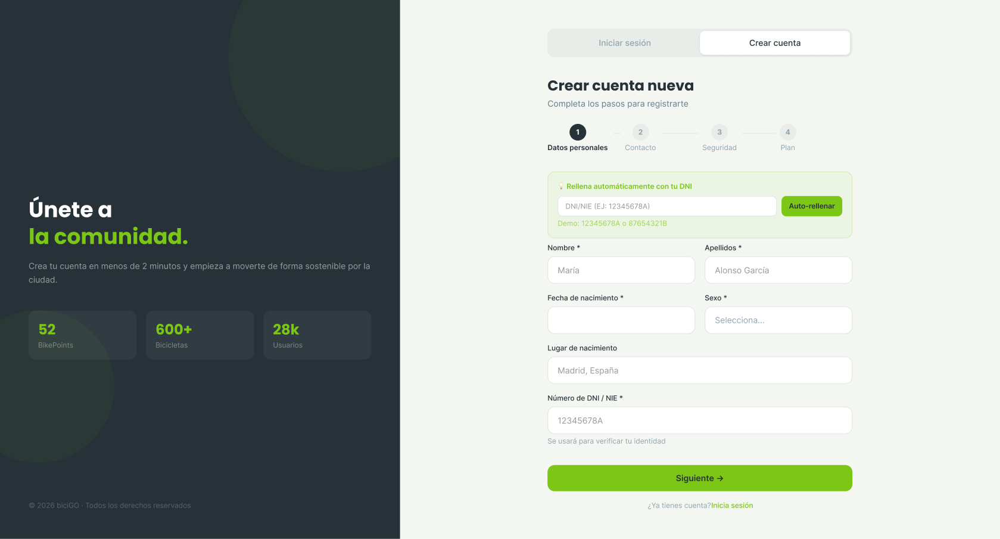

Figura 10: Compact view de la aplicación en entorno móvil.

**Análisis:** La composición de esta maqueta evidencia una estrategia de interfaz enfocada en la ergonomía táctil y la resolución de tareas rápidas. La organización visual favorece la interacción con una sola mano, un aspecto clave para aplicaciones de movilidad urbana. Además, el cromatismo y la jerarquía tipográfica ayudan a distinguir información principal y secundaria, mejorando la comprensión del flujo principal.

#### Dashboard del usuario y gestión de cuenta


Figura 11: Variantes del dashboard del usuario.

**Análisis:** El dashboard presenta un panorama general del rendimiento del servicio y de la actividad personal del usuario. Los elementos visuales principales, como indicadores de viajes, análisis de uso y acceso a funciones clave, sugieren una experiencia funcional y orientada a la gestión. La organización modular permite que el usuario identifique rápidamente su historial, estados de viaje y opciones relevantes sin perder contexto dentro de la aplicación.


Figura 12: Mockup de cambio de plan o suscripción del usuario.

**Análisis:** Esta vista refleja una funcionalidad de valor agregado dentro del producto: la posibilidad de adaptar el servicio según el comportamiento y las necesidades del cliente. La lógica visual de la pantalla enfatiza la comparación entre planes, la claridad en la elección y la comprensión de beneficios. Esto contribuye a mejorar la percepción de flexibilidad y personalización del servicio de movilidad.


## 4.6. Domain-Driven Software Architecture

### 4.6.1. Design-Level EventStorming

En esta sección se presenta el Design-Level EventStorming de biciGO, realizado con el fin de detallar y refinar el modelado del dominio identificado previamente. Durante la sesión, el equipo organizó eventos de dominio, comandos, políticas, agregados y bounded contexts relacionados con los principales procesos del sistema, como la gestión de usuarios, bicicletas, estaciones, disponibilidad, reservas, alquileres, pagos, mantenimiento y notificaciones. Este análisis permitió comprender mejor las responsabilidades de cada contexto y sus relaciones, sirviendo como base para el diseño de la arquitectura del software.

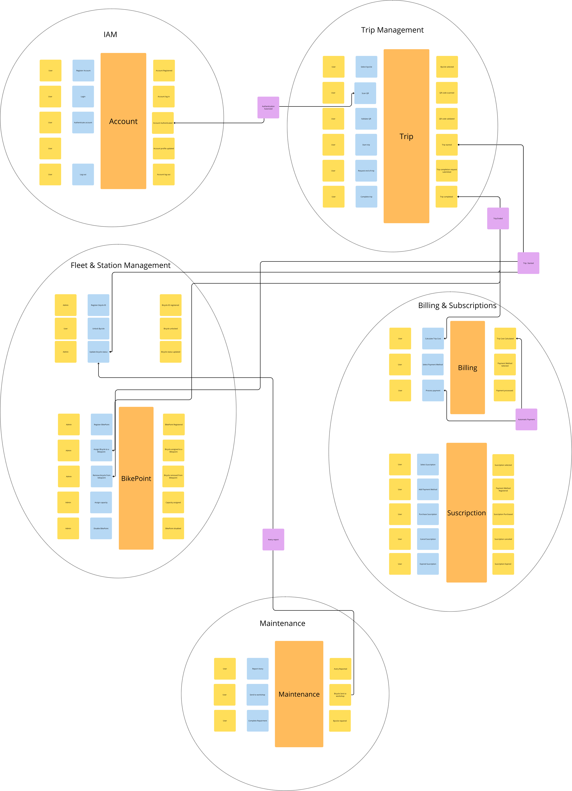

Figura 4: Design-Level EventStorming del dominio de biciGO.

### 4.6.2. Software Architecture Context Diagram

## Descripción

El diagrama de contexto de la arquitectura de software representa la interacción entre la **Plataforma Web de Alquiler de Bicicletas** y los principales actores y servicios externos que participan en su funcionamiento.

La plataforma permite a los usuarios registrarse, consultar bicicletas disponibles, seleccionar zonas de recogida y devolución, iniciar y finalizar viajes y consultar el historial de sus recorridos.

El sistema también contempla usuarios con una suscripción **Premium**, quienes pueden utilizar el servicio sin pagar la tarifa correspondiente al kilometraje durante la vigencia de dicha suscripción.

Además, la plataforma se comunica con servicios externos para obtener información de ubicación y distancia recorrida, así como para procesar las operaciones de pago.

---

## Actores y sistemas externos

### Usuario

El usuario interactúa directamente con la plataforma para:

- Registrarse e iniciar sesión.
- Consultar bicicletas disponibles.
- Consultar las zonas habilitadas.
- Seleccionar una bicicleta.
- Seleccionar una zona de recogida.
- Iniciar un viaje.
- Finalizar un viaje.
- Devolver la bicicleta.
- Consultar los kilómetros recorridos.
- Consultar el costo de sus viajes.
- Revisar el historial de viajes.

### Usuario Premium

El usuario Premium dispone de las mismas funcionalidades que un usuario regular, pero cuenta adicionalmente con los beneficios de una suscripción Premium.

Durante la vigencia de la suscripción:

- Puede realizar viajes normalmente.
- El sistema verifica su estado Premium al finalizar el viaje.
- No se aplica el cobro correspondiente al kilometraje recorrido.
- Puede gestionar y consultar el estado de su suscripción.

### Administrador

El administrador utiliza la plataforma para gestionar los principales elementos del servicio:

- Usuarios.
- Bicicletas.
- Zonas habilitadas.
- Puntos de recogida.
- Puntos de devolución.
- Viajes.
- Suscripciones Premium.

### Servicio de Geolocalización

El servicio de geolocalización es un sistema externo que proporciona información relacionada con la ubicación y la distancia recorrida.

La plataforma puede utilizar esta información para:

- Obtener la ubicación de las bicicletas.
- Registrar la ubicación durante un viaje.
- Determinar la distancia recorrida.
- Utilizar los kilómetros registrados para calcular la tarifa correspondiente.

### Pasarela de Pagos

La pasarela de pagos es un servicio externo encargado de procesar las operaciones económicas realizadas mediante la plataforma.

Puede utilizarse para:

- Procesar el pago de los viajes.
- Procesar el pago de las suscripciones Premium.
- Informar el resultado de una operación de pago.

---

## Sistema central

El sistema central corresponde a la:

**Plataforma Web de Alquiler de Bicicletas**

Esta plataforma concentra las funcionalidades principales del servicio y actúa como intermediario entre los usuarios, el administrador y los servicios externos.

Entre sus responsabilidades se encuentran:

- Gestión de usuarios.
- Gestión de bicicletas.
- Gestión de zonas.
- Gestión de viajes.
- Registro de kilómetros recorridos.
- Cálculo de tarifas.
- Gestión de suscripciones Premium.
- Procesamiento de solicitudes de pago.
- Integración con el servicio de geolocalización.

---

## Diagrama de Contexto

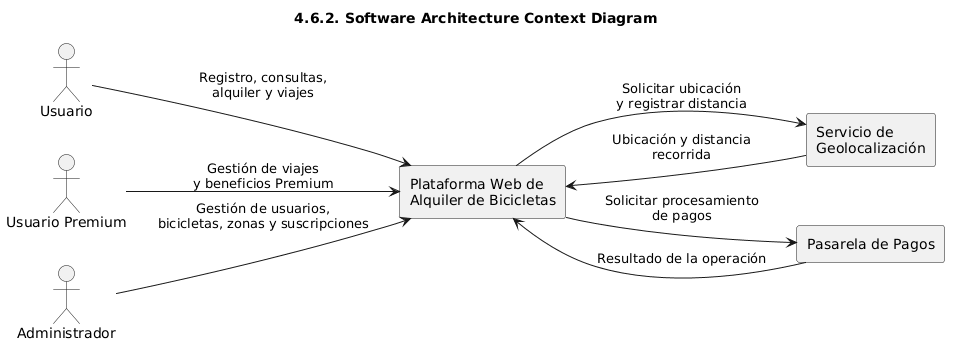

### 4.6.3. Software Architecture Container Diagrams
El diagrama de contenedores (L2) descompone BiciGo en sus bloques de alto nivel: la Landing Page (HTML5/CSS3/JS) que dirige a los usuarios hacia la aplicación, el Web Application que sirve los archivos estáticos y el Single Page Application (Vue 3 + PrimeVue) que provee todas las funcionalidades de la plataforma directamente en el navegador. El SPA se comunica con la API Application mediante llamadas REST, y depende de Html5Qrcode para el acceso a la cámara del dispositivo.

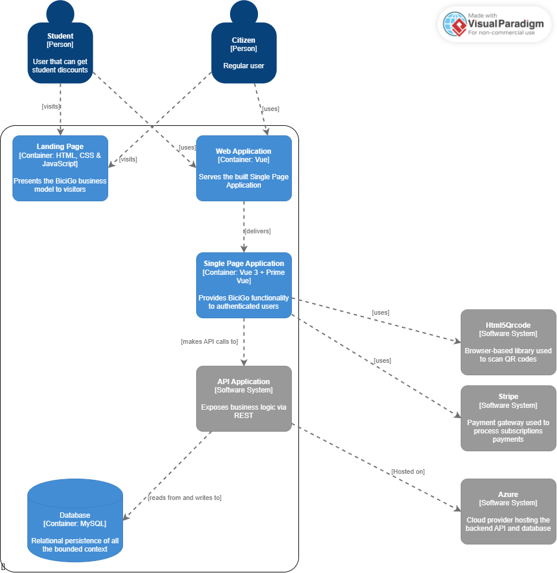


### 4.6.4. Software Architecture Components Diagrams

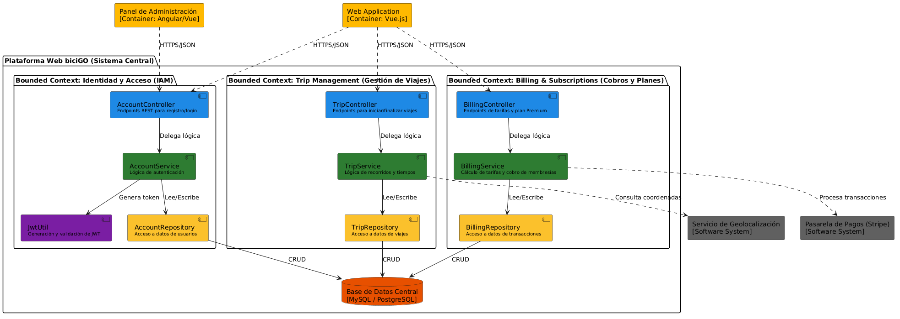

## 4.7. Software Object-Oriented Design

### 4.7.1. Class Diagrams
IAM

[iam](./Resources/chapter4/IAMSLA.png)

Trip managment
[trip](/Resources/chapter4/trip.png)

Fleet & Station Management
[fleet](./Resources/chapter4/fleet.png)

Billing
[billing](./Resources/chapter4/billing.png)

Maintance
[maintance](./Resources/chapter4/main.png)
## 4.8. Database Design
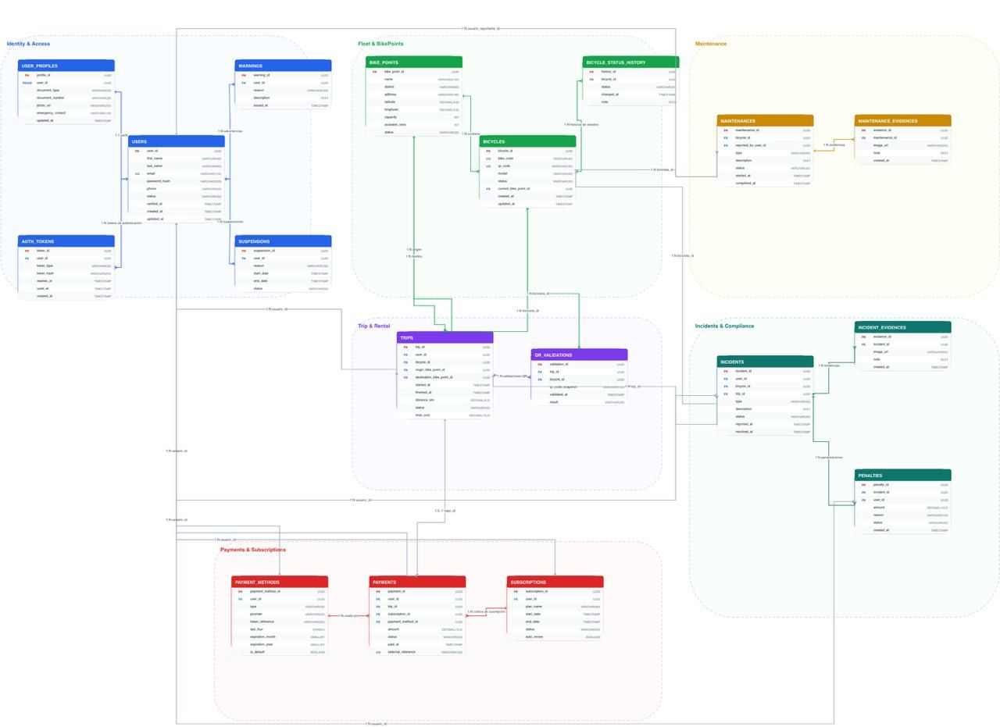
### 4.8.1. Database Diagrams


# CAPÍTULO V: Product Implementation, Validation & Deployment

## 5.1. Software Configuration Management

### 5.1.1. Software Development Environment Configuration

| Categoría | Herramienta | Propósito | Enlace |
|---|---|---|---|
| Diseño UX/UI | Figma | Elaboración de wireframes, mockups y prototipos utilizados para definir la interfaz y experiencia de usuario de biciGO. | [https://www.figma.com/design/FIUjx83bu9OhBxZ4EMqyfe/Sin-t%C3%ADtulo?node-id=0-1&t=2NPsUYYjUh7xKI3R-1](https://www.figma.com/design/FIUjx83bu9OhBxZ4EMqyfe/Sin-t%C3%ADtulo?node-id=0-1&t=2NPsUYYjUh7xKI3R-1) |
| Investigación UX | UXPressia | Herramienta utilizada para elaborar los User Personas de los segmentos objetivo de biciGO, permitiendo representar sus características, necesidades, frustraciones y objetivos. | [https://uxpressia.com/](https://uxpressia.com/) |
| Planeamiento del Producto | UXPressia | Herramienta utilizada para desarrollar el Impact Mapping de biciGO, relacionando el objetivo del negocio, actores, impactos esperados y entregables asociados. | [https://uxpressia.com/](https://uxpressia.com/) |
| Modelado de Base de Datos | Draw.io | Elaboración del diagrama de base de datos de biciGO, incluyendo entidades, atributos, claves y relaciones entre las tablas del sistema. | [https://drive.google.com/file/d/1frY_P-cg-4JuKiY2Jh8m85aaZD9V1CCT/view?usp=sharing](https://drive.google.com/file/d/1frY_P-cg-4JuKiY2Jh8m85aaZD9V1CCT/view?usp=sharing) |
| Modelado de Dominio | Canva | Desarrollo del Event Storming utilizado para identificar eventos, procesos y elementos principales del dominio de biciGO. | [https://canva.link/7coo689oj2nx3b7](https://canva.link/7coo689oj2nx3b7) |
| Desarrollo Web | GitHub Pages | Despliegue público de la Landing Page de biciGO. | [https://startup-chapa.github.io/Landing-Page/](https://startup-chapa.github.io/Landing-Page/) |
| Frontend Deployment | Firebase Hosting | Plataforma utilizada para publicar la Frontend Web Application de biciGO y proporcionar acceso mediante una URL pública. | [https://firebase.google.com/](https://firebase.google.com/) |
| Framework frontend | Vue 3 | Construcción de las interfaces reactivas y los componentes de la aplicación web. | https://vuejs.org/ |
| Bundler y entorno de desarrollo | Vite | Servidor local y generación de archivos optimizados de producción en `dist`. | https://vite.dev/ |
| Estado y navegación | Pinia y Vue Router | Estado compartido, navegación entre vistas y separación de rutas por módulo. | https://pinia.vuejs.org/ |
| Biblioteca de componentes | PrimeVue | Controles, formularios, tablas y componentes de interfaz usados en la SPA. | https://primevue.org/ |
| Internacionalización | Vue I18n | Recursos de idioma en español e inglés y actualización de textos de interfaz. | https://vue-i18n.intlify.dev/ |
| API simulada | JSON Server | Simulación local de recursos del frontend mientras se implementan los Web Services definitivos. | https://github.com/typicode/json-server |
| Entorno de Desarrollo | WebStorm | Entorno utilizado para editar y organizar los archivos del proyecto, trabajar con Git y desarrollar los componentes web de biciGO. | [https://www.jetbrains.com/webstorm/](https://www.jetbrains.com/webstorm/) |
| Control de Versiones | Git | Sistema utilizado para registrar cambios, trabajar mediante ramas y mantener el historial del proyecto. | [https://git-scm.com/](https://git-scm.com/) |
| Repositorio Remoto | GitHub | Plataforma utilizada para almacenar el proyecto y facilitar el trabajo colaborativo entre los integrantes. | [https://github.com/](https://github.com/) |
| Documentación | Markdown | Formato utilizado para redactar y mantener los capítulos del informe, tablas, enlaces, imágenes y demás documentación del proyecto bajo un enfoque Docs-as-Code. | [https://www.markdownguide.org/](https://www.markdownguide.org/) |
| Gestión Ágil | Trello | Herramienta utilizada para organizar el Sprint Backlog, distribuir tareas y dar seguimiento al avance del equipo durante el Sprint. | [https://trello.com/invite/b/6aac96a6ce176e2f9d496d31/ATTI96186798f26dde57c47e51ca96f0fff04FDD51DF/sprint-web-1](https://trello.com/invite/b/6aac96a6ce176e2f9d496d31/ATTI96186798f26dde57c47e51ca96f0fff04FDD51DF/sprint-web-1) |
| Gestión del Producto | Product Backlog | Permite organizar y priorizar las User Stories y Technical Stories que forman parte del desarrollo de biciGO. | [https://trello.com/invite/b/6aac96a6ce176e2f9d496d31/ATTI96186798f26dde57c47e51ca96f0fff04FDD51DF/sprint-web-1](https://trello.com/invite/b/6aac96a6ce176e2f9d496d31/ATTI96186798f26dde57c47e51ca96f0fff04FDD51DF/sprint-web-1) |

### 5.1.2. Source Code Management

El equipo de **BiciGO — Startup-Chapa** utiliza Git y GitHub para gestionar el código de la Landing Page, la Frontend Web Application y la documentación del proyecto. Los repositorios asociados son los siguientes:

| Solución | Repositorio | Enlace | Observación |
|---|---|---|---|
| Informe | `project-report` | https://github.com/Startup-Chapa/project-report | Documentación en Markdown y evidencias |
| Landing Page | `Landing-Page` | https://github.com/Startup-Chapa/Landing-Page | Sitio informativo publicado con GitHub Pages |
| Frontend Web Application | `frontend-bicigo` | https://github.com/Startup-Chapa/frontend-bicigo | SPA desarrollada con Vue 3 y Vite |
| Backend / Platform | `backend-bicigo` | https://github.com/Startup-Chapa/backend-bicigo | API REST por Bounded Contexts implementada en el Sprint 3 (.NET 10, EF Core y MySQL) |

El repositorio del frontend tiene `main` como rama principal y utiliza `develop` como rama de integración. El trabajo por funcionalidad se distribuye en ramas tales como `feature/iam`, `feature/trip-management`, `feature/billing-subscriptions`, `feature/fleet-station-management` y `feature/maintenance`. El repositorio también conserva una rama `feature/corrections`. La documentación de integración señala que se consolidaron archivos de los módulos sobre una base compartida; por tanto, no corresponde afirmar que todos los cambios se integraron exclusivamente mediante *merge* o Pull Requests.

El flujo se inspira en prácticas de GitFlow y utiliza, cuando corresponde, ramas de funcionalidad y revisión. Las ramas `release/*` y `hotfix/*` se consideran convenciones para versiones posteriores; **no se declara su uso efectivo en el Sprint 2** sin evidencia. Las confirmaciones de cambios procuran una convención comprensible, por ejemplo `feat(iam): add login view` o `feat: integrate BiciGO frontend modules`. Algunos commits existentes utilizan otra redacción y se conservan tal como figuran en el historial.

La aplicación se organiza por contextos funcionales y comparte en `src` el enrutador, el layout de navegación, Pinia e internacionalización. Para reproducir el entorno de integración local se siguen las instrucciones del [README del frontend](https://github.com/Startup-Chapa/frontend-bicigo/blob/develop/README.md), con una API simulada basada en JSON Server. Esta organización facilita las pruebas tempranas, aunque todavía no equivale a un despliegue integral con backend de producción.

**Evidencias de repositorios:**

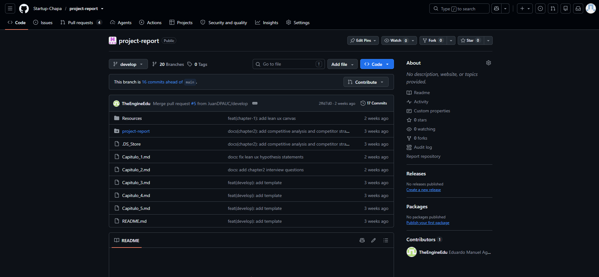

*Figura: repositorio de documentación del proyecto.*

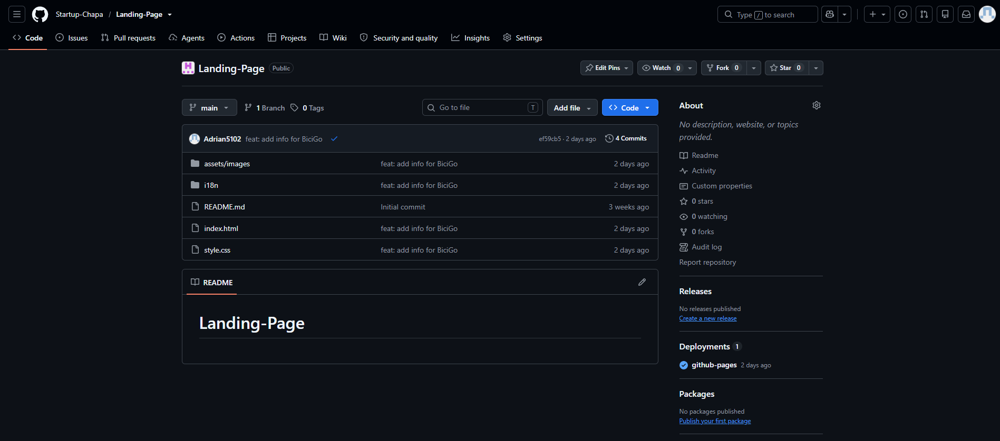

*Figura: repositorio de la Landing Page.*


*Figura: repositorio de la Frontend Web Application.*


*Figura: captura histórica asociada a plataforma; confirmar su repositorio y alcance antes de presentarla como backend implementado.*

### 5.1.3. Source Code Style Guide & Conventions

El equipo usa convenciones de organización y nomenclatura para mantener consistente el código de la aplicación Vue. Estas pautas se relacionan con la guía de estilos del Capítulo IV y con la arquitectura modular documentada en la sección 4.6.

| Aspecto | Convención aplicada o recomendada |
|---|---|
| Organización | Agrupar el código por Bounded Context: IAM, Fleet & Station Management, Trip Management, Billing & Subscriptions y Maintenance. |
| Capas | Separar, según el módulo, `domain`, `application`, `infrastructure` y `presentation`; utilizar servicios y componentes compartidos cuando corresponda. |
| Componentes | Utilizar componentes Vue de responsabilidad específica y mantener separadas vistas, rutas y lógica de estado. |
| Estado | Centralizar el estado compartido en Pinia; evitar duplicar sesiones y datos de usuario entre contextos. |
| Navegación | Declarar rutas en Vue Router y usar guardas de interfaz para la experiencia de demostración. La autorización definitiva deberá verificarse en el backend. |
| HTTP | Emplear el cliente HTTP compartido y una variable de entorno (`VITE_BICIGO_API_URL`) para configurar el origen de la API. |
| Internacionalización | Mantener textos en recursos `vue-i18n` y evitar cadenas duplicadas en las vistas. |
| Diseño | Aplicar la paleta, tipografías, espaciado y estados de interacción definidos en 4.1; considerar mobile y desktop. |
| Commits | Utilizar, de preferencia, mensajes descriptivos con prefijos como `feat`, `fix` y `docs` para registrar las modificaciones. |
| Verificación | Compilar con `npm run build` y ejecutar las pruebas documentadas. No atribuir herramientas de *lint* o pruebas automáticas que aún no estén configuradas. |

Las decisiones de implementación deben preservar la trazabilidad con las User Stories, los escenarios **Given–When–Then** del Capítulo III y las pantallas del Capítulo IV. Para considerar una funcionalidad terminada no basta con tener una vista: deben verificarse sus estados, validaciones, navegación y persistencia según el alcance acordado para el Sprint.

### 5.1.4. Software Deployment Configuration

La arquitectura **diseñada** en el Capítulo IV contempla una SPA, una API, mecanismos de persistencia y servicios externos de geolocalización y pagos. Sin embargo, el **incremento del Sprint 2** se ejecuta principalmente como frontend de demostración. Es necesario distinguir ambos niveles para no presentar componentes proyectados como funcionalidades productivas.

| Componente | Implementación comprobable o documentada para Sprint 2 | Alcance |
|---|---|---|
| Frontend SPA | Vue 3, Vite, PrimeVue, Pinia, Vue Router y `vue-i18n` | Interfaz, navegación y estados de los módulos |
| API de desarrollo | JSON Server, ejecutado con `npm run dev:api` | Datos locales de prueba; no es el backend REST productivo |
| Persistencia de Maintenance | `localStorage` en el modo de demostración | Reportes y cambios simulados que persisten en el navegador |
| Autenticación | Sesión simulada y usuarios de prueba | No constituye autenticación ni autorización de backend |
| Hosting del frontend | Firebase Hosting, según las capturas de despliegue del informe | Publicación de los archivos estáticos de Vite |
| Geolocalización y pagos reales | Servicios previstos en la arquitectura | Integración productiva no acreditada en Sprint 2 |

**Flujo de despliegue y ejecución.** En desarrollo, el navegador accede a Vite en `127.0.0.1:5173` y el frontend consume datos de JSON Server en `127.0.0.1:3000/api/v1`, además de determinados estados locales. En despliegue, Vite genera el directorio `dist`, que es publicado por Firebase Hosting. La publicación de los archivos estáticos no significa por sí sola que la API local quede expuesta en Internet.

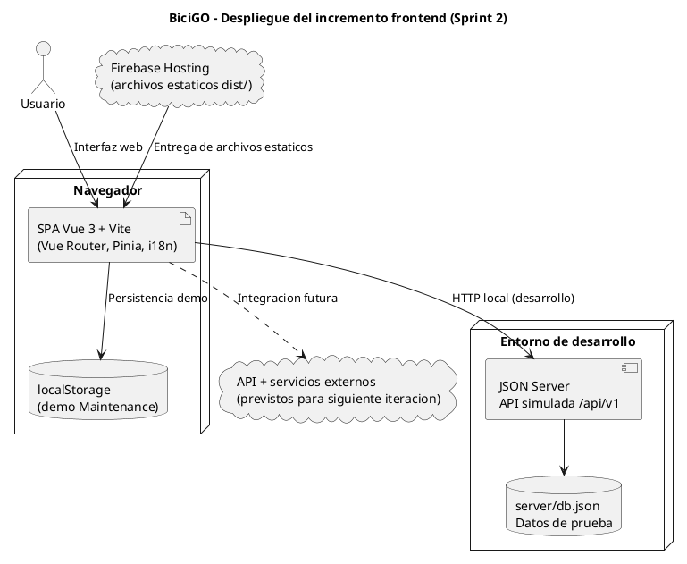

*Figura: vista lógica de la configuración de despliegue del Sprint 2. El nodo de API simulada es local y el nodo de servicios productivos es proyectado, no desplegado.*

**Consideración de seguridad y operación.** La SPA utiliza navegación basada en fragmentos (`createWebHashHistory`), que permite resolver rutas del cliente sin configurar reglas de reescritura en Firebase. Los permisos de vistas o roles simulados no reemplazan controles de autorización en los Web Services definitivos. Los flujos de cobro y de ubicación en tiempo real se dejarán pendientes hasta contar con servicios integrados y pruebas específicas.

## 5.2. Landing Page, Services & Applications Implementation

### 5.2.1. Sprint 1

El Sprint 1 corresponde a la primera entrega del proyecto (AV1 – Sprint Review) y tiene como alcance la implementación y el despliegue de la primera versión del **Landing Page** de BiciGO. El Landing Page presenta el modelo de negocio y el propósito de la plataforma a los visitantes de los segmentos objetivo (ciudadanos urbanos que realizan trayectos cortos e instituciones que desean promover el uso de la bicicleta), y es el punto de entrada hacia las aplicaciones. Los Web Services y las Frontend Web Applications se implementarán en los siguientes Sprints, según el cronograma de entregas del curso.

#### 5.2.1.1. Sprint Planning 1

La planificación del Sprint 1 organiza la primera versión de la Landing Page de biciGO, tomando como insumos el Lean UX Canvas, los segmentos objetivo, las User Personas, el wireframe, el mock-up y la guía de estilos. Se consideran las seis historias de usuario y la historia técnica identificadas en el Sprint Backlog 1.

**Base de planificación:** la fecha y la hora se proponen para completar el registro; los story points y la velocidad planificada son estimaciones de referencia, no mediciones históricas.

**Sprint Planning Background**

| Campo | Sprint 1 |
|---|---|
| Sprint # | Sprint 1 |
| Date | 07/09/2026 (propuesta) |
| Time | 20:00–21:00 (hora de Lima; propuesta) |
| Location | Reunión virtual |
| Prepared By | Aguirre Ramos, Eduardo Manuel |
| Attendees (to planning meeting) | Aguirre Ramos, Eduardo Manuel / Armestar Felipa, Adrian Andres / Ayllon Pauccar, Juan David / Franco del Carpio, José María / Velasquez Velasquez, Rodrigo |
| Sprint 0 Review Summary | No aplica: este es el primer Sprint. Como antecedentes se consideran los artefactos de investigación, requisitos y diseño de los Capítulos I al IV, además de los repositorios del informe y de la Landing Page. |
| Sprint 0 Retrospective Summary | No aplica: no hubo un Sprint anterior. Como acuerdos iniciales de planificación se propone distribuir tareas por sección, registrar avances en Trello y revisar los cambios antes de integrarlos. |

**Sprint Goal & User Stories**

| Campo | Sprint 1 |
|---|---|
| Sprint 1 Goal | *Our focus is on publishing the first deployed version of the BiciGO Landing Page, available in English and Latin American Spanish and responsive on mobile and desktop screens.*<br>*We believe it delivers a clear understanding of the service (mission, vision, benefits and how it works) and a direct way to get in touch with the team to urban citizens who make short trips and to institutions interested in promoting cycling.*<br>*This will be confirmed when the Landing Page is publicly reachable at its GitHub Pages URL, every section can be read on a 390 px and on a 1440 px wide screen without horizontal scrolling, and a visitor can switch the whole interface between English and Spanish.* |
| Selected User Stories | US-LP01: navegación y presentación principal; US-LP02: funcionamiento del servicio; US-LP03: beneficios y métricas; US-LP04: tarifas y planes; US-LP05: preguntas frecuentes; US-LP06: contacto y validación del formulario. |
| Selected Technical Stories | TS-LP01: configuración del repositorio, despliegue en GitHub Pages y revisión responsive. |
| Sprint 1 Velocity | 16 story points por sprint (velocidad planificada inicial, sin historial previo). |
| Sum of Story Points | 16 story points: 13 de historias de usuario y 3 de la historia técnica. |
| Task Estimation | 38 horas, correspondientes a las 16 microtareas del Sprint Backlog 1. |

**Distribución estimada de Story Points**

| Story Id | Story Title | Story Points |
|---|---|---:|
| US-LP01 | Navegación y presentación principal (Navbar & Hero) | 3 |
| US-LP02 | Explicación del funcionamiento del servicio | 2 |
| US-LP03 | Presentación de beneficios y métricas | 2 |
| US-LP04 | Comparación de tarifas y planes | 2 |
| US-LP05 | Consulta de preguntas frecuentes | 2 |
| US-LP06 | Formulario de contacto y validación | 2 |
| TS-LP01 | Despliegue y revisión responsive | 3 |
| **Total** | **6 User Stories y 1 Technical Story** | **16** |

Los puntos se asignan a cada historia una sola vez; sus microtareas conservan las estimaciones en horas del backlog. La velocidad real requiere validar las historias terminadas frente a sus criterios de aceptación. La internacionalización se mantiene como condición transversal del Sprint Goal y requiere reflejar su trabajo en las tareas de las historias correspondientes, ya que el backlog disponible no la desglosa como tarea independiente.

#### 5.2.1.2. Aspect Leaders and Collaborators

Para el Sprint 1 se identificaron seis aspectos dentro del alcance. La Leadership-and-Collaboration Matrix (LACX) indica, para cada aspecto, quién lidera y quiénes colaboran. La organización de líderes y colaboradores guarda relación con la selección de tareas del Sprint Backlog 1.

- **Landing Page Structure & Content (HTML):** estructura semántica de las secciones y redacción de los contenidos.
- **Visual Style & Responsive Design (CSS):** aplicación de la guía de estilos del Capítulo IV y diseño adaptable a móvil y escritorio.
- **Internationalization (i18n):** diccionarios en inglés y español, y selector de idioma.
- **Deployment (GitHub Pages):** publicación del Landing Page en un sitio público.
- **Landing Page UI Design (Figma):** wireframe y mock-up que guían la implementación.
- **Report Documentation:** redacción de las secciones del Capítulo V correspondientes al Sprint.

| Team Member (Last Name, First Name) | GitHub Username | Structure & Content (HTML) | Visual Style & Responsive (CSS) | Internationalization (i18n) | Deployment (GitHub Pages) | UI Design (Figma) | Report Documentation |
|---|---|:---:|:---:|:---:|:---:|:---:|:---:|
| Aguirre Ramos, Eduardo Manuel | TheEngineEdu | C | C | C | C | C | L |
| Armestar Felipa, Adrian Andres | Adrian5102 | L | L | L | L | L | C |
| Ayllon Pauccar, Juan David | JuanDPAUC | C | C | C | C | C | C |
| Franco del Carpio, José María | VoltTrd [POR CONFIRMAR] | C | C | C | C | C | C |
| Velasquez Velasquez, Rodrigo | Rodrigov233 | C | C | C | C | C | C |

*L = Leader, C = Collaborator.*

La asignación de líderes y colaboradores se definió a partir de la participación de cada integrante en los repositorios `Landing-Page` y `project-report`.

#### 5.2.1.3. Sprint Backlog 1

El objetivo principal del Sprint 1 es publicar la primera versión del Landing Page de BiciGO, en inglés y español y con diseño responsive, para presentar el modelo de negocio a los visitantes. El Sprint Backlog 1 se gestiona en un tablero de Trello con las columnas To-do, In-Process, To-Review y Done.

Las tareas se agrupan bajo seis historias específicas de la Landing Page (US-LP01 a US-LP06) y una historia técnica (TS-LP01), diferenciadas de las historias de la aplicación web. El backlog disponible contiene 16 microtareas de 2 a 3 horas cada una, con una estimación total de **38 horas**. La estimación de referencia de sus historias suma **16 story points**, como se detalla en Sprint Planning 1.

**Trello del AV1**

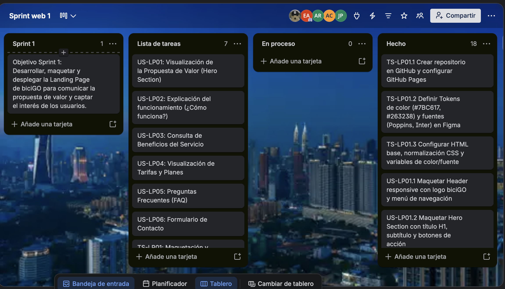

[https://trello.com/invite/b/6aac96a6ce176e2f9d496d31/ATTI96186798f26dde57c47e51ca96f0fff04FDD51DF/sprint-web-1](https://trello.com/invite/b/6aac96a6ce176e2f9d496d31/ATTI96186798f26dde57c47e51ca96f0fff04FDD51DF/sprint-web-1)

**Sprint #: Sprint 1**

| Epic / Story ID | Task ID | Título de la Microtarea | Descripción y Alcance Técnico | Estimación (Horas) | Asignado a | Estado |
| :--- | :--- | :--- | :--- | :---: | :--- | :---: |
| **US-LP01** | T-01.1 | `[US-LP01]` `[UI/UX]` Navbar & Hero Design | Diseñar el componente del Navbar con el isotipo biciGO y la sección Hero en Figma aplicando contraste de marca. | 2 h | Ayllon Pauccar, Juan David | Done |
| **US-LP01** | T-01.2 | `[US-LP01]` `[FRONT]` Navbar responsive layout | Maquetar el menú superior responsive con el logo de biciGO, enlaces de navegación y menú hamburguesa para móviles. | 3 h | Armestar Felipa, Adrian Andres | Done |
| **US-LP01** | T-01.3 | `[US-LP01]` `[FRONT]` Hero section CTA & Overlay | Construir el Hero Section con el título H1, subtítulo, imagen de fondo con overlay oscuro (#263238) y botones principales de acción (CTA). | 3 h | Armestar Felipa, Adrian Andres | Done |
| **US-LP02** | T-02.1 | `[US-LP02]` `[UI/UX]` "How it Works" Icons | Seleccionar y optimizar los 4 íconos SVG representativos del proceso (*Busca, Escanea, Muévete, Devuelve*). | 2 h | Velasquez Velasquez, Rodrigo | Done |
| **US-LP02** | T-02.2 | `[US-LP02]` `[FRONT]` "How it Works" 4-step grid | Maquetar el grid responsive de 4 pasos secuenciales aplicando la escala de espaciado `space-md` (16px) y textos explicativos. | 3 h | Ayllon Pauccar, Juan David | Done |
| **US-LP03** | T-03.1 | `[US-LP03]` `[FRONT]` Benefits cards layout | Maquetar las tarjetas de beneficios (Ahorro, Ecología, Rapidez) con bordes redondeados de 8px y sombras suaves. | 3 h | Velasquez Velasquez, Rodrigo | Done |
| **US-LP03** | T-03.2 | `[US-LP03]` `[FRONT]` Key metrics counter bar | Maquetar la barra de métricas destacadas (100+ estaciones, 500+ bicis, 100% ecofriendly) con números en Verde biciGO (#7BC617). | 2 h | Velasquez Velasquez, Rodrigo | Done |
| **US-LP04** | T-04.1 | `[US-LP04]` `[FRONT]` Pricing cards comparison | Maquetar la comparativa de tarifas (Pago por uso vs. Suscripción Pro) con la tabla de precios transparente. | 3 h | Franco Del Carpio, José María | Done |
| **US-LP04** | T-04.2 | `[US-LP04]` `[FRONT]` Pro plan highlight & CTA | Aplicar el estilo destacado (Fondo #263238, tag 'Recomendado' y botón #7BC617) a la tarjeta de suscripción mensual. | 2 h | Franco Del Carpio, José María | Done |
| **US-LP05** | T-05.1 | `[US-LP05]` `[FRONT]` FAQ accordion HTML/CSS | Maquetar la estructura de acordeón para las preguntas frecuentes sobre zonas de cobertura y métodos de pago. | 2 h | Armestar Felipa, Adrian Andres | Done |
| **US-LP05** | T-05.2 | `[US-LP05]` `[JS]` Accessible accordion logic | Implementar la interacción JavaScript para abrir/cerrar preguntas con soporte de teclado y atributos ARIA de accesibilidad. | 2 h | Armestar Felipa, Adrian Andres | Done |
| **US-LP06** | T-06.1 | `[US-LP06]` `[FRONT]` Contact form UI | Maquetar los campos del formulario (Nombre, Correo, Mensaje) asegurando una altura táctil mínima de 44px. | 2 h | Armestar Felipa, Adrian Andres | Done |
| **US-LP06** | T-06.2 | `[US-LP06]` `[JS]` Form validation & feedback | Implementar la validación básica de campos obligatorios e indicador de confirmación de envío en verde (#2E8B57). | 2 h | Armestar Felipa, Adrian Andres | Done |
| **TS-LP01** | T-07.1 | `[TS-LP01]` `[DEVOPS]` Git repo & GitHub Pages setup | Crear el repositorio en GitHub, configurar la rama `main` y habilitar el despliegue automático en GitHub Pages. | 2 h | Armestar Felipa, Adrian Andres | Done |
| **TS-LP01** | T-07.2 | `[TS-LP01]` `[DEVOPS]` Public URL & Domain check | Verificar el despliegue correcto de la URL pública (`https://startup-chapa.github.io/Landing-Page/`) y ruta de assets. | 2 h | Armestar Felipa, Adrian Andres | Done |
| **TS-LP01** | T-11.1 | `[TS-LP01]` `[QA]` Cross-device responsive test | Probar la adaptabilidad en resoluciones móviles (393x852px), tablets y monitores de escritorio (1200px max-width). | 3 h | Aguirre Ramos, Eduardo Manuel | Done |

#### 5.2.1.4. Development Evidence for Sprint Review

Durante el Sprint 1 se implementó la primera versión del Landing Page en el repositorio `Startup-Chapa/Landing-Page`: la estructura HTML, los estilos CSS responsive, los diccionarios de traducción en inglés y español y las imágenes de las secciones. En paralelo, en el repositorio `Startup-Chapa/project-report` se documentaron el wireframe y el mock-up del Landing Page (Capítulo IV) y la gestión del código fuente (Capítulo V), que sirvieron de base para la implementación. Los commits siguen la convención Conventional Commits descrita en la sección 5.1.2.

| Commit | Autor | Email | Fecha | Mensaje |
|---|---|---|---|---|
| `ef59cb5` | Adrian5102 | u202410084@upc.edu.pe | 2026-09-14 | feat: add info for BiciGo |
| `615a806` | Adrian5102 | u202410084@upc.edu.pe | 2026-09-14 | feat: add first version of Landing Page |
| `aeca1f3` | Adrian5102 | u202410084@upc.edu.pe | 2026-09-14 | feat: add index & css files |
| `ef218d4` | Eduardo Manuel Aguirre | enginedujob@gmail.com | 2026-08-30 | Initial commit |

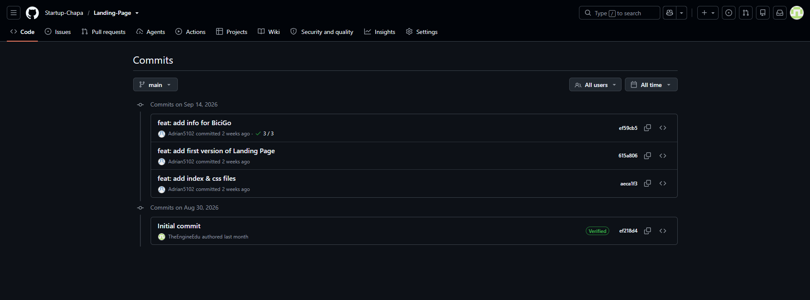

*Figura: historial de commits del repositorio Landing-Page en GitHub.*

#### 5.2.1.5. Execution Evidence for Sprint Review

El Landing Page de BiciGO está publicado y accesible en https://startup-chapa.github.io/Landing-Page/. La primera versión incluye las siguientes vistas:

- **Barra de navegación:** logotipo, enlaces a Home, About Us, Benefits, How does it work?, FAQs y Contact, selector de idioma EN/ES y botones Login y Sign Up.
- **Hero:** lema de la marca "MOVE | LIVE | LIMA", mensaje principal y botón de llamado a la acción *Get Started*.
- **Misión y visión:** textos de la propuesta de valor con fotografías de movilidad en Lima.
- **Beneficios:** seis tarjetas con los beneficios del servicio.
- **How does it work?:** explicación del recorrido del usuario, desde encontrar una bicicleta hasta finalizar el viaje.
- **Contacto:** formulario con nombre, teléfono, correo, tipo de usuario (estudiante, trabajador o ciudadano) y mensaje.
- **FAQs:** cinco preguntas frecuentes en formato acordeón, operables con el teclado.
- **Footer:** logotipo, íconos de redes sociales y aviso de derechos.

La interfaz está disponible en inglés (idioma por defecto) y en español latinoamericano, y se adapta a móvil y escritorio. En la verificación realizada, el ancho de la página coincide con el ancho de la pantalla tanto en 390 px como en 1440 px, es decir, sin desplazamiento horizontal.

**Vista de escritorio (1440 px)**

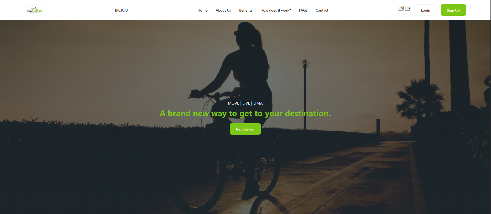

**Página completa en escritorio (1440 px)**

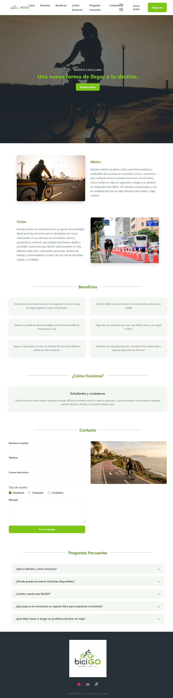

**Página completa en móvil (390 px)**


#### 5.2.1.6. Services Documentation Evidence for Sprint Review

En el Sprint 1 no se implementaron Web Services. El alcance de este Sprint se limitó al Landing Page, tal como establece la primera entrega del trabajo final, por lo que no existen endpoints documentados con OpenAPI ni commits de documentación de API en este Sprint.

Los endpoints que se implementarán en los siguientes Sprints están especificados como Technical Stories en el Capítulo III (por ejemplo, `GET /api/coverage` para la consulta de zonas de cobertura). Su documentación con OpenAPI (Swagger) se presentará en esta sección a partir del Sprint en que se implementen los Web Services.

#### 5.2.1.7. Software Deployment Evidence for Sprint Review

En el Sprint 1 se desplegó el Landing Page en **GitHub Pages**, directamente desde el repositorio `Startup-Chapa/Landing-Page`. Como el Landing Page es un sitio estático (HTML, CSS, JavaScript y archivos JSON), no requiere una etapa de compilación, y la publicación se realiza a partir del contenido de la rama `main`.

Los pasos realizados fueron los siguientes:

1. Se creó el repositorio `Landing-Page` en la organización Startup-Chapa de GitHub.
2. Se subieron a la rama `main` el archivo `index.html`, la hoja de estilos `style.css`, la carpeta `assets/images` y los diccionarios de la carpeta `i18n`.
3. En la configuración del repositorio (*Settings > Pages*) se habilitó GitHub Pages con la publicación desde la rama `main`.
4. GitHub ejecutó el flujo `pages build and deployment`, que finalizó correctamente el 14/09/2026 a las 23:42 (GMT-5), con una duración de 38 segundos, para el commit `ef59cb5`.
5. Se verificó el acceso público al sitio en https://startup-chapa.github.io/Landing-Page/.

| Producto | Plataforma | URL | Estado |
|---|---|---|---|
| Landing Page | GitHub Pages | https://startup-chapa.github.io/Landing-Page/ | Desplegado |
| Web Applications | Por definir (sección 5.1.4) | Sin desplegar en el Sprint 1 | No incluido en el alcance |
| Web Services | Por definir (sección 5.1.4) | Sin desplegar en el Sprint 1 | No incluido en el alcance |

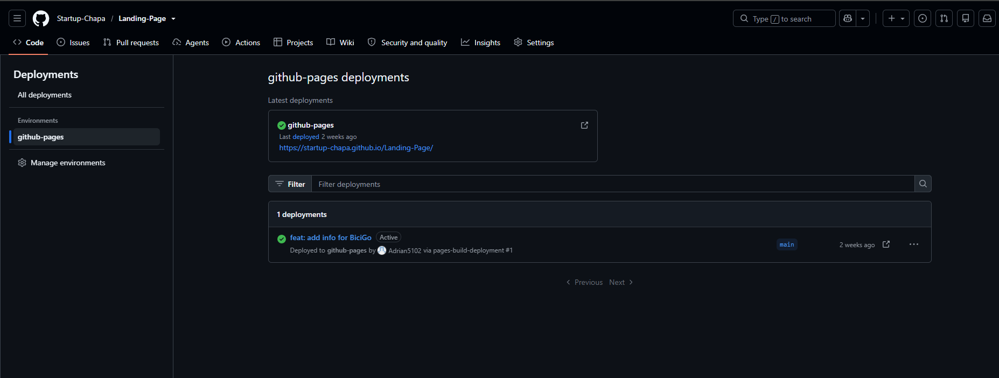

*Figura: ejecución del flujo pages build and deployment en GitHub Actions.*

#### 5.2.1.8. Team Collaboration Insights during Sprint

Las actividades del Sprint 1 se organizaron con el flujo GitFlow descrito en la sección 5.1.2: el trabajo del informe se realizó en ramas `feature/*` creadas a partir de `develop` e integradas mediante Pull Requests. La implementación del Landing Page se realizó en el repositorio `Landing-Page`. La siguiente tabla resume los commits de cada integrante, sin contar los commits de fusión (*merge*), en la rama `develop` al cierre de este informe.

| Integrante | Usuario de GitHub | Commits en Landing-Page | Commits en project-report |
|---|---|:---:|:---:|
| Aguirre Ramos, Eduardo Manuel | TheEngineEdu | 1 | 9 |
| Armestar Felipa, Adrian Andres | Adrian5102 | 3 | 18 |
| Ayllon Pauccar, Juan David | JuanDPAUC | 0 | 7 |
| Franco del Carpio, José María | VoltTrd | 0 | 1 |
| Velasquez Velasquez, Rodrigo | Rodrigov233 | 0 | 4 |

### 5.2.2. Sprint 2

El Sprint 2 corresponde al primer incremento integrado de la **Frontend Web Application de BiciGO**. Como referencia se utilizan el Product Backlog y los escenarios de aceptación actualizados del Capítulo III, la guía de estilos, los wireframes y mock-ups del Capítulo IV y las evidencias de código disponibles en el repositorio `Startup-Chapa/frontend-bicigo`.

El alcance real debe documentarse distinguiendo entre **interfaz integrada**, **flujo simulado** y **funcionalidad productiva**. Las pruebas locales con JSON Server o `localStorage` no demuestran por sí mismas una integración con el backend real.

#### 5.2.2.1. Sprint Planning 2

**Sprint Planning Background**

| Campo | Registro de Sprint 2 |
|---|---|
| Sprint # | Sprint 2 |
| Fecha de planificación | 28/09/2026, **fecha propuesta en el registro anterior; pendiente de confirmar** |
| Hora | 20:00–21:00, hora de Lima, **referencia propuesta** |
| Modalidad | Reunión virtual |
| Preparado por | Chapa Technologies / Startup-Chapa |
| Participantes | Aguirre Ramos, Eduardo Manuel; Armestar Felipa, Adrian Andres; Ayllon Pauccar, Juan David; Franco del Carpio, José María; Velasquez Velasquez, Rodrigo |
| Sprint 1 Review Summary | Se elaboró y publicó la primera versión de la Landing Page, con estructura responsive e internacionalización. |
| Sprint 1 Retrospective Summary | Se propuso mantener la asignación por responsables, actualizar el tablero y documentar mejor los commits y las evidencias individuales. Los acuerdos específicos deben validarse con el acta o tablero. |

**Sprint Goal & User Stories**

*Our focus is on integrating the first navigable version of the BiciGO Frontend Web Application using the user flows and interface guidelines defined in Chapters III and IV. We believe it delivers a coherent demonstration of account access, bicycle and station consultation, trip information, subscription plans and incident management to prospective users and operators. This will be confirmed when the integrated SPA can be executed, its main routes and validations can be demonstrated, and the team clearly documents which interactions use mock data or local persistence and which requirements remain pending.*

Las **15 User Stories** consignadas en el backlog anterior se mantienen como **selección originalmente planificada**, hasta que el equipo confirme formalmente si hubo cambios de alcance. La disponibilidad de un módulo integrado no demuestra automáticamente el cumplimiento de todos sus escenarios Given–When–Then.

| Indicador | Valor y criterio |
|---|---|
| Selected User Stories | IAM: US-01, US-02, US-03; Fleet: US-07, US-08, US-09; Trip: US-11, US-13, US-15; Billing: US-16, US-17, US-19; Maintenance: US-26, US-29, US-33. |
| Tareas transversales | T2-16 integración; T2-17 pruebas de interfaces y responsive; T2-18 publicación del frontend. |
| Suma de SP de la selección original con la línea base actualizada | **56 SP**, recalculados según las estimaciones actuales de **3.3 Product Backlog**; reemplazan la suma anterior de 30 SP, sin afirmar que sean velocidad real. |
| Estimación de tareas | **70 h**, correspondientes a 18 tareas; las horas son esfuerzo estimado y no una conversión de SP. |
| Velocidad real | **No determinada**: requiere el resultado de cada historia frente a sus criterios de aceptación y Definition of Done. |
| Alcance técnico | SPA Vue con integración de módulos y servicios de demostración. La API REST de producción permanece en una iteración posterior. |

**Correspondencia de estimaciones con el Capítulo III**

| Bounded Context | Story ID | Historia | SP del Product Backlog |
|---|---|---|---:|
| IAM | US-01 | Registro de usuario | 3 |
| IAM | US-02 | Inicio de sesión | 3 |
| IAM | US-03 | Recuperación de contraseña | 3 |
| Fleet & Station Management | US-07 | Visualización de bicicletas cercanas | 5 |
| Fleet & Station Management | US-08 | Consulta de información de bicicleta | 3 |
| Fleet & Station Management | US-09 | Búsqueda de bicicletas por zona | 3 |
| Trip Management | US-11 | Inicio de alquiler | 5 |
| Trip Management | US-13 | Consulta del viaje activo | 3 |
| Trip Management | US-15 | Finalización de alquiler | 5 |
| Billing & Subscriptions | US-16 | Registro de método de pago | 5 |
| Billing & Subscriptions | US-17 | Consulta de tarifa | 2 |
| Billing & Subscriptions | US-19 | Suscripción a plan mensual | 5 |
| Maintenance | US-26 | Reporte de bicicleta dañada | 3 |
| Maintenance | US-29 | Seguimiento de incidencias | 3 |
| Maintenance | US-33 | Gestión de incidencias de bicicletas | 5 |
| **Total** | **15 US** | **Selección originalmente planificada** | **56** |

**Observación de alcance.** Los módulos implementados también contienen vistas relacionadas con otras historias del Capítulo III, como consulta de perfil (US-21), historial de viajes (US-23), detalle de viaje (US-24) y administración de flota (US-31/US-32). Estas funcionalidades pueden mencionarse como evidencia adicional, **pero no se suman retroactivamente** a la velocidad del Sprint 2 sin una actualización aprobada del Sprint Backlog.

#### 5.2.2.2. Aspect Leaders and Collaborators

Para el Sprint 2 se organizó el desarrollo en cinco Bounded Contexts. Esta división facilita la identificación de responsables de implementación y permite integrar funcionalidades sobre una estructura de navegación compartida. Los Epics del Capítulo III no deben confundirse con los Bounded Contexts: un mismo contexto puede implementar historias pertenecientes a más de un Epic, como sucede con Maintenance (EP-06 y EP-07).

| Team Member | GitHub Username | IAM | Trip Management | Billing & Subscriptions | Fleet & Station Management | Maintenance |
|---|---|:---:|:---:|:---:|:---:|:---:|
| Armestar Felipa, Adrian Andres | Adrian5102 | L | C | C | C | C |
| Franco del Carpio, José María | VoltTrd | C | L | C | C | C |
| Ayllon Pauccar, Juan David | JuanDPAUC | C | C | L | C | C |
| Aguirre Ramos, Eduardo Manuel | TheEngineEdu | C | C | C | L | C |
| Velasquez Velasquez, Rodrigo | Rodrigov233 | C | C | C | C | L |

*L = Leader; C = Collaborator. Esta matriz refleja la asignación documentada y no constituye por sí misma un conteo de commits ni una validación del trabajo completado.*

#### 5.2.2.3. Sprint Backlog 2

El backlog organiza las tareas inicialmente asociadas a las 15 historias seleccionadas, más tres actividades transversales. El tablero de seguimiento se encuentra en [Trello — Sprint 2 Web Application](https://trello.com/invite/b/6ac5b1a35529b83a03b51a0b/ATTI93c275e0a7f8461177850a9425f1680415930B03/sprint-2-web-application).

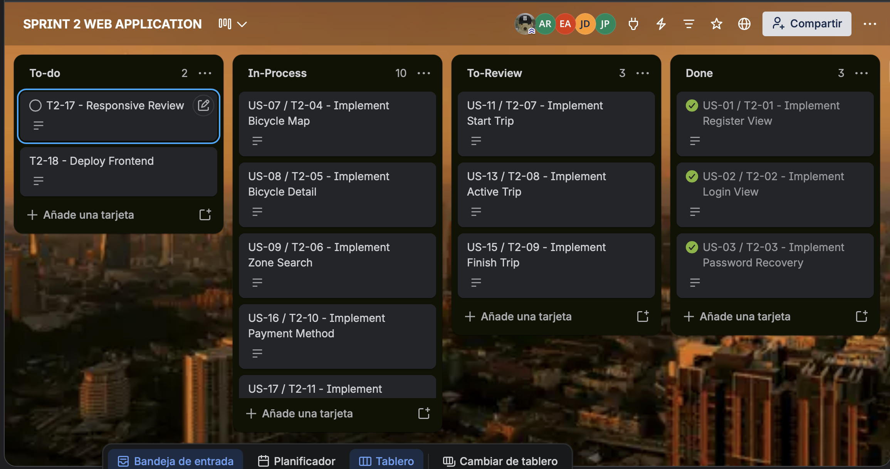

*Figura: captura del tablero de Sprint 2. Sus estados deben contrastarse con la versión actual del tablero.*

La columna **Revisión documental** de la tabla siguiente refleja lo que puede inferirse de la documentación del repositorio. **No reemplaza el estado oficial en Trello** ni equivale a la aceptación formal de cada User Story.

| Story ID | Task ID | Microtarea | Estimación | Responsable | Revisión documental |
|---|---|---|---:|---|---|
| US-01 | T2-01 | Implement Register View | 3 h | Adrian Armestar | Vista de registro documentada; flujo local de demostración |
| US-02 | T2-02 | Implement Login View | 3 h | Adrian Armestar | Vista y sesión simulada documentadas |
| US-03 | T2-03 | Implement Password Recovery | 3 h | Adrian Armestar | Recuperación de prueba; envío real no acreditado |
| US-07 | T2-04 | Implement Bicycle Map | 5 h | Eduardo Aguirre | Falta evidenciar mapa con bicicletas cercanas al usuario |
| US-08 | T2-05 | Implement Bicycle Detail | 3 h | Eduardo Aguirre | Fleet consulta bicicletas; validar detalle y criterios de US-08 |
| US-09 | T2-06 | Implement Zone Search | 3 h | Eduardo Aguirre | Falta evidenciar búsqueda por zona de usuario |
| US-11 | T2-07 | Implement Start Trip | 5 h | José María Franco | No se acredita inicio de alquiler; Trip documenta historial |
| US-13 | T2-08 | Implement Active Trip | 5 h | José María Franco | No se acredita vista o estado de viaje activo |
| US-15 | T2-09 | Implement Finish Trip | 5 h | José María Franco | No se acredita finalización de alquiler |
| US-16 | T2-10 | Implement Payment Method | 3 h | Juan David Ayllon | No se acredita registro de un método de pago real o simulado |
| US-17 | T2-11 | Implement Pricing View | 3 h | Juan David Ayllon | Existen vistas de planes; confirmar tarifa por alquiler |
| US-19 | T2-12 | Implement Subscription View | 5 h | Juan David Ayllon | Selección y compra simulada de plan documentadas |
| US-26 | T2-13 | Implement Damage Report | 3 h | Rodrigo Velasquez | Reporte de Maintenance en modo demo local |
| US-29 | T2-14 | Implement Incident Tracking | 5 h | Rodrigo Velasquez | Consulta de reportes demo; comprobar estados de incidencias |
| US-33 | T2-15 | Implement Incident Management | 5 h | Rodrigo Velasquez | Gestión local para rol de operador/administrador simulado |
| Transversal | T2-16 | Integrate Frontend | 5 h | Equipo completo | Integración modular documentada en `develop` |
| Transversal | T2-17 | Responsive Review | 3 h | Equipo completo | Pruebas de 390, 768 y 1440 px descritas en README de Maintenance; adjuntar resultados de ejecución |
| Transversal | T2-18 | Deploy Frontend | 3 h | Equipo completo | Capturas de publicación Firebase incluidas; comprobar la versión accesible |
| **Total** | **18 tareas** | | **70 h** | | **Pendiente de cierre validado** |

**Criterio para el cierre.** Cada historia solo debe pasar a `Done` cuando el equipo pueda demostrar todos los escenarios comprometidos para ese incremento o haya aprobado formalmente un alcance reducido. Los estados `To-do`, `In-Process`, `To-Review` y `Done` deben actualizarse desde el tablero real; aquí no se asignan estados inventados. Un mockup del Capítulo IV sirve como referencia visual, pero no equivale a una captura de ejecución de la aplicación.

#### 5.2.2.4. Development Evidence for Sprint Review

El desarrollo del Sprint 2 se documenta en el repositorio [Startup-Chapa/frontend-bicigo](https://github.com/Startup-Chapa/frontend-bicigo). La aplicación integrada contiene rutas y componentes de IAM, Trip Management, Billing & Subscriptions, Fleet & Station Management y Maintenance, además de un router, layout, cliente HTTP y estado compartidos.

| Bounded Context | Rama de desarrollo | Evidencia funcional identificada | Limitación relevante |
|---|---|---|---|
| IAM | `feature/iam` | Login, registro, perfil, sesión y recuperación de prueba | Autenticación y recuperación simuladas |
| Trip Management | `feature/trip-management` | Consulta del historial de viajes y acceso al reporte de incidencias desde un viaje | Inicio, viaje activo y cierre de alquiler no acreditados por el README |
| Billing & Subscriptions | `feature/billing-subscriptions` | Planes, selección y compra simulada de suscripción | No existe evidencia de pasarela de pagos productiva |
| Fleet & Station Management | `feature/fleet-station-management` | Gestión y consulta de estaciones y bicicletas mediante API local | No se demuestra por sí sola la geolocalización de bicicletas cercanas |
| Maintenance | `feature/maintenance` | Reportes, gestión administrativa y transiciones de estado de bicicleta en demo | Uso de `localStorage` sin contratos API productivos confirmados |

El archivo `src/router.js` usa `createWebHashHistory` para integrar la navegación y las rutas de los contextos; `src/main.js` registra Pinia, Vue Router, `vue-i18n` y PrimeVue. El README explica que parte de la integración se realizó por selección y combinación de archivos, de modo que las estadísticas de Pull Requests no representan toda la integración efectuada.

**Fuente de verificación técnica:** [README de integración](https://github.com/Startup-Chapa/frontend-bicigo/blob/develop/README.md), [Router de la aplicación](https://github.com/Startup-Chapa/frontend-bicigo/blob/develop/src/router.js), [README de Maintenance](https://github.com/Startup-Chapa/frontend-bicigo/blob/develop/src/maintenance/README.md).

**Historial aportado para la revisión inicial (instantánea de `develop`)**

La tabla conserva los mensajes y fechas registrados previamente en el informe. Las fechas de esta instantánea pertenecen al período **27/09/2026–07/10/2026**; no sustituyen un historial completo ni representan necesariamente el estado del repositorio en la última fecha de edición del informe. Como el extracto proporcionado carece de códigos SHA y cuerpos, estos datos permanecen identificados como no proporcionados, sin rellenarlos arbitrariamente.

| Repository | Branch | Commit Id | Commit Message | Commit Message Body | Committed on | GitHub User |
|---|---|---|---|---|---|---|
| Startup-Chapa/frontend-bicigo | `develop` | No proporcionado | fix: modify db.json | No proporcionado | 07/10/2026 | TheEngineEdu |
| Startup-Chapa/frontend-bicigo | `develop` | No proporcionado | Merge branch 'develop' of https://github.com/Startup-Chapa/frontend-bicigo into develop | No proporcionado | 07/10/2026 | TheEngineEdu |
| Startup-Chapa/frontend-bicigo | `develop` | No proporcionado | Refactor JSON structure in db.json | No proporcionado | 07/10/2026 | Adrian5102 |
| Startup-Chapa/frontend-bicigo | `develop` | No proporcionado | Change localStorage key from 'bicigo_user' to 'users' | No proporcionado | 07/10/2026 | Adrian5102 |
| Startup-Chapa/frontend-bicigo | `develop` | No proporcionado | Merge branch 'develop' of https://github.com/Startup-Chapa/frontend-bicigo into develop | No proporcionado | 07/10/2026 | TheEngineEdu |
| Startup-Chapa/frontend-bicigo | `develop` | No proporcionado | db.json | No proporcionado | 06/10/2026 | VoltTrd |
| Startup-Chapa/frontend-bicigo | `develop` | No proporcionado | feat: integrate BiciGO frontend modules | No proporcionado | 06/10/2026 | Rodrigov233 |
| Startup-Chapa/frontend-bicigo | `develop` | No proporcionado | feat:add configuration to the page | No proporcionado | 06/10/2026 | TheEngineEdu |
| Startup-Chapa/frontend-bicigo | `develop` | No proporcionado | Merge pull request #2 from Startup-Chapa/feature/iam | No proporcionado | 06/10/2026 | TheEngineEdu |
| Startup-Chapa/frontend-bicigo | `develop` | No proporcionado | feat(iam): add forgot password view | No proporcionado | 02/10/2026 | Adrian5102 |
| Startup-Chapa/frontend-bicigo | `develop` | No proporcionado | feat(iam): add final details for i18n | No proporcionado | 02/10/2026 | Adrian5102 |
| Startup-Chapa/frontend-bicigo | `develop` | No proporcionado | feat(iam): fixed great part of iam | No proporcionado | 02/10/2026 | Adrian5102 |
| Startup-Chapa/frontend-bicigo | `develop` | No proporcionado | feat(iam): trying to fix everything pls maybe hopefully | No proporcionado | 02/10/2026 | Adrian5102 |
| Startup-Chapa/frontend-bicigo | `develop` | No proporcionado | feat(iam): update layout | No proporcionado | 02/10/2026 | Adrian5102 |
| Startup-Chapa/frontend-bicigo | `develop` | No proporcionado | fix iam requirements | No proporcionado | 02/10/2026 | Adrian5102 |
| Startup-Chapa/frontend-bicigo | `develop` | No proporcionado | feat(iam): add iam routes | No proporcionado | 02/10/2026 | Adrian5102 |
| Startup-Chapa/frontend-bicigo | `develop` | No proporcionado | feat(iam): add authentication section component | No proporcionado | 02/10/2026 | Adrian5102 |
| Startup-Chapa/frontend-bicigo | `develop` | No proporcionado | feat(iam): add reset password view | No proporcionado | 02/10/2026 | Adrian5102 |
| Startup-Chapa/frontend-bicigo | `develop` | No proporcionado | feat(iam): add forgot password view | No proporcionado | 02/10/2026 | Adrian5102 |
| Startup-Chapa/frontend-bicigo | `develop` | No proporcionado | feat(iam): add register view | No proporcionado | 02/10/2026 | Adrian5102 |
| Startup-Chapa/frontend-bicigo | `develop` | No proporcionado | feat(iam): add login view | No proporcionado | 02/10/2026 | Adrian5102 |
| Startup-Chapa/frontend-bicigo | `develop` | No proporcionado | feat(iam): add pinia start | No proporcionado | 02/10/2026 | Adrian5102 |
| Startup-Chapa/frontend-bicigo | `develop` | No proporcionado | feat(iam): add i18n start | No proporcionado | 02/10/2026 | Adrian5102 |
| Startup-Chapa/frontend-bicigo | `develop` | No proporcionado | feat(iam): add iam store | No proporcionado | 02/10/2026 | Adrian5102 |
| Startup-Chapa/frontend-bicigo | `develop` | No proporcionado | feat(iam): add mock api for iam | No proporcionado | 02/10/2026 | Adrian5102 |
| Startup-Chapa/frontend-bicigo | `develop` | No proporcionado | feat(iam): add user assembler | No proporcionado | 01/10/2026 | Adrian5102 |
| Startup-Chapa/frontend-bicigo | `develop` | No proporcionado | feat(iam): add iam interceptor | No proporcionado | 01/10/2026 | Adrian5102 |
| Startup-Chapa/frontend-bicigo | `develop` | No proporcionado | feat(iam): add iam storage | No proporcionado | 01/10/2026 | Adrian5102 |
| Startup-Chapa/frontend-bicigo | `develop` | No proporcionado | feat(iam): add user entity | No proporcionado | 01/10/2026 | Adrian5102 |
| Startup-Chapa/frontend-bicigo | `develop` | No proporcionado | feat: add base entity | No proporcionado | 01/10/2026 | Adrian5102 |
| Startup-Chapa/frontend-bicigo | `develop` | No proporcionado | feat:add shared context to src | No proporcionado | 30/09/2026 | TheEngineEdu |
| Startup-Chapa/frontend-bicigo | `develop` | No proporcionado | feat:initial commit | No proporcionado | 27/09/2026 | TheEngineEdu |

El extracto original tiene **32 entradas**, incluidas **3 entradas de fusión**. La confirmación exacta de autoría, SHA y fecha de cada commit requiere consultar el historial completo, filtrando por el rango de Sprint y diferenciando commits propios de merges.

**GitHub Pulse: actividad del 30/09/2026 al 07/10/2026 (captura histórica)**

| Indicador de la captura | Valor |
|---|---:|
| Autores activos | 5 |
| Commits en todas las ramas | 62 |
| Commits en `main` | 2 |
| Pull Requests fusionados | 2 |
| Pull Requests abiertos | 0 |
| Archivos modificados en `main` | 14 |
| Líneas añadidas en `main` | 632 |
| Líneas eliminadas en `main` | 0 |

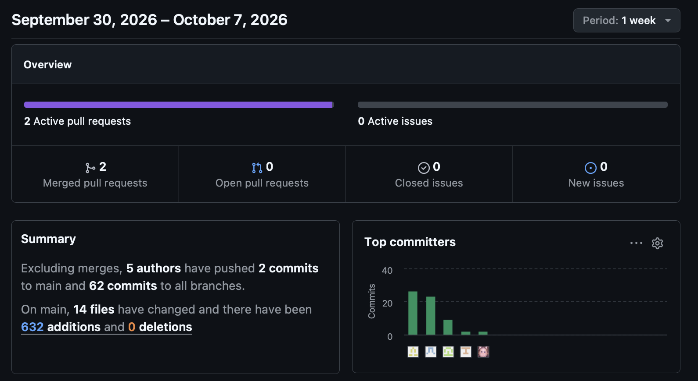

*Figura: GitHub Pulse del período indicado. Incluye los Pull Requests #1 (Trip Management) y #2 (IAM) fusionados, según la captura del informe.*

Estos datos **no deben presentarse como resultado final de todo el Sprint 2** si el equipo continuó trabajando después del 07/10/2026. Es necesario adjuntar, al cierre, una captura con el rango completo acordado para la evaluación.

#### 5.2.2.5. Execution Evidence for Sprint Review

Las evidencias de ejecución deben mostrar pantallas **reales de la SPA** y relacionarse con las User Stories y mockups de los Capítulos III y IV. Se conserva la estructura de archivos de imágenes existente, pero se corrige la asociación de contextos: la pantalla de perfil pertenece a gestión de cuenta y la pantalla de suscripciones no corresponde a Trip Management.

**Identity & Access Management (IAM)**

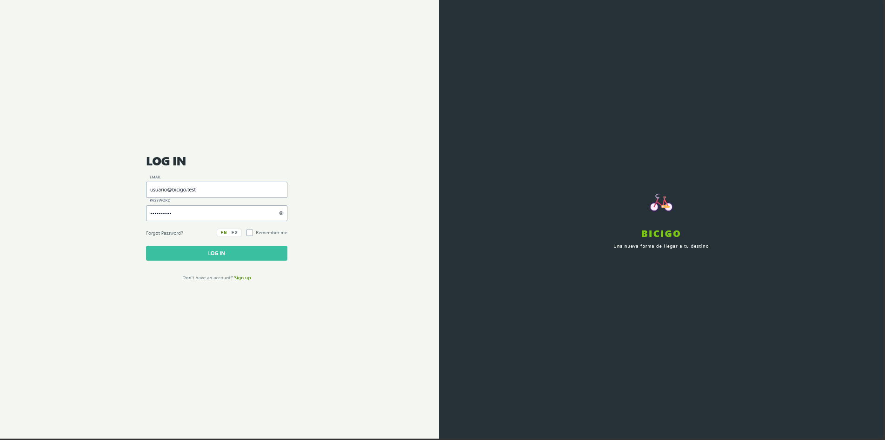

*Figura: vista de login (US-02). Comparar las validaciones de credenciales con los escenarios del Capítulo III; la autenticación actual es de demostración.*

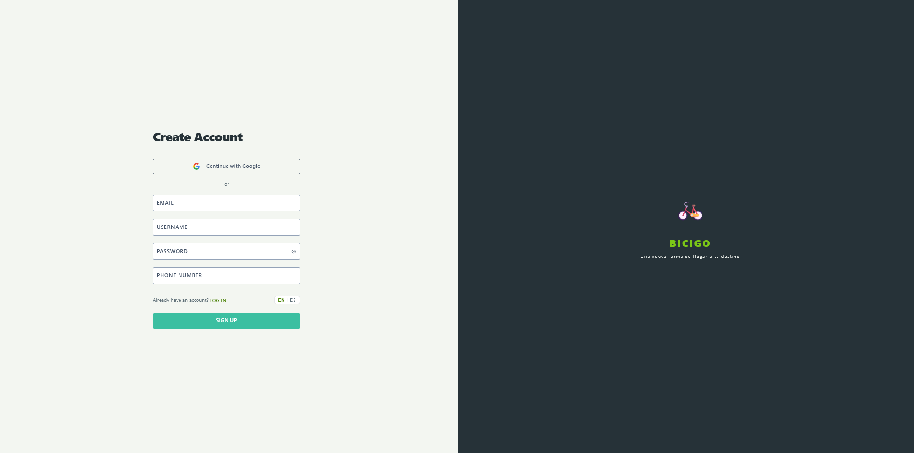

*Figura: vista de registro (US-01); verificar campos obligatorios y prevención de duplicados con datos de prueba.*

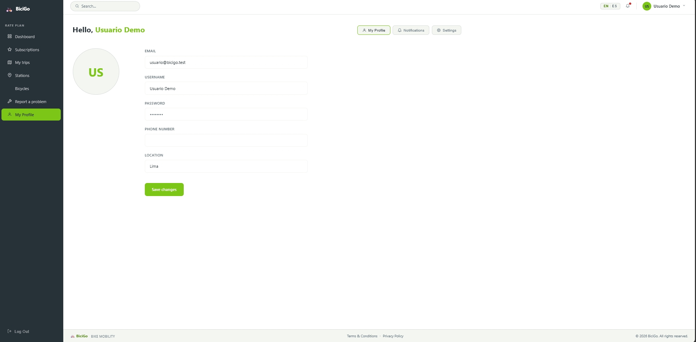

*Figura: perfil (US-21, funcionalidad adicional a las 15 historias originalmente seleccionadas).* 

**Fleet & Station Management**

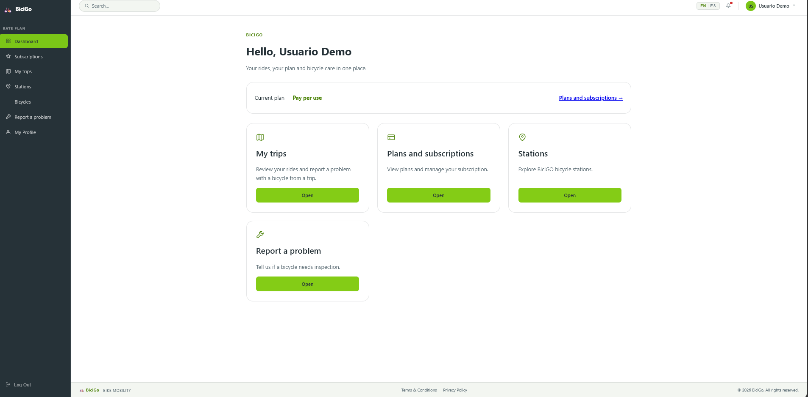

*Figura: dashboard integrado; sirve como evidencia de navegación, pero no prueba geolocalización o estados en tiempo real.*

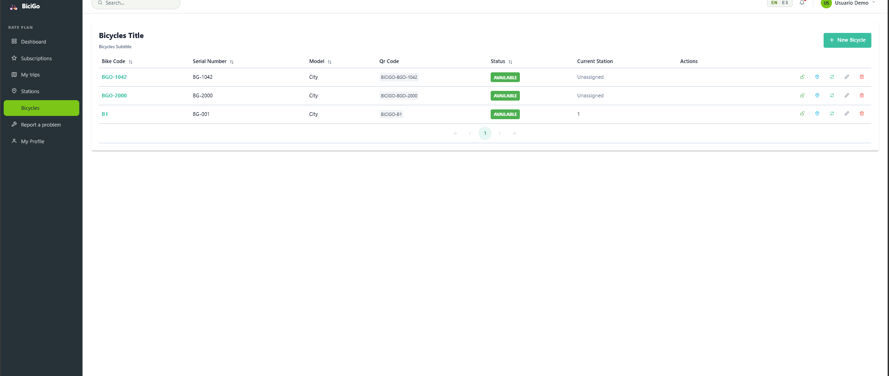

*Figura: vista de bicicletas. Contrastar sus campos con US-08 y añadir una captura específica si existe un mapa para US-07 o una búsqueda para US-09.*

**Trip Management**

El repositorio documenta una vista de historial y la navegación a reportes desde un viaje. **En el material adjunto no aparece una captura inequívoca** del inicio de alquiler (US-11), del viaje activo (US-13) o de su finalización (US-15). Antes de marcarlas `Done`, se requieren evidencias de esas pantallas o una replanificación documentada. Para el historial, puede añadirse una captura de `/#/app/trips` (US-23), indicando que es trabajo adicional al alcance inicial.

**Billing & Subscriptions**


*Figura: consulta de planes y suscripción simulada (US-19). No equivale a un pago procesado por pasarela real.*


*Figura: vista de Billing. La captura por sí sola no confirma US-16 ni el cálculo de la tarifa de US-17.*

**Maintenance**


*Figura: formulario para reportar una bicicleta (US-26). En la implementación de demostración, los datos de Maintenance se mantienen mediante `localStorage`.*

Para completar las evidencias US-29 y US-33, agregar capturas de la consulta de incidencias y de la vista `/#/maintenance/management` utilizando un usuario operador de prueba. Una captura del cambio de estado `AVAILABLE → MAINTENANCE → AVAILABLE` debe identificarse expresamente como una simulación y no como una actualización de flota productiva.

**Video de ejecución**

Se debe incorporar un video que muestre, de manera continua, el recorrido por IAM, Fleet, Trip, Billing y Maintenance, indicando qué funcionalidades dependen de API simulada, cuáles usan almacenamiento local y cuáles están pendientes de integración. El enlace y el intervalo de tiempo del video **no figuran aún en el material recibido**:

```text
Microsoft Stream: PENDIENTE DE ENLACE
Minutos de demostración por contexto: PENDIENTES
```

#### 5.2.2.6. Services Documentation Evidence for Sprint Review

El Sprint 2 se centra en la Frontend Web Application. El entorno local utiliza JSON Server para ofrecer recursos de prueba mediante rutas bajo `/api/v1` y variables de entorno del frontend. Este mecanismo permite desarrollar y evaluar flujos sin depender del backend final. **No debe presentarse JSON Server como implementación de los Web Services productivos exigidos por las Technical Stories.**

En el Capítulo III se especifican Technical Stories de registro, login, flota, viajes, pagos e incidencias. La implementación y documentación OpenAPI/Swagger de esos endpoints corresponde a la iteración de backend que corresponda. Por ello, no se adjuntan aquí contratos OpenAPI atribuidos a servicios todavía no confirmados.

| Recurso | Estado documentado en Sprint 2 | Próximo paso |
|---|---|---|
| JSON Server / API de desarrollo | Disponible en desarrollo con datos de prueba | Verificar rutas y contratos de cada contexto |
| IAM | Sesión y recuperación de prueba | Conectar autenticación, autorización y recuperación reales |
| Billing | Compra simulada de planes | Integrar reglas de pago y pasarela verificada |
| Maintenance | Modo demo local; endpoints definitivos sin confirmar | Definir contrato y trasladar persistencia al backend |
| Fleet y Trip | Consumos y flujos parciales con API local | Vincular casos de uso y estados de alquiler con API definitiva |

Como evidencia complementaria se pueden enlazar `server/routes.json`, el archivo de datos de desarrollo y el README del proyecto, pero deben etiquetarse como **mock API** y no como Swagger de producción.

#### 5.2.2.7. Software Deployment Evidence for Sprint Review

En el informe se documenta la publicación de la versión frontend mediante **Firebase Hosting**. El procedimiento descrito se basa en un build de Vite y la subida de los archivos estáticos del directorio `dist`. El repositorio confirma que `firebase.json` configura `dist` como directorio público; el router implementa `createWebHashHistory`.

**Procedimiento registrado**

1. Preparar dependencias del proyecto y ejecutar `npm run build`.
2. Verificar que Vite genera los archivos de producción dentro de `dist`.
3. Autenticarse en Firebase CLI con `firebase login`.
4. Configurar Hosting para publicar `dist` y conservar el `index.html` generado.
5. Ejecutar `firebase deploy --only hosting`.
6. Validar el acceso por HTTPS y comprobar navegación, recursos estáticos y comportamiento en móvil y escritorio.

```bash
npm install
npm run build
firebase login
firebase deploy --only hosting
```

| Producto | Plataforma | URL o acceso | Estado de evidencia |
|---|---|---|---|
| Landing Page | GitHub Pages | https://startup-chapa.github.io/Landing-Page/ | Publicación documentada en Sprint 1 |
| Frontend Web Application | Firebase Hosting | https://example-pro-d6e84.web.app | URL reportada en captura del informe; **revalidar acceso y versión publicada** |
| API local de desarrollo | JSON Server | `http://127.0.0.1:3000/api/v1` | Solo para desarrollo; no accesible públicamente por estar en localhost |
| RESTful Web Services productivos | Pendiente | No disponible en la evidencia del Sprint 2 | No incluidos en el incremento actual |

**Evidencia del despliegue registrada por el equipo**


*Figura: instalación y autenticación con Firebase CLI.*


*Figura: autenticación y comando de compilación del frontend.*


*Figura: generación del build e inicialización de Firebase Hosting.*


*Figura: selección de proyecto Firebase y directorio público `dist`.*


*Figura: evidencia reportada del resultado de `firebase deploy --only hosting`.*

**Verificaciones pendientes.** La configuración de Hosting en el repositorio no agrega rewrites para rutas de SPA; por eso resulta relevante documentar que el frontend utiliza navegación hash. Además, el despliegue estático por sí solo no publica la API local ni valida compras, ubicación o autorizaciones productivas. Se debe comprobar desde una ventana privada y un dispositivo ajeno al equipo de desarrollo qué vistas funcionan con datos de producción y cuáles únicamente con datos simulados.

#### 5.2.2.8. Team Collaboration Insights during Sprint

La coordinación del equipo se distribuyó por cinco Bounded Contexts y se complementó con actividades compartidas de integración, verificación y documentación. La matriz de responsabilidades de 5.2.2.2 identifica liderazgo funcional; la actividad de GitHub presenta evidencia de contribuciones, pero debe interpretarse en función de la rama y el período observados.

| Integrante | GitHub Username | Contexto liderado | Rama relacionada |
|---|---|---|---|
| Adrian Andres Armestar Felipa | Adrian5102 | IAM | `feature/iam` |
| José María Franco del Carpio | VoltTrd | Trip Management | `feature/trip-management` |
| Juan David Ayllon Pauccar | JuanDPAUC | Billing & Subscriptions | `feature/billing-subscriptions` |
| Eduardo Manuel Aguirre Ramos | TheEngineEdu | Fleet & Station Management | `feature/fleet-station-management` |
| Rodrigo Velasquez Velasquez | Rodrigov233 | Maintenance | `feature/maintenance` |

**GitHub Contributors**


*Figura: Contributors correspondiente a la rama `main` y al filtro de tres meses de la captura proporcionada, excluyendo commits de fusión.*

| Integrante visible en la captura | Usuario | Commits mostrados en `main` | Líneas añadidas | Líneas eliminadas |
|---|---|---:|---:|---:|
| Eduardo Manuel Aguirre Ramos | TheEngineEdu | 2 | 714 | 0 |
| José María Franco del Carpio | VoltTrd | 1 | 418 | 0 |

El panel de Contributors **no contabiliza necesariamente la actividad de las ramas `feature/*` y `develop`**. No corresponde registrar cero contribuciones para los demás miembros solo porque no aparezcan en esta captura. Del mismo modo, la captura de Pulse (5 autores y 62 commits en todas las ramas entre el 30/09 y el 07/10) no es directamente comparable con Contributors, porque mide otro conjunto de datos.

Para una evaluación completa de la colaboración se recomienda adjuntar una tabla de commits y Pull Requests filtrados por los límites reales del Sprint, con autor, rama de origen, SHA, fecha y referencia al aspecto desarrollado. Las cifras deberán actualizarse al cierre, sin inventar historiales ni atribuir aportes sin evidencia.

### 5.2.3. Sprint 3

#### 5.2.3.1. Sprint Planning 3

El Sprint 3 corresponde al primer incremento de backend de BiciGO: la implementación de los **RESTful Web Services** en el repositorio [`Startup-Chapa/backend-bicigo`](https://github.com/Startup-Chapa/backend-bicigo), una API REST desarrollada con **ASP.NET Core (.NET 10)**, **Entity Framework Core 10** y **MySQL**, organizada por **Bounded Contexts** (IAM, Trip, Billing, Fleet & Station Management, Maintenance y Shared) con capas Domain, Application, Infrastructure e Interfaces (REST). Los contratos se exponen mediante OpenAPI 3.1.1 con la interfaz **Scalar** en el entorno local `http://localhost:5267`.

**Sprint Planning Background**

| Campo | Registro de Sprint 3 |
|---|---|
| Sprint # | Sprint 3 |
| Date | 09/11/2026 (**propuesta original, por confirmar**) |
| Time | 20:00–21:00, hora de Lima (**propuesta**) |
| Location | Reunión virtual |
| Prepared By | Aguirre Ramos, Eduardo Manuel  |
| Attendees | Aguirre Ramos, Eduardo Manuel; Armestar Felipa, Adrian Andres; Ayllon Pauccar, Juan David; Franco del Carpio, José María; Velasquez Velasquez, Rodrigo |
| Sprint 2 Review Summary | Se integró y publicó la primera versión navegable de la Frontend Web Application con módulos por Bounded Context, API simulada (JSON Server) y Firebase Hosting. Quedaron pendientes de validar evidencias de algunos flujos (inicio, viaje activo y cierre de alquiler; método de pago). |
| Sprint 2 Retrospective Summary | Se acordó trasladar la lógica al backend real organizado por Bounded Contexts, asignar un líder por contexto, versionar la API bajo el prefijo `/api/v1` y documentar los contratos con OpenAPI antes de reintegrar el frontend. |

**Sprint Goal & User Stories**

*Our focus is on implementing and connecting the backend services required by BiciGO's priority user journeys. We believe it will replace key simulated operations with verifiable RESTful endpoints and allow the frontend and backend to work as a consistent application. This will be confirmed when the selected Technical Stories meet their acceptance criteria, API contracts are documented, and end-to-end scenarios can be demonstrated.*

| Campo | Situación |
|---|---|
| Selected Technical Stories | IAM: TS-15 (con cobertura parcial de TS-01). Trip: TS-08, TS-09, TS-10, TS-11. Billing: TS-12, TS-13, TS-14. Fleet: TS-05, TS-06. Maintenance: TS-17, TS-18, TS-19. Transversal: persistencia compartida, seeder y documentación OpenAPI (TS-SH01) y despliegue del backend en Azure App Service (TS-SH02). |
| Cobertura parcial | TS-02, TS-03 y TS-04 (login, recuperación y verificación) no cuentan con endpoints de autenticación dedicados; el registro se expone como `POST /api/v1/users` y el acceso por correo como `GET /api/v1/users?email=`. Su cierre se plantea para una iteración posterior. |
| Historias no incluidas | TS-07 (Search Coverage Zone) y TS-20 (Get Dashboard Metrics) quedan fuera del alcance del Sprint 3. |
| Sum of Story Points | 41 SP de Technical Stories + 8 SP del trabajo transversal (Shared y despliegue en Azure) = **49 SP** (escala 1, 2, 3 y 5). |
| Task Estimation | **67 h**, correspondientes a 21 microtareas. |
| Sprint 3 Velocity | Pendiente de validar contra los criterios de aceptación de cada Technical Story. |

**Distribución estimada de Story Points**

| Story Id | Story Title | Story Points |
|---|---|---:|
| TS-05 | Get Nearby Bikes (Fleet) | 3 |
| TS-06 | Get Bike Detail (Fleet) | 2 |
| TS-08 | Start Rental (Trip) | 5 |
| TS-09 | Unlock Bike (Trip) | 3 |
| TS-10 | Get Active Rental (Trip) | 2 |
| TS-11 | Finish Rental (Trip) | 5 |
| TS-12 | Register Payment Method (Billing) | 3 |
| TS-13 | Process Rental Payment (Billing) | 5 |
| TS-14 | Manage Subscription (Billing) | 3 |
| TS-15 | Get User Profile (IAM) | 2 |
| TS-17 | Create Incident (Maintenance) | 3 |
| TS-18 | Get Incident Status (Maintenance) | 2 |
| TS-19 | Manage Bike Status (Maintenance) | 3 |
| TS-SH01 | Persistencia compartida, seeder y OpenAPI (transversal) | 5 |
| TS-SH02 | Deploy Backend to Azure App Service (transversal) | 3 |
| **Total** | **13 Technical Stories + 2 transversales** | **49** |

#### 5.2.3.2. Aspect Leaders and Collaborators

La organización del Sprint 3 se encuentra basada en los cinco Bounded Contexts definidos durante el diseño de arquitectura.

Cada integrante lidera un contexto y participa como colaborador en los demás. Respecto al Sprint 2, Fleet y Maintenance rotaron **intencionalmente** entre Eduardo Aguirre y Rodrigo Velasquez: Rodrigo asume Fleet & Station Management y Eduardo asume Maintenance. El cambio fue acordado en la planificación para repartir el conocimiento de la capa de datos, ya que Fleet administra los agregados de bicicletas y estaciones, y Maintenance registra reportes e historial de estados sobre esas mismas unidades. El trabajo transversal del contexto Shared (persistencia, seeder y OpenAPI) se distribuyó entre todo el equipo según el backlog.

| Team Member | GitHub Username | IAM | Trip Management | Billing & Subscriptions | Fleet & Station Management | Maintenance |
|---|---|:---:|:---:|:---:|:---:|:---:|
| Armestar Felipa, Adrian Andres | Adrian5102 | L | C | C | C | C |
| Franco del Carpio, José María | VoltTrd | C | L | C | C | C |
| Ayllon Pauccar, Juan David | JuanDPAUC | C | C | L | C | C |
| Aguirre Ramos, Eduardo Manuel | TheEngineEdu | C | C | C | C | L |
| Velasquez Velasquez, Rodrigo | Rodrigov233 | C | C | C | L | C |

**L:** Leader  
**C:** Collaborator

La distribución permite implementar cada contexto de forma paralela sobre el repositorio `backend-bicigo` y luego exponer los recursos en una API común bajo el prefijo `/api/v1`.

#### 5.2.3.3. Sprint Backlog 3

El backlog organiza 21 microtareas agrupadas por Bounded Context y actividades transversales, con una estimación total de **67 horas**. Las tareas siguen la convención `T3-XX` y se asocian a las Technical Stories del Capítulo III.

**Trello del Sprint 3**


[Sprint 3 — Trello](https://trello.com/invite/b/6af3d267ba7a4372b40bbdd6/ATTI31ef73f3a471df4c015b5d06485dd09712588AB8/sprint-3)


**Sprint #: Sprint 3**

| Epic / Story ID | Task ID | Título de la Microtarea | Descripción y Alcance Técnico | Estimación (Horas) | Asignado a | Estado |
| :--- | :--- | :--- | :--- | :---: | :--- | :---: |
| **TS-SH01** | T3-01 | Solución y estructura por Bounded Contexts | Crear la solución .NET 10 con las carpetas `Iam`, `Trip`, `Billing`, `Fleet`, `Maintenance` y `Shared`, y registrar los servicios de cada contexto en `Program.cs`. | 3 h | Equipo | Done |
| **TS-SH01** | T3-02 | AppDbContext MySQL y repositorios base | Configurar `AppDbContext` con MySQL (`MySql.EntityFrameworkCore`), `UnitOfWork`, `BaseRepository` y `AuditableEntityInterceptor`. | 3 h | Equipo | Done |
| **TS-SH01** | T3-03 | Seeder y tablas normalizadas | Implementar `DatabaseSeeder` y la creación idempotente de `plan_features`, `user_notifications`, `bicycle_assignments`, `trip_users`, `trip_route_points`, `trip_photo_evidences` y `maintenance_status_histories`. | 3 h | Equipo | Done |
| **TS-SH01** | T3-04 | OpenAPI 3.1.1 y Scalar | Habilitar `AddOpenApi`/`MapOpenApi` y `MapScalarApiReference` para documentar y explorar la API en el entorno local. | 2 h | Equipo | Done |
| **TS-15** | T3-05 | Dominio y aplicación de Users | Modelar el agregado `User` con sus comandos y consultas (registro, consulta por correo), su repositorio y los servicios de aplicación. | 3 h | Armestar Felipa, Adrian Andres | Done |
| **TS-15** | T3-06 | Users REST: CRUD y PATCH de perfil | Exponer `POST /api/v1/users` (201/400/409), `GET /api/v1/users?email=`, `GET /{id}`, `PATCH /{id}` (perfil, plan y balance) y `DELETE /{id}` con assemblers. | 3 h | Armestar Felipa, Adrian Andres | Done |
| **TS-15** | T3-07 | UserNotifications REST | Implementar `GET`/`POST /api/v1/user-notifications` y `PATCH /{id}/read` para las notificaciones del usuario. | 3 h | Armestar Felipa, Adrian Andres | Done |
| **TS-08** | T3-08 | Dominio y persistencia de Trips | Modelar el agregado `Trip` con sus estados, comandos y consultas, y su repositorio EFC. | 4 h | Franco del Carpio, José María | Done |
| **TS-08/10/11** | T3-09 | Trips REST: ciclo de alquiler | Exponer `POST /api/v1/trips` (inicio), `GET /{id}` (consulta), `PUT /{id}` (actualización y cierre), `DELETE /{id}` y el listado `GET /api/v1/trips`. | 4 h | Franco del Carpio, José María | Done |
| **TS-10** | T3-10 | TripUsers REST | Implementar `GET`/`POST /api/v1/trip-users` y `GET /{id}` para asociar usuarios al viaje. | 2 h | Franco del Carpio, José María | Done |
| **TS-11** | T3-11 | Route points y evidencias fotográficas | Implementar `api/v1/trip-route-points` y `api/v1/trip-photo-evidences` (consulta y registro). | 2 h | Franco del Carpio, José María | Done |
| **TS-09** | T3-12 | QrValidations REST | Implementar `GET`/`POST /api/v1/qr-validations` y `GET /{id}` para la validación QR del desbloqueo del alquiler vigente. | 3 h | Franco del Carpio, José María | Done |
| **TS-12** | T3-13 | PaymentMethods y Payments REST | Implementar `GET`/`POST /api/v1/payment-methods`, `GET/POST /api/v1/payments` y `GET /payments/{id}`. | 4 h | Ayllon Pauccar, Juan David | Done |
| **TS-14** | T3-14 | Plans, PlanFeatures y Subscriptions | Exponer `GET /api/v1/plans` y `GET /{id}`, `GET`/`POST /api/v1/plan-features` y `GET`/`POST /api/v1/subscriptions` (activación de plan). | 4 h | Ayllon Pauccar, Juan David | Done |
| **TS-05/06** | T3-15 | Bicycles REST y estados | Modelar el agregado `Bicycle` con el value object `BicycleStatus` y exponer `GET`/`POST`/`PUT`/`DELETE /api/v1/bicycles` (disponibilidad y detalle). | 4 h | Velasquez Velasquez, Rodrigo | Done |
| **TS-05** | T3-16 | BikePoints y BicycleAssignments | Implementar `GET`/`POST`/`PUT`/`DELETE /api/v1/bike-points` y `GET`/`POST /api/v1/bicycle-assignments` (ubicación y asignaciones). | 3 h | Velasquez Velasquez, Rodrigo | Done |
| **TS-17/18** | T3-17 | MaintenanceReports REST | Modelar el reporte de mantenimiento e implementar `GET`/`POST /api/v1/maintenance-reports` y `GET /{id}`. | 4 h | Aguirre Ramos, Eduardo Manuel | Done |
| **TS-19** | T3-18 | Cambio de estado e historial | Implementar `POST /api/v1/maintenance-reports/{bikeId}/status` y `GET`/`POST /api/v1/maintenance-status-histories` con el agregado `MaintenanceStatusHistory`. | 3 h | Aguirre Ramos, Eduardo Manuel | Done |
| **Transversal** | T3-19 | Pruebas locales de la API | Ejecutar la API con MySQL y verificar los contratos de cada contexto desde Scalar: al menos una respuesta exitosa y un caso de error por recurso. | 3 h | Equipo | To-Review |
| **Transversal** | T3-20 | Documentación del Sprint 3 en el informe | Redactar las secciones 5.2.3.1 a 5.2.3.8 y actualizar la tabla de repositorios de 5.1.2 con `backend-bicigo`. | 3 h | Aguirre Ramos, Eduardo Manuel | Done |
| **TS-SH02** | T3-21 | Despliegue del backend en Azure App Service | Crear el recurso de Azure App Service (runtime .NET 10), configurar la cadena de conexión MySQL (`DefaultConnection`) y publicar la API; registrar la URL pública al finalizar la verificación. | 4 h | Equipo | In-Process |

**Criterio para el cierre.** Una Technical Story solo pasa a `Done` cuando su recurso responde en el entorno local, el contrato figura en OpenAPI y sus escenarios se pueden reproducir contra la base MySQL con los datos del seeder. La cobertura parcial de autenticación (TS-02 a TS-04) queda fuera del cierre del Sprint 3; el despliegue en Azure App Service (T3-21) se encuentra **en proceso** al momento de este registro y debe acreditar la URL pública antes de pasar a `Done`.

#### 5.2.3.4. Development Evidence for Sprint Review

El desarrollo se documenta en el repositorio [`Startup-Chapa/backend-bicigo`](https://github.com/Startup-Chapa/backend-bicigo). Cada contexto organiza sus capas como `Domain` (agregados, value objects, comandos y consultas), `Application` (servicios de comando y consulta), `Infrastructure` (repositorios EFC) e `Interfaces` (controllers, resources y assemblers REST), sobre el contexto `Shared`, que registra el `DbContext`, el unit of work y el seeder.

| Bounded Context | Carpeta | Recursos REST implementados | Agregados principales |
|---|---|---|---|
| IAM | `Iam/` | `users`, `user-notifications` | `User`, `UserNotification` |
| Trip Management | `Trip/` | `trips`, `trip-users`, `trip-route-points`, `trip-photo-evidences`, `qr-validations` | `Trip`, `TripUser`, `TripRoutePoint`, `TripPhotoEvidence`, `QrValidation` |
| Billing & Subscriptions | `Billing/` | `plans`, `plan-features`, `payments`, `payment-methods`, `subscriptions` | `Plan`, `Payment`, `Subscription` |
| Fleet & Station Management | `Fleet/` | `bicycles`, `bike-points`, `bicycle-assignments` | `Bicycle`, `BikePoint`, `BicycleAssignment` |
| Maintenance | `Maintenance/` | `maintenance-reports`, `maintenance-status-histories` | `MaintenanceReport`, `MaintenanceStatusHistory` |

`Program.cs` registra los servicios de cada contexto, configura MySQL mediante la cadena `DefaultConnection` y, al arrancar, ejecuta `EnsureCreated`, crea las siete tablas normalizadas con `CREATE TABLE IF NOT EXISTS` y aplica el `DatabaseSeeder`.


*Figura: documentación OpenAPI 3.1.1 de `backend-bicigo v1`, abierta en el entorno local `http://localhost:5267`.*

**Historial de commits del backend** Esta sección debe completarse con la tabla de commits de la rama `develop` del backend (SHA, mensaje, autor y fecha) filtrada por el rango del Sprint 3 y la captura de GitHub Pulse del repositorio `backend-bicigo`, siguiendo el formato de las secciones 5.2.1.4 y 5.2.2.4.

| Repositorio | Rama | Commit | Asunto | Cuerpo | Fecha | Autor |
| --- | --- | --- | --- | --- | --- | --- |
| Startup-Chapa/backend-bicigo | `main` | `962d3a6` | Merge pull request #8 from Startup-Chapa/develop | Develop | 12/11/2026 | Eduardo Manuel Aguirre |
| Startup-Chapa/backend-bicigo | `main` | `64d11d8` | Merge pull request #7 from Startup-Chapa/feature/deploy | Feature/deploy | 12/11/2026 | Eduardo Manuel Aguirre |
| Startup-Chapa/backend-bicigo | `main` | `74bdb0c` | fix: the final solution |  | 12/11/2026 | TheEngineEdu |
| Startup-Chapa/backend-bicigo | `main` | `8405e55` | fix: add some datails to conecto frontend |  | 12/11/2026 | TheEngineEdu |
| Startup-Chapa/backend-bicigo | `main` | `b19a16d` | fix:change shared configurations |  | 12/11/2026 | TheEngineEdu |
| Startup-Chapa/backend-bicigo | `main` | `2af0e55` | Merge pull request #6 from Startup-Chapa/feature/iam | Feature/iam | 12/11/2026 | Eduardo Manuel Aguirre |
| Startup-Chapa/backend-bicigo | `main` | `0b10104` | Merge pull request #5 from Startup-Chapa/trips | Trips | 12/11/2026 | Eduardo Manuel Aguirre |
| Startup-Chapa/backend-bicigo | `main` | `733b63b` | Delete Trip directory | fix: ultimate change | 12/11/2026 | Eduardo Manuel Aguirre |
| Startup-Chapa/backend-bicigo | `main` | `f8c913b` | fix: repair internal error |  | 12/11/2026 | Rodrigov233 |
| Startup-Chapa/backend-bicigo | `main` | `8cede9c` | Merge pull request #4 from Startup-Chapa/feature/billing | Feature/billing | 12/11/2026 | Eduardo Manuel Aguirre |
| Startup-Chapa/backend-bicigo | `main` | `554e2f3` | Merge pull request #3 from Startup-Chapa/fleet | Fleet | 12/11/2026 | Eduardo Manuel Aguirre |
| Startup-Chapa/backend-bicigo | `main` | `e3c51c8` | Merge pull request #2 from Startup-Chapa/feature/maintenance | Feature/maintenance | 12/11/2026 | Eduardo Manuel Aguirre |
| Startup-Chapa/backend-bicigo | `main` | `5e517c0` | feat: add maintenance controller to maintenance interfaces |  | 12/11/2026 | TheEngineEdu |
| Startup-Chapa/backend-bicigo | `main` | `1e3612a` | feat: add assemblers of maintenance to transform file |  | 12/11/2026 | TheEngineEdu |
| Startup-Chapa/backend-bicigo | `main` | `73ffa11` | feat:add maintenanceStatusHistory to Maintenance REST resource |  | 12/11/2026 | TheEngineEdu |
| Startup-Chapa/backend-bicigo | `main` | `295a2de` | feat: add maintenancereport as a resource to interfaces maintenance |  | 12/11/2026 | TheEngineEdu |
| Startup-Chapa/backend-bicigo | `main` | `282b37e` | feat: add the creation of resource maintenace report to interfaces maintenance |  | 12/11/2026 | TheEngineEdu |
| Startup-Chapa/backend-bicigo | `main` | `ad7ef3f` | feat: add services to application maintenance |  | 12/11/2026 | TheEngineEdu |
| Startup-Chapa/backend-bicigo | `main` | `3e017da` | feat: add queryservices to internal maintenance |  | 12/11/2026 | TheEngineEdu |
| Startup-Chapa/backend-bicigo | `main` | `cbd56e3` | feat:add commandservice to maintenance |  | 12/11/2026 | TheEngineEdu |
| Startup-Chapa/backend-bicigo | `main` | `3380c1f` | feat: add value of error to application of maintenance |  | 12/11/2026 | TheEngineEdu |
| Startup-Chapa/backend-bicigo | `main` | `2d340b1` | feat: add infrastructure file to maintenance |  | 12/11/2026 | TheEngineEdu |
| Startup-Chapa/backend-bicigo | `main` | `78e1cb3` | feat: add maintenance repository to doamin |  | 12/11/2026 | TheEngineEdu |
| Startup-Chapa/backend-bicigo | `main` | `74ce38b` | feat:add maintenance status history query to queries in aggregates |  | 11/11/2026 | TheEngineEdu |
| Startup-Chapa/backend-bicigo | `main` | `db3c9d8` | feat: add maintenancestatushistory to aggregates in maintenance |  | 11/11/2026 | TheEngineEdu |
| Startup-Chapa/backend-bicigo | `main` | `60ed8f9` | feat: add maintenaceReport to aggregates |  | 11/11/2026 | TheEngineEdu |
| Startup-Chapa/backend-bicigo | `main` | `e6e49a9` | feat: maintenancequeries ad to maintenance BC |  | 11/11/2026 | TheEngineEdu |
| Startup-Chapa/backend-bicigo | `main` | `2a78d35` | feat: add maintenanceStatus to maintenance domain |  | 11/11/2026 | TheEngineEdu |
| Startup-Chapa/backend-bicigo | `main` | `4ab5753` | feat: add MaintenanceCommands to maintenance domain |  | 11/11/2026 | TheEngineEdu |
| Startup-Chapa/backend-bicigo | `main` | `0f13a3f` | feat:valueObject of maintenance bicigo |  | 11/11/2026 | TheEngineEdu |
| Startup-Chapa/backend-bicigo | `main` | `662294f` | feat(trip): implement REST endpoints and documentation |  | 11/11/2026 | VoltTrd |
| Startup-Chapa/backend-bicigo | `main` | `5da05b4` | feat(trip): implement persistence repositories |  | 11/11/2026 | VoltTrd |
| Startup-Chapa/backend-bicigo | `main` | `d7741b3` | feat(trip): implement application services |  | 11/11/2026 | VoltTrd |
| Startup-Chapa/backend-bicigo | `main` | `b279bea` | feat(trip): implement domain model |  | 11/11/2026 | VoltTrd |
| Startup-Chapa/backend-bicigo | `main` | `d1debac` | feat(iam): add action result from create user result assembler |  | 11/11/2026 | Adrian5102 |
| Startup-Chapa/backend-bicigo | `main` | `6368c7a` | feat(iam): add create user command from resource assembler |  | 11/11/2026 | Adrian5102 |
| Startup-Chapa/backend-bicigo | `main` | `2ba6428` | feat(iam): add user resource from entity assembler |  | 11/11/2026 | Adrian5102 |
| Startup-Chapa/backend-bicigo | `main` | `f5b7336` | feat(iam): add user notification assembler |  | 11/11/2026 | Adrian5102 |
| Startup-Chapa/backend-bicigo | `main` | `7ef8562` | feat(iam): add user resource |  | 11/11/2026 | Adrian5102 |
| Startup-Chapa/backend-bicigo | `main` | `df610c4` | feat(iam): add user notification resource |  | 11/11/2026 | Adrian5102 |
| Startup-Chapa/backend-bicigo | `main` | `9fd5430` | feat(iam): add update user resource |  | 11/11/2026 | Adrian5102 |
| Startup-Chapa/backend-bicigo | `main` | `ab6c7cc` | feat(iam): add create user resource |  | 11/11/2026 | Adrian5102 |
| Startup-Chapa/backend-bicigo | `main` | `3562530` | feat(iam): add user notification controller |  | 11/11/2026 | Adrian5102 |
| Startup-Chapa/backend-bicigo | `main` | `41c9ee1` | feat(iam): add users controller |  | 11/11/2026 | Adrian5102 |
| Startup-Chapa/backend-bicigo | `main` | `a42aa44` | feat(iam): add user query service |  | 11/11/2026 | Adrian5102 |
| Startup-Chapa/backend-bicigo | `main` | `e913b2f` | feat(iam): add interface user query service |  | 11/11/2026 | Adrian5102 |
| Startup-Chapa/backend-bicigo | `main` | `21503e3` | feat(iam): add user command service |  | 11/11/2026 | Adrian5102 |
| Startup-Chapa/backend-bicigo | `main` | `e6996d3` | feat(iam): add interface user command service |  | 11/11/2026 | Adrian5102 |
| Startup-Chapa/backend-bicigo | `main` | `c5d4167` | feat(iam): add cr├®ate user errors |  | 11/11/2026 | Adrian5102 |
| Startup-Chapa/backend-bicigo | `main` | `27c7104` | feat(iam): add user repository |  | 11/11/2026 | Adrian5102 |
| Startup-Chapa/backend-bicigo | `main` | `cedba6c` | feat(iam): add interface user repository |  | 11/11/2026 | Adrian5102 |
| Startup-Chapa/backend-bicigo | `main` | `de5e72e` | feat(iam): add plan key value object |  | 11/11/2026 | Adrian5102 |
| Startup-Chapa/backend-bicigo | `main` | `0e235dd` | feat(iam): add email value object |  | 11/11/2026 | Adrian5102 |
| Startup-Chapa/backend-bicigo | `main` | `ac2d8b8` | feat(iam): add user queries |  | 11/11/2026 | Adrian5102 |
| Startup-Chapa/backend-bicigo | `main` | `ffad930` | feat(iam): add user notification queries |  | 11/11/2026 | Adrian5102 |
| Startup-Chapa/backend-bicigo | `main` | `a4e627d` | feat(iam): add user notification commands |  | 11/11/2026 | Adrian5102 |
| Startup-Chapa/backend-bicigo | `main` | `c5061da` | feat(iam): add update user command |  | 11/11/2026 | Adrian5102 |
| Startup-Chapa/backend-bicigo | `main` | `f51ae45` | feat(iam): add register user command |  | 11/11/2026 | Adrian5102 |
| Startup-Chapa/backend-bicigo | `main` | `22a4ecf` | feat(iam): add user notification aggregate |  | 11/11/2026 | Adrian5102 |
| Startup-Chapa/backend-bicigo | `main` | `0b25022` | feat(iam): add user aggregate |  | 11/11/2026 | Adrian5102 |
| Startup-Chapa/backend-bicigo | `main` | `e8c7b60` | feat(http): add billing api requests |  | 10/11/2026 | Juan David |
| Startup-Chapa/backend-bicigo | `main` | `a5905d9` | feat(config): add development database connection string |  | 10/11/2026 | Juan David |
| Startup-Chapa/backend-bicigo | `main` | `c4e5d31` | feat(config): add database connection string |  | 10/11/2026 | Juan David |
| Startup-Chapa/backend-bicigo | `main` | `f023dbd` | feat(api): register billing services and controllers |  | 10/11/2026 | Juan David |
| Startup-Chapa/backend-bicigo | `main` | `2576c8a` | feat(shared): add billing seed data |  | 10/11/2026 | Juan David |
| Startup-Chapa/backend-bicigo | `main` | `51807af` | feat(shared): configure billing entities in AppDbContext |  | 10/11/2026 | Juan David |
| Startup-Chapa/backend-bicigo | `main` | `5437fe8` | feat(shared): add auditable entity interceptor |  | 10/11/2026 | Juan David |
| Startup-Chapa/backend-bicigo | `main` | `9e3c085` | feat(shared): add persistence string extensions |  | 10/11/2026 | Juan David |
| Startup-Chapa/backend-bicigo | `main` | `50b96e6` | feat(shared): align Result pattern namespace with backend_bicigo |  | 10/11/2026 | Juan David |
| Startup-Chapa/backend-bicigo | `main` | `37813ab` | feat(billing): add payment methods controller |  | 10/11/2026 | Juan David |
| Startup-Chapa/backend-bicigo | `main` | `8db480a` | feat(billing): add payments controller |  | 10/11/2026 | Juan David |
| Startup-Chapa/backend-bicigo | `main` | `e498cad` | feat(billing): add subscriptions controller |  | 10/11/2026 | Juan David |
| Startup-Chapa/backend-bicigo | `main` | `e005ee9` | feat(billing): add plan features controller |  | 10/11/2026 | Juan David |
| Startup-Chapa/backend-bicigo | `main` | `c6d00da` | feat(billing): add plans controller |  | 10/11/2026 | Juan David |
| Startup-Chapa/backend-bicigo | `main` | `701a0a5` | feat(billing): add plan feature assembler |  | 10/11/2026 | Juan David |
| Startup-Chapa/backend-bicigo | `main` | `46dea16` | feat(billing): add billing resource assembler |  | 10/11/2026 | Juan David |
| Startup-Chapa/backend-bicigo | `main` | `921ab26` | feat(billing): add billing commands assembler |  | 10/11/2026 | Juan David |
| Startup-Chapa/backend-bicigo | `main` | `258f5d4` | feat(billing): add create payment method resource |  | 10/11/2026 | Juan David |
| Startup-Chapa/backend-bicigo | `main` | `9e73416` | feat(billing): add create payment resource |  | 10/11/2026 | Juan David |
| Startup-Chapa/backend-bicigo | `main` | `3370edd` | feat(billing): add create subscription resource |  | 10/11/2026 | Juan David |
| Startup-Chapa/backend-bicigo | `main` | `6c70348` | feat(billing): add payment method resource |  | 10/11/2026 | Juan David |
| Startup-Chapa/backend-bicigo | `main` | `490f36e` | feat(billing): add payment resource |  | 10/11/2026 | Juan David |
| Startup-Chapa/backend-bicigo | `main` | `9b0e553` | feat(billing): add subscription resource |  | 10/11/2026 | Juan David |
| Startup-Chapa/backend-bicigo | `main` | `d4b9195` | feat(billing): add plan feature resource |  | 10/11/2026 | Juan David |
| Startup-Chapa/backend-bicigo | `main` | `5b4e33f` | feat(billing): add plan resource |  | 10/11/2026 | Juan David |
| Startup-Chapa/backend-bicigo | `main` | `955b878` | feat(billing): implement billing query service |  | 10/11/2026 | Juan David |
| Startup-Chapa/backend-bicigo | `main` | `97495b7` | feat(billing): implement billing command service |  | 10/11/2026 | Juan David |
| Startup-Chapa/backend-bicigo | `main` | `c6d74f1` | feat(billing): add billing query service contract |  | 10/11/2026 | Juan David |
| Startup-Chapa/backend-bicigo | `main` | `71eccd9` | feat(billing): add billing command service contract |  | 10/11/2026 | Juan David |
| Startup-Chapa/backend-bicigo | `main` | `2417ef3` | feat(billing): add billing error types |  | 10/11/2026 | Juan David |
| Startup-Chapa/backend-bicigo | `main` | `3ae0d5a` | feat(billing): add subscription repository |  | 10/11/2026 | Juan David |
| Startup-Chapa/backend-bicigo | `main` | `90bb324` | feat(billing): add billing repository contract |  | 10/11/2026 | Juan David |
| Startup-Chapa/backend-bicigo | `main` | `5848140` | feat(billing): add PaymentMethod aggregate |  | 10/11/2026 | Juan David |
| Startup-Chapa/backend-bicigo | `main` | `60242c2` | feat(billing): add Payment aggregate |  | 10/11/2026 | Juan David |
| Startup-Chapa/backend-bicigo | `main` | `b62cac4` | feat(billing): add Subscription aggregate |  | 10/11/2026 | Juan David |
| Startup-Chapa/backend-bicigo | `main` | `c490db9` | feat(billing): add PlanFeature aggregate |  | 10/11/2026 | Juan David |
| Startup-Chapa/backend-bicigo | `main` | `0897131` | feat(billing): add Plan aggregate |  | 10/11/2026 | Juan David |
| Startup-Chapa/backend-bicigo | `main` | `ed39936` | feat(billing): add plan feature query |  | 10/11/2026 | Juan David |
| Startup-Chapa/backend-bicigo | `main` | `2aeaf38` | feat(billing): add billing queries |  | 10/11/2026 | Juan David |
| Startup-Chapa/backend-bicigo | `main` | `be90b45` | feat(billing): add plan feature command |  | 10/11/2026 | Juan David |
| Startup-Chapa/backend-bicigo | `main` | `8880f20` | feat(billing): add billing commands |  | 10/11/2026 | Juan David |
| Startup-Chapa/backend-bicigo | `main` | `91b4493` | feat(billing): add billing value objects marker |  | 10/11/2026 | Juan David |
| Startup-Chapa/backend-bicigo | `main` | `d4196fb` | feat(billing): add PaymentType value object |  | 10/11/2026 | Juan David |
| Startup-Chapa/backend-bicigo | `main` | `9ad6872` | feat(billing): add PlanType value object |  | 10/11/2026 | Juan David |
| Startup-Chapa/backend-bicigo | `main` | `49ebaef` | feat(fleet): add fleet REST assembler |  | 10/11/2026 | rodrigovelasquez |
| Startup-Chapa/backend-bicigo | `main` | `262e47c` | feat(fleet): add bicycle assignment assembler |  | 10/11/2026 | rodrigovelasquez |
| Startup-Chapa/backend-bicigo | `main` | `9ce278e` | feat(fleet): add create bike point REST resource |  | 10/11/2026 | rodrigovelasquez |
| Startup-Chapa/backend-bicigo | `main` | `7f6a4ba` | feat(fleet): add create bicycle REST resource |  | 10/11/2026 | rodrigovelasquez |
| Startup-Chapa/backend-bicigo | `main` | `2ba6a56` | feat(fleet): add bicycle assignment REST resource |  | 10/11/2026 | rodrigovelasquez |
| Startup-Chapa/backend-bicigo | `main` | `2758a00` | feat(fleet): add bike point REST resource |  | 10/11/2026 | rodrigovelasquez |
| Startup-Chapa/backend-bicigo | `main` | `908bec1` | feat(fleet): add bicycle REST resource |  | 10/11/2026 | rodrigovelasquez |
| Startup-Chapa/backend-bicigo | `main` | `bf90fb3` | feat(fleet): add bicycle assignments REST controller |  | 10/11/2026 | rodrigovelasquez |
| Startup-Chapa/backend-bicigo | `main` | `d6eabdd` | feat(fleet): add bike points REST controller |  | 10/11/2026 | rodrigovelasquez |
| Startup-Chapa/backend-bicigo | `main` | `60e1387` | feat(fleet): add bicycles REST controller |  | 10/11/2026 | rodrigovelasquez |
| Startup-Chapa/backend-bicigo | `main` | `a789665` | feat(fleet): implement bike point repository |  | 10/11/2026 | rodrigovelasquez |
| Startup-Chapa/backend-bicigo | `main` | `6b7ba93` | feat(fleet): implement bicycle repository |  | 10/11/2026 | rodrigovelasquez |
| Startup-Chapa/backend-bicigo | `main` | `9321b5a` | feat(fleet): add fleet error definitions |  | 10/11/2026 | rodrigovelasquez |
| Startup-Chapa/backend-bicigo | `main` | `194613f` | feat(fleet): implement fleet query service |  | 10/11/2026 | rodrigovelasquez |
| Startup-Chapa/backend-bicigo | `main` | `686c88f` | feat(fleet): implement fleet command service |  | 10/11/2026 | rodrigovelasquez |
| Startup-Chapa/backend-bicigo | `main` | `db421d0` | feat(fleet): add fleet query service interface |  | 10/11/2026 | rodrigovelasquez |
| Startup-Chapa/backend-bicigo | `main` | `7109617` | feat(fleet): add fleet command service interface |  | 10/11/2026 | rodrigovelasquez |
| Startup-Chapa/backend-bicigo | `main` | `d84b2c8` | feat(fleet): add bicycle repository interface |  | 10/11/2026 | rodrigovelasquez |
| Startup-Chapa/backend-bicigo | `main` | `d487b8f` | feat(fleet): add bicycle assignment queries |  | 10/11/2026 | rodrigovelasquez |
| Startup-Chapa/backend-bicigo | `main` | `ec1794e` | feat(fleet): add fleet queries |  | 10/11/2026 | rodrigovelasquez |
| Startup-Chapa/backend-bicigo | `main` | `4e8a03d` | feat(fleet): add bicycle assignment commands |  | 10/11/2026 | rodrigovelasquez |
| Startup-Chapa/backend-bicigo | `main` | `a38ac62` | feat(fleet): add fleet commands |  | 10/11/2026 | rodrigovelasquez |
| Startup-Chapa/backend-bicigo | `main` | `4319e17` | feat(fleet): add BikePointStatus value object |  | 10/11/2026 | rodrigovelasquez |
| Startup-Chapa/backend-bicigo | `main` | `9f779f4` | feat(fleet): add BicycleStatus value object |  | 10/11/2026 | rodrigovelasquez |
| Startup-Chapa/backend-bicigo | `main` | `b4e30e1` | feat(fleet): add BicycleAssignment aggregate |  | 10/11/2026 | rodrigovelasquez |
| Startup-Chapa/backend-bicigo | `main` | `cc029e4` | feat(fleet): add BikePoint aggregate |  | 10/11/2026 | rodrigovelasquez |
| Startup-Chapa/backend-bicigo | `main` | `0cff6f1` | feat(fleet): add Bicycle aggregate |  | 10/11/2026 | rodrigovelasquez |
| Startup-Chapa/backend-bicigo | `main` | `cb5332f` | feat:Some initial change |  | 30/10/2026 | TheEngineEdu |
| Startup-Chapa/backend-bicigo | `main` | `8b9ea79` | feat:initial commit |  | 29/10/2026 | TheEngineEdu |


#### 5.2.3.5. Execution Evidence for Sprint Review

La evidencia de ejecución debe mostrar solicitudes reales contra la API local. Para cerrar esta sección se requieren capturas por contexto que incluyan al menos una respuesta exitosa y un caso de error coherente con los criterios de aceptación del Capítulo III:

| Bounded Context | Solicitudes sugeridas para la evidencia |
|---|---|
| IAM | `POST /api/v1/users` (201), `POST /api/v1/users` con correo duplicado (409), `PATCH /api/v1/users/{id}` |
| Trip | `POST /api/v1/trips`, `GET /api/v1/trips/{id}`, `POST /api/v1/qr-validations` |
| Billing | `GET /api/v1/plans`, `POST /api/v1/payment-methods`, `POST /api/v1/payments` |
| Fleet | `GET /api/v1/bicycles`, `POST /api/v1/bicycle-assignments` |
| Maintenance | `POST /api/v1/maintenance-reports`, `POST /api/v1/maintenance-reports/{bikeId}/status` |

```text
Capturas de ejecución por contexto: PENDIENTES DE ADJUNTAR
Video de ejecución: PENDIENTE DE ENLACE
```

#### 5.2.3.6. Services Documentation Evidence for Sprint Review

La documentación se expone como **OpenAPI 3.1.1** (`backend-bicigo v1`) y se explora con **Scalar** en el servidor local `http://localhost:5267`. La siguiente tabla corresponde a las **60 operaciones implementadas en los 17 controllers** del repositorio, extraídas del código fuente:

| Bounded Context | Recurso | Operación | Método y ruta |
|---|---|---|---|
| IAM | Users | Registro de usuario | `POST /api/v1/users` |
| IAM | Users | Listado y filtro por correo | `GET /api/v1/users?email={email}` |
| IAM | Users | Usuario por identificador | `GET /api/v1/users/{id}` |
| IAM | Users | Actualización parcial (perfil, plan, balance) | `PATCH /api/v1/users/{id}` |
| IAM | Users | Eliminación de usuario | `DELETE /api/v1/users/{id}` |
| IAM | User Notifications | Notificaciones de usuario | `GET /api/v1/user-notifications` |
| IAM | User Notifications | Notificación por identificador | `GET /api/v1/user-notifications/{id}` |
| IAM | User Notifications | Crear notificación | `POST /api/v1/user-notifications` |
| IAM | User Notifications | Marcar como leída | `PATCH /api/v1/user-notifications/{id}/read` |
| Trip | Trips | Listado de viajes | `GET /api/v1/trips` |
| Trip | Trips | Viaje por identificador | `GET /api/v1/trips/{id}` |
| Trip | Trips | Inicio de alquiler | `POST /api/v1/trips` |
| Trip | Trips | Actualización y cierre | `PUT /api/v1/trips/{id}` |
| Trip | Trips | Eliminación de viaje | `DELETE /api/v1/trips/{id}` |
| Trip | Trip Users | Usuarios del viaje | `GET /api/v1/trip-users` · `GET /{id}` · `POST /` |
| Trip | Trip Route Points | Puntos de recorrido | `GET /api/v1/trip-route-points` · `GET /{id}` · `POST /` |
| Trip | Trip Photo Evidences | Evidencias fotográficas | `GET /api/v1/trip-photo-evidences` · `GET /{id}` · `POST /` |
| Trip | QR Validations | Validación QR para desbloqueo | `GET /api/v1/qr-validations` · `GET /{id}` · `POST /` |
| Billing | Plans | Listado y detalle de planes | `GET /api/v1/plans` · `GET /{id}` |
| Billing | Plan Features | Características de plan | `GET /api/v1/plan-features` · `GET /{id}` · `POST /` |
| Billing | Payments | Pagos | `GET /api/v1/payments` · `POST /` · `GET /{id}` |
| Billing | Payment Methods | Métodos de pago | `GET /api/v1/payment-methods` · `POST /` · `GET /{id}` |
| Billing | Subscriptions | Suscripciones | `GET /api/v1/subscriptions` · `GET /{id}` · `POST /` |
| Fleet | Bicycles | Flota de bicicletas | `GET /api/v1/bicycles` · `GET /{id}` · `POST /` · `PUT /{id}` · `DELETE /{id}` |
| Fleet | Bike Points | Estaciones y puntos | `GET /api/v1/bike-points` · `GET /{id}` · `POST /` · `PUT /{id}` · `DELETE /{id}` |
| Fleet | Bicycle Assignments | Asignaciones bicicleta–punto | `GET /api/v1/bicycle-assignments` · `GET /{id}` · `POST /` |
| Maintenance | Maintenance Reports | Reportes de mantenimiento | `GET /api/v1/maintenance-reports` · `GET /{id}` · `POST /` |
| Maintenance | Maintenance Reports | Cambio de estado de bicicleta | `POST /api/v1/maintenance-reports/{bikeId}/status` |
| Maintenance | Status Histories | Historial de estados | `GET /api/v1/maintenance-status-histories` · `GET /{id}` · `POST /` |

**Desalineación de prefijos.** El backend usa el prefijo `/api/v1/...`, mientras que los ejemplos del Capítulo III escriben `/api/...` con rutas como `/api/auth/register`, `/api/bikes/nearby` o `/api/rentals`. Antes del cierre, el equipo debe alinear los contratos de las Technical Stories con las rutas reales o documentar el mapeo entre ambas. La correspondencia funcional principal es: registro (`TS-01`) → `POST /api/v1/users`; detalle de bicicleta (`TS-06`) → `GET /api/v1/bicycles/{id}`; inicio de alquiler (`TS-08`) → `POST /api/v1/trips`; desbloqueo (`TS-09`) → `POST /api/v1/qr-validations`; consulta del viaje activo (`TS-10`) → `GET /api/v1/trips/{id}`; finalización (`TS-11`) → `PUT /api/v1/trips/{id}`; método de pago (`TS-12`) → `POST /api/v1/payment-methods`; pago del alquiler (`TS-13`) → `POST /api/v1/payments`; suscripción (`TS-14`) → `POST /api/v1/subscriptions`; reporte de incidencia (`TS-17`) → `POST /api/v1/maintenance-reports`; cambio de estado administrativo (`TS-19`) → `POST /api/v1/maintenance-reports/{bikeId}/status`.

#### 5.2.3.7. Software Deployment Evidence for Sprint Review

El backend del Sprint 3 se **ejecuta localmente** con MySQL y se encuentra **en proceso de despliegue en Azure** (tarea T3-21). La evidencia disponible (documentación OpenAPI/Scalar en `localhost:5267`) acredita la ejecución local; la URL pública de Azure se registrará al finalizar la verificación. No debe confundirse con la publicación del frontend en Firebase Hosting documentada para el Sprint 2.

**Aprovisionamiento de la base de datos MySQL en Azure (12/11/2026)**

Como parte del despliegue, el equipo aprovisionó en Azure la base de datos MySQL que utilizará el backend, mediante el servicio **Azure Database for MySQL Flexible Server**. Los pasos realizados y su evidencia son los siguientes:

1. Se creó el servidor `new-backend-bicigo` en el grupo de recursos `backend-project`, en la región **Chile Central**, con MySQL **8.4**, carga de trabajo *Dev/Test* y configuración *Burstable B1ms* (1 vCore, 2 GiB RAM, 20 GiB de almacenamiento).


*Figura: configuración básica del servidor `new-backend-bicigo` (región Chile Central, MySQL 8.4, Burstable B1ms).*

2. Se configuró la autenticación exclusiva de **MySQL** con el usuario administrador `backendroot`.


*Figura: método de autenticación "MySQL authentication only" y administrador del servidor.*

3. En la pestaña *Networking* se habilitó el **acceso público** con direcciones IP permitidas, el puerto **3306** y el acceso desde servicios de Azure.


*Figura: conectividad pública del servidor MySQL Flexible Server y puerto 3306.*

4. Se agregó la regla de firewall necesaria para las conexiones del equipo durante la verificación inicial.


*Figura: regla de firewall configurada para la verificación de conexiones.*

5. El servidor quedó aprovisionado el **12/11/2026 (16:14 UTC)** con el endpoint `new-backend-bicigo.mysql.database.azure.com`. Tras la verificación inicial, el servidor se detuvo (*Stop*) para controlar los costos del nivel *Dev/Test*; puede reiniciarse al completar el despliegue del App Service.


*Figura: vista general del servidor `new-backend-bicigo` con su endpoint y la acción de detención.*

**Despliegue del backend en Azure App Service (en curso — T3-21)**

1. Crear el recurso de **Azure App Service** (runtime .NET 10) y su grupo de recursos.
2. Configurar la cadena de conexión MySQL (`DefaultConnection`) apuntando al servidor `new-backend-bicigo.mysql.database.azure.com` en *Settings > Environment variables*.
3. Publicar la API desde el repositorio (`az webapp up` o GitHub Actions).
4. Reiniciar el servidor MySQL, verificar HTTPS, la documentación OpenAPI/Scalar y los contratos de cada contexto contra la base MySQL.
5. Registrar la URL pública en la tabla de productos al finalizar la verificación.

| Producto | Plataforma | URL o acceso | Estado de evidencia |
|---|---|---|---|
| Backend API (Sprint 3) | Ejecución local .NET 10 + MySQL | `http://localhost:5267` | Ejecutado localmente; despliegue público pendiente |
| Documentación OpenAPI | Scalar (local) | `http://localhost:5267` | Captura incluida en 5.2.3.4 |
| Base de datos en Azure | Azure Database for MySQL Flexible Server | `new-backend-bicigo.mysql.database.azure.com` | Aprovisionada el 12/11/2026 (Chile Central); servidor detenido para control de costos |
| Frontend Web Application | Firebase Hosting | https://example-pro-d6e84.web.app | Publicación documentada en Sprint 2 |
| Backend en Azure App Service | Azure (T3-21, en proceso) | URL por confirmar | En curso; la base de datos ya se encuentra aprovisionada |

**Pendiente de despliegue.** Al finalizar T3-21 se debe registrar la URL pública de Azure App Service y la evidencia del despliegue (capturas del portal o del pipeline). La base de datos MySQL en Azure ya se encuentra aprovisionada; para completar el despliegue, el servidor debe reiniciarse y el App Service debe configurar la cadena de conexión. También corresponde actualizar la configuración de despliegue de la sección 5.1.4.

#### 5.2.3.8. Team Collaboration Insights during Sprint

El trabajo se distribuyó por Bounded Contexts según la matriz de 5.2.3.2, con la rotación intencional de Fleet y Maintenance respecto al Sprint 2. El contexto Shared (persistencia, seeder y documentación OpenAPI) se trabajó de forma transversal.

| Integrante | GitHub Username | Contexto liderado | Technical Stories principales |
|---|---|---|---|
| Armestar Felipa, Adrian Andres | Adrian5102 | IAM | TS-15 (y cobertura parcial de TS-01) |
| Franco del Carpio, José María | VoltTrd | Trip Management | TS-08, TS-09, TS-10, TS-11 |
| Ayllon Pauccar, Juan David | JuanDPAUC | Billing & Subscriptions | TS-12, TS-13, TS-14 |
| Aguirre Ramos, Eduardo Manuel | TheEngineEdu | Maintenance | TS-17, TS-18, TS-19 |
| Velasquez Velasquez, Rodrigo | Rodrigov233 | Fleet & Station Management | TS-05, TS-06 |

**Evidencia de contribución — PENDIENTE DE ADJUNTAR.** Al cierre se debe incorporar la captura de GitHub Pulse y la tabla de commits del repositorio `backend-bicigo` (autor, rama, SHA, fecha y Technical Story asociada) filtradas por el rango real del Sprint 3, sin atribuir aportes sin evidencia.

## 5.3. Validation Interviews.
### 5.3.1. Diseño de Entrevistas.

### 5.3.2. Registro de Entrevistas.

#### Entrevista 1

| Campo | Detalle |
|---|---|
| Entrevistado | Fernando Guere (nombre visible en la captura) |
| Segmento | Usuario de movilidad urbana que realiza trayectos cotidianos y recorridos cortos |
| Entrevistador | Juan David Ayllon |
| Video | [Ver entrevista en Microsoft Stream](https://upcedupe-my.sharepoint.com/:v:/g/personal/u20241a860_upc_edu_pe/IQB7Vo7PzItDQZnS5a6Q6wJbAbt5YZamBytgUuFBTexmkEA?nav=eyJyZWZlcnJhbEluZm8iOnsicmVmZXJyYWxBcHAiOiJPbmVEcml2ZUZvckJ1c2luZXNzIiwicmVmZXJyYWxBcHBQbGF0Zm9ybSI6IldlYiIsInJlZmVycmFsTW9kZSI6InZpZXciLCJyZWZlcnJhbFZpZXciOiJNeUZpbGVzTGlua0NvcHkifX0&e=YgDPsl) |
| Tiempo | 00:00–17:35 (17 min 35 s) |


*Resumen de apreciaciones:* El entrevistado consideró que la propuesta y la aplicación se entienden y valoró positivamente la facilidad para ubicar una unidad, iniciar y seguir un recorrido, así como conocer la tarifa estimada antes de confirmar. Como oportunidad de mejora para la Landing Page, señaló que algunos espacios se perciben desaprovechados y que la separación entre el contenido y las imágenes afecta el atractivo visual. Indicó que usaría el servicio sobre todo para trayectos cortos y destacó como posibles barreras la falta de conexión a Internet, la disponibilidad de unidades y las opciones de pago; además, propuso compartir el viaje en tiempo real y permitir dividir la tarifa. La transcripción también incluye referencias a mototaxis, conductores y placas, por lo que esas opiniones de seguridad no se consideran una validación directa del flujo de alquiler de bicicletas de BiciGO. La edad y el distrito del entrevistado no aparecen en la transcripción disponible.

### 5.3.3. Evaluaciones según heurísticas.
 
| Campo | Detalle |
|-------|---------|
| CARRERA | Ingenieria de Software |
| CURSO | Aplicaciones Web |
| SECCIÓN | 8168 |
| PROFESORES | Todos |
| AUDITOR | Bicigo |
| CLIENTE(S) |  Aguirre, Eduardo & Armestar, Adrian & Ayllon, Juan David & Franco, José Maria & Velasquez, Rodrigo |
| SITE A EVALUAR | https://github.com/Startup-Chapa/project-report |
 
#### TAREAS A EVALUAR
 
El alcance de esta evaluación incluye la revisión de la usabilidad de las siguientes tareas:
 
1. Navegación general del Landing Page y comportamiento responsive del header
2. Cambio de idioma (EN/ES) en el Landing Page y en la Web Application
3. Lectura del contenido informativo del Landing Page (beneficios y "¿Cómo funciona?")
4. Inicio de sesión (login)
5. Registro de un nuevo usuario (correo, usuario, contraseña y teléfono)
6. Consulta y comparación de planes (Plan Tarifa / Suscripción Pro)
7. Registro de pago con tarjeta para la Suscripción Pro
8. Consulta y gestión de bicicletas (Fleet & Station Management)
9. Gestión de perfil y guardado de cambios
10. Navegación del dashboard y del sidebar
11. Uso del buscador del header
 
#### ESCALA DE SEVERIDAD
 
| Nivel | Descripción |
|-------|-------------|
| 1 | Problema superficial: puede ser fácilmente superado por el usuario u ocurre con muy poca frecuencia. No necesita ser corregido a menos que exista disponibilidad de tiempo. |
| 2 | Problema menor: puede ocurrir con más frecuencia o es algo más difícil de superar para el usuario. Se le debería asignar una prioridad baja resolverlo de cara al siguiente release. |
| 3 | Problema mayor: ocurre frecuentemente o los usuarios no son capaces de resolverlo. Es importante que sea corregido y se le debe asignar una prioridad alta. |
| 4 | Problema muy grave: un error de gran impacto que impide al usuario continuar con el uso de la herramienta. Es imperativo que sea corregido antes del lanzamiento. |
 
#### TABLA RESUMEN
 
| # | Problema | Severidad | Heurística / Principio violado | Plan afectado |
|---|----------|-----------|-------------------------------|---------------|
| 1 | En vista móvil, el header del Landing Page no ofrece menú hamburguesa y los enlaces de navegación desaparecen | 3 | Usability: Consistencia y estándares / Flexibilidad y eficiencia de uso | Todos |
| 2 | El selector de idioma EN/ES del Landing Page se ve como botones sin estilo, apilados y sin indicar el idioma activo | 2 | Usability: Visibilidad del estado del sistema / Consistencia y estándares | Todos |
| 3 | La sección "¿Cómo funciona?" es un único bloque de texto sin pasos y omite a los trabajadores | 2 | Usability: Reconocimiento antes que recuerdo / Coincidencia entre el sistema y el mundo real | Todos |
| 4 | Las tarjetas de beneficios son solo texto, sin íconos ni jerarquía visual | 1 | Usability: Diseño estético y minimalista | Todos |
| 5 | En el login, el selector de idioma está dentro de la fila de "Forgot Password?" y "Remember me" | 2 | Usability: Consistencia y estándares / Inclusive Design: Offer choice | Todos |
| 6 | El registro no muestra requisitos de contraseña, no pide confirmarla y el teléfono no indica formato | 2 | Usability: Prevención de errores / Ayuda y documentación | Todos |
| 7 | La comparación de planes no muestra la tarifa del Plan Tarifa ni explica por qué se recomienda la Suscripción Pro | 2 | Usability: Reconocimiento antes que recuerdo / Ayuda y documentación | Todos |
| 8 | El formulario de pago expone el botón "Generar datos aleatorios" | 3 | Usability: Prevención de errores / Coincidencia entre el sistema y el mundo real | Suscripción Pro |
| 9 | El formulario de pago tiene etiquetas inconsistentes y no guía el formato de tarjeta y CVV | 2 | Usability: Consistencia y estándares / Reconocimiento antes que recuerdo | Suscripción Pro |
| 10 | Las acciones de gestión de flota (crear, editar, eliminar bicicletas) aparecen en el mismo menú del usuario sin distinción de rol | 3 | Usability: Prevención de errores / Coincidencia entre el sistema y el mundo real | Todos |
| 11 | La vista de bicicletas muestra textos de relleno ("Bicycles Title" / "Bicycles Subtitle") | 2 | Usability: Coincidencia entre el sistema y el mundo real / Consistencia y estándares | Todos |
| 12 | Las acciones de cada bicicleta son íconos sin etiqueta y la columna "Actions" queda lejos de ellos | 2 | Usability: Reconocimiento antes que recuerdo | Todos |
| 13 | "Current Station" muestra un ID numérico y los códigos de bicicleta no siguen un mismo formato | 2 | Usability: Coincidencia entre el sistema y el mundo real / Consistencia y estándares | Todos |
| 14 | La contraseña se edita en el mismo formulario del perfil, sin un flujo de cambio seguro | 3 | Usability: Prevención de errores | Todos |
| 15 | La locación del perfil parece ser un campo de texto libre en lugar de una lista de opciones | 2 | Usability: Prevención de errores / Consistencia y estándares | Todos |
| 16 | El perfil solo ofrece "Save changes", sin opción de cancelar o restablecer | 1 | Usability: Control y libertad del usuario | Todos |
| 17 | La interfaz mezcla inglés y español aunque el idioma activo es EN | 3 | Usability: Consistencia y estándares / Inclusive Design: Offer choice | Todos |
| 18 | Las tarjetas del dashboard repiten el sidebar y todas usan el mismo botón genérico "Open" | 1 | Usability: Reconocimiento antes que recuerdo / Diseño estético y minimalista | Todos |
| 19 | El buscador del header ("Search...") no comunica qué se puede buscar | 2 | Usability: Reconocimiento antes que recuerdo / Ayuda y documentación | Todos |
 
#### DESCRIPCIÓN DE PROBLEMAS 
##### 1. Landing Page
 
**PROBLEMA #1:** En vista móvil, el header del Landing Page no ofrece menú hamburguesa y los enlaces de navegación desaparecen
 
- **Severidad:** 3
- **Heurística violada:** Usability — Consistencia y estándares / Flexibilidad y eficiencia de uso
- **Plan afectado:** Todos
**Problema:**
En el ancho de 390 px, el header solo muestra el logo, el selector de idioma y los botones "Iniciar sesión" y "Regístrate". Los enlaces de navegación que sí aparecen en escritorio (Inicio, Nosotros, Beneficios, ¿Cómo funciona?, Preguntas frecuentes, Contacto) desaparecen y no existe un menú hamburguesa que los reemplace. El usuario móvil pierde el acceso directo a las secciones y solo puede recorrer la página haciendo scroll.
 
**Recomendación:**
Agregar un menú hamburguesa por debajo de un breakpoint definido (por ejemplo, < 768px) que agrupe los enlaces de navegación, el selector de idioma y los botones de acceso, manteniendo visible solo el logo y el botón de menú en la barra.

**PROBLEMA #2:** El selector de idioma EN/ES del Landing Page se ve como botones sin estilo, apilados y sin indicar el idioma activo
 
- **Severidad:** 2
- **Heurística violada:** Usability — Visibilidad del estado del sistema / Consistencia y estándares
- **Plan afectado:** Todos
**Problema:**
En el header del Landing Page, los botones "EN" y "ES" aparecen uno encima del otro con la apariencia de botones nativos del navegador, sin el estilo del resto de la interfaz. Ambos se ven iguales, por lo que el usuario no sabe cuál es el idioma activo. Dentro de la aplicación, en cambio, el selector es una píldora horizontal que resalta el idioma seleccionado, lo que rompe la coherencia entre ambos sitios.
 
**Recomendación:**
Rediseñar el selector como un control horizontal compacto que resalte el idioma activo y sea idéntico al de la Web Application, de modo que el usuario reconozca el mismo componente en todo el producto.
 
**PROBLEMA #3:** La sección "¿Cómo funciona?" es un único bloque de texto sin pasos y omite a los trabajadores
 
- **Severidad:** 2
- **Heurística violada:** Usability — Reconocimiento antes que recuerdo / Coincidencia entre el sistema y el mundo real
- **Plan afectado:** Todos
**Problema:**
La sección presenta una sola tarjeta titulada "Estudiantes y ciudadanos" con un párrafo que describe todo el recorrido (ubicar la estación, escanear el QR, viajar, estacionar y finalizar desde la app). Al ser un proceso secuencial, el usuario debe leer y recordar el orden en lugar de reconocerlo de un vistazo. Además, el título deja fuera a los trabajadores, aunque el formulario de contacto del mismo sitio sí los considera como tipo de usuario.
 
**Recomendación:**
Presentar el flujo como pasos numerados e iconografiados (1. Ubica una bicicleta, 2. Escanea el QR, 3. Viaja, 4. Estaciona y finaliza) y reemplazar el título por uno que cubra a todos los segmentos (estudiantes, trabajadores y ciudadanos).
 
**PROBLEMA #4:** Las tarjetas de beneficios son solo texto, sin íconos ni jerarquía visual
 
- **Severidad:** 1
- **Heurística violada:** Usability — Diseño estético y minimalista
- **Plan afectado:** Todos
**Problema:**
Los seis beneficios se muestran como tarjetas idénticas con un párrafo corto, sin ícono, título ni énfasis en la idea principal. Esto dificulta el escaneo rápido de la propuesta de valor, ya que ningún beneficio destaca sobre otro.
 
**Recomendación:**
Añadir un ícono y un título breve a cada tarjeta (por ejemplo, "Rápido", "Sostenible", "Tarifas claras") y reducir el párrafo a una línea de apoyo.
 
##### 2. Autenticación (Login y Registro)
 
**PROBLEMA #5:** En el login, el selector de idioma está dentro de la fila de "Forgot Password?" y "Remember me"
 
- **Severidad:** 2
- **Heurística violada:** Usability — Consistencia y estándares / Inclusive Design — Offer choice
- **Plan afectado:** Todos
**Problema:**
El selector EN/ES de la pantalla de login está colocado entre el enlace "Forgot Password?" y la casilla "Remember me", en la misma fila de acciones del formulario. Su ubicación no es la habitual (en el header o en una esquina de la pantalla) y puede confundirse con un control relacionado con la sesión o la contraseña, por lo que el usuario difícilmente lo encuentra a tiempo.
 
**Recomendación:**
Mover el selector a una zona fija y reconocible de la pantalla de autenticación (esquina superior) y mantener la misma posición en login y registro, separado de las acciones del formulario.
 
**PROBLEMA #6:** El registro no muestra requisitos de contraseña, no pide confirmarla y el teléfono no indica formato
 
- **Severidad:** 2
- **Heurística violada:** Usability — Prevención de errores / Ayuda y documentación
- **Plan afectado:** Todos
**Problema:**
El formulario de registro solicita correo, nombre de usuario, contraseña y teléfono, pero no informa los requisitos de la contraseña (longitud, caracteres) ni solicita repetirla para confirmar. El campo de teléfono tampoco indica el formato esperado ni el código de país. Esto facilita errores de tipeo en credenciales y datos de contacto que el usuario solo descubrirá cuando no pueda ingresar o ser contactado.
 
**Recomendación:**
Mostrar los requisitos de contraseña junto al campo con validación en tiempo real, agregar un campo de confirmación, y aplicar al teléfono un formato guiado (prefijo +51, tipo `tel` y máscara) con mensajes de error claros.
 
##### 3. Suscripción y Pago
 
**PROBLEMA #7:** La comparación de planes no muestra la tarifa del Plan Tarifa ni explica por qué se recomienda la Suscripción Pro
 
- **Severidad:** 2
- **Heurística violada:** Usability — Reconocimiento antes que recuerdo / Ayuda y documentación
- **Plan afectado:** Todos
**Problema:**
En la pantalla de planes, la Suscripción Pro muestra su precio (S/ 30.00 al mes) y se marca como "Recomendado", pero el Plan Tarifa solo dice "Pago por uso" sin indicar cuánto cuesta cada viaje o minuto. Sin ese dato el usuario no puede comparar y decidir si le conviene pagar S/ 30.00. Además, el gráfico "Actividad Semanal" no tiene escala ni valores por día, y no se explica que la recomendación se basa en esa actividad.
 
**Recomendación:**
Mostrar la tarifa concreta del Plan Tarifa (por viaje o por minuto), agregar una estimación como "Con tus 28 viajes semanales pagarías S/ X en Plan Tarifa vs. S/ 30.00 en Pro" y añadir valores al gráfico y una leyenda que justifique la etiqueta "Recomendado".
 
**PROBLEMA #8:** El formulario de pago expone el botón "Generar datos aleatorios"
 
- **Severidad:** 3
- **Heurística violada:** Usability — Prevención de errores / Coincidencia entre el sistema y el mundo real
- **Plan afectado:** Suscripción Pro
**Problema:**
En el formulario "Datos de la tarjeta" aparece un botón "Generar datos aleatorios" que parece una herramienta de pruebas del equipo de desarrollo. Para un usuario real no tiene sentido en un pago, genera dudas sobre la seriedad y seguridad del proceso y puede llevar a enviar datos falsos creyendo que son válidos.
 
**Recomendación:**
Retirar el botón de la versión visible al usuario o limitarlo a un entorno de desarrollo mediante una variable de configuración, de modo que el formulario de pago solo contenga los campos reales de la tarjeta.
 
**PROBLEMA #9:** El formulario de pago tiene etiquetas inconsistentes y no guía el formato de tarjeta y CVV
 
- **Severidad:** 2
- **Heurística violada:** Usability — Consistencia y estándares / Reconocimiento antes que recuerdo
- **Plan afectado:** Suscripción Pro
**Problema:**
Solo el campo de vencimiento tiene una etiqueta visible ("Fecha de vencimiento"); número de tarjeta, nombre del titular y CVV dependen únicamente de un placeholder que desaparece al escribir. Tampoco se aprecia ayuda sobre el formato esperado (grupos de dígitos, longitud del CVV), lo que obliga al usuario a recordar qué campo era cuál y aumenta la probabilidad de errores.
 
**Recomendación:**
Usar etiquetas persistentes sobre todos los campos, aplicar máscaras de formato (número en grupos de 4, vencimiento MM/AA, CVV de 3–4 dígitos), mostrar el tipo de tarjeta detectado y validar cada campo con mensajes claros.
 
##### 4. App — Flota y Estaciones (Bicicletas)
 
**PROBLEMA #10:** Las acciones de gestión de flota aparecen en el mismo menú del usuario sin distinción de rol
 
- **Severidad:** 3
- **Heurística violada:** Usability — Prevención de errores / Coincidencia entre el sistema y el mundo real
- **Plan afectado:** Todos
**Problema:**
El sidebar del usuario ("Usuario Demo") incluye la opción "Bicycles", que abre una tabla con el botón "New Bicycle" y acciones de editar y eliminar por cada unidad. Estas son funciones de administración de la flota mezcladas con las de un usuario final (My trips, Subscriptions, Report a problem). Un usuario común podría crear, modificar o eliminar bicicletas por error, y la interfaz no deja claro quién debería usar esa vista.
 
**Recomendación:**
Separar la experiencia por rol: mostrar la gestión de bicicletas solo a administradores o personal de mantenimiento, y ofrecer al usuario final una vista de solo lectura de bicicletas disponibles y estaciones cercanas.
 
**PROBLEMA #11:** La vista de bicicletas muestra textos de relleno ("Bicycles Title" / "Bicycles Subtitle")
 
- **Severidad:** 2
- **Heurística violada:** Usability — Coincidencia entre el sistema y el mundo real / Consistencia y estándares
- **Plan afectado:** Todos
**Problema:**
El encabezado de la tabla de bicicletas muestra literalmente "Bicycles Title" y "Bicycles Subtitle", que son textos provisionales. El usuario no recibe un título ni una descripción útil de lo que está viendo, y la pantalla transmite que el producto está inacabado, a diferencia de las demás vistas, que sí tienen títulos reales (por ejemplo, "Planes para Usuario Demo").
 
**Recomendación:**
Reemplazar los textos provisionales por un título y subtítulo reales (por ejemplo, "Flota de bicicletas" / "Gestiona las unidades registradas") y revisar que no queden otras claves o textos de prueba en la aplicación.
 
**PROBLEMA #12:** Las acciones de cada bicicleta son íconos sin etiqueta y la columna "Actions" queda lejos de ellos
 
- **Severidad:** 2
- **Heurística violada:** Usability — Reconocimiento antes que recuerdo
- **Plan afectado:** Todos
**Problema:**
Cada fila ofrece cinco íconos pequeños (candado, ubicación, actualizar, editar y eliminar) sin texto visible, y el encabezado "Actions" está a la izquierda mientras los íconos están al extremo derecho de la tabla. El usuario debe adivinar qué hace cada ícono, incluyendo el de eliminar, que está junto a acciones inocuas, con riesgo de pulsar el equivocado.
 
**Recomendación:**
Alinear el encabezado "Actions" con los íconos, agregar tooltips o etiquetas a cada acción, separar visualmente la acción destructiva (eliminar) y pedir confirmación antes de ejecutarla.
 
**PROBLEMA #13:** "Current Station" muestra un ID numérico y los códigos de bicicleta no siguen un mismo formato
 
- **Severidad:** 2
- **Heurística violada:** Usability — Coincidencia entre el sistema y el mundo real / Consistencia y estándares
- **Plan afectado:** Todos
**Problema:**
En la columna "Current Station" una bicicleta muestra "1" en lugar del nombre de una estación, mientras otras muestran "Unassigned". Además, los códigos de bicicleta mezclan formatos ("BGO-1042", "BGO-2000" y "B1"). El usuario no puede ubicar la bicicleta con un dato que no corresponde al lenguaje de la ciudad (nombres de estaciones) ni confiar en un código uniforme para identificarla.
 
**Recomendación:**
Mostrar el nombre de la estación (con enlace a su detalle) en lugar del ID, y estandarizar el formato del código de bicicleta con una validación al crearla.
 
##### 5. App — Perfil
 
**PROBLEMA #14:** La contraseña se edita en el mismo formulario del perfil, sin un flujo de cambio seguro
 
- **Severidad:** 3
- **Heurística violada:** Usability — Prevención de errores
- **Plan afectado:** Todos
**Problema:**
La pantalla "My Profile" muestra el campo de contraseña dentro del mismo formulario que correo, usuario, teléfono y locación, y todo se guarda con un único botón. Cambiar una credencial junto con datos generales, sin pedir la contraseña actual ni verificar la identidad, aumenta el riesgo de modificaciones accidentales o no autorizadas y compromete la seguridad de la cuenta.
 
**Recomendación:**
Quitar la contraseña del formulario general y ofrecer una acción separada "Cambiar contraseña" que pida la contraseña actual y la nueva con confirmación; solicitar verificación adicional cuando se cambie el correo.
 
**PROBLEMA #15:** La locación del perfil parece ser un campo de texto libre en lugar de una lista de opciones
 
- **Severidad:** 2
- **Heurística violada:** Usability — Prevención de errores / Consistencia y estándares
- **Plan afectado:** Todos
**Problema:**
El campo "Location" del perfil tiene el aspecto de una caja de texto igual a las demás (con el valor "Lima"), sin señales de selección como una flecha de desplegable. Si es texto libre, se permiten errores de tipeo y distintas formas de escribir un mismo distrito, lo que dificulta filtrar o agrupar por zona de operación (San Isidro, Miraflores, Surco).
 
**Recomendación:**
Reemplazar el campo por un dropdown o autocomplete con los distritos donde opera BiciGo, garantizando valores válidos y consistentes.

**PROBLEMA #16:** El perfil solo ofrece "Save changes", sin opción de cancelar o restablecer
 
- **Severidad:** 1
- **Heurística violada:** Usability — Control y libertad del usuario
- **Plan afectado:** Todos
**Problema:**
La única acción disponible en el formulario del perfil es "Save changes". Si el usuario modifica un dato por error no encuentra un botón para cancelar o restablecer los valores originales, y su única salida es abandonar la pantalla o corregir manualmente.
 
**Recomendación:**
Agregar un botón secundario "Cancelar" o "Restablecer", deshabilitar "Save changes" mientras no haya cambios y mostrar un mensaje de éxito tras guardar.
 
##### 6. App — Navegación General
 
**PROBLEMA #17:** La interfaz mezcla inglés y español aunque el idioma activo es EN

- **Severidad:** 3
- **Heurística violada:** Usability — Consistencia y estándares / Inclusive Design — Offer choice
- **Plan afectado:** Todos
**Problema:**
Con el selector en "EN", el sidebar, el dashboard, el perfil y la tabla de bicicletas están en inglés, mientras que las pantallas "Planes para Usuario Demo" y "Realiza tu pago" están completamente en español. En login y registro, el formulario está en inglés pero el eslogan del panel derecho ("Una nueva forma de llegar a tu destino") está en español, y en la tarjeta del Plan Tarifa se muestran juntos "Plan Actual" y "Current plan". El usuario no puede predecir en qué idioma encontrará cada pantalla y el selector de idioma pierde credibilidad.
 
**Recomendación:**
Centralizar todos los textos en los diccionarios de traducción (sin cadenas escritas directamente en los componentes), revisar cada pantalla en ambos idiomas y garantizar que el idioma elegido se mantenga en todo el flujo, incluidos planes, pagos y paneles de marca.
  
**PROBLEMA #18:** Las tarjetas del dashboard repiten el sidebar y todas usan el mismo botón genérico "Open"
 
- **Severidad:** 1
- **Heurística violada:** Usability — Reconocimiento antes que recuerdo / Diseño estético y minimalista
- **Plan afectado:** Todos
**Problema:**
El dashboard muestra cuatro tarjetas (My trips, Plans and subscriptions, Stations, Report a problem) que duplican las opciones del sidebar y cada una tiene un botón idéntico "Open". El texto del botón no dice qué ocurre al pulsarlo, y la pantalla no destaca información útil como un viaje activo o las bicicletas disponibles cerca. Además, la cuarta tarjeta queda sola en una segunda fila.

**Recomendación:**
Usar botones con acciones concretas ("Ver mis viajes", "Ver planes", "Ver estaciones", "Reportar problema") o hacer clicable la tarjeta completa, y priorizar en el dashboard información accionable (viaje en curso, estaciones cercanas, plan actual).
 
**PROBLEMA #19:** El buscador del header ("Search...") no comunica qué se puede buscar
 
- **Severidad:** 
- **Heurística violada:** Usability — Reconocimiento antes que recuerdo / Ayuda y documentación
- **Plan afectado:** Todos
**Problema:**
El header de la Web Application incluye un buscador con el placeholder genérico "Search...", sin indicar si busca estaciones, bicicletas, viajes u opciones del menú. El usuario debe adivinar su alcance, lo que reduce su utilidad y genera incertidumbre sobre el resultado esperado.
 
**Recomendación:**
Usar un placeholder descriptivo del ámbito de búsqueda (por ejemplo, "Buscar estaciones, bicicletas o viajes...") y mostrar sugerencias o categorías de resultados al escribir.
## 5.4. Video About-the-Product.

# Conclusiones

## Conclusiones y recomendaciones
Conclusiones Generales del Proyecto
Validación del Problema de Movilidad Urbana:

El análisis del problema de transporte en distritos de alto flujo (como San Isidro, Miraflores y Surco) confirmó la necesidad crítica de soluciones de micro-movilidad en el tramo de "última milla". La dependencia del transporte tradicional e informal genera congestión y altos costos para los usuarios, respaldando la propuesta de valor de biciGO como una alternativa rápida, económica y sostenible.

Diseño de Propuesta Centrado en el Usuario:

A través de herramientas metodológicas como la User Task Matrix, Journey Mapping y Empathy Mapping, se logró comprender a detalle el comportamiento de los perfiles B2C (usuarios frecuentes y transeúntes ocasionales). Esto permitió estructurar requisitos claros enfocados en la predictibilidad de tarifas, la facilidad de uso y la reducción de tiempos de espera.

Publicación Exitosa de la Landing Page:

Se logró desplegar e implementar la Landing Page oficial como primer entregable del proyecto. Esta plataforma estática/responsive cumple con comunicar de manera clara la propuesta de valor, el funcionamiento del servicio (Busca, Escanea, Muévete, Devuelve), las tarifas transparentes y el canal de contacto para la captación inicial de usuarios.

Retos y Desafíos en la Coordinación del Equipo:

Durante el desarrollo del proyecto se presentó cierta dificultad para coordinar los tiempos y sincronizar las entregas entre los integrantes del equipo. No obstante, mediante la organización del Sprint Backlog y el seguimiento del flujo de trabajo en Trello, se lograron redistribuir las actividades y canalizar los esfuerzos para cumplir con los entregables.

Avances y Adaptabilidad en el Frontend:

Se registraron avances significativos en la maquetación y estructura del frontend, aplicando de forma rigurosa el sistema de diseño (tokens de color #7BC617 y #263238, fuentes Poppins/Inter y principios de accesibilidad). La experiencia visual se adaptó de forma responsive para asegurar que tanto la versión móvil como la de escritorio mantengan coherencia visual y usabilidad.

Dificultad de Implementación y Fricción en el Flujo Principal de Bicicletas:

Se identificó una complejidad considerable al diseñar e implementar el flujo principal de alquiler y la interacción del usuario con las bicicletas (localización por GPS, escaneo QR del candado y finalización en BikePoints). Esta etapa genera fricción operativa debido a problemas potenciales como fallas de conexion con otras bounded context y por potenciales criticos a no ser lanzado el programa, se tuvo que suspeder ese apartado y por ello tambien la logica de bicigo.

# Bibliografía

Comexperu (2024, 19 de abril) TRANSPORTE PÚBLICO EN LIMA EN RIESGO DE EMPEORAR (AUN) MÁS. ComexPeru. https://www.comexperu.org.pe/articulo/transporte-publico-en-lima-en-riesgo-de-empeorar-aun-mas

Grupo Banco Mundial (2024, 15 de octubre). Modernizar la gestión del tráfico en Lima con apoyo del Banco Mundial [Comunicado de prensa]. Banco Mundial. https://www.bancomundial.org/es/news/press-release/2024/10/15/modernizing-traffic-management-in-lima-with-world-bank-support

LimaComoVamos (2026, 16 de enero) Lima y Callao según sus habitantes (Reporte urbano de percepción ciudadana Edición 15). https://www.limacomovamos.org/wp-content/uploads/2026/01/EncuestaLCV2025.pdf

Ortega, R., Chavez, H. & Borja, M. (2026). Una ciudad desigual: ¿cómo afecta el tráfico la calidad de vida de los estudiantes?. Redacción Nexos. https://nexos.ulima.edu.pe/2026/03/05/una-ciudad-desigual-como-afecta-el-trafico-la-calidad-de-vida-de-los-estudiantes/

# Anexos
En esta sección se presentan los enlaces a los recursos de diseño, presentaciones de equipo y entornos desplegados para el proyecto:
